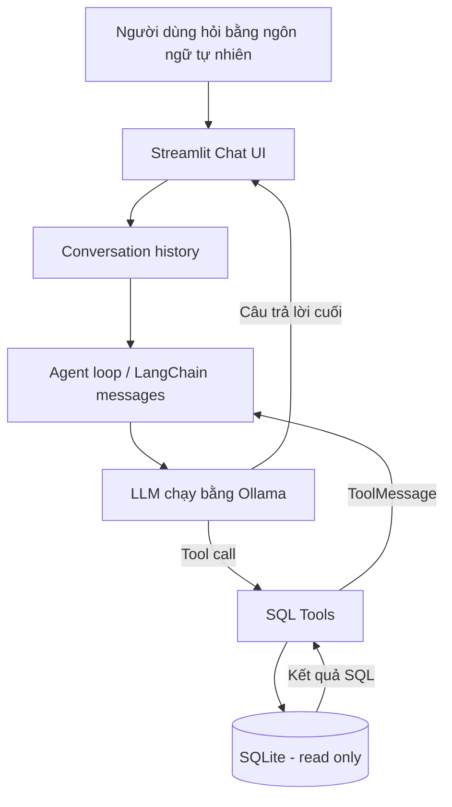

# Khóa học: Xây dựng AI Agent Text-to-SQL cục bộ với LangChain, Ollama và Streamlit

## 1. Tổng quan

Một người dùng có thể hỏi bằng tiếng Việt: **“Khách hàng nào đặt nhiều đơn hàng nhất?”**. Thay vì yêu cầu họ hiểu cấu trúc bảng, viết `JOIN` hay `GROUP BY`, ứng dụng AI Agent sẽ tự khảo sát cơ sở dữ liệu, tạo truy vấn SQL, lấy kết quả và trình bày bằng ngôn ngữ tự nhiên.

Khóa học này hướng dẫn thiết kế một AI Agent truy vấn **SQLite** theo hướng **Text-to-SQL**, dùng **LangChain** để định nghĩa công cụ và trao đổi thông điệp với mô hình, **Ollama** để chạy LLM tại máy cá nhân và **Streamlit** để cung cấp giao diện hội thoại. Trong các bước nâng cao, có thể thay Ollama bằng Groq hoặc nhà cung cấp tương thích; cấu hình này không còn hoàn toàn cục bộ.

Điều quan trọng là agent không chỉ biến một câu hỏi thành một câu SQL. Agent có thể chọn một chuỗi hành động: liệt kê bảng → xem schema → kiểm tra một vài dòng → thực thi SQL → diễn giải kết quả. Đó là khác biệt giữa một tác vụ Text-to-SQL một lượt và một vòng lặp agent sử dụng công cụ.

## 2. Mục tiêu hoàn thành

Sau khóa học, người học có thể:

- Giải thích kiến trúc agent gồm LLM, lịch sử hội thoại, bộ công cụ và cơ sở dữ liệu.
- Tạo cơ sở dữ liệu SQLite thương mại điện tử có các quan hệ khóa ngoại.
- Khởi tạo `ChatOllama`, dùng `bind_tools()` và kiểm tra `tool_calls`.
- Tự phát triển công cụ liệt kê bảng, mô tả bảng, lấy mẫu dữ liệu và truy vấn SQL chỉ đọc.
- Viết vòng lặp agent có giới hạn số lần gọi công cụ, xử lý lỗi và bảo toàn `tool_call_id`.
- Tạo giao diện Streamlit có `st.chat_input`, `st.chat_message`, `st.session_state`.
- Kiểm thử truy vấn nhiều bảng và câu hỏi phụ thuộc lịch sử.

## 3. Đối tượng và kiến thức chuẩn bị

Phù hợp với người đã biết Python cơ bản (`function`, `dict`, `list`, `try/except`), có thể đọc câu lệnh SQL cơ bản và biết mở terminal. Không cần có kinh nghiệm trước với agent framework.

Môi trường: Python, SQLite tích hợp sẵn qua thư viện chuẩn `sqlite3`, Ollama cài trên máy, các gói Python `langchain`, `langchain-ollama`, `streamlit`; `rich` và `langchain-groq` là phần mở rộng tùy chọn. Chọn một mô hình Ollama **thực sự hỗ trợ tool calling** (ví dụ `qwen2.5:7b` được sử dụng trong tình huống minh họa; khả năng hỗ trợ còn tùy mô hình và bản cài đặt).

## 4. Lộ trình bài học

| Bài | Nội dung | Kết quả đầu ra |
| --- | --- | --- |
| 01 | Agent và kiến trúc Text-to-SQL | Phân biệt workflow và agent, vẽ luồng xử lý |
| 02 | SQLite và cơ sở dữ liệu thương mại điện tử | Hiểu schema, tạo bảng và dữ liệu kiểm thử |
| 03 | Cấu hình LLM và model factory | Khởi tạo model cục bộ và gọi thử |
| 04 | Bốn công cụ truy vấn SQL | Công cụ inspect schema và truy vấn chỉ đọc |
| 05 | Prompt, lịch sử và vòng lặp agent | Điều phối tool call an toàn |
| 06 | Giao diện Streamlit | Chat UI, hội thoại nhiều lượt |
| 07 | Lab tích hợp và kiểm thử | Chạy end-to-end và xử lý lỗi |
| 08 | Tổng kết và hướng mở rộng | Đánh giá giới hạn, đề xuất kiến trúc production |

## 5. Kiến trúc tổng quát

Mỗi công cụ là một cầu nối có kiểm soát giữa mô hình và dữ liệu. LLM **đề xuất** công cụ/đối số, còn Python **thực thi**; hai vai trò không được đánh đồng. Kết quả được đưa vào vòng hội thoại để mô hình quyết định bước tiếp theo.

## 6. Nguyên tắc thực hành

- Đừng cấp cho model quyền ghi/xóa dữ liệu chỉ để trả lời câu hỏi.
- Mỗi truy vấn phải bị giới hạn bởi quyền của database, ngân sách thời gian và số dòng đầu ra.
- Không giả định câu SQL do LLM tạo là đúng: hãy đối chiếu kết quả với dữ liệu chuẩn.
- Phân biệt **lịch sử phiên chat** và **bộ nhớ dài hạn**: `st.session_state` không phải giải pháp lưu trữ xuyên phiên bền vững.
- Mọi đoạn code bổ sung trong khóa học là **ví dụ thực hành được biên soạn lại**, không phải bản chép nguyên mã của tác giả.

## 7. Tài liệu tham khảo kỹ thuật

- LangChain ChatOllama: https://docs.langchain.com/oss/python/integrations/chat/ollama
- LangChain Tools: https://docs.langchain.com/oss/python/langchain/tools
- Streamlit Chat App: https://docs.streamlit.io/develop/tutorials/chat-and-llm-apps/build-conversational-apps
- Python sqlite3: https://docs.python.org/3/library/sqlite3.html

Các API và ví dụ có thể đổi theo phiên bản; khi chạy thực tế cần tham khảo tài liệu của phiên bản đã cài.
