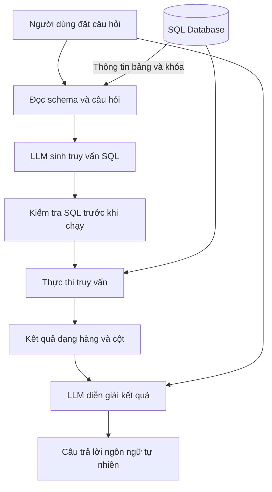

# Bài 01. Tổng quan Text-to-SQL và kiến trúc AI Agent

## 1. Tóm tắt

**Text-to-SQL** là kỹ thuật biến yêu cầu bằng ngôn ngữ tự nhiên thành truy vấn SQL có thể dùng để đọc dữ liệu quan hệ. Khi kết hợp với bước thực thi SQL và một LLM diễn giải kết quả, ta tạo được hệ thống hỏi–đáp dữ liệu cho người dùng không chuyên kỹ thuật.

Bài học tập trung vào pipeline, vai trò của **schema**, vai trò của mô hình ngôn ngữ lớn và khác biệt giữa việc *tạo câu SQL* với việc *trả lời người dùng bằng dữ liệu thực*.

## 2. Mục tiêu học tập

Sau bài học, bạn có thể:

- Giải thích được bài toán Text-to-SQL và tình huống sử dụng phù hợp.
- Phân biệt bước sinh SQL, thực thi truy vấn và tạo câu trả lời.
- Mô tả các dữ liệu đầu vào cần cung cấp cho LLM.
- Vẽ lại quy trình hỏi–đáp từ đầu đến cuối.

## 3. Vấn đề cần giải quyết

Một nhân viên muốn hỏi “Có những album nào của nghệ sĩ Audioslave?” nhưng không biết cấu trúc SQL. Cơ sở dữ liệu lại lưu nghệ sĩ và album trong hai bảng khác nhau. Một công cụ tìm kiếm văn bản đơn giản không biết phải nối bảng bằng khóa ngoại; một LLM chỉ đoán dựa trên kiến thức sẵn có cũng không thể biết chắc dữ liệu *hiện nằm trong cơ sở dữ liệu riêng của doanh nghiệp*.

Giải pháp là cho mô hình biết **lược đồ của cơ sở dữ liệu**, yêu cầu nó viết truy vấn SQL tương ứng và chỉ dùng **kết quả truy vấn thực** để hình thành câu trả lời.

## 4. Quy trình Text-to-SQL



Luồng thông tin đi qua hai công việc khác nhau của LLM:

1. **Tạo truy vấn:** đọc câu hỏi và schema, sau đó tạo SQL đúng mục tiêu và phù hợp tên bảng/cột.
2. **Tạo phản hồi:** đọc câu hỏi ban đầu, SQL đã thực thi và các hàng dữ liệu trả về, rồi soạn câu trả lời dễ hiểu.

Giữa hai bước là **bộ thực thi SQL**. Đây là thành phần quyết định câu trả lời có thật sự dựa trên dữ liệu hay không. Trong kiến trúc sử dụng thực tế còn cần lớp kiểm tra quyền truy cập, câu SQL và giới hạn tài nguyên trước khi thực thi.

## 5. Thành phần và trách nhiệm

| Thành phần | Đầu vào | Đầu ra | Trách nhiệm |
| --- | --- | --- | --- |
| Giao diện người dùng | Câu hỏi tự nhiên | Chuỗi câu hỏi | Giữ cách hỏi thân thiện, không bắt người dùng viết SQL |
| Schema provider | Kết nối DB | Tên bảng, cột, khóa, đôi khi dữ liệu mẫu | Cho LLM biết cấu trúc có thật |
| LLM sinh SQL | Câu hỏi + schema + hướng dẫn | Chuỗi SQL | Diễn giải yêu cầu và quan hệ dữ liệu |
| SQL validator | SQL sinh ra | Cho phép/chặn | Giảm nguy cơ câu lệnh sai hoặc thay đổi dữ liệu |
| Database executor | SQL đã được chấp nhận | Kết quả truy vấn hoặc lỗi | Chạy SQL trên dữ liệu thật |
| LLM trả lời | Câu hỏi + SQL + kết quả | Câu trả lời tự nhiên | Tóm lược dữ liệu chính xác, không bịa phần còn thiếu |

## 6. Vì sao schema là dữ liệu quan trọng nhất?

Giả sử có ba bảng:

- `Artist(ArtistId, Name)` lưu nghệ sĩ;
- `Album(AlbumId, Title, ArtistId)` lưu album;
- `Track(TrackId, Name, AlbumId)` lưu bản nhạc.

Nếu được hỏi “Những bài hát nào của Audioslave?”, mô hình phải biết rằng `Track` **không trực tiếp có** trường tên nghệ sĩ. Nó cần nối `Track` → `Album` → `Artist`. Không cung cấp schema, mô hình dễ sinh ra một cột không tồn tại như `Track.ArtistName`, khiến SQL lỗi hoặc trả dữ liệu sai.

Schema cung cấp **cấu trúc**, không cung cấp sẵn **câu trả lời**. Hai thứ đó cần được phân biệt rõ: một truy vấn SQL hợp lệ vẫn có thể cho kết quả rỗng hoặc không đúng ý định của người dùng.

## 7. Workflow có phải luôn là agent tự chủ?

Trong phạm vi khóa học, “agent” là **quy trình phối hợp LLM với công cụ cơ sở dữ liệu**. Đây là một workflow có các bước định trước: sinh SQL, chạy SQL, trả lời. Nó chưa nhất thiết là tác nhân có khả năng tự lập kế hoạch, chọn nhiều công cụ, lặp suy luận hoặc tự sửa lỗi. Sự phân biệt này giúp bạn không nhầm một chuỗi xử lý (chain) với một agent tự chủ phức tạp.

## 8. Ví dụ minh họa

**Câu hỏi:** “Cho tôi tên 10 nghệ sĩ.”

Một truy vấn phù hợp với Chinook SQLite là:

```sql
SELECT Name
FROM Artist
LIMIT 10;
```

Cơ sở dữ liệu sẽ trả về tối đa 10 hàng chứa tên nghệ sĩ. LLM có thể viết: “Dưới đây là 10 nghệ sĩ được truy vấn từ cơ sở dữ liệu: ...”. Các tên thật phải lấy từ kết quả trả về, không suy đoán từ kiến thức của mô hình.

Nếu cần kết quả ổn định theo một tiêu chí, thêm `ORDER BY` — không có `ORDER BY`, khái niệm “10 nghệ sĩ đầu tiên” không có bảo đảm thứ tự rõ ràng theo chuẩn SQL.

## 9. Bài thực hành ngắn

Hãy tự thiết kế một pipeline cho câu hỏi: “Có những album nào của nghệ sĩ có mã 1?”. Nêu tên bảng cần truy vấn, dữ liệu mô hình cần đọc và nơi dữ liệu trả lời xuất phát. Sau đó thử mở rộng thành “Có những bài hát nào của nghệ sĩ có mã 1?” và cho biết vì sao cần thêm bảng.

## 10. Câu hỏi ôn tập

### Câu 1

Một LLM tự trả lời tên album từ kiến thức đã học mà không truy vấn database có đáp ứng yêu cầu Text-to-SQL dựa trên dữ liệu hiện thời không?

A. Có, vì mô hình luôn nhớ tên album.  
B. Có, nếu mô hình tự tin.  
C. Không, vì chưa có truy vấn và kết quả thực từ database.  
D. Không, vì SQL không hỗ trợ album.

**Đáp án:** C. **Giải thích:** Workflow cần truy xuất dữ liệu đang lưu trong database; suy đoán của LLM không thay thế được kết quả truy vấn.

### Câu 2

Thông tin nào giúp mô hình xác định cách nối bảng `Track` với `Artist`?

A. Sơ đồ bảng và quan hệ khóa ngoại.  
B. Tên người sử dụng.  
C. Số token phản hồi.  
D. Ngôn ngữ lập trình của giao diện.

**Đáp án:** A. **Giải thích:** Schema chỉ ra `Track.AlbumId` và `Album.ArtistId` để nối bảng theo đúng quan hệ.

### Câu 3

Đâu là nhiệm vụ của LLM ở giai đoạn cuối pipeline?

A. Tạo mới bảng.  
B. Tự sửa mọi dữ liệu.  
C. Thay quyền truy cập của database.  
D. Chuyển kết quả truy vấn thành câu trả lời tự nhiên.

**Đáp án:** D. **Giải thích:** LLM cuối diễn giải dữ liệu đã trả về, không trực tiếp thay thế bộ thực thi SQL.

### Câu 4

Vì sao một câu SQL hợp lệ về cú pháp vẫn có thể chưa đáp ứng đúng yêu cầu?

A. Vì SQL không có khóa ngoại.  
B. Vì SQL có thể chọn sai cột, sai điều kiện hoặc sai bảng.  
C. Vì mọi truy vấn phải chứa `JOIN`.  
D. Vì LLM không thể viết SQL.

**Đáp án:** B. **Giải thích:** Đúng cú pháp là điều kiện cần nhưng chưa đủ; truy vấn còn phải đúng ngữ nghĩa.

### Câu 5

Bước nào nên được đặt trước khi thực thi SQL do LLM sinh ra?

A. Xóa toàn bộ bảng tạm.  
B. Đổi sang mô hình lớn hơn.  
C. Kiểm tra quyền và mức an toàn của câu SQL.  
D. Gửi toàn bộ database vào prompt.

**Đáp án:** C. **Giải thích:** SQL do LLM tạo ra vẫn cần được kiểm tra trước khi hệ thống cấp quyền thực thi.

## 11. Tổng kết

Text-to-SQL cho phép người dùng hỏi bằng ngôn ngữ tự nhiên mà vẫn khai thác dữ liệu quan hệ. Các mảnh ghép quyết định chất lượng là **schema đúng, truy vấn đúng mục tiêu, thực thi có kiểm soát và phản hồi có căn cứ**. Hiểu tách bạch các bước là nền tảng để xây dựng, gỡ lỗi và nâng cấp workflow.
