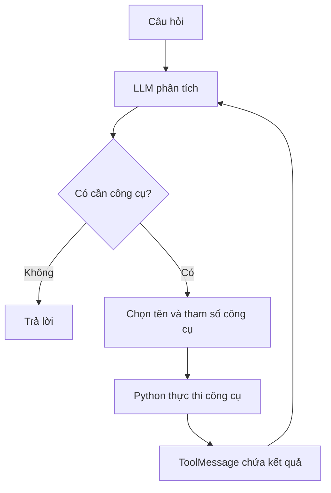

# Bài 01 — AI Agent và kiến trúc Text-to-SQL

## 1. Tóm tắt

AI Agent là chương trình dùng mô hình ngôn ngữ để lựa chọn các bước và công cụ nhằm đạt mục tiêu. Với dữ liệu quan hệ, agent có thể khảo sát bảng, truy vấn và giải thích câu trả lời từ SQLite; đó là một tình huống tiêu biểu của Text-to-SQL dựa trên công cụ.

## 2. Mục tiêu học tập

Sau bài này, bạn có thể giải thích thành phần của agent, phân biệt vòng lặp chủ động với workflow cố định và phác họa ít nhất hai chuỗi công cụ cho hai loại câu hỏi khác nhau.

## 3. Vì sao không chỉ cần một prompt sinh SQL?

Giả sử người dùng hỏi: **“Ai là khách hàng có nhiều đơn nhất?”**. Nếu chỉ hỏi LLM viết SQL, mô hình phải đoán tên bảng, cột và quan hệ. Nó dễ tạo ra `customer_id`, `order_date` không tồn tại hoặc hiểu nhầm tiêu chí “nhiều đơn” thành “tổng chi tiêu cao”.

Agent có thêm quyền **khám phá schema** trước khi tạo truy vấn. Khi đã nhìn thấy `customers(id, name)` và `orders(customer_id, ...)`, mô hình có căn cứ để lập câu SQL thực sự phù hợp. Khi người dùng tiếp tục hỏi **“Hãy liệt kê các đơn của khách hàng này”**, lịch sử hội thoại giúp giữ đối tượng tham chiếu, nhưng thông tin về ID và kết quả vẫn nên được xác nhận bằng truy vấn.

## 4. Bốn thành phần chính

| Thành phần | Chức năng | Rủi ro nếu thiếu |
| --- | --- | --- |
| LLM | Phân tích câu hỏi, chọn công cụ, diễn đạt | Chương trình không có bộ lập kế hoạch linh hoạt |
| Toolset | Định nghĩa những việc agent được phép làm | LLM chỉ trả lời theo kiến thức nền, không tra được dữ liệu |
| Conversation history | Lưu chuỗi user/assistant/tool message | Không xử lý chính xác câu hỏi nối tiếp |
| Môi trường / SQLite | Nguồn dữ liệu thật | Câu trả lời dễ bịa hoặc lỗi thời |

Trong kiến trúc này, agent quyết định *gọi công cụ nào*; một trình điều phối Python ánh xạ tên công cụ sang hàm được phép. Quyền hạn thực tế phải do ứng dụng và DB kiểm soát, không chỉ do prompt tự cam kết.

## 5. Workflow cố định và vòng lặp agent

Workflow cố định: `câu hỏi → sinh SQL → chạy → trả lời`, bất kể mức độ khó. Ngược lại, agent có thể chọn hành động theo phản hồi của môi trường.

Điểm then chốt là **vòng lặp** `LLM → tool → quan sát → LLM`. Nó cho phép nhiều thao tác cho một câu hỏi. Nhưng vòng lặp không có giới hạn có thể kéo dài mãi, vì vậy phải có `max_iterations` và chính sách xử lý khi dừng.

## 6. Hai ví dụ lập kế hoạch

**Tình huống A — “Có bao nhiêu sản phẩm còn hàng?”**

1. `list_tables` để biết tên bảng.
2. `describe_table('products')` để tìm trường số lượng.
3. `execute_sql` với `SELECT COUNT(*) ... WHERE stock > 0`.
4. Trả số lượng, làm rõ khái niệm “còn hàng” dựa trên `stock`.

**Tình huống B — “Đơn hàng gần nhất của khách hàng được nói đến là ngày nào?”**

1. Đọc lịch sử để xác định khách hàng đang được nhắc.
2. Kiểm tra `orders` và `customers` nếu schema chưa có trong ngữ cảnh.
3. Truy vấn theo `customer_id`, sắp xếp `order_date DESC LIMIT 1`.
4. Nếu không có đơn, nói rõ không tìm thấy thay vì tự đặt một ngày.

Hai tình huống này có thể có số bước khác nhau. Agent không cần luôn gọi tất cả công cụ; nó cần dùng đúng công cụ đủ để tìm câu trả lời.

## 7. Khác biệt giữa hành động và lời giải thích

Một số ứng dụng thêm tham số `reason` vào tool để LLM cung cấp **lý do ngắn gọn cho hành động**. Đây là dữ liệu giải thích có thể giúp debug, không phải bản ghi đầy đủ suy nghĩ nội bộ và không chứng minh truy vấn đúng. Log nên ghi tên công cụ, tham số đã lọc, thời gian chạy, số dòng trả về và lỗi; tránh xuất dữ liệu nhạy cảm.

## 8. Thực hành ngắn

Vẽ hai quy trình xử lý cho câu hỏi “Doanh thu tháng này là bao nhiêu?” và “Liệt kê tất cả đơn của khách vừa được nhắc”. Với mỗi quy trình, ghi tối thiểu hai công cụ và chỉ rõ thông tin nào agent phải kiểm tra trong schema thay vì đoán.

## 9. Câu hỏi ôn tập

**Câu 1.** Điều gì khiến một vòng lặp Text-to-SQL trở nên có tính agent hơn một pipeline cố định?  
A. Sử dụng SQLite.  
B. Luôn viết đúng SQL.  
C. LLM có thể chọn hành động tiếp theo dựa trên phản hồi công cụ.  
D. Giao diện có biểu tượng robot.  
**Đáp án: C.** **Giải thích:** Agent điều chỉnh chuỗi hành động theo kết quả quan sát được.

**Câu 2.** Một LLM chưa biết schema. Hành động phù hợp nhất trước khi tạo `JOIN` là gì?  
A. Khám phá bảng và khóa liên quan.  
B. Chọn ngẫu nhiên tên cột.  
C. Chạy `DELETE` để dọn dữ liệu.  
D. Tăng temperature.  
**Đáp án: A.** **Giải thích:** Cần căn cứ từ cấu trúc dữ liệu thực.

**Câu 3.** Câu “Hãy liệt kê đơn của khách hàng này” cần nhất thành phần nào để giải nghĩa “này”?  
A. File ảnh.  
B. GPU.  
C. Cache trình duyệt.  
D. Lịch sử hội thoại.  
**Đáp án: D.** **Giải thích:** Tham chiếu theo ngữ cảnh phải dựa vào các lượt trước.

**Câu 4.** Ai là thành phần thực sự thực thi truy vấn SQL?  
A. Prompt.  
B. Hàm tool do ứng dụng Python cấp quyền.  
C. Markdown renderer.  
D. Mô hình ngôn ngữ tự sửa database.  
**Đáp án: B.** **Giải thích:** LLM chỉ phát ra yêu cầu tool; ứng dụng kiểm soát và thực thi.

**Câu 5.** Vì sao đặt giới hạn số vòng lặp?  
A. Để tăng kích thước cơ sở dữ liệu.  
B. Để xóa lịch sử.  
C. Tránh agent gọi công cụ không dừng khi mắc lỗi.  
D. Để tắt tất cả tool.  
**Đáp án: C.** **Giải thích:** Giới hạn giúp kiểm soát tài nguyên và trạng thái thất bại.

## 10. Tổng kết

Text-to-SQL agent có thể khảo sát schema và thực hiện nhiều thao tác để trả lời chính xác hơn. Nguyên lý cần nắm là vòng lặp quan sát–hành động, lịch sử hội thoại và cơ chế giới hạn quyền công cụ.
