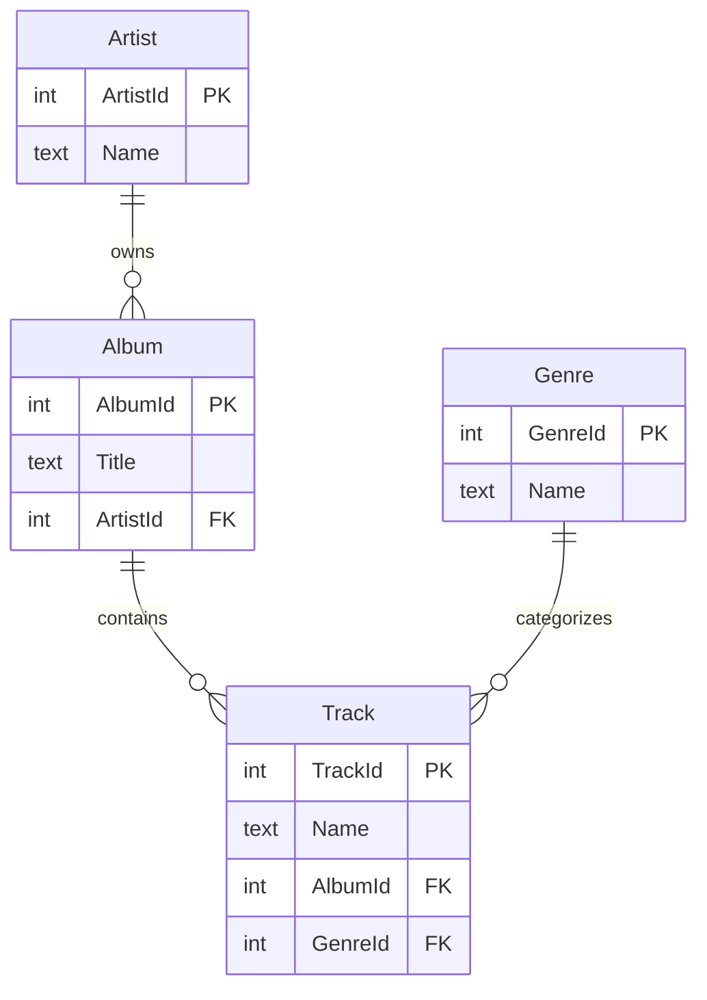

# Bài 02. Đọc schema Chinook và tạo truy vấn SQL nhiều bảng

## 1. Tóm tắt

**Chinook** là cơ sở dữ liệu mẫu về cửa hàng nhạc số. Trong bài này, ba bảng `Artist`, `Album`, `Track` đóng vai trò minh họa cho yêu cầu rất thường gặp: từ tên nghệ sĩ truy ra album, rồi truy ra các bài hát. Đây là cơ sở để một AI Agent có thể tạo ra các phép `JOIN` có ý nghĩa thay vì ghép bảng theo phỏng đoán.

## 2. Mục tiêu học tập

- Nhận biết được khóa chính (primary key) và khóa ngoại (foreign key).
- Phân biệt truy vấn một bảng với truy vấn liên kết nhiều bảng.
- Viết được `SELECT`, `WHERE`, `LIMIT`, `INNER JOIN` trong Chinook.
- Giải thích vì sao yêu cầu theo **tên** nghệ sĩ phức tạp hơn yêu cầu theo `ArtistId`.

## 3. Bộ dữ liệu và cấu trúc trọng tâm

Ở phiên bản Chinook SQLite phổ biến, các bảng có cấu trúc liên quan như sau:

| Bảng | Cột có liên quan | Ý nghĩa |
| --- | --- | --- |
| `Artist` | `ArtistId` (PK), `Name` | Thông tin nghệ sĩ |
| `Album` | `AlbumId` (PK), `Title`, `ArtistId` (FK) | Album thuộc một nghệ sĩ |
| `Track` | `TrackId` (PK), `Name`, `AlbumId` (FK), `GenreId` | Bài nhạc thuộc một album; thể loại có thể truy xuất qua `Genre` |
| `Genre` | `GenreId` (PK), `Name` | Danh sách thể loại |

**Khóa chính (PK)** xác định duy nhất một bản ghi. **Khóa ngoại (FK)** trỏ từ bảng con đến bản ghi của bảng liên quan. Cặp `Album.ArtistId` và `Artist.ArtistId` tạo ra quan hệ album–nghệ sĩ. Cặp `Track.AlbumId` và `Album.AlbumId` tạo ra quan hệ bài hát–album.



Sơ đồ trên thể hiện quan hệ **một–nhiều**: một nghệ sĩ có thể có nhiều album, một album có thể gồm nhiều track. `Track` không lưu trực tiếp `ArtistId` trong cấu trúc được dùng ở ví dụ, vì vậy truy vấn bài hát theo nghệ sĩ phải đi qua `Album`.

## 4. Truy vấn một bảng

### 4.1. Liệt kê 10 nghệ sĩ

```sql
SELECT Name
FROM Artist
ORDER BY ArtistId
LIMIT 10;
```

`SELECT Name` chỉ lấy cột tên; `FROM Artist` xác định bảng; `ORDER BY ArtistId` tạo thứ tự ổn định; `LIMIT 10` giới hạn số dòng. Không có `ORDER BY`, kết quả vẫn hợp lệ nhưng thứ tự không được đảm bảo.

### 4.2. Lấy mã và tên nghệ sĩ

```sql
SELECT ArtistId, Name
FROM Artist
ORDER BY ArtistId
LIMIT 10;
```

Truy vấn này phù hợp cho giao diện cần cả tên hiển thị lẫn mã để định danh. So với ví dụ đầu, yêu cầu bổ sung một trường dữ liệu, chưa cần `JOIN`.

### 4.3. Lấy album theo mã nghệ sĩ

```sql
SELECT AlbumId, Title, ArtistId
FROM Album
WHERE ArtistId = 1
ORDER BY AlbumId
LIMIT 10;
```

Vì bảng `Album` đã chứa `ArtistId`, việc lọc theo mã nghệ sĩ có thể thực hiện trực tiếp. Chỉ khi cần lấy **tên nghệ sĩ** từ bảng khác, ta mới cần phép nối.

## 5. `JOIN` hai bảng: tìm album theo tên nghệ sĩ

**Câu hỏi:** “Liệt kê các album của nghệ sĩ Audioslave.”

Tên nghệ sĩ nằm trong `Artist.Name`, còn tên album nằm trong `Album.Title`. Vì vậy:

```sql
SELECT al.Title
FROM Album AS al
JOIN Artist AS ar
    ON al.ArtistId = ar.ArtistId
WHERE ar.Name = 'Audioslave'
ORDER BY al.Title;
```

Cách đọc:

1. Chọn dữ liệu album từ `Album` (bí danh `al`).
2. Ghép với `Artist` (`ar`) ở những hàng có cùng `ArtistId`.
3. Giữ lại nghệ sĩ có tên `Audioslave`.
4. Trả về tiêu đề album trong thứ tự xác định.

Trường hợp chỉ dùng `SELECT Title FROM Album WHERE Name = 'Audioslave'` sẽ sai vì bảng `Album` không có trường `Name` đại diện cho tên nghệ sĩ.

## 6. `JOIN` ba bảng: tìm bài hát theo tên nghệ sĩ

**Câu hỏi:** “Cho tôi tên các bản nhạc của Audioslave.”

```sql
SELECT t.Name
FROM Track AS t
JOIN Album AS al
    ON t.AlbumId = al.AlbumId
JOIN Artist AS ar
    ON al.ArtistId = ar.ArtistId
WHERE ar.Name = 'Audioslave'
ORDER BY t.Name;
```

Đường đi quan hệ dữ liệu là:


Dù SQL bắt đầu bằng `FROM Track`, về mặt suy luận ta có thể hình dung việc tìm nghệ sĩ, suy ra các album của người đó rồi thu thập track tương ứng. Đây là **truy vấn nối nhiều cấp**, đòi hỏi mô hình hiểu quan hệ bảng và không được dùng khóa không tồn tại.

## 7. Những sai lầm thường gặp

| Tình huống | Nguyên nhân | Cách kiểm tra |
| --- | --- | --- |
| `no such column: ArtistName` | Mô hình đoán tên cột | Đối chiếu chính xác với schema |
| Có hàng nhưng sai nghệ sĩ | Lọc nhầm `Name` của bảng khác | Dùng bí danh đầy đủ như `ar.Name` |
| Kết quả lặp | Một bản ghi có nhiều liên kết hoặc yêu cầu cần duy nhất | Kiểm tra logic; chỉ dùng `DISTINCT` nếu đúng ngữ nghĩa |
| Kết quả rỗng | Tên nghệ sĩ không tồn tại hoặc không khớp chính tả | Tra tên trong bảng `Artist` trước |
| Danh sách 10 dòng thay đổi thứ tự | Thiếu `ORDER BY` | Thêm điều kiện sắp xếp thích hợp |

Tên được dùng trong cơ sở dữ liệu có thể không trùng cách viết của người dùng. Thay vì âm thầm sửa tên thành một nghệ sĩ khác, ứng dụng nên hỏi lại hoặc áp dụng quy tắc tìm kiếm được xác định trước.

## 8. Bài thực hành ngắn

Hãy viết ba truy vấn: (1) tên 5 nghệ sĩ có `ArtistId` nhỏ nhất; (2) tiêu đề album của nghệ sĩ mã 2; (3) tên bài nhạc và tên album của nghệ sĩ `Audioslave`. Với câu (3), hãy giải thích vì sao cần cả `Track`, `Album`, `Artist`.

## 9. Câu hỏi ôn tập

### Câu 1

Muốn lấy tên track theo tên nghệ sĩ, đường nối quan hệ nào phù hợp?

A. `Track` → `Genre` → `Artist`.  
B. `Track` → `Album` → `Artist`.  
C. `Artist` → `Genre` → `Album`.  
D. `Track` → `Artist` trực tiếp qua `TrackId`.

**Đáp án:** B. **Giải thích:** `Track.AlbumId` nối với `Album.AlbumId`, còn `Album.ArtistId` nối với `Artist.ArtistId`.

### Câu 2

Vì sao truy vấn album theo `ArtistId = 1` chưa nhất thiết cần `JOIN`?

A. Vì `Album` đã có cột `ArtistId`.  
B. Vì `JOIN` không hỗ trợ SQLite.  
C. Vì `ArtistId` là tên nghệ sĩ.  
D. Vì bảng `Artist` không có khóa chính.

**Đáp án:** A. **Giải thích:** Dữ liệu lọc đã nằm ngay trong `Album`.

### Câu 3

Điều kiện nối nào đúng giữa `Album` và `Artist`?

A. `Album.AlbumId = Artist.ArtistId`.  
B. `Album.Title = Artist.Name`.  
C. `Album.ArtistId = Artist.ArtistId`.  
D. `Track.TrackId = Artist.ArtistId`.

**Đáp án:** C. **Giải thích:** Hai cột `ArtistId` tạo liên kết khóa ngoại–khóa chính.

### Câu 4

Tại sao nên thêm `ORDER BY` khi người dùng hỏi “10 nghệ sĩ đầu tiên”?

A. Để tăng số lượng hàng.  
B. Để thay đổi schema.  
C. Để tự động tìm khóa ngoại.  
D. Để định nghĩa thứ tự kết quả rõ ràng.

**Đáp án:** D. **Giải thích:** `LIMIT` chỉ hạn chế số hàng, không định nghĩa thứ tự.

### Câu 5

Trong truy vấn hai bảng, `ar.Name` biểu thị điều gì?

A. Tên bảng mới được tạo.  
B. Cột `Name` của bảng được đặt bí danh `ar`.  
C. Tên cột `Name` của tất cả các bảng.  
D. Một biến Python.

**Đáp án:** B. **Giải thích:** Bí danh làm rõ cột nào thuộc bảng nào và tránh nhầm lẫn khi nhiều bảng có cột trùng tên.

## 10. Tổng kết

Đọc schema chính xác là điều kiện thiết yếu để sinh SQL. Khi câu hỏi dùng thông tin ở nhiều bảng, hãy tìm **đường đi giữa các khóa** trước khi viết `JOIN`. Với Chinook, chuỗi `Artist`–`Album`–`Track` là ví dụ điển hình cho truy vấn đa cấp mà Text-to-SQL cần xử lý.
