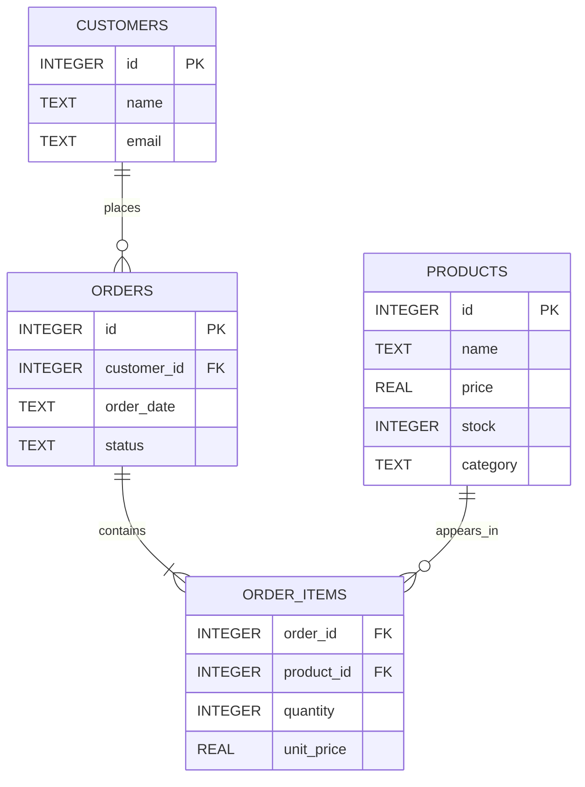

# Bài 02 — Chuẩn bị SQLite và cơ sở dữ liệu thương mại điện tử

## 1. Tóm tắt

Một agent chỉ có thể sinh SQL hữu ích khi cấu trúc cơ sở dữ liệu rõ ràng. Bài này dùng bộ dữ liệu giả lập gồm khách hàng, sản phẩm, đơn hàng và các dòng hàng của đơn để học quan hệ một-nhiều và nhiều-nhiều.

## 2. Mục tiêu học tập

Bạn sẽ nhận diện được khóa chính và khóa ngoại, tự tạo cơ sở dữ liệu SQLite đơn giản, viết câu `JOIN`, `GROUP BY` và kiểm tra truy vấn bằng dữ liệu đã biết trước.

## 3. Sơ đồ dữ liệu



`customers` có nhiều `orders`; một `orders` gồm nhiều `order_items`; một `products` có thể xuất hiện ở nhiều đơn. `order_items` là bảng trung gian để biểu diễn quan hệ nhiều-nhiều giữa `orders` và `products`.

## 4. Tạo database dùng cho lab

Đoạn mã sau tạo dữ liệu thử nghiệm **mới**, không phải cơ sở dữ liệu của chương trình minh họa. Lưu vào `seed_db.py`.

```python
import sqlite3
from pathlib import Path

DB_PATH = Path("ecommerce.sqlite")
with sqlite3.connect(DB_PATH) as conn:
    conn.execute("PRAGMA foreign_keys = ON")
    conn.executescript("""
        CREATE TABLE IF NOT EXISTS customers (
            id INTEGER PRIMARY KEY,
            name TEXT NOT NULL,
            email TEXT
        );
        CREATE TABLE IF NOT EXISTS products (
            id INTEGER PRIMARY KEY,
            name TEXT NOT NULL,
            category TEXT,
            price REAL NOT NULL,
            stock INTEGER NOT NULL
        );
        CREATE TABLE IF NOT EXISTS orders (
            id INTEGER PRIMARY KEY,
            customer_id INTEGER NOT NULL REFERENCES customers(id),
            order_date TEXT NOT NULL,
            status TEXT NOT NULL
        );
        CREATE TABLE IF NOT EXISTS order_items (
            order_id INTEGER NOT NULL REFERENCES orders(id),
            product_id INTEGER NOT NULL REFERENCES products(id),
            quantity INTEGER NOT NULL,
            unit_price REAL NOT NULL,
            PRIMARY KEY (order_id, product_id)
        );
    """)
    if conn.execute("SELECT COUNT(*) FROM customers").fetchone()[0] == 0:
        conn.executemany("INSERT INTO customers VALUES (?, ?, ?)", [
            (1, "Lan", "lan@example.com"),
            (2, "Minh", "minh@example.com"),
            (3, "Hà", "ha@example.com")
        ])
        conn.executemany("INSERT INTO products VALUES (?, ?, ?, ?, ?)", [
            (1, "Cà phê rang", "Đồ uống", 120000, 15),
            (2, "Trà xanh", "Đồ uống", 80000, 0),
            (3, "Cốc sứ", "Đồ gia dụng", 60000, 20)
        ])
        conn.executemany("INSERT INTO orders VALUES (?, ?, ?, ?)", [
            (101, 1, "2026-01-03", "completed"),
            (102, 1, "2026-01-10", "completed"),
            (103, 2, "2026-01-11", "pending")
        ])
        conn.executemany("INSERT INTO order_items VALUES (?, ?, ?, ?)", [
            (101, 1, 2, 120000), (101, 3, 1, 60000),
            (102, 3, 2, 60000), (103, 2, 1, 80000)
        ])
print(f"Đã chuẩn bị {DB_PATH}")
```

Chạy `python seed_db.py`. Dữ liệu minh họa được đặt bằng SQL tham số hóa (`?`) để tránh ghép trực tiếp chuỗi người dùng vào câu lệnh ghi dữ liệu.

## 5. Viết truy vấn nền tảng

**Khách hàng có nhiều đơn nhất:**

```sql
SELECT c.id, c.name, COUNT(o.id) AS order_count
FROM customers AS c
JOIN orders AS o ON o.customer_id = c.id
GROUP BY c.id, c.name
ORDER BY order_count DESC, c.id
LIMIT 1;
```

Với dữ liệu lab, kết quả là **Lan — 2 đơn**. `GROUP BY` gom đơn theo khách, `COUNT(o.id)` tính số đơn, `ORDER BY ... DESC` xếp giảm dần.

**Sản phẩm còn hàng:**

```sql
SELECT id, name, stock
FROM products
WHERE stock > 0
ORDER BY name;
```

Kết quả gồm **Cà phê rang** và **Cốc sứ**. Lưu ý “còn hàng” ở đây định nghĩa bằng `stock > 0`.

**Liệt kê đơn của Lan:**

```sql
SELECT o.id, o.order_date, o.status
FROM orders AS o
JOIN customers AS c ON c.id = o.customer_id
WHERE c.name = 'Lan'
ORDER BY o.order_date;
```

Khi triển khai một hệ thống thật, dùng ID để xác định khách hàng thay vì chỉ dựa vào tên vì nhiều người có thể trùng tên.

## 6. Vì sao cần dữ liệu mẫu và mô tả bảng?

Tên cột không diễn tả đủ ngữ nghĩa. Ví dụ trường `status` có thể chứa `pending`, `completed`, `cancelled`; một vài dòng mẫu giúp mô hình chọn giá trị lọc hợp lệ. Tuy nhiên, dữ liệu mẫu chỉ hỗ trợ hiểu schema, không nên được dùng thay cho tính toán trên toàn bảng.

Thông tin trong ví dụ thương mại điện tử đầu vào được sinh nhân tạo, không phải dữ liệu bán hàng có thật. Trong học tập nên có dữ liệu chuẩn nhỏ để tự kiểm chứng, thay vì chép kết quả mẫu của một cơ sở dữ liệu khác.

## 7. Lỗi thường gặp

- `JOIN` sai khóa khiến số dòng nhân lên bất thường.
- Dùng `COUNT(*)` với `LEFT JOIN` có thể đếm cả hàng không có đơn; cân nhắc `COUNT(o.id)`.
- Nhầm **số đơn hàng** với **tổng giá trị hàng hóa**; đó là hai truy vấn khác nhau.
- Quên rằng SQLite không có kiểu ngày chuyên dụng: lưu chuỗi theo ISO `YYYY-MM-DD` để sắp xếp đơn giản.
- Dùng `SUM(quantity * unit_price)` để tính doanh số mà quên quy tắc hoàn trả/hủy đơn.

## 8. Thực hành

Tạo `ecommerce.sqlite` rồi viết thêm hai câu SQL: (a) đếm số đơn theo trạng thái; (b) tính tổng số lượng sản phẩm đã bán theo tên. Đối chiếu kết quả với từng dòng `order_items`.

## 9. Câu hỏi ôn tập

**Câu 1.** Bảng nào nối đơn hàng và sản phẩm trong schema đã học?  
A. `order_items`.  
B. `customers`.  
C. `orders` tự nối với `customers`.  
D. `products` tự nối với chính nó.  
**Đáp án: A.** **Giải thích:** `order_items` chứa cả `order_id` và `product_id`.

**Câu 2.** Vì sao `GROUP BY` cần thiết trong truy vấn đếm số đơn của từng khách?  
A. Vì SQLite không có `COUNT`.  
B. Vì không thể dùng `JOIN`.  
C. Vì cần xóa đơn trùng.  
D. Vì phải gom các dòng theo từng khách trước khi tính tổng.  
**Đáp án: D.** **Giải thích:** `GROUP BY` xác lập cấp độ tổng hợp dữ liệu.

**Câu 3.** Muốn lọc sản phẩm hiện còn hàng theo schema mẫu, chọn điều kiện nào?  
A. `price > 0`.  
B. `stock > 0`.  
C. `id IS NOT NULL`.  
D. `category <> ''`.  
**Đáp án: B.** **Giải thích:** `stock` thể hiện số lượng tồn.

**Câu 4.** Khi có hai khách trùng tên, cách xác định đơn đáng tin cậy hơn là gì?  
A. Lấy đơn của người tạo đầu tiên.  
B. Sắp xếp theo tên.  
C. Dùng `customer_id` đã xác nhận.  
D. Lấy ngẫu nhiên.  
**Đáp án: C.** **Giải thích:** ID định danh duy nhất theo thiết kế.

**Câu 5.** `COUNT(o.id)` trong `LEFT JOIN` có ưu điểm gì khi đếm đơn từng khách?  
A. Không tính dòng khách có `o.id` rỗng như một đơn thật.  
B. Luôn đếm số sản phẩm.  
C. Tự cộng giá tiền.  
D. Bỏ qua `GROUP BY`.  
**Đáp án: A.** **Giải thích:** `COUNT(column)` bỏ qua giá trị `NULL`.

## 10. Tổng kết

Bản đồ quan hệ dữ liệu và vài truy vấn SQL có kết quả kiểm chứng trước là nền tảng để đánh giá agent. Không nên kết luận agent chính xác chỉ vì câu trả lời tự nhiên nghe hợp lý.
