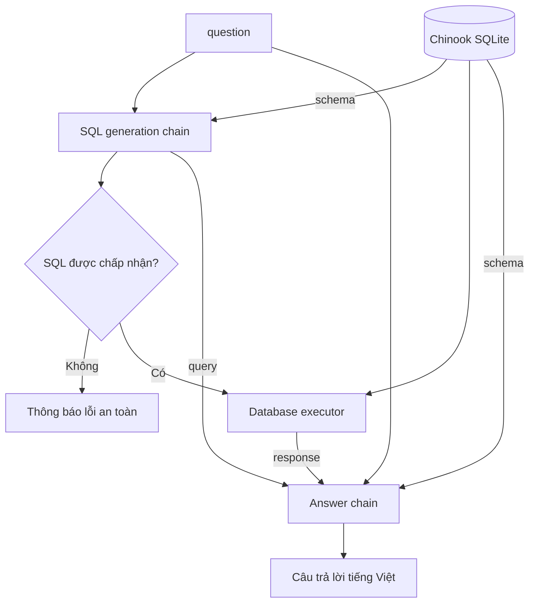

# Bài 05. Ghép workflow hỏi–đáp Text-to-SQL hoàn chỉnh

## 1. Tóm tắt

Một công cụ sinh SQL mới giải quyết **một nửa** bài toán. Người dùng muốn câu trả lời dễ đọc, không phải chuỗi `SELECT` hoặc một danh sách tuple. Vì vậy ta xây dựng chuỗi thứ hai để nhận kết quả truy vấn, diễn giải lại theo ngôn ngữ tự nhiên và ghép hai chuỗi thành workflow thống nhất.

## 2. Mục tiêu học tập

- Thiết kế prompt trả lời có đủ `question`, `query`, `schema`, `response`.
- Nối các bước sinh SQL → kiểm tra → thực thi → trả lời.
- Quan sát trung gian để tìm lỗi ở từng bước.
- Phân biệt trường hợp có dữ liệu, kết quả rỗng và lỗi truy vấn.

## 3. Bốn dữ liệu đầu vào để sinh câu trả lời

| Biến | Ý nghĩa |
| --- | --- |
| `question` | Câu hỏi bằng ngôn ngữ tự nhiên |
| `schema` | Ngữ cảnh cấu trúc database |
| `query` | SQL đã được chấp nhận và thực thi |
| `response` | Dữ liệu thật do database trả về |

Nếu không đưa `response` vào prompt, LLM có thể tự kể tên album hoặc bài hát mà không có chứng cứ. Nếu bỏ `question`, LLM thiếu mục tiêu ban đầu để biết nên diễn giải kết quả theo cách nào.

## 4. Prompt diễn giải kết quả

```python
from langchain_core.prompts import ChatPromptTemplate

answer_prompt = ChatPromptTemplate.from_messages([
    (
        "system",
        """Hãy trả lời người dùng bằng tiếng Việt rõ ràng.
Chỉ dựa vào dữ liệu truy vấn đã trả về; không tự thêm kết quả.
Nếu kết quả rỗng, nêu rõ không tìm thấy bản ghi phù hợp.
Không trình bày câu trả lời như một kết quả được kiểm chứng
nếu database trả về lỗi.""",
    ),
    (
        "human",
        """Câu hỏi: {question}
Schema: {schema}
SQL đã thực thi: {query}
Kết quả database: {response}""",
    ),
])
```

Prompt này dành cho **giai đoạn trả lời**, tách biệt prompt sinh SQL của bài 04. Sự tách biệt giúp bạn kiểm thử từng nhiệm vụ và thay đổi cách diễn đạt mà không ảnh hưởng logic truy vấn.

## 5. Kiến trúc hai chuỗi



Có hai điểm cần phân biệt: (1) `query` là **đề xuất** của LLM, chưa đáng tin nếu chưa qua kiểm tra; (2) `response` là kết quả truy vấn, không phải văn bản do mô hình sáng tác.

## 6. Ví dụ ghép các runnable

Đoạn sau minh họa cấu trúc LCEL. Hàm `run_checked_query` phải thực hiện việc kiểm tra và phân quyền trước khi gọi database; ví dụ triển khai đầy đủ có tại `examples/text_to_sql_demo.py`.

```python
from langchain_core.output_parsers import StrOutputParser
from langchain_core.runnables import RunnablePassthrough

answer_chain = answer_prompt | llm | StrOutputParser()

workflow = (
    RunnablePassthrough.assign(
        query=write_sql,
        schema=lambda _: db.get_table_info(),
    )
    | RunnablePassthrough.assign(
        response=lambda x: run_checked_query(x["query"])
    )
    | answer_chain
)

answer = workflow.invoke({"question": "Cho tôi tên 10 nghệ sĩ"})
print(answer)
```

Thứ tự thực thi được thiết kế sao cho SQL luôn được sinh trước, rồi mới đưa vào `run_checked_query`, và cuối cùng mới gọi prompt diễn giải. Lệnh `RunnablePassthrough.assign` mở rộng dictionary hiện tại bằng các trường mới, giúp giữ nguyên `question` qua toàn bộ pipeline.

**Lưu ý về tính minh họa:** `write_sql`, `llm`, `db` và `run_checked_query` phải được khai báo trước. File Python mẫu cung cấp các định nghĩa cụ thể tương đương. Không được thay `run_checked_query` bằng `db.run` trực tiếp trên hệ thống có dữ liệu quan trọng.

## 7. Quan sát và debug từng giai đoạn

Khi một kết quả không như mong muốn, xác định chính xác bước nào sai:

| Hiện tượng | Bước cần kiểm tra |
| --- | --- |
| LLM sinh thêm code fence ` ```sql ` | Prompt sinh SQL/định dạng đầu ra |
| SQL tham chiếu cột không tồn tại | Schema, cách chọn bảng, prompt |
| SQL đúng nhưng database báo lỗi kết nối | Database, đường dẫn, quyền |
| SQL chạy được nhưng trả sai tập bản ghi | `JOIN`, `WHERE`, dữ liệu thực |
| SQL và dữ liệu đúng nhưng trả lời bịa thêm chi tiết | Prompt trả lời và cách giới hạn ngữ cảnh |

Nên ghi lại **câu hỏi, SQL được sinh, trạng thái kiểm tra, số hàng trả về và thời gian thực thi**. Khi dữ liệu nhạy cảm xuất hiện, cần ẩn thông tin trong log theo chính sách của hệ thống.

## 8. Ví dụ ba tình huống

**Có dữ liệu:** Người dùng hỏi tên các nghệ sĩ; database trả hàng dữ liệu phù hợp; LLM chỉ liệt kê tên có mặt trong kết quả.

**Không có dữ liệu:** Người dùng hỏi album của nghệ sĩ không tồn tại; database trả tập rỗng; câu trả lời nên nêu “Không tìm thấy album phù hợp” thay vì tự suy diễn danh sách.

**Truy vấn lỗi:** LLM tạo `SELECT MissingColumn FROM Album`. Đây là lỗi thực thi, không nên biến thành một kết quả rỗng giả. Workflow cần hiển thị thông báo thất bại hoặc xử lý sửa truy vấn có giám sát.

## 9. Bài thực hành ngắn

Đặt ba câu hỏi: “Tên 10 nghệ sĩ”, “Album của nghệ sĩ mã 1”, “Các track của Audioslave”. Mỗi câu, hãy lưu lại `question`, SQL đã tạo, đầu ra database và câu trả lời cuối. Kiểm tra xem câu trả lời có chứa thông tin không tồn tại trong `response` hay không.

## 10. Câu hỏi ôn tập

### Câu 1

Vì sao cần bước trả lời thứ hai sau khi thực thi SQL?

A. Để database không cần schema.  
B. Để tăng số lượng bản ghi.  
C. Để xóa tên các bảng.  
D. Để trình bày dữ liệu thành câu trả lời dễ hiểu.

**Đáp án:** D. **Giải thích:** Kết quả truy vấn thường là hàng và cột; bước trả lời giúp người không chuyên đọc được.

### Câu 2

Biến nào chứa dữ liệu thật lấy từ database?

A. `schema`.  
B. `response`.  
C. `question`.  
D. `temperature`.

**Đáp án:** B. **Giải thích:** `response` là kết quả thực thi SQL, còn `schema` chỉ mô tả cấu trúc.

### Câu 3

Nếu kết quả database là rỗng, cách phản hồi phù hợp là gì?

A. Thông báo không tìm thấy bản ghi tương ứng.  
B. Tự tạo vài ví dụ có vẻ hợp lý.  
C. Ghi chắc chắn database bị hỏng.  
D. Tự chạy `DELETE` để dọn dữ liệu.

**Đáp án:** A. **Giải thích:** Phản hồi phải trung thực với tập kết quả rỗng.

### Câu 4

Trong workflow, vì sao `run_checked_query` được gọi sau `write_sql`?

A. Vì muốn SQL luôn chạy hai lần.  
B. Vì phải có câu trả lời tiếng Việt trước.  
C. Vì nó cần câu SQL đã được sinh và phải kiểm tra trước khi thực thi.  
D. Vì schema không cần thiết.

**Đáp án:** C. **Giải thích:** Không thể chạy SQL khi chưa có câu lệnh; đồng thời phải kiểm soát SQL do mô hình tạo.

### Câu 5

Nếu SQL trả đúng hàng dữ liệu nhưng câu trả lời chứa tên không xuất hiện trong kết quả, bạn nên kiểm tra đâu trước?

A. Kết nối mạng của SQL.  
B. Prompt và khâu diễn giải kết quả.  
C. Khóa chính của tất cả các bảng.  
D. Định dạng tên file Python.

**Đáp án:** B. **Giải thích:** Sai sót nằm ở phần mô hình tạo phản hồi, không phải bộ thực thi khi dữ liệu đã đúng.

## 11. Tổng kết

Workflow Text-to-SQL hoàn chỉnh gồm **hai lần sử dụng LLM** và **một lần truy vấn database có kiểm soát**. Duy trì dữ liệu trung gian giúp dễ kiểm chứng, debug và áp dụng ràng buộc để câu trả lời cuối có căn cứ.
