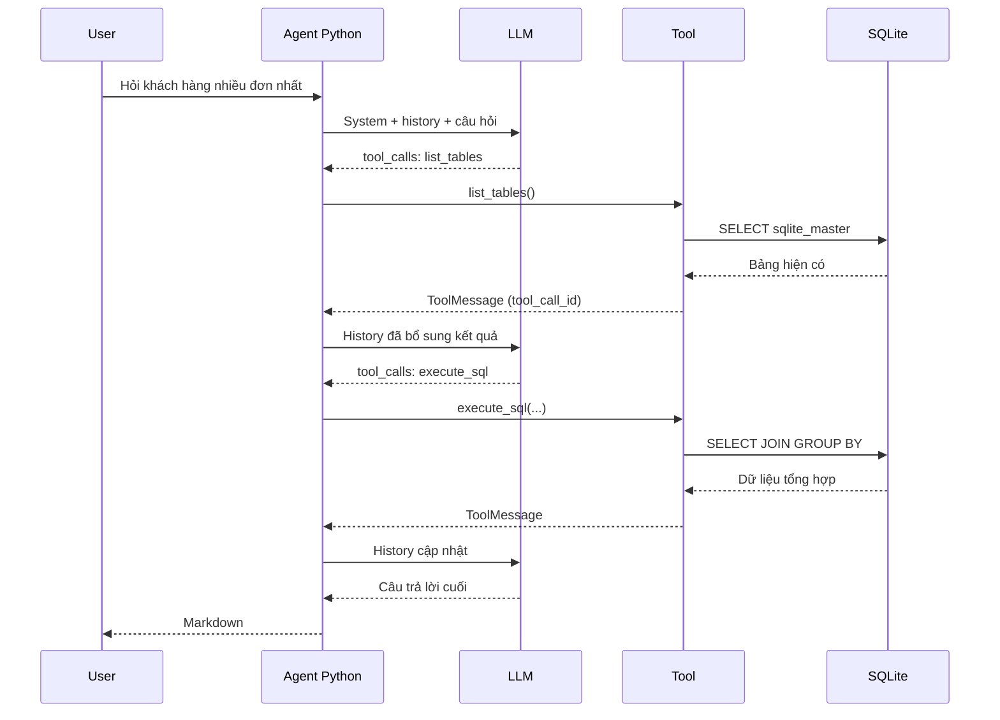

# Bài 05 — System Prompt, lịch sử hội thoại và vòng lặp agent

## 1. Tóm tắt

Agent dùng LLM và các công cụ trong một vòng lặp: nhận câu hỏi, sinh lời gọi tool, thực thi, ghi kết quả vào history và hỏi model lần nữa. Phần quan trọng là thông điệp nhất quán, ID lời gọi được ghép đúng với kết quả và dừng khi đủ thông tin.

## 2. Mục tiêu học tập

Bạn có thể viết system prompt có quy tắc rõ, tạo và cập nhật `messages`, dùng `AIMessage.tool_calls`/`ToolMessage`, đặt `max_iterations` và xử lý những phản hồi lỗi.

## 3. Thiết kế System Prompt

```python
from datetime import datetime

SYSTEM_PROMPT = f"""Bạn là trợ lý phân tích dữ liệu thương mại điện tử.
Ngày hiện tại: {datetime.now().date().isoformat()}.
Trả lời dựa trên dữ liệu SQLite có thể kiểm chứng, không đoán tên bảng hoặc cột.
Khi chưa biết schema, dùng công cụ để kiểm tra bảng/cột trước khi truy vấn.
Chỉ yêu cầu truy vấn SELECT; không đề xuất sửa hoặc xóa dữ liệu.
Nếu không có dữ liệu hoặc truy vấn lỗi, giải thích rõ giới hạn.
Nếu câu hỏi có thể mang nhiều nghĩa (ví dụ số đơn khác tổng tiền),
chọn định nghĩa rõ và nói tiêu chí sử dụng.
Trình bày đáp án ngắn gọn bằng Markdown, dùng bảng khi thích hợp.
Không in quá nhiều dữ liệu cá nhân hoặc toàn bộ nội dung công cụ.
"""
```

Prompt cần mô tả **mục tiêu và quy tắc** chứ không nên cưỡng ép cùng một chuỗi bước cho mọi câu hỏi. Mỗi câu hỏi có thể cần số công cụ khác nhau. Trong những yêu cầu liên quan “hôm nay”, “30 ngày qua”, đưa thời điểm hiện tại vào lời nhắc để giảm nhầm lẫn, nhưng tính toán ngày tháng vẫn phải đúng với dữ liệu.

## 4. Lịch sử tin nhắn

```python
from langchain_core.messages import SystemMessage, HumanMessage

messages = [SystemMessage(content=SYSTEM_PROMPT)]
messages.append(HumanMessage(content="Khách hàng nào có nhiều đơn nhất?"))
```

Lịch sử gồm các loại thông điệp: `SystemMessage` đưa quy tắc; `HumanMessage` chứa yêu cầu; `AIMessage` chứa phản hồi và có thể gồm `tool_calls`; `ToolMessage` chứa kết quả chạy tool. Không nên chỉ lưu văn bản người dùng/trợ lý rồi loại bỏ toàn bộ tool message nếu agent còn phải xử lý lời gọi tool đang chờ.

## 5. Điều phối lời gọi công cụ

```python
from langchain_core.messages import AIMessage, ToolMessage


def ask_agent(user_question, model_with_tools, messages, tools_by_name,
              max_iterations=8):
    messages.append(HumanMessage(content=user_question))
    for _ in range(max_iterations):
        response = model_with_tools.invoke(messages)
        messages.append(response)
        calls = response.tool_calls if isinstance(response, AIMessage) else []
        if not calls:
            return response.content

        for call in calls:
            name = call["name"]
            args = call.get("args", {})
            tool = tools_by_name.get(name)
            if tool is None:
                result = f"Công cụ không được hỗ trợ: {name}"
            else:
                try:
                    result = tool.invoke(args)
                except Exception as exc:
                    result = f"Công cụ {name} gặp lỗi: {type(exc).__name__}"
            messages.append(ToolMessage(
                content=str(result),
                tool_call_id=call["id"],
            ))
    return "Không thể hoàn thành câu hỏi trong số bước cho phép."
```

`tool_call_id` đặc biệt quan trọng: nó nối phản hồi công cụ với đúng lệnh gọi model đưa ra. Nếu mô hình đề xuất nhiều tool trong cùng lượt, ứng dụng phải ghi kết quả cho từng lệnh gọi, không được bỏ sót. Mỗi vòng chỉ trở lại LLM sau khi đã có kết quả cho các lời gọi của lượt đó.

**Lưu ý:** mã ví dụ chủ động không đưa stack trace chi tiết vào phản hồi người dùng. Trong hệ thống thực nên log lỗi ở phía server, đặt timeout và bổ sung trạng thái dừng khi hết lượt. Nếu model sinh tool call sau lần cuối, lịch sử nội bộ có thể còn một lượt dang dở; trước khi dùng lại lịch sử cần cắt/khôi phục ở một ranh giới hợp lệ.

## 6. Sơ đồ trình tự



Sơ đồ cho thấy agent có thể lặp lại nhiều lần trước khi tạo câu trả lời cuối. Một agent không nên coi truy vấn sai là “đã trả lời”; nó có thể đọc lỗi để sửa, miễn không vượt ngân sách và không vi phạm giới hạn quyền truy cập.

## 7. Lịch sử hội thoại và chi phí ngữ cảnh

Giữ toàn bộ history giúp theo dõi các câu hỏi kiểu “khách hàng này”, nhưng số token tăng nhanh khi tool trả nhiều dòng. Có thể giới hạn số dòng, rút gọn các thông điệp cũ theo chính sách rõ ràng, hoặc lưu thông tin quan trọng ở một nơi khác. Các kỹ thuật này phải tránh xóa tham chiếu cần thiết hoặc phá cặp tool-call/result.

Không nhầm `messages` của phiên chạy hiện tại với bộ nhớ dài hạn. Nếu ứng dụng khởi động lại và không có tầng lưu trữ riêng, history có thể mất.

## 8. Thực hành

Tạo một công cụ giả `get_status` trả kết quả cố định. Yêu cầu model dùng công cụ đó, ghi lại `response.tool_calls`, `ToolMessage` và câu trả lời cuối. Đặt `max_iterations=1` để kiểm tra trạng thái không đủ bước, sau đó nâng lên 8.

## 9. Câu hỏi ôn tập

**Câu 1.** Vì sao phải gắn `tool_call_id` vào `ToolMessage`?  
A. Để đổi nhiệt độ model.  
B. Để ghép kết quả vào đúng lời gọi.  
C. Để đặt tên bảng.  
D. Để lưu ảnh.  
**Đáp án: B.** **Giải thích:** Một lượt có thể chứa nhiều lời gọi công cụ, cần ghép đúng cặp.

**Câu 2.** Khi response không còn `tool_calls`, agent thường làm gì?  
A. Trả lời người dùng bằng nội dung cuối.  
B. Tự xóa database.  
C. Bắt buộc gọi thêm `list_tables`.  
D. Đặt lại model.  
**Đáp án: A.** **Giải thích:** Không có tool call nghĩa là LLM đã xuất nội dung đáp ứng, hoặc không yêu cầu thao tác mới.

**Câu 3.** Điều nào thể hiện prompt tốt cho một agent nhiều bước?  
A. Luôn chạy bốn công cụ theo thứ tự cố định.  
B. Chỉ ghi “hãy thông minh”.  
C. Không nói tiêu chí dữ liệu.  
D. Nêu mục tiêu, an toàn, tiêu chí giải đáp và cho phép chọn bước phù hợp.  
**Đáp án: D.** **Giải thích:** Prompt thiết lập ranh giới nhưng để agent linh hoạt trong đó.

**Câu 4.** Kết quả SQL nên được đưa trở lại LLM dưới dạng nào?  
A. Đổi thành tiêu đề file.  
B. Chỉ lưu trong hình ảnh.  
C. `ToolMessage` trong lịch sử.  
D. Một câu lệnh `DROP`.  
**Đáp án: C.** **Giải thích:** Phản hồi công cụ cho phép LLM quan sát và quyết định tiếp.

**Câu 5.** Biện pháp nào giảm vòng lặp vô hạn?  
A. Tăng số dòng kết quả.  
B. Đặt giới hạn số vòng và trạng thái dừng.  
C. Bật mọi công cụ ghi dữ liệu.  
D. Tắt toàn bộ log.  
**Đáp án: B.** **Giải thích:** `max_iterations` chặn vòng lặp vượt quá ngân sách.

## 10. Tổng kết

Vòng lặp agent có cấu trúc đơn giản nhưng đòi hỏi kỷ luật khi quản lý thông điệp, giới hạn lượt và lỗi công cụ. Những yếu tố này thường quyết định tính ổn định hơn là một system prompt thật dài.
