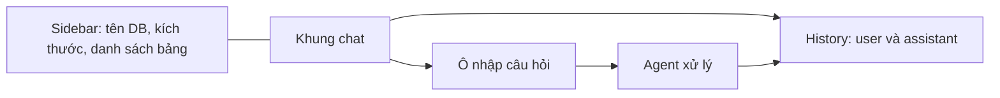

# Bài 06 — Xây dựng giao diện hội thoại Streamlit

## 1. Tóm tắt

Streamlit cho phép đưa agent Python thành một ứng dụng chat tương tác mà không cần viết frontend riêng. Những khối quan trọng là sidebar hiển thị thông tin database, vùng lịch sử hội thoại, ô nhập câu hỏi và trạng thái trong khi agent đang xử lý.

## 2. Mục tiêu học tập

Bạn có thể khởi tạo session state, hiển thị luân phiên vai trò `user`/`assistant`, gắn luồng agent với `st.chat_input`, hiển thị câu trả lời Markdown và giải thích giới hạn của bộ nhớ theo phiên.

## 3. Cấu trúc giao diện



Sidebar giúp người học nhìn thấy hệ thống đang truy vấn nguồn nào. Trong bản dùng dữ liệu thật, không nên hiển thị metadata hay số dòng của bảng ngoài quyền truy cập của người dùng.

## 4. Mẫu chat đơn giản

```python
import streamlit as st

st.set_page_config(page_title="AI Agent SQL", page_icon="🗃️")
st.title("AI Agent hỏi đáp dữ liệu SQLite")

if "visible_messages" not in st.session_state:
    st.session_state.visible_messages = []

for item in st.session_state.visible_messages:
    with st.chat_message(item["role"]):
        st.markdown(item["content"])

question = st.chat_input("Ví dụ: Khách hàng nào đặt nhiều đơn nhất?")
if question:
    st.session_state.visible_messages.append({"role": "user", "content": question})
    with st.chat_message("user"):
        st.markdown(question)

    with st.chat_message("assistant"):
        with st.spinner("Đang truy vấn dữ liệu..."):
            # Thay bằng ask_agent(...) khi tích hợp
            answer = f"Đã nhận câu hỏi: {question}"
        st.markdown(answer)

    st.session_state.visible_messages.append({
        "role": "assistant", "content": answer,
    })
```

Mẫu giao diện này chạy được mà không cần model, nhằm kiểm tra hoạt động chat trước khi kết nối với backend. Hàm `ask_agent(...)` sẽ thay phần trả lời giả lập sau khi hoàn thành kiến trúc ở bài về vòng lặp agent.

## 5. Hai loại lịch sử cần phân biệt

`visible_messages` chỉ gồm lời người dùng và câu trả lời cuối để hiển thị. `agent_messages` cần chứa `SystemMessage`, `HumanMessage`, `AIMessage`, `ToolMessage` theo đúng thứ tự để model xử lý công cụ và ngữ cảnh. Khi dùng hai danh sách riêng, tránh thêm cùng một câu hỏi hai lần vào history của agent.

```python
if "agent_messages" not in st.session_state:
    st.session_state.agent_messages = [SystemMessage(content=SYSTEM_PROMPT)]
```

Nếu trong thực tế chạy `st.cache_resource` để dùng lại model, cần cân nhắc tính thread-safe của client và ngăn history người dùng khác bị dùng chung. Session state phải gắn với phiên người dùng tương ứng.

## 6. Hiển thị metadata trên sidebar

```python
from pathlib import Path
from langchain_core.messages import SystemMessage

with st.sidebar:
    st.subheader("Cơ sở dữ liệu")
    db_path = Path("ecommerce.sqlite")
    st.write("Tệp:", db_path.name)
    if db_path.exists():
        st.write("Dung lượng:", f"{db_path.stat().st_size / 1024:.1f} KB")
    st.caption("Sử dụng dữ liệu thử nghiệm chỉ đọc")
```

Nếu muốn hiển thị số dòng của mỗi bảng, có thể đếm bằng SQL với tên bảng đã kiểm tra hợp lệ, nhưng với bảng lớn, `COUNT(*)` có chi phí. Không cần gọi các câu truy vấn nặng ở mỗi lần Streamlit rerun.

## 7. Giới hạn của `st.session_state`

Streamlit rerun script khi tương tác; `st.session_state` giúp dữ liệu tồn tại giữa các rerun của **cùng phiên kết nối**. Tuy nhiên, nó không thay thế kho lưu trữ bền vững: khi kết nối/session bị kết thúc hoặc tiến trình ứng dụng thay đổi, trạng thái có thể mất. Nếu cần nhớ cuộc hội thoại giữa nhiều ngày hoặc thiết bị, phải thiết kế lưu trữ riêng (database, checkpointer, tài khoản người dùng và chính sách quyền riêng tư).

## 8. Thực hành

Chạy `streamlit run app.py`, thử gửi ba câu hỏi và kiểm tra thứ tự hội thoại. Thêm nút “Xóa lịch sử phiên” và bảo đảm nó đồng thời làm mới `visible_messages` lẫn `agent_messages` về thông điệp hệ thống ban đầu.

## 9. Câu hỏi ôn tập

**Câu 1.** Thành phần nào nhận văn bản chat từ người dùng?  
A. `st.chat_input`.  
B. `st.image`.  
C. `st.table`.  
D. `st.sidebar` tự nhận chat.  
**Đáp án: A.** **Giải thích:** `st.chat_input` tạo ô nhập tin nhắn.

**Câu 2.** Vì sao cần `st.session_state`?  
A. Để ghi lại toàn bộ internet.  
B. Để tránh dùng Python.  
C. Để giữ trạng thái giữa các lần rerun trong phiên.  
D. Để tự sinh SQL chính xác.  
**Đáp án: C.** **Giải thích:** Streamlit thực thi lại script khi có tương tác.

**Câu 3.** Thành phần nào nên được ẩn khỏi lịch sử chat hiển thị cho người dùng phổ thông?  
A. Lời người dùng.  
B. Các thông điệp kỹ thuật ToolMessage chứa dữ liệu nội bộ.  
C. Câu trả lời tổng hợp.  
D. Tiêu đề app.  
**Đáp án: B.** **Giải thích:** History kỹ thuật và history hiển thị có mục tiêu khác nhau.

**Câu 4.** `st.session_state` có phải bộ nhớ bền vững xuyên nhiều phiên độc lập không?  
A. Có, mặc định lưu vô hạn.  
B. Có, nếu dùng Markdown.  
C. Có, nếu tên database là SQLite.  
D. Không, cần lưu trữ bền vững riêng.  
**Đáp án: D.** **Giải thích:** State của Streamlit chỉ giải quyết vòng đời phiên kết nối.

**Câu 5.** Khi tích hợp backend, cách nào tránh nhân đôi câu hỏi trong LLM history?  
A. Chỉ để một tầng chịu trách nhiệm thêm `HumanMessage`.  
B. Thêm lời người dùng ở cả giao diện lẫn agent vào cùng danh sách.  
C. Xóa `SystemMessage`.  
D. Gọi model hai lần.  
**Đáp án: A.** **Giải thích:** Tránh trùng dữ liệu ngữ cảnh và lệch thứ tự message.

## 10. Tổng kết

Streamlit giúp kiểm tra trải nghiệm hội thoại và trình bày kết quả Markdown nhanh chóng. Khi tích hợp, quan trọng nhất là phân định trạng thái giao diện, lịch sử agent và tầng lưu trữ bền vững.
