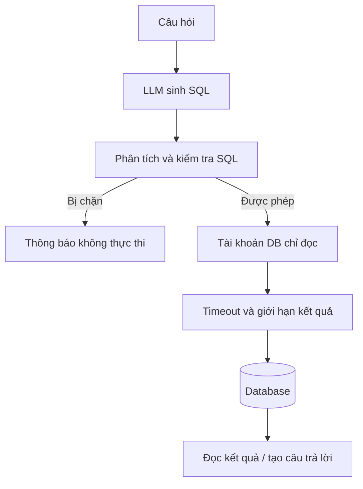

# Bài 07. An toàn, gỡ lỗi và hướng mở rộng Text-to-SQL

## 1. Tóm tắt

LLM có thể viết SQL, nhưng không phải hệ thống kiểm soát truy cập. Một workflow vận hành tốt phải đảm bảo câu SQL được phép chạy, không làm thay đổi dữ liệu, không tiết lộ thông tin ngoài phạm vi người dùng và không tiêu thụ tài nguyên vô hạn. Bài học này hệ thống hóa các biện pháp cần thiết khi đưa bài thực hành vào ứng dụng thực tế.

## 2. Mục tiêu học tập

- Phân tích các nguy cơ khi thực thi SQL tự sinh.
- Phân biệt lớp bảo vệ bằng prompt với lớp bảo vệ bằng quyền database.
- Đề xuất được chiến lược quan sát, xác minh và xử lý lỗi.
- Xác định hướng mở rộng khi schema lớn và câu hỏi phức tạp hơn.

## 3. Vì sao không được tin hoàn toàn SQL sinh bởi LLM?

Câu SQL của mô hình có thể sai vì bốn lý do: thiếu kiến thức về schema, hiểu sai ý định, chọn phép nối sai hoặc làm theo hướng dẫn không đáng tin nằm trong câu hỏi/dữ liệu. Ngoài ra, mô hình đôi khi có thể trả câu lệnh sửa đổi dữ liệu mặc dù prompt yêu cầu chỉ đọc. Vì vậy **không nối thẳng SQL tự sinh với quyền truy cập ghi lên dữ liệu thật**.

## 4. Các lớp bảo vệ nên có

### 4.1. Nguyên tắc quyền tối thiểu

Tạo **tài khoản riêng chỉ có quyền `SELECT` trên các bảng được phép**. Trong SQLite demo, dùng một bản sao database và thiết lập kết nối ở chế độ chỉ đọc. Đối với database nhiều người dùng, phải kiểm soát quyền ở tầng máy chủ và theo danh tính người dùng, không chỉ ở prompt.

### 4.2. Kiểm tra câu SQL trước khi chạy

Một lớp đơn giản có thể yêu cầu chỉ đúng một câu truy vấn, cấm các câu lệnh thay đổi cấu trúc hoặc dữ liệu, và giới hạn bảng/cột được truy cập. **Bộ lọc dựa vào regex hoặc tiền tố `SELECT` không phải bộ phân tích SQL an toàn hoàn chỉnh.** Các truy vấn có CTE, comment, subquery, hàm hoặc cấu trúc phức tạp đòi hỏi parser theo đúng phương ngữ và chính sách kiểm soát đầy đủ.

### 4.3. Giới hạn tài nguyên

Đặt timeout, giới hạn kích thước phản hồi, số hàng và điều kiện phân trang. `LIMIT` trong prompt không đủ để bảo vệ máy chủ; câu SQL có thể thực hiện `JOIN`/tính toán tốn tài nguyên trước khi giới hạn kết quả. Cần thêm kiểm soát ở tầng thực thi và database.

### 4.4. Dữ liệu nhạy cảm và câu trả lời

Chỉ đưa vào prompt những phần schema/kết quả người dùng được phép thấy. Tránh đưa token, thông tin cá nhân hay toàn bộ bảng dữ liệu vào log không được bảo vệ. LLM diễn giải kết quả phải tránh tự suy ra chi tiết không có trong dữ liệu.

## 5. Phân biệt debug và tự động sửa truy vấn

Ở hệ thống học tập, in SQL và lỗi database giúp nhận diện nhanh lỗi cột, lỗi `JOIN` hoặc trường hợp không tìm thấy bản ghi. Có thể mở rộng thành vòng lặp “sinh → kiểm tra → sửa → thử lại”, nhưng vòng lặp phải có **giới hạn số lần thử**, nhật ký kiểm thử và không bao giờ nâng quyền chỉ để sửa lỗi. Những câu hỏi mơ hồ nên được làm rõ, thay vì âm thầm tạo SQL ngày càng phức tạp.

## 6. Các hướng mở rộng

| Vấn đề | Hướng xử lý |
| --- | --- |
| Database có hàng trăm bảng | Lựa chọn bảng liên quan rồi chỉ đưa phần schema cần thiết vào prompt |
| Câu hỏi mơ hồ | Yêu cầu người dùng làm rõ định nghĩa trường, thời gian hoặc cách tính |
| `JOIN` phức tạp | Cung cấp mô tả quan hệ và ví dụ truy vấn đã kiểm chứng |
| Cần kiểm toán | Ghi log câu hỏi, SQL, quyết định validator, thời gian và trạng thái |
| Cần so sánh mô hình | Giữ cố định bộ dữ liệu, tập câu hỏi, tiêu chí đánh giá |
| Có dữ liệu nhạy cảm | Phân quyền trên bảng/cột/hàng và giảm tối đa dữ liệu gửi vào LLM |

Việc đổi giữa GPT và Qwen chỉ thay **bộ máy suy luận**; các lớp kiểm tra quyền, truy vấn, thời gian và dữ liệu phải tiếp tục hoạt động với cả hai.

## 7. Checklist trước khi triển khai

- [ ] Câu hỏi có được kiểm soát theo quyền người dùng không?
- [ ] Tài khoản DB đã giới hạn quyền đọc và phạm vi bảng chưa?
- [ ] SQL được phân tích và xác thực trước khi chạy chưa?
- [ ] Có giới hạn thời gian và dung lượng truy vấn không?
- [ ] Có tập kiểm thử `SELECT`, `WHERE`, `JOIN`, kết quả rỗng và lỗi không?
- [ ] Phản hồi có lấy dữ liệu thật và không tự bổ sung thông tin không?
- [ ] Log có tránh lộ thông tin riêng tư và API key không?

## 8. Câu hỏi ôn tập

### Câu 1

Vì sao prompt “chỉ sinh SELECT” không thể thay thế phân quyền database?

A. Vì database không có vai trò bảo mật.  
B. Vì LLM có thể không tuân thủ prompt và vẫn tạo SQL nguy hiểm.  
C. Vì mọi truy vấn SELECT đều sửa dữ liệu.  
D. Vì schema là dữ liệu nhạy cảm trong mọi tình huống.

**Đáp án:** B. **Giải thích:** Prompt không đảm bảo hành vi; quyền ở database là rào chắn độc lập.

### Câu 2

Biện pháp nào trực tiếp hạn chế hậu quả khi mô hình cố gửi lệnh thay đổi dữ liệu?

A. Tăng nhiệt độ sampling.  
B. Thêm nhiều ví dụ văn bản.  
C. Cho phép tài khoản quản trị để tiện debug.  
D. Dùng tài khoản/chế độ truy cập chỉ đọc và kiểm tra SQL.

**Đáp án:** D. **Giải thích:** Quyền tối thiểu và validator tạo ra giới hạn ngoài LLM.

### Câu 3

Điều nào đúng về kiểm tra `sql.startswith('SELECT')`?

A. Là kiểm tra rất hạn chế, không đủ bảo vệ hệ thống thực.  
B. Đủ xử lý mọi cấu trúc SQL.  
C. Có thể xác minh chính xác mọi khóa ngoại.  
D. Tự thêm điều kiện phân quyền theo người dùng.

**Đáp án:** A. **Giải thích:** Kiểm tra chuỗi không hiểu đầy đủ cấu trúc và ngữ nghĩa SQL.

### Câu 4

Khi schema quá lớn, phương án nào hợp lý hơn việc đưa tất cả bảng vào prompt?

A. Không gửi bất kỳ schema nào.  
B. Chỉ gửi tên database.  
C. Chọn các bảng liên quan đến câu hỏi rồi gửi cấu trúc cần thiết.  
D. Luôn dùng một bảng duy nhất.

**Đáp án:** C. **Giải thích:** Rút gọn ngữ cảnh vào bảng liên quan giảm nhiễu và chi phí, nhưng vẫn bảo đảm thông tin nối cần thiết.

### Câu 5

Vì sao cần ghi nhận `query`, kết quả validator và thời gian chạy khi debug?

A. Để bỏ qua SQL thật.  
B. Để truy vết lỗi và đánh giá hành vi hệ thống.  
C. Để làm LLM miễn phí.  
D. Để xóa các bản ghi bị lỗi.

**Đáp án:** B. **Giải thích:** Quan sát các bước trung gian giúp phân biệt lỗi mô hình, bảo mật và database.

## 9. Tổng kết

Một hệ thống Text-to-SQL đáng tin cần ba yếu tố đi cùng nhau: **chất lượng suy luận của LLM**, **sự chính xác của truy vấn dữ liệu**, và **những giới hạn do chương trình/database thi hành**. Khi mở rộng sang sản phẩm thực tế, các lớp bảo vệ phải trở thành một phần của kiến trúc, không phải một ghi chú ở cuối dự án.
