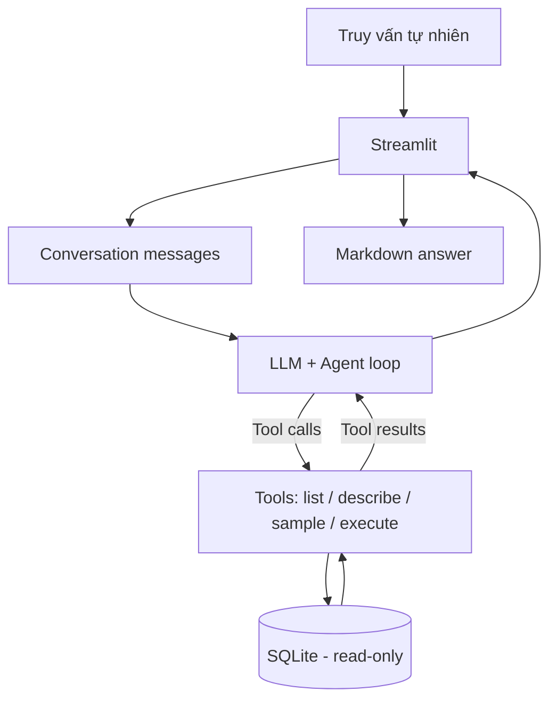

# Bài 08 — Tổng kết, giới hạn và hướng mở rộng hệ thống

## 1. Tóm tắt

Agent Text-to-SQL là một ví dụ rõ ràng về việc kết hợp mô hình ngôn ngữ với công cụ thực thi. Nhưng thành công trong một bộ dữ liệu thương mại điện tử nhỏ không đồng nghĩa hệ thống đã sẵn sàng phục vụ nhiều người dùng hoặc dữ liệu nhạy cảm.

## 2. Mục tiêu học tập

Bạn sẽ đánh giá được agent theo các khía cạnh tính đúng, an toàn, tài nguyên và trải nghiệm; phân biệt khả năng cục bộ với dịch vụ API; xây dựng kế hoạch cải tiến có thứ tự ưu tiên.

## 3. Tổng hợp kiến trúc

Agent gắn chặt tính đúng của mình vào hai yếu tố: *bằng chứng từ database* và *cách thực thi được kiểm soát*. Câu trả lời mượt mà nhưng SQL sai vẫn là lỗi chức năng.

## 4. Đánh giá chất lượng

Đừng chỉ đo xem LLM có nói đúng một đáp án hay không. Nên đánh giá theo từng lớp:

| Lớp | Tiêu chí | Gợi ý kiểm thử |
| --- | --- | --- |
| Hiểu câu hỏi | Xác định đúng chỉ số muốn hỏi | “Nhiều đơn” khác “chi tiêu cao” |
| Sử dụng tool | Chọn đúng bảng/cột, số tool call hợp lý | Đọc log tool |
| SQL | Đúng điều kiện, JOIN và tổng hợp | So với SQL chuẩn |
| Kết quả | Đúng, đủ, có ghi nhận không có dữ liệu | So sánh bản ghi nguồn |
| Vận hành | Không lặp vô hạn, hạn chế truy vấn nặng | Timeout, max_iterations |
| Bảo mật | Không ghi hoặc tiết lộ ngoài quyền | Test truy vấn ghi và dữ liệu nhạy cảm |
| UX | Câu trả lời rõ và giải thích định nghĩa | Người dùng không cần đọc raw SQL |

## 5. Các giới hạn thường gặp

**Bộ nhớ hội thoại:** Streamlit session state chỉ duy trì theo phiên, không hỗ trợ mặc định yêu cầu “thứ Hai tôi thích cà phê, Chủ nhật hãy nhớ” khi người dùng tạo phiên mới. Muốn xử lý loại yêu cầu này, cần lưu trạng thái/ghi chú theo tài khoản bằng database hoặc memory store với quyền đồng ý và xóa dữ liệu.

**Độ tin cậy của truy vấn:** Một model nhỏ đôi khi gọi sai tool, tạo sai tên cột hoặc cho câu SQL trả quá nhiều hàng. Cần schema discovery, giới hạn truy vấn, gợi ý sửa SQL dựa trên lỗi và đánh giá trên bộ câu hỏi riêng.

**Phân quyền:** Database chỉ đọc không có nghĩa là được đọc mọi bảng. Khi có dữ liệu của nhiều tài khoản, phải kiểm tra quyền ở tầng API hoặc DB và giới hạn bản ghi theo danh tính người dùng.

**Cơ sở dữ liệu khác:** Có thể chuyển sang PostgreSQL/MySQL bằng cách thay lớp kết nối/câu truy vấn introspection; với NoSQL, cần xây bộ công cụ khác vì query language và schema không giống SQLite. Không nên giả định chỉ đổi connection string là đủ.

## 6. Hướng cải tiến có thứ tự ưu tiên

**Mức 1 — Độ đúng:** Tạo test set có câu hỏi, SQL chuẩn và expected rows; log các lệnh tool một cách an toàn. Thêm giới hạn thời gian và số dòng, kiểm tra lỗi, theo dõi tỷ lệ thành công.

**Mức 2 — Quản trị dữ liệu:** Giới hạn bảng/cột được phép đọc, phân quyền theo user, masking, audit và kiểm soát kết quả trả về.

**Mức 3 — Khả năng mở rộng:** Tách UI, service agent và database; bổ sung queue / concurrency limit khi truy vấn nặng; giám sát hiệu năng từng tool.

**Mức 4 — Bộ nhớ dài hạn:** Lưu message metadata đã kiểm tra, thiết kế cơ chế tóm tắt và truy xuất lịch sử theo người dùng; hỗ trợ xóa/đính chính dữ liệu cá nhân. Không đưa toàn bộ tin nhắn và kết quả SQL vào bộ nhớ dài hạn mà thiếu chọn lọc.

## 7. Bài thực hành mở rộng

Thiết kế tính năng **“đề xuất sản phẩm dựa trên lịch sử mua hàng”**: agent nhận câu hỏi “Khách Lan thường mua loại sản phẩm nào?”, gọi truy vấn quan hệ `customers -> orders -> order_items -> products`, rồi trả về nhóm hàng và số lượng. Sau đó, yêu cầu thêm câu hỏi “Tháng này họ đã mua gì?” và giải thích vì sao bộ lọc thời gian cần một ngày tham chiếu cụ thể.

Không thêm hành động tự động đặt hàng hoặc thay đổi tồn kho vào chính agent chỉ đọc; mọi thao tác ghi cần workflow xác nhận và quyền riêng.

## 8. Câu hỏi ôn tập

**Câu 1.** Vì sao database chỉ đọc vẫn chưa đủ để bảo vệ dữ liệu khách hàng?  
A. Vì không có cột số.  
B. Vì model không thể tạo SQL.  
C. Vì vẫn có nguy cơ đọc dữ liệu ngoài quyền truy cập.  
D. Vì Streamlit không hiển thị bảng.  
**Đáp án: C.** **Giải thích:** Phân quyền đọc theo bảng, cột và người dùng vẫn bắt buộc.

**Câu 2.** Thành phần nào cần có để nhớ sở thích xuyên phiên chat?  
A. Chỉ `st.session_state`.  
B. Kho lưu trữ bền vững có định danh người dùng và chính sách dữ liệu.  
C. `COUNT(*)`.  
D. Tăng số dòng `LIMIT`.  
**Đáp án: B.** **Giải thích:** Session state không lưu vĩnh viễn lịch sử xuyên phiên.

**Câu 3.** Chỉ số nào kiểm tra agent có thực sự truy vấn đúng?  
A. Độ chính xác so với SQL và expected rows trong tập test.  
B. Số biểu tượng UI.  
C. Số token prompt càng lớn càng tốt.  
D. Màu đường viền.  
**Đáp án: A.** **Giải thích:** Chất lượng phải gắn với dữ liệu có thể kiểm chứng.

**Câu 4.** Khi muốn hỗ trợ PostgreSQL, điều gì chắc chắn cần xem lại?  
A. Tên thư mục ảnh.  
B. Font chữ Markdown.  
C. Biểu tượng chatbot.  
D. Kết nối, metadata schema và cú pháp/tool truy vấn.  
**Đáp án: D.** **Giải thích:** Cơ chế introspection và SQL dialect giữa hệ DB có khác biệt.

**Câu 5.** Với thao tác tự động đặt hàng, thiết kế phù hợp hơn là gì?  
A. Cho agent tự `INSERT` không cần kiểm tra.  
B. Lưu mật khẩu trong system prompt.  
C. Tạo luồng có xác nhận, quyền và log tách biệt công cụ chỉ đọc.  
D. Bỏ toàn bộ giới hạn.  
**Đáp án: C.** **Giải thích:** Hành động có hệ quả cần kiểm soát chặt hơn truy vấn đọc.

## 9. Tổng kết

AI Agent Text-to-SQL là nền tảng để phát triển các hệ thống hỏi đáp dữ liệu, hỗ trợ phân tích nghiệp vụ và tương tác theo ngôn ngữ tự nhiên. Thành công lâu dài đòi hỏi bảo vệ dữ liệu, đo độ đúng và có quy trình phát triển có kiểm chứng.
