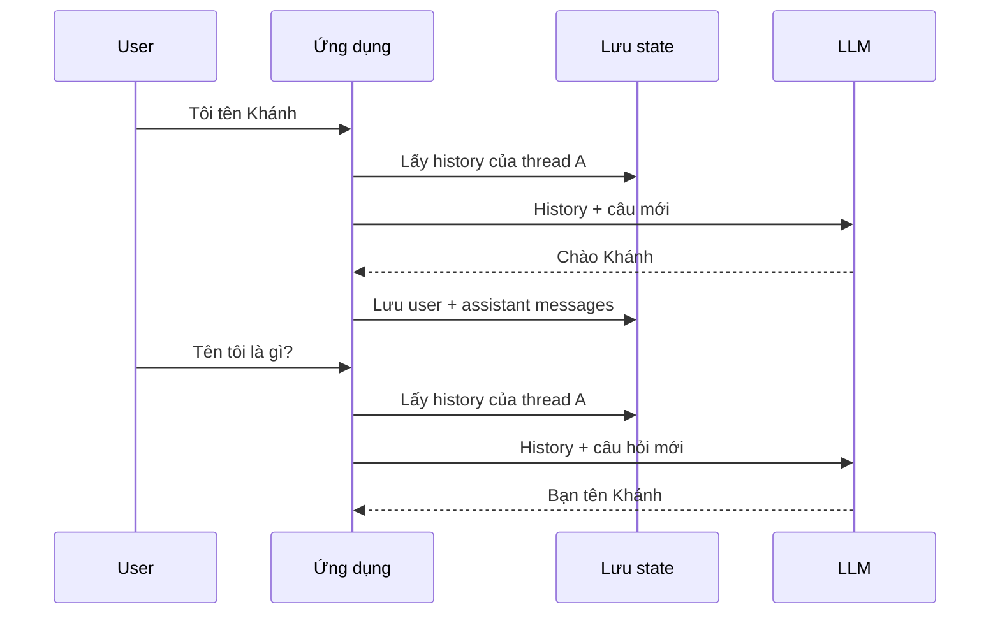

# Bài 01 — LLM Stateless và nguyên lý Short-Term Memory

## 1. Tóm tắt

Một mô hình ngôn ngữ lớn (LLM) không tự lưu toàn bộ cuộc đối thoại chỉ vì ứng dụng đã gọi nó trước đó. Mỗi lời gọi API nhận một **đầu vào** và tạo một **đầu ra**. Để bot hiểu câu “Tên tôi là gì?” sau câu “Tôi tên Khánh”, ứng dụng phải cung cấp ngữ cảnh cũ ở lần gọi tiếp theo. Cơ chế quản lý trạng thái theo từng hội thoại này là nền tảng của **short-term memory (STM)**.

## 2. Mục tiêu học tập

- Giải thích sự khác nhau giữa mô hình, phiên gọi API, lịch sử hội thoại và bộ nhớ ứng dụng.
- Dự đoán đầu ra có/không có lịch sử và giải thích vì sao hai thread không tự chia sẻ trí nhớ.
- Mô tả luồng ghi nhận và tái sử dụng tin nhắn của một ứng dụng chat đa lượt.
- Phân biệt STM và long-term memory ở mức khái niệm, không nhầm với lưu RAM/PostgreSQL.

## 3. Bài toán: Vì sao chatbot quên tên người dùng?

Hãy xét ba lượt trao đổi:

| Bước | Input thực sự của LLM | Người dùng kỳ vọng |
| --- | --- | --- |
| 1 | `Tôi tên Khánh.` | Model chào Khánh |
| 2 không có memory | `Tên tôi là gì?` | Khánh, nhưng model thiếu dữ kiện |
| 2 có memory | `Tôi tên Khánh.` + câu trả lời bước 1 + `Tên tôi là gì?` | Model có căn cứ để trả lời Khánh |

Nói mô hình **stateless** có nghĩa là trạng thái hội thoại không mặc định được giữ giữa hai lệnh `invoke`. Điều này không phủ nhận mô hình có trọng số đã học trong huấn luyện: trọng số mô hình và lịch sử riêng của một người đang chat là hai loại thông tin khác nhau.

## 4. Short-Term Memory vận hành thế nào?



Ở mỗi lượt, ứng dụng:

1. Nhận thông điệp cùng mã hội thoại.
2. Tải trạng thái hiện tại của đúng hội thoại.
3. Cập nhật trạng thái bằng thông điệp mới.
4. Xây input cho LLM (có thể chỉ lấy một phần lịch sử).
5. Nhận câu trả lời và lưu state mới.

**Lưu được không đồng nghĩa với thấy được:** thông điệp có thể tồn tại trong cơ sở dữ liệu nhưng không được đưa vào prompt vì bị trimming.

## 5. STM khác long-term memory như thế nào?

| Tiêu chí | STM | Long-term memory |
| --- | --- | --- |
| Phạm vi | Một cuộc hội thoại hay thread | Có thể xuyên nhiều thread/phiên |
| Nội dung điển hình | `messages`, summary, trạng thái workflow | Sở thích, thông tin người dùng, tri thức lâu dài |
| Công cụ LangGraph | Checkpointer | Store hoặc cơ chế lưu dữ liệu ứng dụng |
| Ví dụ | Nhớ “tên tôi là Khánh” trong thread A | Có thể nhớ sở thích ăn uống ở thread B sau khi được phép lưu |

Sự khác nhau này **không dựa vào việc dữ liệu nằm trong RAM hay PostgreSQL**. Một STM được lưu vào PostgreSQL vẫn là STM vì phạm vi logic của nó là thread.

## 6. Thí nghiệm nhanh không có history

Tạo file `stateless_demo.py`:

```python
import os
from dotenv import load_dotenv
from langchain_openai import ChatOpenAI
from langchain_core.messages import HumanMessage

load_dotenv()
model = ChatOpenAI(model=os.environ['OPENAI_MODEL'], temperature=0)

first = model.invoke([HumanMessage(content='Xin chào, tôi tên Khánh.')])
second = model.invoke([HumanMessage(content='Tên tôi là gì?')])

print('Lượt 1:', first.content)
print('Lượt 2:', second.content)
```

**Quan sát:** ở lượt 2, chương trình không gửi thông điệp đầu tiên. Model không có căn cứ chắc chắn để xác nhận tên. Đầu ra có thể khác nhau tùy model, vì vậy không dùng một câu trả lời cụ thể làm assertion kiểm thử.

Thử sửa `second` để gửi cả lịch sử:

```python
second = model.invoke([
    HumanMessage(content='Xin chào, tôi tên Khánh.'),
    first,
    HumanMessage(content='Tên tôi là gì?'),
])
```

Lần này model thấy thông tin tên ở ngữ cảnh. Cách này hoạt động nhưng ứng dụng phải tự ghép, lưu và phân tách lịch sử; LangGraph giúp chuẩn hóa phần đó.

## 7. Sai lầm thường gặp

- **“LLM nhớ tên nên API có memory mặc định”**: Có thể ứng dụng đang gửi history ngầm. Cần kiểm tra payload chứ không suy ra từ giao diện.
- **“Cứ lưu hết history sẽ an toàn”**: Lịch sử dài tốn token, chi phí và có thể vượt context window.
- **“Lưu vào database là long-term memory”**: Độ bền của kho lưu trữ và phạm vi truy xuất trí nhớ là hai thuộc tính độc lập.
- **“Model sẽ luôn nhớ chính xác”**: Có ngữ cảnh không đảm bảo mô hình không suy diễn sai; kiểm thử phải đo chất lượng và tính riêng tư.

## 8. Thực hành

Hãy gửi 4 lượt: giới thiệu tên, nói đang học Python, hỏi tên, hỏi môn đang học. Chạy lần lượt với (A) chỉ gửi câu mới; (B) luôn gửi lịch sử. Ghi lại input gửi model, số tin nhắn được gửi và mức độ chính xác. Sau đó đổi tên ở giữa hội thoại để xem model xử lý thông tin mới và cũ thế nào.

## 9. Câu hỏi ôn tập

**Câu 1.** Vì sao API gọi LLM lần thứ hai thường không biết thông tin lần đầu?  
A. Model luôn quên trọng số.  
B. Lượt hai không tự có lịch sử lần trước.  
C. Tên người dùng không biểu diễn được bằng token.  
D. Python xóa mọi biến sau mỗi lệnh.  
**Đáp án: B.** Mô hình chỉ thấy nội dung được gửi trong input của lần gọi hiện tại.

**Câu 2.** Điều nào mô tả đúng STM?  
A. Chỉ có thể nằm trong RAM.  
B. Được lưu vĩnh viễn và tự chia sẻ cho mọi người.  
C. Dữ liệu hội thoại có phạm vi thread, có thể được checkpoint.  
D. Luôn là thông tin huấn luyện của model.  
**Đáp án: C.** STM được xác định bởi chức năng và phạm vi dùng của state.

**Câu 3.** Khi có history rất dài, lựa chọn nào bền vững hơn?  
A. Quản lý context budget, trim hoặc summary có kiểm soát.  
B. Gửi toàn bộ vô hạn.  
C. Loại mọi system message.  
D. Không lưu trạng thái.  
**Đáp án: A.** Giới hạn context buộc ứng dụng chọn thông tin phù hợp.

**Câu 4.** Nếu tên người dùng nằm trong PostgreSQL nhưng không có trong prompt hiện tại thì:  
A. Model chắc chắn biết tên.  
B. PostgreSQL gửi tên tự động.  
C. Model sẽ tự query database.  
D. Model không thể dựa trực tiếp vào tên nếu không được truy xuất và đưa vào ngữ cảnh.  
**Đáp án: D.** Lưu trữ không tự quyết định model thấy gì.

**Câu 5.** Khi thử nghiệm stateless, kiểm tra nào đáng tin hơn một câu trả lời mẫu?  
A. So màu giao diện.  
B. Kiểm tra input messages mỗi lượt và xem có history hay không.  
C. Chỉ xem số từ trong câu trả lời.  
D. Chỉ kiểm tra có API key.  
**Đáp án: B.** Input cho biết điều kiện thông tin mà LLM nhận.

## 10. Tổng kết

STM là bài toán **quản lý state và tái dựng context**, không phải phép biến LLM thành cơ sở dữ liệu. Mô hình chỉ có thể sử dụng tin nhắn được ứng dụng đưa vào input ở lượt đang xét.
