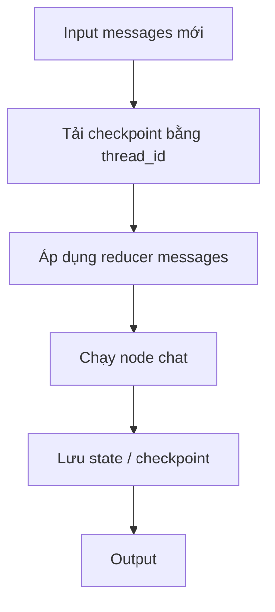

# Bài 02 — MessagesState, StateGraph, Checkpointer và Thread ID

## 1. Tóm tắt

LangGraph biểu diễn ứng dụng dưới dạng đồ thị các node xử lý state. Với chatbot cơ bản, `MessagesState` là kiểu state thuận tiện để chứa hội thoại; checkpointer lưu snapshot state; `thread_id` xác định chuỗi snapshot cần tiếp tục. Kết hợp ba cơ chế cho một bộ nhớ hội thoại có khả năng quan sát và kiểm thử.

## 2. Mục tiêu học tập

- Tạo đồ thị `START -> chat -> END` bằng `StateGraph`.
- Giải thích reducer của `MessagesState` và vì sao trả về một AI message mới không xóa history.
- Phân biệt `builder.compile()` không checkpointer và `builder.compile(checkpointer=...)`.
- Dùng `graph.get_state(config)` để đọc snapshot và xác định thread.

## 3. Các thành phần

| Khái niệm | Vai trò | Ví dụ |
| --- | --- | --- |
| `StateGraph` | Khai báo graph và schema state | `StateGraph(MessagesState)` |
| `MessagesState` | Schema có trường `messages`, xử lý cập nhật bằng message reducer | `state['messages']` |
| Node | Hàm nhận state và trả về phần cập nhật | `chat_node` |
| `START`, `END` | Điểm vào và kết thúc graph | `add_edge(START, 'chat')` |
| Checkpointer | Lưu / tải snapshot state theo các super-step | `InMemorySaver()` |
| `thread_id` | Định danh hội thoại | `{'configurable': {'thread_id':'room-1'}}` |

Đặc biệt, node trả về `{'messages':[response]}`. Reducer của `MessagesState` sẽ kết hợp tin mới với history đang có, thay vì mặc định thay cả danh sách như một dict thông thường.

## 4. Graph chatbot hoàn chỉnh

Tạo `graph_base.py`:

```python
import os
from dotenv import load_dotenv
from langchain_openai import ChatOpenAI
from langgraph.graph import StateGraph, MessagesState, START, END

load_dotenv()
model = ChatOpenAI(model=os.environ['OPENAI_MODEL'], temperature=0)

def chat_node(state: MessagesState):
    answer = model.invoke(state['messages'])
    return {'messages': [answer]}

builder = StateGraph(MessagesState)
builder.add_node('chat', chat_node)
builder.add_edge(START, 'chat')
builder.add_edge('chat', END)

graph = builder.compile()
result = graph.invoke({'messages': [{'role': 'user', 'content': 'Tôi tên Khánh.'}]})
print(result['messages'][-1].content)
```

Trong ví dụ, `graph` hoàn thành một lượt xử lý. Chưa có checkpointer nên lần gọi khác không thể tự tái tải state của lượt trước.

## 5. Bổ sung checkpoint

Thay dòng compile bằng:

```python
from langgraph.checkpoint.memory import InMemorySaver

checkpointer = InMemorySaver()
graph = builder.compile(checkpointer=checkpointer)
config = {'configurable': {'thread_id': 'chat-001'}}

graph.invoke(
    {'messages': [{'role': 'user', 'content': 'Tôi tên Khánh.'}]},
    config=config,
)
graph.invoke(
    {'messages': [{'role': 'user', 'content': 'Tên tôi là gì?'}]},
    config=config,
)

snapshot = graph.get_state(config)
for message in snapshot.values['messages']:
    print(message.type, message.content)
```

Các thành phần phối hợp: khi `invoke`, LangGraph tải state gắn với `chat-001`, áp dụng input thông qua reducer, chạy node và tạo checkpoint. `get_state` trả về `StateSnapshot`; dữ liệu hiện tại nằm ở `.values`.

## 6. Super-step và checkpoint

Một **super-step** là một bước thực thi graph (có thể bao gồm node có thể chạy song song). Checkpointer tạo snapshot qua những bước thực thi thích hợp, không chỉ lưu mỗi câu trả lời cuối. Điều này hữu ích khi cần truy vết history, phục hồi từ gián đoạn và debugging. Không nên hiểu rằng mỗi token sinh ra sẽ có một checkpoint riêng.



## 7. Những phân biệt quan trọng

`thread_id` không phải user ID. Một người có thể có nhiều cuộc hội thoại; hai người không được dùng chung một thread nếu không có chủ ý chia sẻ. Trong hệ thống thật, backend phải kiểm tra quyền truy cập khi lấy thread. Ngoài ra, `get_state()` để đọc trạng thái; không nên gọi model lần nữa chỉ để kiểm tra history vì sẽ tăng số lượt và thay đổi state.

## 8. Thực hành

- Bỏ checkpointer, gọi hai lần “Tôi tên Khánh” rồi “Tên tôi là gì?” và so sánh.
- Thêm `InMemorySaver`, gọi lại cùng thread và đọc `snapshot.values['messages']`.
- Thử dùng `thread_id='chat-002'` cho câu hỏi tên. Giải thích kết quả dựa trên state chứ không dựa vào cách nói của bot.
- Vẽ graph bằng Mermaid, tô rõ những bước có checkpoint.

## 9. Câu hỏi ôn tập

**Câu 1.** Đối tượng nào cung cấp history cho thread đã tồn tại?  
A. `END`  
B. `temperature`  
C. `checkpointer`  
D. `SystemMessage`  
**Đáp án: C.** Checkpointer lưu/truy xuất graph state theo cấu hình thread.

**Câu 2.** Thuộc tính nào đọc giá trị state hiện tại?  
A. `graph.get_state(config).values`  
B. `graph.edges.values`  
C. `model.tokenizer`  
D. `builder.history`  
**Đáp án: A.** `get_state` trả về snapshot có `.values`.

**Câu 3.** Vì sao node có thể trả về một AI message duy nhất?  
A. Tin cũ luôn bị xóa.  
B. LLM mặc định cache tin cũ.  
C. Node không được phép trả danh sách.  
D. Reducer của `MessagesState` hợp nhất update với lịch sử.  
**Đáp án: D.** Schema quyết định cách cập nhật trường `messages`.

**Câu 4.** Một người mở hai cuộc chat độc lập nên thiết kế gì?  
A. Dùng cùng thread và bỏ kiểm tra quyền.  
B. Hai `thread_id` khác nhau.  
C. Xóa mọi checkpoint.  
D. Chỉ thêm system prompt.  
**Đáp án: B.** Mỗi thread là một chuỗi trạng thái độc lập.

**Câu 5.** Điều nào đúng về checkpoint?  
A. Chỉ sinh ở mỗi token.  
B. Luôn là dữ liệu trên đĩa.  
C. Lưu snapshot theo các bước thực thi graph.  
D. Chỉ lưu văn bản đầu vào người dùng.  
**Đáp án: C.** Checkpoint ghi trạng thái graph, không chỉ token hay text.

## 10. Tổng kết

Một graph có memory cần **schema state**, **checkpointer** và **thread_id**. Sử dụng cả ba để giữ ngữ cảnh đúng cuộc hội thoại và quan sát được những gì hệ thống đã ghi.
