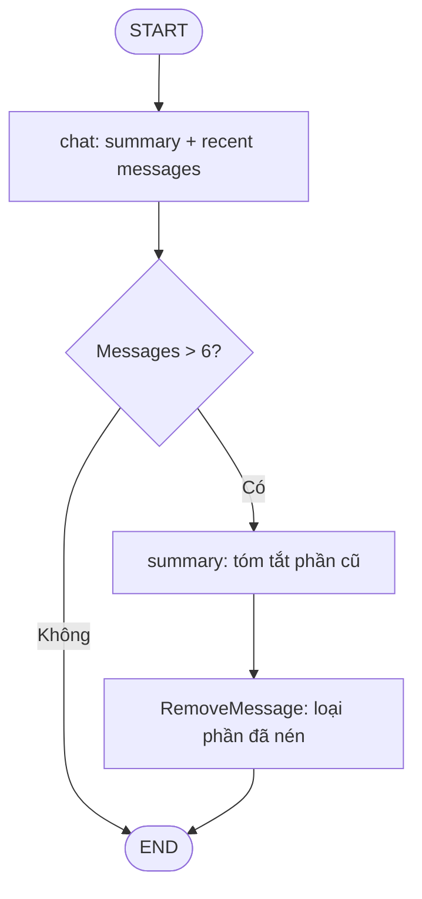

# Bài 11 — Rolling Summarization: nén hội thoại dài mà vẫn giữ ý quan trọng

## 1. Tóm tắt

Trimming chỉ giữ một số tin nhắn gần nhất nên có thể làm mất bối cảnh cũ; deletion xóa thông điệp khỏi state hiện hành. **Summarization** giải quyết bằng cách dùng LLM tạo bản tóm tắt của phần lịch sử cũ, giữ lại một số message gần nhất dưới dạng nguyên văn và cập nhật bản tóm tắt khi hội thoại tiếp tục. Cách cập nhật tích lũy được gọi là **rolling summarization**.

## 2. Mục tiêu học tập

- Mô tả khác biệt giữa trimming và summarization ở mức dữ liệu model nhìn thấy.
- Thiết kế state có `messages` và `summary`.
- Phân biệt lần tạo summary đầu tiên với lần cập nhật summary đã tồn tại.
- Lý giải vì sao phải xóa phần messages cũ sau khi đã tổng hợp.
- Xác định các rủi ro mất chi tiết, sai lệch ngữ nghĩa và tốn thêm inference.

## 3. Ví dụ từ lịch sử 500 messages

Giả sử ứng dụng quyết định giữ 100 messages mới nhất làm ngữ cảnh chi tiết. Với 500 messages tổng cộng:

```text
Messages 1..400  ───────► Summary A
Messages 401..500 ───────► Recent messages nguyên văn

Input LLM = [Summary A] + [401..500] + [câu hỏi mới]
```

Khi đến thêm 100 messages nữa, cần cập nhật summary cho **phần vừa trở thành cũ**, không chỉ tạo summary mới từ đầu:

```text
Summary A (1..400) + Messages mới cần nén (401..500)
    └──► Summary B (đại ý 1..500)
Recent messages mới (501..600) giữ nguyên
```

Đây là logic minh họa; giới hạn 100 không phải cấu hình mặc định của LangGraph. Trong workflow thực tế, ngưỡng có thể dựa trên số message hoặc token; lựa chọn token có thể phù hợp hơn vì độ dài message không đều.

## 4. Kiến trúc tổng quan



Như bài demo, ngưỡng `>6` và giữ `2` message cuối phục vụ việc nhìn thấy rõ chu kỳ tóm tắt. Không nên coi đây là giới hạn phù hợp cho chatbot thật, nhất là khi có nhiều tool calls hoặc câu trả lời dài.

## 5. Cấu trúc state

```python
from langgraph.graph import MessagesState

class ChatState(MessagesState):
    summary: str
```

`messages` tiếp tục dùng reducer để thêm/xóa thông điệp. `summary` là trường văn bản: mỗi lần node summarization cập nhật, bản mới thay bản cũ. Do đó cần phân biệt:

- **Chưa có summary:** tạo bản tóm tắt từ phần message cũ.
- **Đã có summary:** đưa summary hiện có cùng phần message mới cần nén vào model, yêu cầu cập nhật lại thành một bản summary nhất quán.

## 6. Những gì chat node phải nhìn thấy

Khi summary tồn tại, tạo một `SystemMessage` chứa bản tóm tắt, sau đó nối với các messages gần nhất. Nếu summary trống, dùng mỗi messages hiện có. Ví dụ:

```python
from langchain_core.messages import SystemMessage

def build_chat_input(state: ChatState):
    history = list(state['messages'])
    summary = state.get('summary', '')
    if summary:
        return [SystemMessage(content=f'Tóm tắt hội thoại trước đó: {summary}')] + history
    return history
```

Cách đưa summary vào `SystemMessage` là một thiết kế thông dụng trong demo, nhưng summary là nội dung từ hội thoại nên có thể chứa chỉ dẫn độc hại. Trong hệ thống thật, cần phân biệt chỉ dẫn do hệ thống cung cấp và văn bản được tổng hợp từ người dùng; không cho summary vượt quyền các chính sách an toàn.

## 7. Vì sao xóa messages sau tóm tắt?

Nếu vừa giữ đầy đủ 400 messages cũ vừa thêm summary của đúng 400 messages, context có thể bị trùng lặp và tiếp tục phình to. Vì vậy, sau khi đã cập nhật summary, node dùng `RemoveMessage` cho phần cũ, giữ nguyên messages gần nhất. Bản tóm tắt và hai messages cuối cùng tạo thành trạng thái **gọn hơn**.

Lưu ý: xóa message khỏi state hiện hành không bảo đảm xoá dữ liệu trong những checkpoint lịch sử/backup; việc xóa dữ liệu thật sự vì quyền riêng tư là workflow quản lý retention khác.

## 8. Trade-off và cách đánh giá

| Mục tiêu | Trimming | Summarization |
| --- | --- | --- |
| Giảm input context | Có | Có |
| Giữ ý chính lịch sử dài | Thấp nếu chỉ cắt gần nhất | Có thể giữ |
| Chi phí inference thêm | Không cần gọi summary model | Có |
| Sai lệch khi nén | Bỏ mất dữ kiện | Có thể làm sai/lược chi tiết |
| Tính giải thích | Dễ biết tin nào bị cắt | Cần kiểm tra summary chứa gì |

Dữ kiện như mã đặt hàng, con số, dị ứng, điều khoản hợp đồng hoặc yêu cầu chưa hoàn thành có thể cần cơ chế lưu có cấu trúc; summary không bảo đảm nguyên vẹn tuyệt đối. Cách đánh giá phù hợp là kiểm tra khả năng trả lời các câu hỏi dựa trên **thông tin xuất hiện trước khi summary**, không chỉ quan sát summary ngắn đi.

## 9. Thực hành phân tích

Tạo chuỗi 8 messages xoay quanh Vật lý lượng tử và Albert Einstein. Với ngưỡng `>6`, nhận diện đúng thời điểm tóm tắt được kích hoạt, phần nào được nén và 2 messages nào còn nguyên sau bước dọn state. Sau đó tạo tiếp 6 messages, phân tích trường hợp summary đang có cần được cập nhật thế nào.

## 10. Câu hỏi ôn tập

**Câu 1.** Summarization khác trimming ở đâu?  
A. Chỉ có trimming dùng LLM.  
B. Summarization tạo bản nén ngữ nghĩa cho lịch sử cũ.  
C. Trimming luôn xóa database.  
D. Summarization không cần state.  
**Đáp án: B.** Summary là bản đại diện thông tin, không chỉ cắt bỏ.

**Câu 2.** Vì sao cần cập nhật summary cũ thay vì luôn tạo mới?  
A. Để mất history cũ.  
B. Vì Docker yêu cầu thế.  
C. Vì summary mới cần mang tiếp thông tin đã được nén ở các vòng trước.  
D. Để bỏ thread_id.  
**Đáp án: C.** Rolling summary nối tiếp lịch sử đã tóm tắt.

**Câu 3.** Trường `summary` nên cập nhật thế nào?  
A. Ghi bản tóm tắt cập nhật thay cho bản cũ.  
B. Chỉ thêm một ký tự.  
C. Luôn đặt rỗng sau mỗi chat.  
D. Copy nguyên 10.000 messages vào summary.  
**Đáp án: A.** Đây là phần state biểu diễn đại ý hiện hành.

**Câu 4.** Tại sao không giữ cả messages đã tóm tắt trong state mãi?  
A. Vì không thể lưu text.  
B. Vì checkpointer cấm message cũ.  
C. Vì sẽ tự chia sẻ thread.  
D. Vì tạo trùng lặp và không giảm được kích thước history hiện hành.  
**Đáp án: D.** Cần thay thế phần cũ bằng bản nén.

**Câu 5.** Rủi ro quan trọng của summary?  
A. Không chạy được với Python.  
B. Có thể lược bỏ hoặc làm sai chi tiết quan trọng.  
C. Luôn làm mất API key.  
D. Luôn tạo nhiều thread.  
**Đáp án: B.** LLM summarization không bảo đảm bảo toàn tuyệt đối từng dữ kiện.

## 11. Tổng kết

Rolling summarization cho phép chatbot duy trì tính liên tục qua lịch sử dài, nhưng không thể thay thế một kho dữ kiện có cấu trúc khi yêu cầu độ chính xác và quản trị dữ liệu cao.
