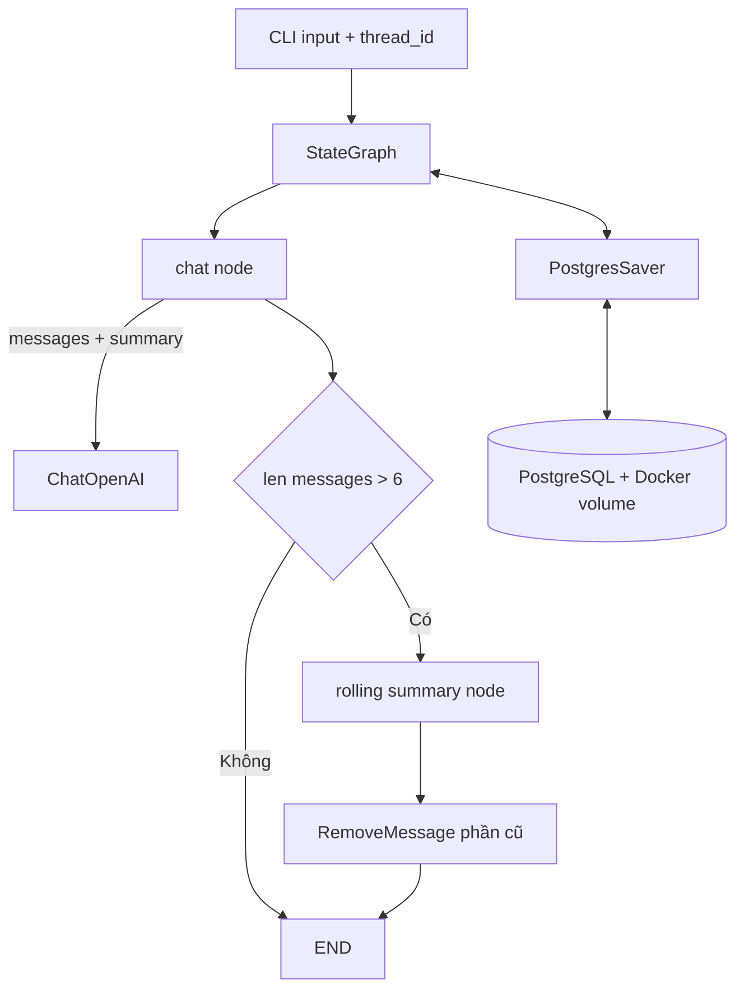

# Bài 13 — Dự án cuối khóa: Chatbot có memory bền vững và tự tóm tắt

## 1. Bài toán

Xây dựng một chatbot Python có thể trò chuyện tự nhiên nhiều lượt, nhớ ngữ cảnh **trong mỗi cuộc hội thoại**, giữ trạng thái sau khi backend restart và tự nén history dài. Dự án kết hợp `StateGraph`, `MessagesState`, `PostgresSaver`, `thread_id`, conditional edges, `RemoveMessage` và rolling summarization.

## 2. Mục tiêu sản phẩm

Ứng dụng dòng lệnh tối thiểu cần hỗ trợ:

1. Nhận `thread_id` của một hội thoại từ người vận hành.
2. Mở lại thread có sẵn từ PostgreSQL sau restart.
3. Trả lời dựa trên messages gần đây + summary cũ.
4. Chỉ tóm tắt khi số messages vượt ngưỡng demo `>6`, giữ 2 message mới nhất.
5. Xem được số messages hiện tại và summary; dùng thread khác không nhìn thấy history cũ.

**Phạm vi:** đây là project CLI thực hành, chưa phải sản phẩm multi-tenant có login, kiểm tra ownership, quan sát, retry, queue và bảo mật production đầy đủ.

## 3. Kiến trúc



## 4. Chuẩn bị

Tạo thư mục `memory-chatbot` gồm `.env`, `compose.yaml`, `app.py` và `.gitignore`. PostgreSQL theo Bài 05. `.gitignore`:

```gitignore
.env
.venv/
__pycache__/
```

Cài gói:

```bash
python -m pip install -U langgraph langchain-openai langgraph-checkpoint-postgres "psycopg[binary]" python-dotenv
```

## 5. Triển khai ứng dụng

Tạo `app.py`:

```python
import os
from dotenv import load_dotenv
from langchain_openai import ChatOpenAI
from langchain_core.messages import HumanMessage, SystemMessage, RemoveMessage
from langgraph.graph import StateGraph, MessagesState, START, END
from langgraph.checkpoint.postgres import PostgresSaver

load_dotenv()
llm = ChatOpenAI(model=os.environ['OPENAI_MODEL'], temperature=0)

class State(MessagesState):
    summary: str


def chat(state: State):
    history = list(state['messages'])
    context = state.get('summary', '')
    if context:
        history = [SystemMessage(content='Tóm tắt hội thoại trước (dữ liệu): '+context)] + history
    return {'messages': [llm.invoke(history)]}


def summarize(state: State):
    older = state['messages'][:-2]
    previous = state.get('summary', '')
    if not older:
        return {}
    instruction = 'Tóm tắt các sự kiện, sở thích, mục tiêu và việc còn dang dở. Không bịa.'
    if previous:
        instruction += '\nTóm tắt hiện tại:\n' + previous
        instruction += '\nCập nhật bản tóm tắt với các tin nhắn sau.'
    prompt = [SystemMessage(content=instruction)] + list(older)
    prompt += [HumanMessage(content='Trả lại bản tóm tắt mới ngắn gọn.')]
    new_summary = llm.invoke(prompt).content
    return {
        'summary': str(new_summary),
        'messages': [RemoveMessage(id=m.id) for m in older],
    }


def route(state: State):
    return 'summarize' if len(state['messages']) > 6 else 'end'


def make_graph(saver):
    builder = StateGraph(State)
    builder.add_node('chat', chat)
    builder.add_node('summarize', summarize)
    builder.add_edge(START, 'chat')
    builder.add_conditional_edges('chat', route, {
        'summarize': 'summarize',
        'end': END,
    })
    builder.add_edge('summarize', END)
    return builder.compile(checkpointer=saver)


def main():
    thread = input('Thread ID (ví dụ demo-01): ').strip()
    if not thread:
        raise ValueError('Cần thread ID')
    config = {'configurable': {'thread_id': thread}}
    with PostgresSaver.from_conn_string(os.environ['POSTGRES_URI']) as saver:
        saver.setup()
        graph = make_graph(saver)
        current = graph.get_state(config).values
        print('History đã lưu:', len(current.get('messages', [])), 'messages')
        print('Nhập /exit để thoát, /state để xem state.')
        while True:
            question = input('Bạn: ').strip()
            if question == '/exit':
                break
            if question == '/state':
                snap = graph.get_state(config).values
                print('Số messages:', len(snap.get('messages', [])))
                print('Summary:', snap.get('summary', ''))
                continue
            if not question:
                continue
            output = graph.invoke({'messages': [('user', question)]}, config)
            print('AI:', output['messages'][-1].content)

if __name__ == '__main__':
    main()
```

**Điểm thực hành:** mã thiết lập `.setup()` mỗi lần chạy cho tiện thử nghiệm; production nên chuyển migration/setup sang bước deploy và quản lý connection pool theo vòng đời server. Khi dùng một `thread_id` lần sau, state được nạp từ Postgres; nhập ID mới sẽ tạo hội thoại mới khi có tin nhắn đầu tiên.

## 6. Milestone

| Giai đoạn | Nhiệm vụ | Dấu hiệu hoàn thành |
| --- | --- | --- |
| 1 | Dựng Postgres | DB healthy, URI kết nối được |
| 2 | Graph + saver | Gọi 2 lượt cùng thread nhớ tên |
| 3 | Restart backend | Tiếp tục thread cũ, state không rỗng |
| 4 | Summary >6 | Sau 4 lượt có summary, state còn 2 tin |
| 5 | Thread isolation | Thread B không có lịch sử thread A |
| 6 | Quan sát | `/state` in summary và số messages |

## 7. Kiểm thử bắt buộc

- **Same-thread:** “Tôi tên Lan” rồi “Tên tôi?” ở cùng ID trước tóm tắt.
- **New-thread:** đổi ID, không thấy tên Lan trong history của thread mới.
- **Restart:** đóng `app.py`, chạy lại cùng ID và dùng `/state` kiểm tra summary/messages.
- **Summary:** gửi >6 messages, dùng `/state` xem summary có hình thành và số message thu gọn.
- **Context retention:** hỏi lại một thông tin xuất hiện trước bước summary; kiểm tra summary thực tế trước khi kết luận độ chính xác.
- **Privacy check:** không đưa API key hoặc URI chứa mật khẩu thật vào logs hay phần chia sẻ.

## 8. Vận hành production: những gì dự án chưa giải quyết

- Xác thực, phân quyền sở hữu hội thoại; `thread_id` không phải security boundary tự động.
- TLS database, quản lý secret, backup, retention policy và quy trình xóa dữ liệu.
- Connection pooling, async backend, giới hạn đồng thời trên cùng thread.
- Token budget chính xác cho mọi lần `chat` **và** cho lần gọi `summarize` (vì summary node cũng có context window).
- Khi data đặc biệt quan trọng, lưu facts ở cấu trúc riêng, không chỉ dưới dạng summary do LLM sinh.
- Theo dõi chi phí/tỉ lệ sai summary, kiểm thử prompt injection và chống đưa nội dung nguồn thành chỉ dẫn có quyền cao.

## 9. Deliverable và Definition of Done

Đầu ra gồm `app.py`, `compose.yaml`, `.gitignore`, `README.md` hướng dẫn chạy, và log 5 bài test (đã che thông tin bí mật). Được coi là hoàn thành khi cùng thread khôi phục sau restart; thread mới độc lập; summary được cập nhật; state không tăng vô hạn theo chính sách demo; mã chạy được trong môi trường có API credentials hợp lệ.

## 10. Câu hỏi ôn tập

**Câu 1.** Phần nào cho phép tiếp tục thread sau restart Python?  
A. `PostgresSaver` và đúng `thread_id`.  
B. `temperature=0`.  
C. `SystemMessage` duy nhất.  
D. `print()` mỗi lượt.  
**Đáp án: A.** Persistence gắn với đúng khóa thread.

**Câu 2.** Khi history mới vượt 6 messages, graph đi đâu?  
A. Tạo UUID mới.  
B. Xóa database.  
C. Node `summarize` trước khi END.  
D. Tắt LLM.  
**Đáp án: C.** Conditional edge quyết định kích hoạt summary.

**Câu 3.** Vì sao không cung cấp `thread_id` do client chọn tùy ý trong sản phẩm thật?  
A. Vì Postgres chỉ hỗ trợ một thread.  
B. Có nguy cơ truy cập dữ liệu người khác nếu thiếu phân quyền.  
C. Vì model quên tên.  
D. Vì không dùng được Docker.  
**Đáp án: B.** Backend phải gắn thread với người được xác thực.

**Câu 4.** `/state` hữu ích vì:  
A. Sinh ra model mới.  
B. Xóa toàn bộ history.  
C. Đổi server DB.  
D. Quan sát history/summary không phải thêm lượt gọi LLM.  
**Đáp án: D.** Đó là công cụ debug state.

**Câu 5.** Những gì không được xem là đã giải quyết chỉ vì demo chạy đúng?  
A. Privacy, secrets, scale và quản trị context dài ở production.  
B. Tạo một `StateGraph`.  
C. In câu trả lời.  
D. Truyền config.  
**Đáp án: A.** Prototype chức năng không đồng nghĩa đã bảo mật/scale.

## 11. Tổng kết

Dự án tích hợp toàn bộ kiến thức khóa học: state theo thread, lưu bền bằng Postgres và nén history có điều kiện. Mở rộng thành backend đa người dùng cần bổ sung các lớp an toàn, giám sát và quản trị dữ liệu.
