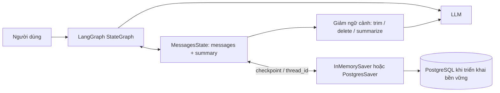

# Khóa học: Short-Term Memory trong LangGraph — từ RAM đến PostgreSQL và Summarization

> **Trình độ:** đã biết Python cơ bản và nguyên lý gọi chat LLM.  
> **Mục tiêu:** xây dựng chatbot LangGraph có hội thoại nhiều lượt, phân tách phiên, lưu trạng thái sau khi khởi động lại và kiểm soát lịch sử dài.  
> **Công nghệ:** Python, LangGraph, LangChain, ChatOpenAI, Docker Compose, PostgreSQL, Psycopg.  
> **Hình thức:** lý thuyết + demo + lab + dự án tổng kết.

## 1. Kết quả học tập

Hoàn tất khóa học, bạn có thể:

1. Giải thích chính xác vì sao mỗi lời gọi LLM là stateless và cách `messages` tạo ngữ cảnh hội thoại.
2. Xây `StateGraph(MessagesState)` và cấu hình `checkpointer` với `thread_id`.
3. Chứng minh hai cuộc hội thoại được cô lập và giải thích vì sao `InMemorySaver` mất dữ liệu khi tiến trình kết thúc.
4. Tạo PostgreSQL bằng Docker Compose; lưu và khôi phục state bằng `PostgresSaver`.
5. Đo ngân sách token; phân biệt trimming ở đầu vào LLM và deletion trong graph state.
6. Xây rolling summarization, kết hợp `summary` với những tin nhắn mới nhất, sử dụng `RemoveMessage` để dọn state.
7. Kiểm thử phiên, restart, giới hạn context và những tình huống mất dữ kiện quan trọng.

## 2. Lộ trình và cấu trúc thư mục

```text
Conversation Memory và cá nhân hóa/
├── README.md
├── 01_Nen_tang_Memory_va_LangGraph/
│   ├── 01_LLM_Stateless_va_Nguyen_ly_STM.md
│   └── 02_MessagesState_StateGraph_Checkpointer.md
├── 02_Short_Term_Memory_va_Threads/
│   ├── 03_InMemorySaver_Thuc_hanh.md
│   └── 04_Thread_ID_Co_lap_Hoi_thoai.md
├── 03_PostgreSQL_Persistence/
│   ├── 05_Docker_PostgreSQL.md
│   ├── 06_PostgresSaver.md
│   └── 07_Lab_Khoi_dong_lai.md
├── 04_Context_Window_Trimming_Deletion/
│   ├── 08_Context_Window_Token_Budget.md
│   ├── 09_Trimming.md
│   └── 10_Deletion_RemoveMessage.md
├── 05_Summarization/
│   ├── 11_Rolling_Summarization.md
│   └── 12_Lab_Summarization_Graph.md
└── 06_Lab_Du_an_va_Danh_gia/
    ├── 13_Du_an_Chatbot_Co_Memory.md
    └── 14_Kiem_thu_va_Trac_nghiem.md
```

## 3. Hướng dẫn học

Học theo số bài. Mỗi bài có mục tiêu, lý thuyết, ví dụ, lưu ý, thực hành và trắc nghiệm có đáp án. **Nên chạy ví dụ thật** vì khái niệm bộ nhớ chỉ rõ khi so sánh trạng thái trước/sau lời gọi và sau restart. Mẫu code chọn Python; tên mô hình được đọc từ biến môi trường `OPENAI_MODEL`, không gán một mã mô hình cố định, vì người học có thể sử dụng model tương thích mà tài khoản của mình được cấp quyền.

Ví dụ tối thiểu về cài đặt:

```bash
python -m venv .venv
# Windows PowerShell: .venv\Scripts\Activate.ps1
# macOS/Linux: source .venv/bin/activate
python -m pip install -U langgraph langchain-openai langchain-core python-dotenv
```

Tạo `.env` ở máy cá nhân, không commit lên Git:

```dotenv
OPENAI_API_KEY=thay_bang_api_key_cua_ban
OPENAI_MODEL=ten_model_ban_co_quyen_truy_cap
```

Các bài PostgreSQL dùng thêm `langgraph-checkpoint-postgres` và `psycopg[binary]`. Docker phải hoạt động trước khi chạy lab database.

## 4. Sơ đồ xuyên suốt khóa học



**Phân biệt trọng tâm:** checkpoint giúp *lưu được* trạng thái; trimming quyết định *LLM được xem* những gì; deletion thay đổi *trạng thái đang lưu*; summarization chuyển thông tin cũ thành dạng nén. Bốn công việc này liên quan nhau nhưng không đồng nghĩa.

## 5. Tài liệu và phạm vi

- Bài giảng gốc CampusX: [How To Implement Short Term Memory Using LangGraph](https://www.youtube.com/watch?v=FSBkTI1QuvY).
- [Mã nguồn thực hành CampusX](https://github.com/campusx-official/memory-in-llms), ưu tiên notebooks `1_stm.ipynb` đến `5_stm_summarization.ipynb` cho phần này.
- [LangGraph — Memory](https://docs.langchain.com/oss/python/langgraph/add-memory).
- [LangGraph — Checkpointers](https://docs.langchain.com/oss/python/langgraph/checkpointers).
- [LangChain — Short-term memory](https://docs.langchain.com/oss/python/langchain/short-term-memory).

Các bài học được biên soạn thành giáo trình độc lập; đoạn mã minh họa có thể không trùng 100% cách tổ chức notebook gốc. Mẫu bảo mật và kiểm thử bổ sung được ghi rõ như ứng dụng thực hành, không phải kết quả thực nghiệm được cam kết.

## 6. Lưu ý trước khi làm lab

- `.env` không đưa lên Drive/Git cùng khóa học.
- Lưu state vào Postgres **không** tự giải quyết chuyện context window vượt giới hạn.
- `thread_id` cần gắn với phiên đã được xác thực; người dùng không được tự do truy cập thread của người khác.
- Các ví dụ sử dụng mức ngân sách token nhỏ để nhìn thấy hiệu ứng, không phải giá trị production chuẩn.
