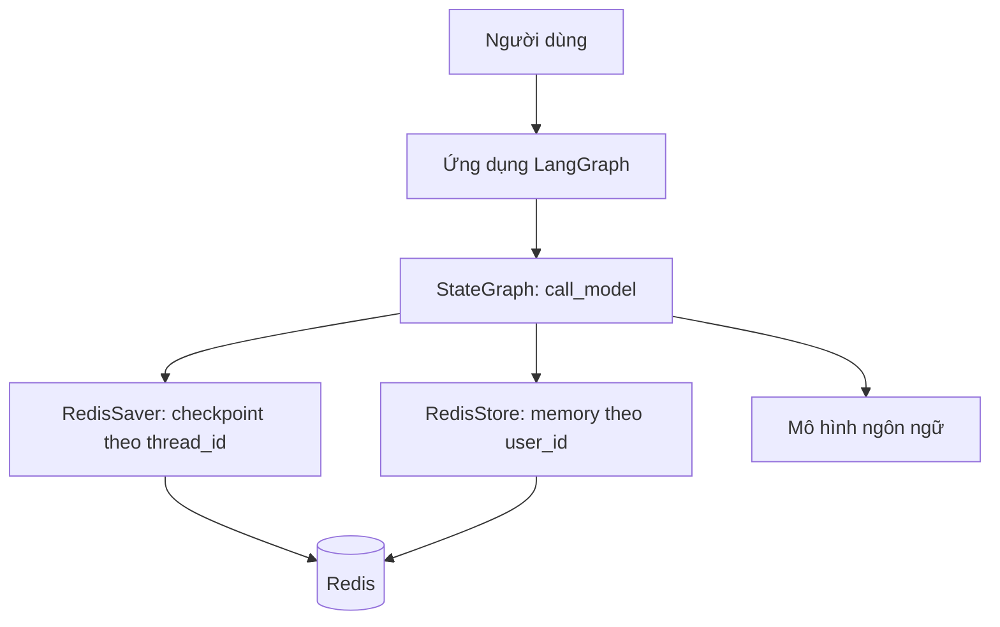

# Khóa học: Xây dựng AI Agent có bộ nhớ dài hạn với LangGraph và Redis

## 1. Tổng quan

Một AI Agent tốt không chỉ trả lời từng câu hỏi đơn lẻ. Nó còn có thể sử dụng những thông tin người dùng đã chia sẻ trong các lần trò chuyện trước để đưa ra phản hồi phù hợp ở lần tiếp theo. Khóa học này hướng dẫn xây dựng cơ chế **bộ nhớ liên cuộc trò chuyện (cross-thread long-term memory)** bằng **LangGraph** và **Redis**.

Ví dụ xuyên suốt: Thứ Hai, người dùng nói “Tôi tên Bob, tôi thích cà phê”. Thứ Tư, họ mở cuộc trò chuyện khác và hỏi “Tên tôi là gì?” hoặc “Gợi ý một món uống hợp sở thích”. Agent cần truy xuất thông tin đã lưu của **đúng người dùng**, không nhầm dữ liệu với tài khoản khác.

**Đối tượng:** Người đã biết Python cơ bản và muốn xây dựng chatbot/AI Agent có khả năng cá nhân hóa.

**Kiến thức đầu vào:** Python, biến môi trường, Docker cơ bản và khái niệm API của mô hình ngôn ngữ.

## 2. Kết quả học tập

Hoàn thành khóa học, người học có thể:

1. Phân biệt bộ nhớ ngắn hạn theo cuộc trò chuyện với bộ nhớ dài hạn theo người dùng.
2. Giải thích vai trò của `thread_id`, `user_id`, `RedisSaver`, `RedisStore` và `namespace`.
3. Khởi động Redis và khởi tạo các cấu trúc lưu trữ cần thiết.
4. Xây dựng `StateGraph` đơn giản có thể lưu và tái sử dụng thông tin.
5. Kiểm tra khả năng nhớ giữa nhiều cuộc trò chuyện và tính cách ly giữa người dùng.
6. Phân biệt lưu JSON với tìm kiếm ngữ nghĩa bằng embedding và chọn đúng cơ chế truy xuất.

## 3. Lộ trình học

| Thứ tự | Tài liệu | Trọng tâm | Sản phẩm học tập |
| --- | --- | --- | --- |
| 1 | [Bài 01 – Bản chất bộ nhớ dài hạn](01_BO_NHO_DAI_HAN_VA_DANH_TINH.md) | Vấn đề, `user_id` và `thread_id` | Thiết kế quy tắc định danh |
| 2 | [Bài 02 – Thiết lập Redis](02_CAI_DAT_REDIS_VA_PHU_THUOC.md) | Docker, Redis Stack, Python | Môi trường chạy được |
| 3 | [Bài 03 – Hai lớp lưu trữ](03_REDIS_STORE_VA_CHECKPOINTER.md) | Store, checkpointer, namespace, JSON/vector | Sơ đồ dữ liệu |
| 4 | [Bài 04 – Xây dựng Agent](04_XAY_DUNG_AGENT_LANGGRAPH.md) | Graph và ví dụ Python | Agent nhớ được thông tin giữa các thread |
| 5 | [Bài 05 – Kiểm thử và vận hành](05_KIEM_THU_VA_BAO_MAT.md) | Test, debug, an toàn dữ liệu | Bộ kiểm thử chức năng |
| 6 | [Bài 06 – Bài thực hành mở rộng](06_LAB_AGENT_NHO_SO_THICH.md) | Ghi nhớ sở thích và gợi ý phù hợp | Bài lab độc lập |

## 4. Kiến trúc tổng quát

**Cách đọc sơ đồ:** `RedisSaver` khôi phục trạng thái của một luồng cụ thể, còn `RedisStore` lưu các thông tin có thể đọc lại trong những luồng khác. LLM không tự ghi nhớ những thông tin này qua các phiên; ứng dụng chủ động đưa dữ liệu đã truy xuất vào ngữ cảnh trước khi gọi mô hình.

## 5. Quy ước thực hành

- `user_id` là định danh người dùng do hệ thống xác thực cung cấp; không lấy từ một chuỗi do người dùng tự khai trong prompt.
- `thread_id` là định danh cuộc trò chuyện; một người dùng có thể có nhiều `thread_id`.
- Ví dụ Python trong bài 04 sử dụng thao tác lưu dữ liệu rõ ràng bằng quy tắc đơn giản để dễ kiểm tra; đây chưa phải cơ chế tự động trích xuất mọi loại ký ức.
- Muốn tìm kiếm ngữ nghĩa, cần cấu hình embedding và chỉ mục tương ứng; việc lưu JSON không tự động đồng nghĩa với có tìm kiếm vector.
- Đối với ứng dụng thực tế, cần cơ chế đồng ý lưu, chỉnh sửa/xóa dữ liệu và kiểm soát truy cập.

## 6. Tài liệu đọc thêm

- [LangGraph – Stores](https://docs.langchain.com/oss/python/langgraph/persistence)
- [LangGraph – Long-term memory](https://docs.langchain.com/oss/python/langchain/long-term-memory)
- [Redis – langgraph-checkpoint-redis](https://redis-developer.github.io/langgraph-redis/main/index.html)

Đọc theo thứ tự từ bài 01 đến bài 05, sau đó thực hiện bài lab 06. Mỗi bài được viết để có thể mở riêng mà vẫn nắm được khái niệm thiết yếu.
