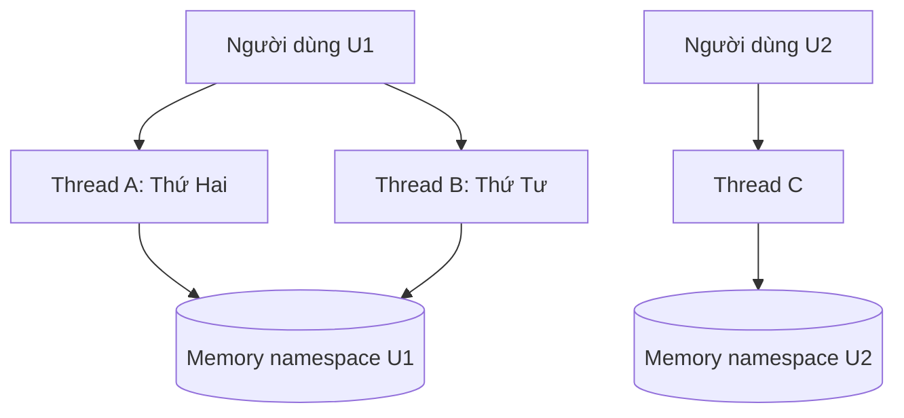
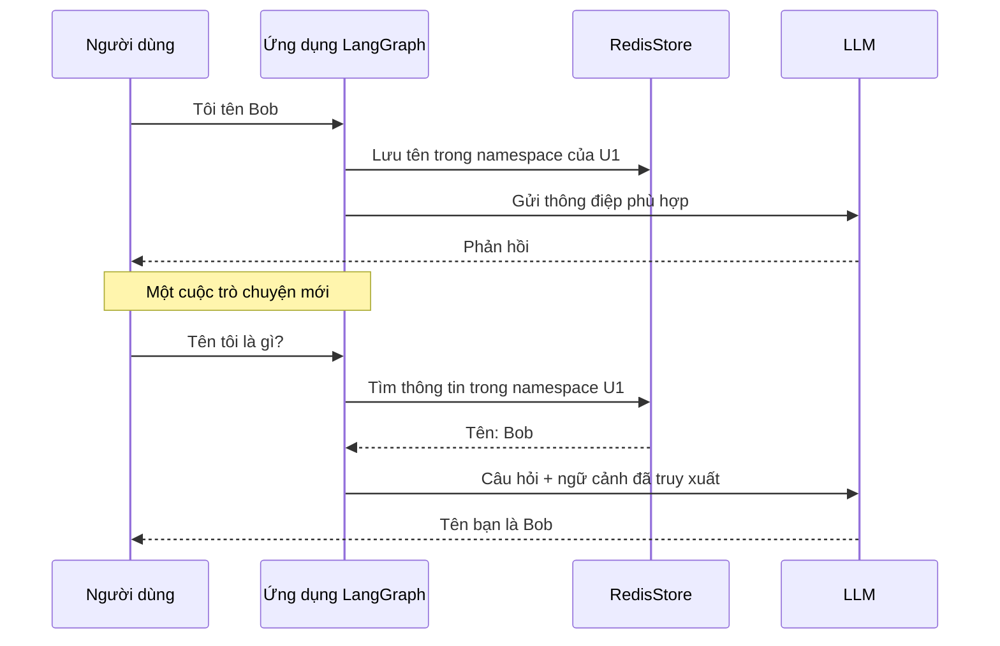

# Bài 01: Bộ nhớ dài hạn và định danh trong AI Agent

## 1. Tóm tắt

Một cuộc trò chuyện có thể kết thúc, nhưng sở thích, tên gọi hoặc một mục tiêu mà người dùng muốn theo đuổi vẫn còn giá trị ở lần tương tác sau. Để sử dụng được những thông tin này, ứng dụng AI phải **lưu có chủ đích**, **gắn với đúng người dùng** và **truy xuất lại khi cần**. Đó là nền tảng của bộ nhớ dài hạn trong AI Agent.

## 2. Mục tiêu học tập

Sau bài học, bạn có thể:

- Giải thích vì sao gửi toàn bộ lịch sử chat vào LLM không phải lúc nào cũng là cách quản lý trí nhớ tốt.
- Phân biệt trạng thái cuộc trò chuyện và ký ức tồn tại qua nhiều cuộc trò chuyện.
- Mô tả chính xác quan hệ giữa `user_id`, `thread_id` và dữ liệu ghi nhớ.
- Thiết kế tình huống kiểm thử không làm rò rỉ thông tin giữa các người dùng.

## 3. Bài toán: quay lại sau nhiều ngày

Hãy xét hai lượt tương tác:

**Thứ Hai – cuộc trò chuyện A:**

> Người dùng: “Tôi tên là Bob và tôi thích cà phê.”
>
> Agent: “Rất vui được trò chuyện với bạn, Bob.”

**Thứ Tư – cuộc trò chuyện B:**

> Người dùng: “Bạn còn nhớ tên tôi không?”
>
> Agent: “Tên bạn là Bob.”

Cuộc trò chuyện B không chứa lời giới thiệu tên. Vì vậy, để trả lời có căn cứ, ứng dụng phải truy xuất dữ liệu đã lưu ở cuộc trò chuyện A, xác nhận thuộc cùng một người dùng và đưa thông tin phù hợp vào lời gọi LLM.

Lưu ý: bản thân LLM không có trí nhớ bền vững tự động giữa những request API độc lập. Cảm giác “nhớ” đến từ kiến trúc hệ thống bao quanh mô hình.

## 4. Hai phạm vi bộ nhớ

| Tiêu chí | Bộ nhớ theo cuộc trò chuyện (short-term / thread state) | Bộ nhớ dài hạn (long-term / cross-thread) |
| --- | --- | --- |
| Phạm vi | Một `thread_id` | Một người dùng hoặc phạm vi được định nghĩa qua `namespace` |
| Nội dung điển hình | Lịch sử tin nhắn, trạng thái các bước xử lý | Tên, sở thích, thói quen, mục tiêu dài hạn |
| Thành phần LangGraph thường dùng | `checkpointer` | `store` |
| Khi đổi sang thread mới | Không mặc nhiên mang toàn bộ trạng thái cũ sang | Vẫn có thể truy xuất nếu cùng namespace |
| Mục đích | Tiếp tục quá trình đang diễn ra | Cá nhân hóa những tương tác về sau |

Hai loại bộ nhớ bổ sung cho nhau, chứ không thay thế nhau. Checkpoint giúp một cuộc trò chuyện tiếp diễn, trong khi store giúp thông tin liên quan tồn tại ngoài cuộc trò chuyện đã tạo ra nó.

## 5. Định danh người dùng và định danh cuộc trò chuyện

`user_id` xác định **ai** đang dùng ứng dụng. `thread_id` xác định **cuộc trò chuyện nào** đang chạy. Không được đồng nhất hai giá trị này.



Trong sơ đồ, thread A và B đọc chung bộ nhớ của U1. Thread C chỉ được phép dùng bộ nhớ của U2. Nếu U2 hỏi “Tên tôi là gì?”, ứng dụng không được lấy tên Bob từ vùng dữ liệu U1.

Ví dụ dữ liệu định danh:

```json
{
  "user_id": "user-001",
  "thread_id": "conversation-2026-10-26"
}
```

Khi mở cuộc trò chuyện mới, chỉ `thread_id` thay đổi:

```json
{
  "user_id": "user-001",
  "thread_id": "conversation-2026-10-28"
}
```

Một người dùng khác phải có `user_id` khác, cho dù nội dung câu hỏi giống hệt.

## 6. Luồng lưu và truy xuất ký ức



Có hai quyết định cần thiết trong một hệ thống thực tế. Thứ nhất, khi nào một chi tiết xứng đáng được lưu làm ký ức. Thứ hai, ký ức nào có liên quan đến câu hỏi hiện tại. Không nên mặc định lưu mọi lời nói, hoặc nhét toàn bộ dữ liệu người dùng vào mọi prompt.

## 7. Những lỗi tư duy thường gặp

**Nhầm 1: “LLM tự nhớ mọi hội thoại trước.”** Mô hình chỉ xử lý ngữ cảnh được cung cấp trong request hiện tại; hệ thống bên ngoài chịu trách nhiệm lưu và nạp dữ liệu.

**Nhầm 2: “Chỉ cần `thread_id` là đủ.”** Dùng một checkpoint của thread A không tạo ra cơ chế chia sẻ bộ nhớ thích hợp cho thread B.

**Nhầm 3: “Có Redis là không bị lộ dữ liệu.”** Redis chỉ lưu trữ theo cấu trúc ứng dụng yêu cầu. Nếu ứng dụng sử dụng nhầm namespace, dữ liệu vẫn có thể bị trả sai người.

**Nhầm 4: “Tên người dùng do prompt nhập vào là danh tính đã xác thực.”** Một prompt như “Tôi là user-002” không phải bằng chứng về quyền đọc dữ liệu của user-002.

## 8. Thực hành ngắn

Thiết kế ba bản ghi hội thoại: U1/A, U1/B, U2/C. Chọn một bộ nhớ cho U1 (ví dụ `favorite_drink = coffee`) và dự đoán kết quả ba truy vấn: U1/A hỏi lại sở thích, U1/B hỏi lại sở thích, U2/C hỏi lại sở thích. Đánh dấu trường hợp có thể truy xuất và trường hợp phải trả lời chưa biết.

## 9. Câu hỏi ôn tập

**Câu 1.** Một người dùng tạo thread mới nhưng muốn agent vẫn biết sở thích đã lưu. Thành phần nào phù hợp nhất?

A. `RedisStore` theo namespace của người dùng.  
B. Một `thread_id` ngẫu nhiên không liên quan.  
C. Bỏ qua hoàn toàn cơ sở dữ liệu.  
D. Chỉ tăng giới hạn token của mô hình.

**Đáp án:** A. **Giải thích:** Store cung cấp dữ liệu vượt phạm vi một thread.

**Câu 2.** Giá trị nào cần giữ nguyên khi cùng một người dùng bắt đầu cuộc trò chuyện mới?

A. Nội dung câu trả lời cuối.  
B. `thread_id`.  
C. `user_id`.  
D. ID của người dùng khác.

**Đáp án:** C. **Giải thích:** `user_id` gắn với người dùng; `thread_id` gắn với từng cuộc trò chuyện.

**Câu 3.** Vì sao không nên dùng `user_id` do prompt tự khai để phân quyền?

A. Vì Redis không lưu được chuỗi.  
B. Vì prompt không phải bằng chứng xác thực danh tính.  
C. Vì LangGraph không hỗ trợ định danh.  
D. Vì LLM chỉ xử lý số nguyên.

**Đáp án:** B. **Giải thích:** Phải dựa vào phiên đăng nhập hoặc hệ thống xác thực đáng tin cậy.

**Câu 4.** Checkpointer chủ yếu giúp gì?

A. Mã hóa tất cả mật khẩu.  
B. Huấn luyện lại LLM.  
C. Phân loại văn bản tự động.  
D. Lưu và khôi phục trạng thái thực thi của một thread.

**Đáp án:** D. **Giải thích:** Checkpoint bảo toàn tiến trình và state của graph theo luồng.

**Câu 5.** Khi U2 hỏi tên của mình nhưng chưa cung cấp tên, agent nên làm gì?

A. Trả tên của U1 vì câu hỏi giống nhau.  
B. Đoán một tên phổ biến.  
C. Cho biết chưa có thông tin của U2 và đề nghị cung cấp tên.  
D. Truy xuất toàn bộ dữ liệu trong Redis.

**Đáp án:** C. **Giải thích:** Truy xuất phải giới hạn trong vùng nhớ của U2 và không được suy diễn danh tính.

## 10. Tổng kết

Bộ nhớ dài hạn của AI Agent là một cơ chế ứng dụng: chọn thông tin cần nhớ, lưu dưới danh tính phù hợp, truy xuất ở những lần tương tác tiếp theo và cung cấp cho LLM. Nền tảng an toàn của thiết kế là **phân biệt `user_id` với `thread_id`**.
