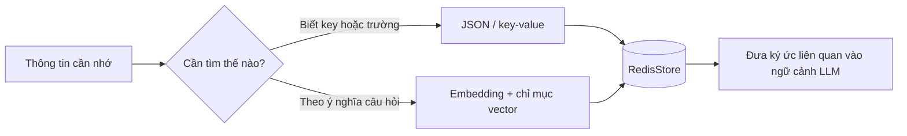

# Bài 03: RedisStore, RedisSaver và cơ chế truy xuất bộ nhớ

## 1. Tóm tắt

LangGraph có hai lớp lưu trữ thường được kết hợp: **checkpointer** để ghi lại trạng thái của từng luồng thực thi và **store** để giữ thông tin mà nhiều luồng có thể cùng sử dụng. Khi gắn cả hai vào graph, agent có thể vừa duy trì mạch hội thoại hiện tại vừa truy xuất thông tin từ những lần tương tác cũ.

## 2. Mục tiêu học tập

- Phân biệt dữ liệu checkpoint với dữ liệu memory.
- Mô tả ý nghĩa của `namespace`, `key`, `value` và `thread_id`.
- Sử dụng `store.put`, `store.get` và `store.search` cho các trường hợp phù hợp.
- Giải thích khi nào cần embedding và khi nào chỉ cần truy xuất JSON theo key.

## 3. Checkpoint: lưu trạng thái một cuộc trò chuyện

Trong một graph, **state** có thể chứa danh sách thông điệp và dữ liệu trung gian. `RedisSaver` ghi lại trạng thái liên quan đến một `thread_id`, giúp khôi phục hoặc tiếp tục quá trình xử lý trong cùng luồng.

Ví dụ:

```python
from langgraph.checkpoint.redis import RedisSaver

with RedisSaver.from_conn_string("redis://localhost:6379") as saver:
    saver.setup()
    graph = builder.compile(checkpointer=saver)

    config = {"configurable": {"thread_id": "thread-A"}}
    # graph.invoke(input_state, config=config)
```

Ở đây `builder` đại diện cho một graph đã được định nghĩa. Khi gọi với `thread-A`, trạng thái được quản lý trong phạm vi thread đó. Tạo `thread-B` không có nghĩa lịch sử của `thread-A` được chuyển sang `thread-B`.

## 4. Store: lưu dữ liệu có thể dùng ở nhiều thread

`RedisStore` hỗ trợ tổ chức dữ liệu thành các mục dưới một `namespace`. Một mục có thể hình dung như sau:

```text
namespace: ("user-001", "memories")
key:       "favorite_drink"
value:     {"value": "cà phê", "type": "preference"}
```

Ví dụ thao tác:

```python
from langgraph.store.redis import RedisStore

with RedisStore.from_conn_string("redis://localhost:6379") as store:
    store.setup()
    ns = ("user-001", "memories")

    store.put(ns, "favorite_drink", {
        "value": "cà phê", "type": "preference"
    })

    item = store.get(ns, "favorite_drink")
    print(item.value if item else "Chưa có dữ liệu")

    items = store.search(ns, limit=10)
    for memory in items:
        print(memory.key, memory.value)
```

`get` phù hợp khi biết trước key. `search` không có `query` có thể dùng để liệt kê các mục trong namespace phù hợp (có giới hạn kết quả). Không nên nhầm việc liệt kê này với tìm kiếm semantic.

## 5. JSON và embedding: hai cách lưu, hai cách tìm

**JSON/key–value** phù hợp với dữ liệu có cấu trúc rõ: `name`, `preferred_language`, `favorite_drink`. Ví dụ, truy vấn `get(namespace, "name")` lấy đúng trường đã biết. Trường hợp này không bắt buộc dùng embedding.

**Embedding/vector search** có ích khi truy vấn được diễn đạt theo nhiều cách khác nhau. Chẳng hạn câu hỏi “Mình nên gọi đồ uống gì nhỉ?” có thể liên quan tới ký ức “Tôi thích cà phê” ngay cả khi câu hỏi không chứa từ “cà phê”. Để làm được điều này, cần mô hình embedding, cấu hình index/vector tương thích và gọi tìm kiếm với `query`.



Điểm cốt lõi: **tạo `RedisStore` không tự động bảo đảm mọi trường dữ liệu đã có vector embedding**. Cần thiết lập cấu hình lập chỉ mục phù hợp theo phiên bản thư viện, mô hình embedding và schema của ứng dụng.

## 6. Kết hợp checkpoint và store trong graph

```python
from langgraph.checkpoint.redis import RedisSaver
from langgraph.store.redis import RedisStore

url = "redis://localhost:6379"

with RedisSaver.from_conn_string(url) as saver:
    saver.setup()
    with RedisStore.from_conn_string(url) as store:
        store.setup()
        graph = builder.compile(checkpointer=saver, store=store)
        # Chạy graph trong phạm vi các kết nối còn mở.
```

Khi `compile` nhận cả `checkpointer` và `store`, các node có thể truy cập dữ liệu dài hạn qua cơ chế của LangGraph, trong khi state của thread được checkpoint. Tuy nhiên, **graph không tự biết dữ liệu nào cần lưu hay cần đọc**: logic đó phải được xây dựng trong node, middleware hoặc tool.

## 7. Thiết kế namespace an toàn

Một namespace đơn giản là `(user_id, "memories")`. Trong ứng dụng nhiều tổ chức có thể dùng `(tenant_id, user_id, "memories")` để tăng khả năng phân vùng logic. Ở cả hai trường hợp, danh tính phải đến từ kết quả xác thực của backend.

Ngoài phân vùng, cần cân nhắc: quyền đọc/ghi, yêu cầu xóa dữ liệu, thời hạn lưu (TTL nếu có), log kiểm toán và tránh lưu thông tin nhạy cảm không cần thiết. Namespace là công cụ tổ chức dữ liệu, **không tự thay thế hệ thống phân quyền**.

## 8. Thực hành ngắn

Tạo hai namespace `("U1", "memories")` và `("U2", "memories")`, mỗi vùng đều có key `"name"` nhưng giá trị khác nhau. Thử `store.get` trong từng vùng để chứng minh key giống nhau không làm các mục dữ liệu bị nhập làm một. Sau đó thử `store.search` với `limit=10` và giải thích sự khác biệt với truy vấn embedding.

## 9. Câu hỏi ôn tập

**Câu 1.** Dữ liệu nào thích hợp nhất để lưu bằng `RedisSaver`?

A. Danh mục đồ ăn toàn hệ thống.  
B. Trạng thái của graph trong `thread-A`.  
C. Cấu hình Docker Compose.  
D. Khóa API công khai.

**Đáp án:** B. **Giải thích:** Checkpointer dùng để ghi lại state/tiến trình theo thread.

**Câu 2.** Để đọc chính xác mục `"name"` đã biết key, nên chọn thao tác nào?

A. `store.get(namespace, "name")`  
B. `docker compose down`  
C. `graph.add_edge`  
D. Chỉ chạy embedding.

**Đáp án:** A. **Giải thích:** Key–value lookup là cách trực tiếp và xác định được mục cần lấy.

**Câu 3.** Kết luận nào đúng về tìm kiếm semantic?

A. Mọi JSON tự có vector search.  
B. Chỉ cần đổi `thread_id` là có embedding.  
C. Không cần index hoặc embedding.  
D. Cần cấu hình embedding và chỉ mục truy xuất thích hợp.

**Đáp án:** D. **Giải thích:** Tìm kiếm semantic phụ thuộc cơ chế vector, không chỉ việc lưu JSON.

**Câu 4.** Hai người dùng cùng có key `"name"` nhưng namespace khác nhau sẽ thế nào?

A. Bị gộp thành một trường.  
B. Tự động chia sẻ giá trị.  
C. Là hai mục được phân vùng logic theo namespace.  
D. Redis sẽ xóa một trong hai.

**Đáp án:** C. **Giải thích:** Namespace cùng key tạo địa chỉ lưu trữ riêng.

**Câu 5.** Khi truyền cả `checkpointer` và `store` vào `compile`, ứng dụng có tự động biết dữ liệu nào là ký ức quan trọng không?

A. Có, không cần logic khác.  
B. Không; cần xây dựng logic lựa chọn, ghi và truy xuất.  
C. Có, với mọi loại LLM.  
D. Chỉ khi không có `user_id`.

**Đáp án:** B. **Giải thích:** Hai backend cung cấp hạ tầng; hành vi ghi nhớ phải do ứng dụng thiết kế.

## 10. Tổng kết

`RedisSaver` lưu **trạng thái theo thread**; `RedisStore` lưu **thông tin có thể dùng xuyên thread**. JSON/key–value và embedding/vector search giải quyết các nhu cầu truy xuất khác nhau. Lựa chọn phù hợp giúp agent nhớ đúng, nhanh và tránh bơm quá nhiều dữ liệu không liên quan vào prompt.
