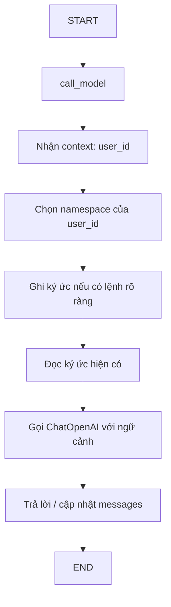

# Bài 04: Xây dựng AI Agent ghi nhớ thông tin qua nhiều cuộc trò chuyện

## 1. Tóm tắt

Bài này triển khai một `StateGraph` có một node `call_model`. Mỗi lần nhận tin nhắn, node truy cập vùng nhớ riêng của người dùng, ghi lại một số thông tin được cung cấp rõ ràng, lấy các ký ức đã lưu và đưa vào ngữ cảnh của mô hình. `RedisSaver` đồng thời quản lý trạng thái của từng cuộc trò chuyện.

## 2. Mục tiêu học tập

- Khai báo một graph tối giản với `MessagesState`.
- Truyền danh tính người dùng vào graph qua context và định danh hội thoại qua `thread_id`.
- Lưu/đọc các sự kiện đơn giản bằng `RedisStore`.
- Kiểm chứng ký ức được dùng lại giữa hai thread khác nhau của cùng người dùng.

## 3. Kiến trúc xử lý một tin nhắn



Node `call_model` được gắn vào graph như một bước điều phối. Redis không tự động gợi ý ký ức đúng lúc; chính node xác định nguồn dữ liệu và cách sử dụng nó. Ví dụ dùng trích xuất theo mẫu để bảo đảm dễ thực hiện và dễ kiểm chứng, thay vì tuyên bố LLM có thể nhớ mọi dữ kiện tự động.

## 4. Cài đặt và cấu hình

Cần chạy Redis và cài:

```bash
python -m pip install langgraph langgraph-checkpoint-redis langchain-openai
```

Thiết lập biến môi trường `OPENAI_API_KEY` và `OPENAI_MODEL` bằng tên model chat tài khoản cho phép. Chạy mã sau trong một file Python hoặc notebook (giữ context manager mở trong khi invoke).

## 5. Ví dụ Python hoàn chỉnh

```python
import os
import re
from dataclasses import dataclass

from langchain_core.messages import SystemMessage
from langchain_openai import ChatOpenAI
from langgraph.checkpoint.redis import RedisSaver
from langgraph.graph import END, START, MessagesState, StateGraph
from langgraph.runtime import Runtime
from langgraph.store.redis import RedisStore


REDIS_URL = os.getenv("REDIS_URL", "redis://localhost:6379")
model = ChatOpenAI(model=os.environ["OPENAI_MODEL"])


@dataclass
class UserContext:
    user_id: str


def call_model(state: MessagesState, runtime: Runtime[UserContext]):
    user_id = runtime.context.user_id
    namespace = (user_id, "memories")
    store = runtime.store

    # Demo: chủ động ghi một dữ kiện theo mẫu cú pháp rõ ràng.
    latest = state["messages"][-1].content
    if isinstance(latest, str):
        match = re.search(
            r"(?:tôi tên là|mình tên là|tên tôi là)\s+([^\n.!?]+)",
            latest,
            flags=re.IGNORECASE,
        )
        if match:
            store.put(namespace, "name", {
                "kind": "name", "value": match.group(1).strip()
            })

    # Đọc các mục ghi nhớ của CHÍNH người dùng này.
    saved = store.search(namespace, limit=20)
    memories = "\n".join(
        f"- {item.value.get('kind')}: {item.value.get('value')}"
        for item in saved
    ) or "Chưa lưu thông tin nào."

    instruction = (
        "Bạn là trợ lý hữu ích. Thông tin ghi nhớ đã được ứng dụng "
        "đọc từ dữ liệu của người dùng hiện tại. Chỉ dùng khi liên quan; "
        "không bịa dữ liệu chưa có.\n"
        f"Thông tin ghi nhớ:\n{memories}"
    )
    reply = model.invoke([
        SystemMessage(content=instruction),
        *state["messages"],
    ])
    return {"messages": [reply]}


builder = StateGraph(MessagesState, context_schema=UserContext)
builder.add_node("call_model", call_model)
builder.add_edge(START, "call_model")
builder.add_edge("call_model", END)


with RedisSaver.from_conn_string(REDIS_URL) as saver:
    saver.setup()
    with RedisStore.from_conn_string(REDIS_URL) as store:
        store.setup()
        graph = builder.compile(checkpointer=saver, store=store)

        def ask(user_id: str, thread_id: str, text: str) -> str:
            # Trong sản phẩm thực, user_id PHẢI do backend xác thực cấp.
            response = graph.invoke(
                {"messages": [{"role": "user", "content": text}]},
                config={"configurable": {"thread_id": thread_id}},
                context=UserContext(user_id=user_id),
            )
            return response["messages"][-1].content

        print(ask("user-001", "thread-A", "Tôi tên là Bob."))
        print(ask("user-001", "thread-B", "Tên tôi là gì?"))
        print(ask("user-002", "thread-C", "Tên tôi là gì?"))
```

**Phạm vi của ví dụ:** Đây là một triển khai có chủ đích tối giản. Nó chỉ nhận diện một số mẫu khai báo tên; không tự học toàn bộ sở thích, không tự phân loại mọi câu hỏi và không có semantic search. `store.search` ở đây được gọi **không có `query`** nhằm lấy các mục đã lưu, không phải truy vấn bằng embedding. Nếu dữ liệu nhiều hơn giới hạn `limit=20`, cần phân trang hoặc truy xuất có chọn lọc.

## 6. Giải thích các phần quan trọng

### 6.1. `MessagesState`

`MessagesState` giữ danh sách thông điệp của cuộc trò chuyện. Khi graph được gọi thêm lần nữa trong cùng `thread_id`, checkpoint giúp phục hồi ngữ cảnh của luồng đó. Khi đổi thread, graph có thể bắt đầu với lịch sử riêng mà vẫn tìm được ký ức trong RedisStore.

### 6.2. `UserContext` và `namespace`

`UserContext(user_id=...)` được truyền vào mỗi lượt gọi. Node tạo `namespace = (user_id, "memories")`, nhờ vậy hai thread của cùng một người dùng cùng đọc một vùng nhớ. Trong dịch vụ thật, ID này phải được ánh xạ từ session/token đã xác thực, không được để người gọi tùy ý chọn ID của người khác.

### 6.3. `store.put` và `store.search`

Quy tắc trong demo thấy câu “Tôi tên là Bob” thì lưu `{"kind":"name","value":"Bob"}` dưới key `name`. Khi thread mới đặt câu hỏi, `store.search(namespace, limit=20)` đọc lại bản ghi đó. Cần phân biệt hành vi này với *trích xuất ký ức tự động bằng LLM*, vốn đòi hỏi thêm chính sách lựa chọn và xác minh dữ kiện.

### 6.4. Cung cấp thông tin cho LLM

`SystemMessage` mang các ký ức mà ứng dụng đã đọc từ store. LLM trả lời dựa trên câu hỏi hiện tại và ngữ cảnh này; nếu không có dữ liệu tên của người dùng hiện tại, mô hình được chỉ dẫn không đoán mò.

## 7. Kết quả kiểm thử mong đợi

| Lượt | Người dùng | Thread | Đầu vào | Kỳ vọng |
| --- | --- | --- | --- | --- |
| 1 | `user-001` | `thread-A` | Tôi tên là Bob. | Lưu tên Bob |
| 2 | `user-001` | `thread-B` | Tên tôi là gì? | Trả lời Bob dựa trên memory |
| 3 | `user-002` | `thread-C` | Tên tôi là gì? | Không sử dụng tên Bob |

Đầu ra ngôn ngữ cụ thể có thể khác nhau giữa các model hoặc lần chạy. Điều cần kiểm thử là **tính đúng của việc đọc ký ức và phân vùng theo danh tính**, không phải sự trùng khớp tuyệt đối về câu chữ.

## 8. Lỗi thường gặp

- **Chỉ truyền `checkpointer` mà quên `store`:** graph vẫn có state theo thread nhưng không có backend ký ức dùng xuyên thread.
- **Đổi cả `user_id` khi tạo thread mới:** ứng dụng truy vấn namespace khác nên không tìm thấy dữ liệu trước đó.
- **Để mọi tài khoản dùng một namespace chung:** dẫn tới nguy cơ lộ dữ liệu giữa người dùng.
- **Đóng Redis context manager quá sớm:** graph có thể sử dụng kết nối đã đóng.
- **Kỳ vọng trích xuất tự động sở thích từ mã demo:** ví dụ chỉ có quy tắc lưu tên; muốn lưu sở thích phải thiết kế thêm logic tương ứng.

## 9. Câu hỏi ôn tập

**Câu 1.** Trong ví dụ, điều gì giúp thread B lấy lại tên đã lưu ở thread A?

A. Hai thread có cùng tên.  
B. Dùng cùng giá trị `user_id` để tạo namespace.  
C. Mô hình được huấn luyện lại.  
D. Bỏ qua Redis.

**Đáp án:** B. **Giải thích:** Hai thread truy vấn cùng vùng nhớ dài hạn của một user.

**Câu 2.** Node có được trang bị `store` nhưng không viết logic đọc dữ liệu thì điều gì xảy ra?

A. Không có cơ chế tự động bảo đảm ký ức được đưa vào prompt.  
B. Redis tự đẩy toàn bộ JSON vào model.  
C. Checkpointer tự chuyển mọi checkpoint thành sở thích.  
D. Mọi `user_id` tự biến thành một giá trị.

**Đáp án:** A. **Giải thích:** Việc chọn và nạp ký ức là trách nhiệm logic của agent.

**Câu 3.** Trong demo, `store.search(namespace, limit=20)` làm gì?

A. Luôn tạo embedding trước khi tìm.  
B. Xóa các ký ức cũ.  
C. Trả về các mục dưới namespace phù hợp trong giới hạn cho phép.  
D. Thay thế `model.invoke`.

**Đáp án:** C. **Giải thích:** Không truyền `query` thì đây không phải truy vấn semantic.

**Câu 4.** Vì sao mã cần `context=UserContext(user_id=...)`?

A. Để bật GPU.  
B. Để thay đổi Docker image.  
C. Để tạo API key.  
D. Để node biết danh tính người dùng khi chọn namespace.

**Đáp án:** D. **Giải thích:** Context mang thông tin dùng để xác định vùng nhớ cần truy xuất.

**Câu 5.** Khả năng nào không được triển khai trong ví dụ hoàn chỉnh?

A. Sử dụng checkpoint theo `thread_id`.  
B. Tự động hiểu và ghi nhớ mọi loại sở thích nhờ semantic extraction.  
C. Lưu tên theo namespace.  
D. Gọi LLM bằng `ChatOpenAI`.

**Đáp án:** B. **Giải thích:** Ví dụ chỉ trích xuất tên bằng biểu thức chính quy để minh họa rõ đường đi dữ liệu.

## 10. Tổng kết

Một agent có thể “nhớ” giữa các cuộc trò chuyện nhờ kết hợp **graph**, **checkpoint theo thread**, **store theo user** và **logic truy xuất có chủ đích**. Hành vi ghi nhớ cần được kiểm thử trong cả trường hợp cùng người dùng và khác người dùng.
