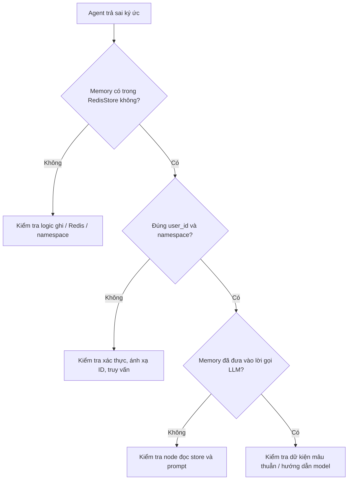

# Bài 05: Kiểm thử bộ nhớ đa cuộc trò chuyện và bảo vệ dữ liệu người dùng

## 1. Tóm tắt

Một AI Agent có trí nhớ dài hạn chỉ đáng tin khi nhớ **đúng thông tin**, **đúng người dùng** và **đúng bối cảnh**. Kiểm thử không thể dừng ở tình huống agent trả lời được tên Bob; cần có cả phép thử âm để bảo đảm người dùng khác không được nhìn thấy dữ liệu của Bob.

## 2. Mục tiêu học tập

- Xây dựng ma trận kiểm thử gồm nhiều `user_id` và `thread_id`.
- Phân biệt lỗi truy xuất ký ức với lỗi diễn đạt của LLM.
- Kiểm tra nội dung lưu trữ trực tiếp bằng API của RedisStore.
- Nhận diện những yêu cầu bảo mật và quản trị dữ liệu trước khi đưa hệ thống vào sản phẩm thật.

## 3. Bộ kiểm thử chức năng tối thiểu

| Ca | Bước chuẩn bị | Hành động | Kết quả kỳ vọng |
| --- | --- | --- | --- |
| T1 – Ghi nhớ trong cùng thread | U1/A nói “Tôi tên Bob” | U1/A hỏi tên | Trả Bob |
| T2 – Nhớ xuyên thread | Đã chạy T1 | U1/B hỏi tên | Trả Bob |
| T3 – Không rò rỉ sang user khác | Đã chạy T1 | U2/C hỏi tên | Không trả Bob |
| T4 – Hai user cùng trường | U1 tên Bob, U2 tên Alice | Mỗi user hỏi tên ở thread mới | Mỗi người nhận tên của mình |
| T5 – Cập nhật dữ kiện | U1 đổi tên hiển thị thành Robert | U1/B hỏi lại tên | Trả giá trị mới theo chính sách cập nhật |
| T6 – Khởi động lại ứng dụng | Đã ghi bộ nhớ vào Redis | Khởi động lại tiến trình Python và truy vấn | Truy xuất được khi Redis vẫn giữ dữ liệu |

**Phép thử âm T3 là bắt buộc:** một bài demo thành công ở T2 nhưng thất bại ở T3 không chứng minh hệ thống an toàn. Không chia sẻ `namespace` chung cho nhiều tài khoản.

## 4. Kiểm tra trực tiếp dữ liệu RedisStore

Để phân biệt “dữ liệu không lưu” với “mô hình không dùng dữ liệu”, trước hết đọc thẳng từ store:

```python
from langgraph.store.redis import RedisStore

with RedisStore.from_conn_string("redis://localhost:6379") as store:
    store.setup()
    for user_id in ("user-001", "user-002"):
        namespace = (user_id, "memories")
        records = store.search(namespace, limit=20)
        print(user_id, [(x.key, x.value) for x in records])
```

Nếu dữ liệu U1 xuất hiện trong truy vấn namespace U2, trước hết phải kiểm tra logic namespace, thao tác ghi và nguồn định danh. Nếu namespace đúng nhưng LLM trả sai, kiểm tra nội dung prompt, độ phù hợp ký ức và cách mô hình xử lý ngữ cảnh.

## 5. Quy trình gỡ lỗi



Sơ đồ đề xuất kiểm tra từ **lớp dữ liệu** đến **lớp sinh câu trả lời**, vì việc sửa prompt không khắc phục được lỗi ghi sai hoặc lấy nhầm dữ liệu.

## 6. Những rủi ro cần quản trị

**Xác thực và phân quyền:** Ở backend, `user_id` nên được tạo từ tài khoản hoặc token đã xác minh. Không dựa vào câu “Tôi là Alice” trong nội dung chat để cho phép đọc namespace của Alice.

**Thông tin nhạy cảm:** Không mặc định lưu mọi câu nói. Chỉ lưu dữ kiện có mục đích rõ ràng, hạn chế thu thập nội dung không cần thiết và tránh đặt khóa bí mật trong bộ nhớ của agent.

**Chỉnh sửa và xóa:** Người dùng có thể thay đổi sở thích; ứng dụng cần có đường cập nhật dữ liệu và cơ chế xóa theo yêu cầu. Ký ức cũ không nên vô thời hạn ghi đè thông tin mới.

**Vòng đời dữ liệu:** Có thể áp dụng retention policy và TTL tương ứng. TTL của thư viện Redis được cấu hình theo đơn vị phút khi dùng tùy chọn `default_ttl`; không được nhầm với giây. Cấu hình TTL phải nhất quán với yêu cầu nghiệp vụ, không thiết lập tùy tiện khiến bộ nhớ mất trước khi cần dùng.

**Prompt injection từ memory:** Bản ghi lưu trữ có thể chứa văn bản do người dùng nhập, không phải chỉ thị cấp hệ thống đáng tin cậy. Hãy coi nó là dữ liệu, không cho phép nội dung memory vượt qua quy tắc phân quyền hay chính sách của ứng dụng.

**Giới hạn lưu trữ:** Không đưa mọi mục memory vào prompt. Khi dữ liệu tăng, nên có giới hạn, tìm kiếm theo điều kiện hoặc semantic retrieval và chiến lược phân giải dữ liệu mâu thuẫn.

## 7. Bài tập thực hành

Tạo hai tài khoản giả lập U1 và U2, mỗi tài khoản có ít nhất hai thread. Lưu tên và một sở thích riêng cho mỗi người. Chạy ma trận T1–T6, ghi lại kết quả thực tế, trạng thái RedisStore và nguyên nhân nếu kiểm thử không đạt. Không dùng dữ liệu cá nhân thật trong bài lab.

## 8. Câu hỏi ôn tập

**Câu 1.** Tình huống nào kiểm tra trực tiếp khả năng cách ly dữ liệu giữa người dùng?

A. U1 hỏi tên hai lần trong cùng thread.  
B. U1 thay đổi màu giao diện.  
C. U2 hỏi tên khi chỉ U1 đã cung cấp tên.  
D. Docker tải image thành công.

**Đáp án:** C. **Giải thích:** Đây là phép thử âm xác nhận không lấy nhầm dữ liệu U1 cho U2.

**Câu 2.** Khi agent trả sai tên, thao tác đầu tiên hợp lý là gì?

A. Kiểm tra RedisStore có dữ liệu đúng trong namespace người dùng hay không.  
B. Lập tức tăng temperature của LLM.  
C. Xóa toàn bộ database.  
D. Đổi mọi thread thành một ID.

**Đáp án:** A. **Giải thích:** Kiểm tra lớp dữ liệu trước giúp khoanh vùng lỗi lưu/đọc so với lỗi dùng prompt.

**Câu 3.** Vì sao phải giới hạn dữ liệu memory đưa vào prompt?

A. Redis không lưu được JSON.  
B. LLM không nhận được `SystemMessage`.  
C. Checkpoint không cần thread.  
D. Để giảm thông tin dư thừa, chi phí và rủi ro ngữ cảnh sai lệch.

**Đáp án:** D. **Giải thích:** Chỉ những thông tin phù hợp với câu hỏi mới cần xuất hiện.

**Câu 4.** TTL của backend Redis trong thư viện tích hợp được mô tả bằng `default_ttl` có đơn vị nào?

A. Ngày.  
B. Phút.  
C. Millisecond.  
D. Số lượt chat.

**Đáp án:** B. **Giải thích:** Tài liệu tích hợp dùng đơn vị phút, cần chú ý khi cấu hình.

**Câu 5.** Nếu người dùng thay đổi sở thích, hệ thống nên làm gì?

A. Giữ mãi sở thích cũ bất kể người dùng nói gì.  
B. Chuyển dữ liệu cho người dùng khác.  
C. Cho phép cập nhật hoặc thay thế ký ức theo chính sách rõ ràng.  
D. Tự công bố toàn bộ lịch sử chat.

**Đáp án:** C. **Giải thích:** Bộ nhớ là dữ liệu sống, cần khả năng cập nhật và kiểm soát.

## 9. Tổng kết

Một bộ nhớ dài hạn tốt phải vượt qua phép thử **đúng người – đúng cuộc trò chuyện – đúng thông tin**. Quy trình kiểm thử cần chứng minh cả khả năng truy xuất lẫn khả năng cách ly và phải có chính sách quản trị trước khi triển khai rộng rãi.
