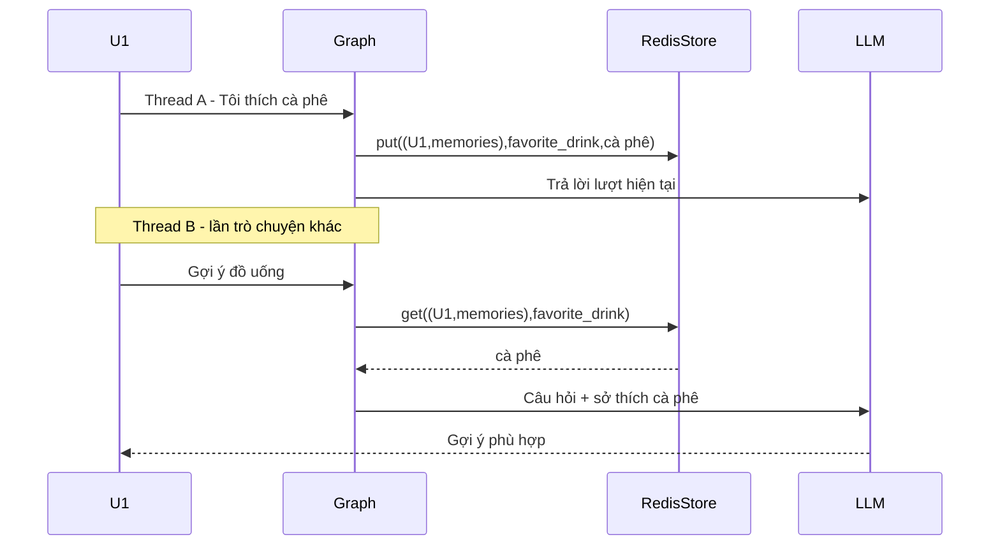

# Bài 06: Lab xây dựng AI Agent ghi nhớ sở thích đồ uống

## 1. Tổng quan

Trong bài lab này, bạn mở rộng agent LangGraph–Redis để ghi nhớ sở thích của từng người dùng ở một cuộc trò chuyện và vận dụng sở thích đó vào lần trò chuyện sau. Ví dụ: Thứ Hai, U1 nói “Tôi thích cà phê”; Thứ Tư, trong thread mới, U1 hỏi “Gợi ý một đồ uống cho tôi”. Hệ thống phải đưa sở thích cà phê vào ngữ cảnh nhưng không dùng thông tin đó cho U2.

Bài thực hành dùng một tiêu chí có thể xác minh: **lưu thành công một thuộc tính `favorite_drink` dưới namespace người dùng và đọc lại từ thread khác**. Việc mô hình tạo câu trả lời tự nhiên là phần ứng dụng của dữ liệu này.

## 2. Mục tiêu

- Mở rộng cơ chế lưu tên thành cơ chế lưu sở thích.
- Sử dụng đồng thời `RedisSaver` và `RedisStore`.
- Thiết kế luồng lưu, truy xuất, cập nhật và kiểm thử quyền truy cập.
- Đánh giá khi nào cần chuyển từ key–value sang tìm kiếm semantic.

## 3. Chuẩn bị

- Python đã cài `langgraph`, `langgraph-checkpoint-redis` và `langchain-openai`.
- Redis có khả năng index đang chạy.
- `OPENAI_API_KEY` và `OPENAI_MODEL` hợp lệ.
- Mã graph mẫu trong bài 04 hoặc một ứng dụng LangGraph tương đương.

## 4. Yêu cầu chức năng

**Yêu cầu A – Lưu sở thích:** Khi U1 nói rõ “Tôi thích cà phê”, ứng dụng ghi giá trị `cà phê` dưới `("U1", "memories")` với key `favorite_drink`.

**Yêu cầu B – Dùng lại trong thread khác:** Khi U1 hỏi đồ uống trong thread mới, ứng dụng đưa sở thích đã truy xuất vào prompt để LLM có thể ưu tiên gợi ý phù hợp.

**Yêu cầu C – Cách ly:** Khi U2 hỏi câu tương tự mà chưa có dữ kiện, hệ thống không được giả định U2 thích cà phê.

**Yêu cầu D – Cập nhật:** Khi U1 nói “Tôi không còn thích cà phê, tôi thích trà”, hệ thống cần có cách thay thế sở thích cũ bằng giá trị mới, không lưu hai kết luận trái ngược mà không có quy tắc ưu tiên.

## 5. Sơ đồ thực hành



Điểm mấu chốt là **đường lưu** ở thread A và **đường đọc** ở thread B cùng dùng namespace U1. Checkpoint của từng thread không cần chứa toàn bộ lịch sử hội thoại của người dùng.

## 6. Các bước triển khai

### 6.1. Chuẩn hóa cấu trúc dữ liệu

Quy ước memory:

```json
{
  "key": "favorite_drink",
  "value": {
    "kind": "drink_preference",
    "value": "cà phê"
  }
}
```

Lưu dữ kiện trong store:

```python
namespace = (user_id, "memories")
store.put(namespace, "favorite_drink", {
    "kind": "drink_preference",
    "value": "cà phê",
})
```

`user_id` phải lấy từ context đáng tin cậy. Đừng phân tích chuỗi trong prompt để tự nhận định người dùng là U1 hay U2.

### 6.2. Bổ sung logic nhận biết và cập nhật

Mức cơ bản: đặt một mẫu câu rõ ràng, hoặc tạo thao tác “Lưu sở thích” trong giao diện. Đừng dùng đoạn code chứa vài regex để khẳng định đã hiểu được mọi câu phủ định hoặc câu nói mơ hồ. Với yêu cầu D, cần một quy tắc cập nhật nhất quán hoặc một bước xác nhận ý định thay đổi.

Mức nâng cao: thêm bước trích xuất dữ kiện có cấu trúc từ LLM và kiểm tra tính hợp lệ trước khi ghi. Chỉ lưu khi nội dung đủ rõ ràng và người dùng được thông báo về việc ghi nhớ.

### 6.3. Đọc memory khi cần gợi ý

```python
item = store.get((user_id, "memories"), "favorite_drink")
preference = item.value["value"] if item else None

context_text = (
    f"Sở thích đồ uống đã lưu: {preference}."
    if preference else "Chưa có dữ liệu sở thích đồ uống."
)
```

Gắn `context_text` vào chỉ dẫn khi gọi mô hình. Nếu không có preference, agent có thể hỏi người dùng muốn đồ uống theo vị, nhiệt độ hay mục đích nào; không được tự mượn sở thích của tài khoản khác.

### 6.4. Kiểm thử độc lập theo user/thread

| Tình huống | `user_id` | `thread_id` | Kết quả mong đợi |
| --- | --- | --- | --- |
| Lưu “thích cà phê” | U1 | A | Có bản ghi trong namespace U1 |
| Hỏi “Gợi ý đồ uống” | U1 | B | Memory U1 được đọc và dùng đúng |
| Hỏi “Gợi ý đồ uống” | U2 | C | Không có thông tin cà phê từ U1 |
| Đổi thành “thích trà” | U1 | D | Giá trị cập nhật của U1 là trà |
| Hỏi lại đồ uống | U1 | E | Không ưu tiên sở thích cũ khi đã được thay thế |

Kiểm tra cả dữ liệu đọc trực tiếp từ RedisStore và nội dung được truyền vào model; không chỉ quan sát câu văn cuối.

## 7. Gỡ lỗi

- Nếu thread B không tìm thấy cà phê: kiểm tra key `favorite_drink`, namespace U1 và lệnh ghi ở thread A.
- Nếu U2 được gợi ý cá nhân hóa từ ký ức U1: kiểm tra ánh xạ `user_id` từ backend, thay vì chỉ sửa prompt.
- Nếu agent tiếp tục gợi ý cà phê sau khi đổi sang trà: kiểm tra chính sách cập nhật và dữ liệu cũ đang được nạp vào ngữ cảnh.
- Nếu tất cả ký ức bị quên khi khởi động lại: kiểm tra kết nối Redis, volume và retention/TTL.

## 8. Tiêu chí hoàn thành

Bài lab đạt khi:

- [ ] Có ít nhất hai user và ba thread thử nghiệm.
- [ ] Sở thích được lưu trong đúng namespace.
- [ ] Thread mới của U1 đọc được sở thích đã lưu.
- [ ] U2 không đọc được sở thích của U1.
- [ ] Có cơ chế cập nhật sở thích cũ.
- [ ] Có ghi nhận kết quả kiểm thử (đầu vào, dữ liệu lưu, phản hồi).
- [ ] Biến môi trường được sử dụng cho API key.

## 9. Câu hỏi ôn tập

**Câu 1.** Với thuộc tính `favorite_drink` đã biết key, cách đọc phù hợp nhất là gì?

A. `store.get((user_id, "memories"), "favorite_drink")`  
B. Xóa checkpoint.  
C. Bắt mọi người dùng dùng chung `user_id`.  
D. Tạo lại Redis ở mỗi lượt chat.

**Đáp án:** A. **Giải thích:** Lookup theo key giúp đọc đúng thuộc tính đã có cấu trúc.

**Câu 2.** Khi U1 chuyển từ thích cà phê sang thích trà, hành động phù hợp là gì?

A. Tự động đổi `user_id`.  
B. Trả rằng U1 vẫn thích cà phê mãi mãi.  
C. Không đọc Redis nữa.  
D. Cập nhật ký ức theo quy tắc thay đổi đã đặt.

**Đáp án:** D. **Giải thích:** Ký ức cá nhân cần phản ánh thông tin mới có độ tin cậy phù hợp.

**Câu 3.** Vì sao không nên suy đoán U2 cũng thích cà phê?

A. Vì cà phê không phải đồ uống.  
B. Vì dữ liệu U1 không được sử dụng để suy ra sở thích cá nhân U2.  
C. Vì LangGraph không tạo được thread mới.  
D. Vì Redis không lưu được tiếng Việt.

**Đáp án:** B. **Giải thích:** Cá nhân hóa phải dựa trên bộ nhớ thuộc đúng người dùng.

**Câu 4.** Khi nào nên cân nhắc bổ sung vector search?

A. Khi chỉ cần lấy đúng một key đã biết.  
B. Khi cần kiểm tra Docker đang chạy.  
C. Khi có nhiều ký ức và câu hỏi có thể diễn đạt khác với văn bản ký ức.  
D. Khi muốn bỏ xác thực người dùng.

**Đáp án:** C. **Giải thích:** Tìm kiếm theo ý nghĩa hữu ích khi khó định vị bản ghi bằng key cố định.

**Câu 5.** Vì sao cần kiểm tra dữ liệu RedisStore bên cạnh câu trả lời LLM?

A. Để phân biệt lỗi lưu/truy xuất với lỗi tạo câu trả lời.  
B. Để Redis tự huấn luyện mô hình.  
C. Để không cần `thread_id`.  
D. Để truy cập dữ liệu của user khác.

**Đáp án:** A. **Giải thích:** Hai bước kiểm tra giúp xác định nguyên nhân sai lệch.

## 10. Tổng kết

Một AI Agent cá nhân hóa cần nhiều hơn việc lưu tin nhắn. Quy trình đúng là: **xác định sự kiện cần nhớ → gắn vào người dùng đã xác thực → lưu có cấu trúc → truy xuất đúng lúc → cập nhật khi dữ liệu thay đổi → kiểm thử cách ly**. Đây là nền tảng để mở rộng sang các thuộc tính phức tạp hơn như khẩu vị, tiêu chí tìm món ăn hoặc thói quen sử dụng ứng dụng.
