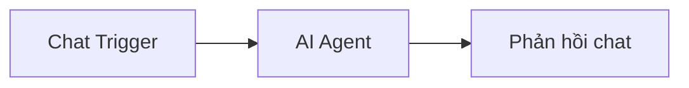

# Bài 01 — Làm quen với n8n và lựa chọn phương án cài đặt

## 1. Tóm tắt và mục tiêu học tập

n8n là nền tảng tự động hóa cho phép nối các dịch vụ thành một **workflow**. Trong khóa học này, workflow phục vụ vai trò chatbot cá nhân, gồm nút nhận chat, AI Agent, mô hình ngôn ngữ, các kho nhớ và công cụ tìm kiếm. Sau bài này, bạn có thể giải thích workflow, trigger, node; lựa chọn hình thức triển khai; chạy n8n trên máy local và phân biệt chi phí phần mềm với chi phí API.

## 2. Tại sao nên bắt đầu từ workflow nhỏ?

Khi xây dựng AI Agent, nhiều người mới thường cố tích hợp cơ sở dữ liệu, RAG, nhiều công cụ và nhiều Agent ngay từ đầu. Cách đó làm khó xác định lỗi. Một luồng chat nhỏ giúp kiểm tra từng thành phần: trước hết nhận được tin nhắn; sau đó trả lời; cuối cùng mới bổ sung bộ nhớ và tìm kiếm. Đây là cách học theo từng bước kiểm chứng được.

Một workflow gồm các **node** và đường truyền dữ liệu giữa chúng. **Trigger** khởi chạy workflow khi có sự kiện (tin nhắn, email, lịch chạy hoặc thao tác thủ công). Mỗi lần chạy thường được gọi là một **execution**.



Trong giai đoạn đầu, chỉ cần luồng tối giản này. Các thành phần khác sẽ được nối vào những cổng riêng của AI Agent.

## 3. Ba hình thức sử dụng n8n

| Phương án | Khi nên dùng | Điểm cần chú ý |
|---|---|---|
| Local trên máy cá nhân | Học, thử nghiệm, phát triển nhanh | Chỉ hoạt động khi máy và tiến trình n8n đang chạy; không mặc định truy cập được từ Internet |
| n8n Cloud | Muốn ít quản trị hạ tầng | Tính phí theo gói; cần kiểm tra hạn mức workflow/execution |
| Self-host trên VPS | Muốn kiểm soát máy chủ, dữ liệu và cấu hình | Cần quản lý HTTPS, backup, cập nhật, bảo mật và chi phí máy chủ |

Trong ví dụ minh họa thường thấy giá khoảng **24 EUR/tháng** cho Cloud và **5 USD/tháng** cho VPS. Đây chỉ là con số quảng bá tại thời điểm làm nội dung, không phải giá cam kết. Khuyến mãi, giảm giá và thương hiệu cung cấp VPS không ảnh hưởng bản chất kỹ thuật của n8n.

## 4. Chạy n8n trên máy local

### 4.1. Kiểm tra môi trường

Mở Terminal, PowerShell hoặc Command Prompt:

```bash
node --version
npm --version
```

Cần cài phiên bản Node.js được n8n đang dùng hỗ trợ. Nếu lệnh không nhận diện, cài Node.js trước. Tài liệu n8n có thể thay đổi yêu cầu phiên bản theo những bản phát hành mới.

### 4.2. Thử nhanh bằng npx

```bash
npx n8n
```

Cách này tải và chạy n8n mà không yêu cầu cài global trước. Nếu môi trường/bản phát hành tương thích, mở URL sau trong trình duyệt:

```text
http://localhost:5678
```

### 4.3. Cài bằng npm như trong quy trình minh họa

```bash
npm install -g n8n@latest
n8n
```

Lệnh đầu cài bản được gắn nhãn `latest` và lệnh sau khởi động. Cách cài/npm có thể thay đổi hoặc ngừng được khuyến nghị ở các phiên bản mới; nếu gặp lỗi cài đặt, tra tài liệu chính thức hoặc chọn Docker. Đừng bỏ qua cảnh báo tương thích Node.js.

### 4.4. Bắt đầu với n8n Cloud hoặc VPS

Với n8n Cloud, tạo workspace và đăng nhập vào editor. Với VPS, có thể dùng image triển khai n8n do nhà cung cấp hỗ trợ; xác nhận SSL/TLS, tên miền, storage và phiên bản cập nhật trước khi đưa dịch vụ ra Internet. Không công khai giao diện quản trị chỉ để truy cập chatbot.

## 5. Thực hành có kiểm chứng

1. Truy cập editor n8n bằng một trong ba phương án.
2. Tạo một workflow trống bằng lựa chọn tương đương **Start from scratch**.
3. Đặt tên workflow **Trợ lý AI của tôi**.
4. Quan sát nút thêm node, danh sách trigger và vùng canvas.
5. Lưu workflow và kiểm tra nó xuất hiện trong danh sách workflow.

**Checkpoint:** Bạn mở lại được workflow vừa tạo. Chưa cần kết nối model hay API key.

## 6. Lỗi thường gặp

- `node` hoặc `npm` không được nhận diện: cài Node.js và mở terminal mới.
- Không vào được `localhost:5678`: kiểm tra n8n còn chạy và cổng có bị ứng dụng khác chiếm không.
- Cài đặt npm báo lỗi phiên bản: kiểm tra yêu cầu phiên bản Node.js và cân nhắc Docker.
- Cài trên máy cá nhân nhưng muốn người khác truy cập công khai: cần giải pháp host hoặc reverse proxy và cấu hình bảo mật, không tự động có URL công khai.

## 7. Câu hỏi ôn tập

### Câu 1

Trong chatbot n8n, node nào có trách nhiệm bắt đầu workflow khi người dùng gửi tin nhắn?

A. Chat Trigger  
B. Data Table  
C. Chat Model  
D. Credential

**Đáp án:** A. **Giải thích:** Trigger nhận sự kiện đầu vào và kích hoạt các node phía sau.

### Câu 2

Vì sao nên kiểm tra chatbot trả lời được trước khi gắn bộ nhớ dài hạn?

A. Vì bộ nhớ dài hạn không thể dùng với n8n.  
B. Để tránh phải dùng Chat Model.  
C. Để khoanh vùng lỗi theo từng thành phần.  
D. Vì workflow không thể có nhiều node.

**Đáp án:** C. **Giải thích:** Kiểm thử từng chặng giúp biết lỗi nằm ở trigger, model hay công cụ.

### Câu 3

Phương án nào thường phù hợp nhất cho người học muốn thử nhanh mà chưa quản lý máy chủ?

A. Tự triển khai cụm máy chủ sản xuất.  
B. Chạy local bằng npx nếu bản n8n tương thích.  
C. Công khai cổng quản trị trên Internet.  
D. Tự xây một công cụ thay n8n.

**Đáp án:** B. **Giải thích:** Thử local giảm yêu cầu hạ tầng ở giai đoạn đầu.

### Câu 4

Một VPS giá rẻ có đồng nghĩa toàn bộ chatbot miễn phí không?

A. Có, vì API mô hình là miễn phí.  
B. Có, vì VPS luôn tặng SerpApi.  
C. Có, nếu dùng n8n.  
D. Không, mô hình, tìm kiếm, máy chủ và vận hành có thể tính phí riêng.

**Đáp án:** D. **Giải thích:** Chi phí hạ tầng không thay thế chi phí mô hình và dịch vụ khác.

### Câu 5

Nếu n8n local đã tắt, điều gì thường xảy ra với chatbot đặt tại môi trường đó?

A. Workflow vẫn hoạt động trên một đám mây tự tạo.  
B. Chatbot không thực thi được cho tới khi dịch vụ chạy lại.  
C. Data Table được tự động xóa.  
D. Credential tự đổi mật khẩu.

**Đáp án:** B. **Giải thích:** Workflow local cần một tiến trình n8n đang hoạt động.

## 8. Tổng kết

Bạn đã phân biệt ba phương án triển khai, chạy n8n và tạo workflow trống. Nền tảng kỹ thuật quan trọng nhất là: đi từ workflow nhỏ và chỉ thêm một thành phần mới sau khi bước trước đã chạy đúng.
