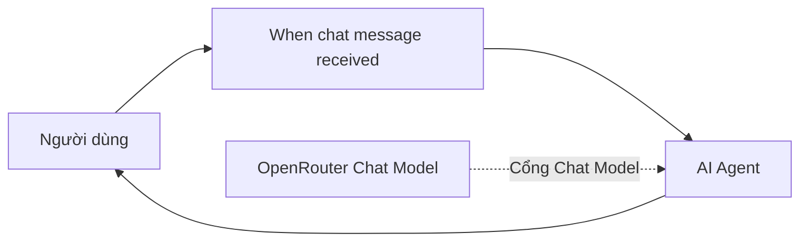

# Bài 02 — Xây dựng chatbot n8n với Chat Trigger, AI Agent và OpenRouter

## 1. Tóm tắt và mục tiêu học tập

AI Agent trong n8n không tự hoạt động một mình. Nó cần **trigger** để nhận yêu cầu và **chat model** để xử lý ngôn ngữ. Cuối bài này, người học có thể tạo đường đi của một tin nhắn, kết nối OpenRouter bằng credential và kiểm chứng phản hồi đầu tiên của chatbot.

## 2. Kiến trúc chatbot tối thiểu



**Đường liền** là luồng tin nhắn chính. **Đường nét đứt** biểu thị node Chat Model được liên kết tới cổng chức năng của AI Agent, không phải bước nhận chat trực tiếp.

AI Agent điều phối: đọc yêu cầu, sử dụng khả năng suy luận/gọi công cụ nếu có, và tạo trả lời. OpenRouter đóng vai trò cổng truy cập các mô hình từ nhiều nhà cung cấp; nó không phải tên của một mô hình AI duy nhất.

## 3. Tạo các node cơ bản

1. Trong n8n, mở workflow **Trợ lý AI của tôi**.
2. Thêm trigger loại **On chat message** hoặc **When chat message received** (thường gọi Chat Trigger).
3. Nhấn dấu cộng ở đường workflow, tìm nhóm **AI**, thêm **AI Agent**.
4. Nối đầu ra trigger vào đầu vào của AI Agent.
5. Đổi tên node Agent thành **Trợ lý AI** để dễ đọc.

Tại thời điểm này, AI Agent thường còn báo thiếu Chat Model. Đây là điều bình thường vì chưa có mô hình được gán.

## 4. Kết nối OpenRouter Chat Model

### 4.1. Tạo credential

1. Chuẩn bị tài khoản OpenRouter và kiểm tra điều khoản, hạn mức thanh toán.
2. Mở mục API Keys trong tài khoản đó, tạo một API key dành riêng cho học tập.
3. Trong n8n, nhấn vào cổng **Chat Model** của AI Agent.
4. Chọn **OpenRouter Chat Model**, tạo credential mới và dán API key vào trường phù hợp.
5. Lưu credential và chọn mô hình khả dụng.

Có thể chọn một mô hình **Anthropic Claude Sonnet** nếu tài khoản và thời điểm đó cung cấp phiên bản mong muốn. Phiên bản *Claude Sonnet 4.6* là tên được dùng trong ví dụ minh họa; không bắt buộc và không phải bảo đảm luôn có trong danh sách. Có thể thay bằng model phù hợp khác, hoặc **Ollama** cho một số cách chạy local.

**Bảo mật:** Chỉ nhập khóa vào vùng credential chuyên dụng. Không ghi API key vào system prompt, tài liệu, screenshot công khai hoặc node có đầu ra ghi log.

### 4.2. Kiểm thử câu đầu tiên

Mở **Chat** trong editor và gửi:

```text
Xin chào! Bạn có thể giúp tôi những gì?
```

Nếu workflow chạy thành công, chatbot sẽ trả lời dựa trên mô hình đã chọn. Mở kết quả execution để quan sát đường chạy trigger → AI Agent. Tại thời điểm này chưa có trí nhớ tùy chỉnh và chưa có công cụ truy cập web.

## 5. So sánh các thành phần

| Thành phần | Nhận dữ liệu gì? | Làm gì? |
|---|---|---|
| Chat Trigger | Tin nhắn, định danh phiên | Khởi động workflow |
| AI Agent | Tin nhắn, prompt, model, memory, tools | Điều phối và tạo câu trả lời |
| OpenRouter Chat Model | Nội dung hội thoại do agent truyền tới | Suy luận/tạo văn bản bằng mô hình được chọn |
| Credential | Khóa xác thực | Cho phép node kết nối tới nhà cung cấp |

Một credential hợp lệ chưa đảm bảo mọi model dùng được. Quyền truy cập, hạn mức, tên mô hình và số dư có thể làm yêu cầu thất bại.

## 6. Checkpoint và gỡ lỗi

**Checkpoint:** Gửi “Xin chào” và nhận được câu trả lời trong cửa sổ Chat của n8n.

Nếu không hoạt động, kiểm tra lần lượt: trigger đã kết nối AI Agent chưa; agent đã có Chat Model chưa; credential đã lưu đúng chưa; tên model còn được OpenRouter cung cấp không; tài khoản còn hạn mức và workflow có báo lỗi gì trong execution log. Không chia sẻ API key khi nhờ người khác hỗ trợ debug.

## 7. Câu hỏi ôn tập

### Câu 1

Trong workflow cơ bản, đâu là thứ tự đúng của luồng tin nhắn chính?

A. Chat Model → Trigger → Agent  
B. Chat Trigger → AI Agent → trả lời chat  
C. Data Table → Chat Trigger → model  
D. SerpApi → Agent → Trigger

**Đáp án:** B. **Giải thích:** Chat Trigger nhận sự kiện và chuyển tin nhắn cho agent xử lý.

### Câu 2

OpenRouter là gì trong kiến trúc này?

A. Cơ sở dữ liệu bộ nhớ dài hạn.  
B. Giao diện xuất bản chatbot.  
C. Cơ chế nhận tin nhắn.  
D. Dịch vụ cung cấp quyền truy cập đến các mô hình AI.

**Đáp án:** D. **Giải thích:** OpenRouter là nhà cung cấp cổng API kết nối nhiều mô hình.

### Câu 3

Chỗ nào phù hợp nhất để nhập API key?

A. Credential của node tương ứng.  
B. Trong nội dung message người dùng.  
C. Trong Sticky Note công khai.  
D. Trong tên workflow.

**Đáp án:** A. **Giải thích:** Credential được quản lý riêng cho xác thực dịch vụ.

### Câu 4

Nếu đã nối AI Agent nhưng không thêm Chat Model, tình trạng nào dễ xảy ra nhất?

A. Hệ thống tự tải mô hình từ máy chủ bất kỳ.  
B. Memory tự động thay model.  
C. Agent thiếu thành phần tạo/suy luận phản hồi.  
D. Trigger bị xóa.

**Đáp án:** C. **Giải thích:** Agent cần một chat model để xử lý ngôn ngữ.

### Câu 5

Khi nhận lỗi truy cập model, bước kiểm tra hợp lý nhất là gì?

A. Xóa toàn bộ workflow.  
B. Kiểm tra credential, quyền model và hạn mức tài khoản.  
C. Đổi tên trigger thành khác.  
D. Chèn thêm Sticky Note.

**Đáp án:** B. **Giải thích:** Lỗi xác thực, hạn mức hoặc model không còn khả dụng là nguyên nhân phổ biến.

## 8. Tổng kết

Một chatbot n8n đầu tiên chỉ cần Chat Trigger, AI Agent và Chat Model. Hãy kiểm tra phản hồi cơ bản trước khi xây bộ nhớ và công cụ phức tạp.
