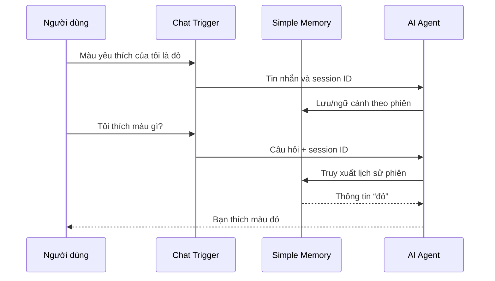

# Bài 04 — Xây dựng bộ nhớ hội thoại ngắn hạn bằng Simple Memory

## 1. Tóm tắt và mục tiêu học tập

Chatbot không có memory có thể coi mỗi tin nhắn là độc lập. **Simple Memory** cung cấp lịch sử hội thoại để Agent sử dụng lại ngữ cảnh của một phiên. Sau bài này, người học có thể gắn Simple Memory, cấu hình cửa sổ lịch sử, kiểm thử tính liên tục và giải thích vì sao bộ nhớ phiên khác với bộ nhớ dài hạn.

## 2. Ngữ cảnh hội thoại được lưu như thế nào?

Giả sử người dùng gửi: “Màu yêu thích của tôi là đỏ”, rồi hỏi “Tôi thích màu gì?”. Nếu Agent nhận chỉ câu hỏi thứ hai thì nó không thể biết “đỏ”. Memory giúp cung cấp các lượt trao đổi trước trong cùng session để Agent trả lời đúng.



Session ID đóng vai trò phân biệt các cuộc trò chuyện. Bộ nhớ hội thoại chỉ có ích nếu các lượt tin nhắn cùng phiên sử dụng đúng định danh phiên.

## 3. Cấu hình Simple Memory

1. Từ node **AI Agent**, chọn cổng **Memory**.
2. Thêm node **Simple Memory**.
3. Chọn cấu hình session ID liên kết với Chat Trigger (nhiều cấu hình sử dụng lựa chọn kết nối từ trigger).
4. Đặt số lượt lịch sử được giữ ở **20** theo bài thực hành.
5. Lưu workflow và kiểm tra các node được nối đúng cổng.

**Lưu ý:** Cấu hình dạng “20” thường là tham số cửa sổ lịch sử của node, không đồng nghĩa chắc chắn 20 *tin nhắn đơn lẻ* trong mọi phiên bản/kiểu triển khai. Dùng mô tả chính xác trong UI đang sử dụng.

## 4. Thực hành phân biệt cùng phiên và khác phiên

### 4.1. Test cùng phiên

```text
Người dùng: Màu yêu thích của tôi là đỏ.
Người dùng: Màu yêu thích của tôi là gì?
Kết quả mong đợi: Đỏ.
```

Cùng một cửa sổ chat/session, Agent có thể truy hồi thông tin vừa nói.

### 4.2. Test phiên mới

Tạo **new chat**, sau đó hỏi lại câu hỏi màu yêu thích. Khi chưa có Data Tables, agent không có căn cứ để khẳng định màu đỏ. Nếu phiên cũ vẫn hiện diện do thay đổi session/ID, hãy kiểm tra cách n8n xác định session, không kết luận ngay rằng nó có long-term memory.

## 5. Giới hạn và rủi ro

**Simple Memory không phải cơ sở dữ liệu hồ sơ người dùng.** Nó gắn với phiên và môi trường triển khai; không nên coi là cơ chế lưu bền chắc qua mọi lần khởi động/mở phiên, đặc biệt trong hệ thống nhiều worker. Khi thông tin cần được lưu lâu dài, phải dùng kho lưu trữ bền vững hơn.

Ngữ cảnh quá dài làm tăng token đầu vào và có thể khiến model bỏ sót chi tiết. Trước khi tăng cửa sổ lịch sử, kiểm tra chi phí và mục tiêu ứng dụng.

## 6. Checkpoint

Trong cùng một session, Luna trả lời được màu yêu thích; trong phiên mới và khi chưa thêm kho dài hạn, Luna nói không có đủ dữ liệu nếu chưa được cung cấp lại. Ghi lại session ID (không cần chia sẻ cho người khác) và cách bạn thử new chat.

## 7. Câu hỏi ôn tập

### Câu 1

Bộ nhớ hội thoại giải quyết trực tiếp vấn đề nào?

A. Tăng tốc GPU.  
B. Tạo API key.  
C. Tự động xuất bản chatbot.  
D. Cung cấp ngữ cảnh các lượt trao đổi trong một phiên.

**Đáp án:** D. **Giải thích:** Simple Memory giúp Agent có lịch sử của cùng session.

### Câu 2

Tại sao cần định danh session ổn định?

A. Để model dịch tốt hơn.  
B. Để các lượt của cùng cuộc chat được gắn với đúng lịch sử.  
C. Để giảm giá VPS.  
D. Để Data Table tự tạo bảng.

**Đáp án:** B. **Giải thích:** Nếu session ID thay đổi không chủ ý, lịch sử có thể bị tách hoặc ghép sai.

### Câu 3

Khi cần giữ “Tôi thích pizza” qua nhiều phiên khác nhau, lựa chọn đúng hơn là gì?

A. Kho nhớ bền vững như Data Table.  
B. Chỉ tăng nhiệt độ model.  
C. Chỉ đổi màu Sticky Note.  
D. Tắt Chat Trigger.

**Đáp án:** A. **Giải thích:** Long-term memory cần lưu dữ liệu ngoài phạm vi một phiên.

### Câu 4

Bước kiểm tra nào xác nhận memory đang phát huy tác dụng?

A. Agent nói tên model.  
B. Có nhiều node hơn.  
C. Nhắc sở thích rồi hỏi lại trong cùng phiên.  
D. API key được đổi tên.

**Đáp án:** C. **Giải thích:** Đây là phép thử trực tiếp khả năng dùng ngữ cảnh trước đó.

### Câu 5

Điều gì cần cân nhắc khi tăng cửa sổ lưu hội thoại quá lớn?

A. Chỉ giao diện không đẹp.  
B. Dữ liệu Google tự biến mất.  
C. Trigger tự dừng.  
D. Chi phí token và độ nhiễu ngữ cảnh có thể tăng.

**Đáp án:** D. **Giải thích:** Lịch sử càng dài càng tốn ngữ cảnh và đôi khi khó truy hồi đúng chi tiết.

## 8. Tổng kết

Simple Memory giúp Luna “nhớ những gì vừa trao đổi” trong cùng một phiên chat. Để nhớ người dùng là ai hoặc thích gì khi quay lại sau vài ngày, cần một lớp lưu trữ dài hạn riêng biệt.
