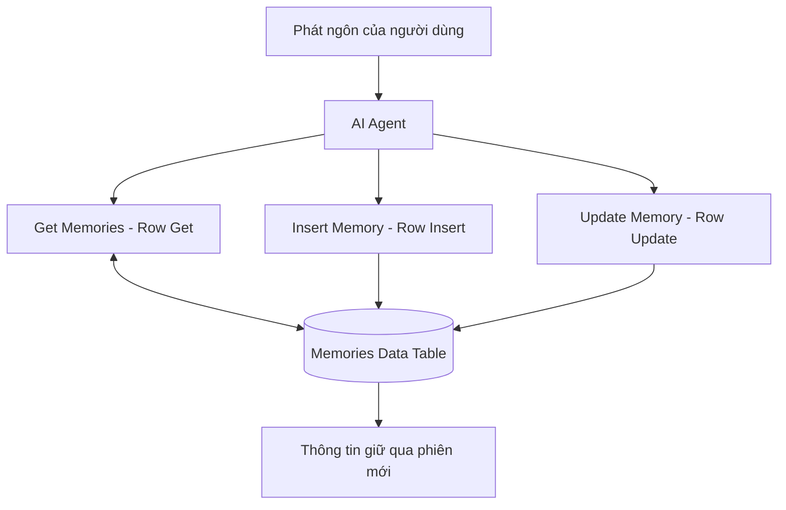

# Bài 05 — Lưu, truy xuất và cập nhật ký ức dài hạn với n8n Data Tables

## 1. Tóm tắt và mục tiêu học tập

Một hồ sơ sở thích cần được lưu độc lập với session. **Data Tables** là bảng dữ liệu nội bộ trong n8n, thích hợp cho ví dụ memory nhỏ. Người học sẽ tạo bảng `Memories`, thêm ba công cụ `Get Memories`, `Insert Memory`, `Update Memory`, kiểm thử cập nhật và biết cách tránh lẫn dữ liệu giữa người dùng.

## 2. Thiết kế bộ nhớ tối giản

Trong giao diện **Data Tables**, tạo bảng tên **Memories** với hai cột tự định nghĩa:

| Cột | Kiểu | Vai trò |
|---|---|---|
| `MemoryKey` | String | Tên thuộc tính, ví dụ `favorite_color` |
| `MemoryValue` | String | Giá trị, ví dụ `red` |

Thêm bản ghi ban đầu `MemoryKey = favorite_color`, `MemoryValue = red`. n8n có thể cấp **ID** nội bộ cho từng dòng; đây là định danh phục vụ cập nhật, khác với `MemoryKey`.

Trong ví dụ người dùng Việt Nam, có thể lưu `favorite_food = pizza`, `dog_name = Ruby` hoặc `favorite_color = xanh dương`. Nên dùng khóa nhất quán (ví dụ dạng snake_case) thay vì tạo nhiều bản ghi `Màu yêu thích`, `mau_yeu_thich` và `favorite_color` cho cùng một ý.

## 3. Kiến trúc memory dài hạn



Khi nhận câu hỏi, agent có thể gọi `Get` để lấy dữ kiện trước khi trả lời. Khi người dùng nói sở thích mới và muốn nhớ, agent gọi `Insert`. Nếu thông tin đã tồn tại nhưng được sửa, agent cần `Get` tìm dòng đúng trước rồi `Update`.

## 4. Thiết lập ba công cụ

### 4.1. Get Memories

1. Trên cổng **Tool** của AI Agent, thêm node **Data Table**.
2. Chọn tài nguyên hàng (`Row`) và thao tác **Get**.
3. Chọn bảng **Memories**.
4. Đặt tên node **Get Memories**.
5. Cấu hình bộ lọc/giới hạn trả về theo phiên bản n8n; trường được agent quyết định có thể dùng tùy chọn AI tự điền.

Mục đích là trả về hàng có `MemoryKey` liên quan. Với dữ liệu thật, không nên để agent tải tất cả ký ức của mọi người dùng.

### 4.2. Insert Memory

1. Thêm node **Data Table** khác vào cổng Tool.
2. Chọn **Row → Insert** và bảng **Memories**.
3. Ánh xạ `MemoryKey` và `MemoryValue` bằng giá trị được Agent cung cấp/được workflow xác nhận.
4. Đổi tên node **Insert Memory** và mô tả khi nào được lưu.

Nếu sử dụng tùy chọn để mô hình điền tham số tự động, chỉ trao quyền cho các trường thực sự cần nó; không dùng tính năng đó cho ID danh tính, quyền truy cập hoặc các ràng buộc bảo mật.

### 4.3. Update Memory

1. Thêm một node **Data Table**, chọn **Row → Update**.
2. Chọn bảng **Memories** và khai báo điều kiện tìm dòng cần cập nhật.
3. Trong bài thực hành một người, có thể dùng `id` của dòng đã lấy từ `Get`.
4. Ánh xạ giá trị `MemoryValue` mới.
5. Đổi tên node **Update Memory**.

**Điểm dễ sai:** Không nên cho Agent đoán tùy ý ID bản ghi. Tốt hơn là yêu cầu nó gọi `Get` trước, sau đó sử dụng chính ID trả về. Nếu phiên bản Data Table hỗ trợ **Upsert**, có thể cân nhắc thao tác đó để giảm tình trạng có nhiều dòng cùng một khóa.

## 5. Quy tắc sử dụng ký ức

Bổ sung vào system prompt:

```text
Khi cần trả lời một câu hỏi về sở thích trước đây của người dùng,
hãy tra Get Memories trước nếu ký ức chưa có trong ngữ cảnh hiện tại.
Khi người dùng yêu cầu ghi nhớ một thông tin ổn định, lưu vào Memories.
Khi họ sửa thông tin đã lưu, tìm dòng hiện tại trước rồi cập nhật.
Không tự coi suy đoán hoặc kết quả web là sự thật về người dùng.
Nếu thao tác thất bại, nói rõ chưa thể xác nhận đã lưu/cập nhật.
```

**Quan trọng:** Đây là hướng dẫn hành vi, không thay thế kiểm soát truy cập ở tầng workflow và database.

## 6. Kiểm thử theo kịch bản

### 6.1. Đọc ký ức có sẵn

- Tạo bản ghi `favorite_color = đỏ` trực tiếp trong bảng.
- Mở **New Chat** và hỏi “Màu yêu thích của tôi là gì?”.
- Xem execution: Agent có gọi `Get Memories` và nhận đúng dòng không?

### 6.2. Cập nhật ký ức

- Nói “Thực ra màu yêu thích của tôi là xanh dương. Hãy cập nhật ký ức.”
- Kiểm tra có cuộc gọi `Update Memory`, đối chiếu dòng trong Data Tables.
- Mở phiên mới và hỏi lại. Câu trả lời dự kiến: **xanh dương**.

### 6.3. Lưu thông tin mới

- Nói “Chó của tôi tên là Ruby. Hãy ghi nhớ.”
- Kiểm tra bảng có một dòng `dog_name = Ruby`.
- Mở phiên khác và hỏi “Chó của tôi tên gì?”.

Một câu trả lời đúng của model **chưa đủ chứng minh đã lưu**. Phải quan sát Data Table và execution log, sau đó kiểm thử ở phiên mới.

## 7. Mở rộng an toàn cho nhiều người dùng

Ví dụ hai cột chỉ phù hợp với demo một người. Nếu triển khai chatbot nhiều người, nên mở rộng bảng, chẳng hạn:

| `user_id` | `MemoryKey` | `MemoryValue` | `updated_at` |
|---|---|---|---|
| `user_001` | `favorite_food` | `pizza` | Thời điểm cập nhật |
| `user_002` | `favorite_food` | `phở` | Thời điểm cập nhật |

`user_id` phải được xác định từ cơ chế xác thực tin cậy, **không lấy tùy tiện từ tin nhắn do người dùng tự gửi**. Mọi lệnh đọc/ghi/sửa cần bị giới hạn theo đúng `user_id`; kiểm soát này nên thực thi bằng cấu hình workflow và truy vấn thay vì chỉ dặn Agent “đừng xem dữ liệu khác”.

Nên có cơ chế xem, sửa, xóa ký ức theo yêu cầu người dùng; không lưu mật khẩu hoặc dữ liệu nhạy cảm chỉ vì người dùng vô tình nhắc tới. Data Tables có giới hạn dung lượng, quyền truy cập theo dự án và không phải lựa chọn tối ưu cho kho dữ liệu rất lớn.

## 8. Checkpoint

**Hoàn thành khi:** (1) Get đọc được thuộc tính; (2) Insert tạo ký ức mới; (3) Update thay giá trị cũ; (4) New Chat vẫn nhận được sở thích đã lưu; (5) không tạo nhiều dòng trùng khóa khi cập nhật.

## 9. Câu hỏi ôn tập

### Câu 1

Người dùng muốn đổi màu yêu thích từ đỏ sang xanh dương. Cách làm nào phù hợp nhất?

A. Luôn Insert dòng mới mà không kiểm tra.  
B. Chỉ chỉnh system prompt.  
C. Get dòng hiện có rồi Update giá trị đúng.  
D. Xóa workflow.

**Đáp án:** C. **Giải thích:** Cập nhật đúng bản ghi tránh xung đột giữa giá trị mới và cũ.

### Câu 2

Vai trò chính của `MemoryKey` trong mô hình hai cột là gì?

A. Tên thuộc tính được lưu.  
B. Mật khẩu của tài khoản.  
C. Giá tiền API.  
D. Session ID do n8n cấp tự động.

**Đáp án:** A. **Giải thích:** `MemoryKey` xác định ý nghĩa của `MemoryValue`.

### Câu 3

Vì sao cần kiểm tra trực tiếp Data Table sau khi Agent nói “Đã lưu”?

A. Để chỉnh màu canvas.  
B. Để xóa chat.  
C. Để đổi model.  
D. Vì câu trả lời tự nhiên không đảm bảo thao tác ghi đã thành công.

**Đáp án:** D. **Giải thích:** Công cụ ghi có thể lỗi dù model vẫn tạo ra câu trả lời.

### Câu 4

Trường nào nên bổ sung khi nhiều người dùng dùng chung một bảng Memories?

A. `prompt_color`  
B. `user_id` được xác minh từ lớp xác thực.  
C. `desktop_wallpaper`  
D. `random_number`

**Đáp án:** B. **Giải thích:** Phải tách dữ liệu theo đúng người sở hữu.

### Câu 5

Nguyên nhân nào khiến chatbot trả lời sai dù Data Table đã có dữ liệu đúng?

A. Vì mọi Data Table đều không thể đọc.  
B. Vì model không được phép gọi công cụ.  
C. Agent không truy xuất đúng bản ghi trước khi trả lời.  
D. Vì Chat Trigger luôn trả lời màu đỏ.

**Đáp án:** C. **Giải thích:** Có dữ liệu nhưng không gọi Get hoặc lọc sai sẽ dẫn đến trả lời không dựa trên ký ức.

## 10. Tổng kết

Bộ nhớ dài hạn trong demo là một Data Table kèm ba thao tác đọc–thêm–sửa. Để biến demo thành sản phẩm, phải thêm định danh người dùng đáng tin cậy, kiểm soát truy cập và quy tắc đồng bộ dữ liệu.
