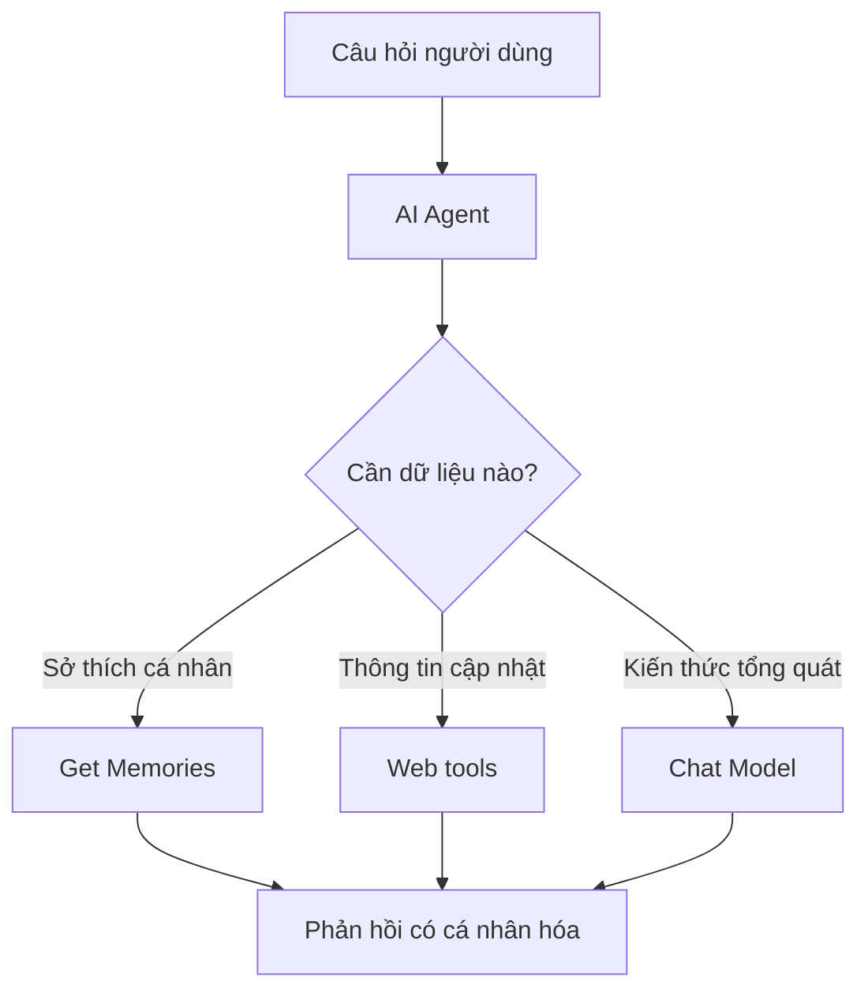

# Bài 06 — Trang bị công cụ nghiên cứu Internet cho AI Agent

## 1. Tóm tắt và mục tiêu học tập

Mô hình ngôn ngữ không tự có quyền truy cập Internet chỉ vì nó biết trả lời câu hỏi. **Tool calling** cho phép Agent chọn và sử dụng một công cụ khi cần dữ kiện bên ngoài. Bài học hướng dẫn nối công cụ tìm kiếm Google qua SerpApi, Wikipedia và Hacker News, sau đó kết hợp kết quả tìm kiếm với sở thích lưu trong Data Tables.

## 2. Khi nào nên gọi công cụ?

Phân biệt hai nhóm câu hỏi:

- “Tên bạn là gì?”: câu trả lời từ system prompt; không cần web.
- “Tôi thích món gì?”: từ memory; không cần web nếu đã có dữ liệu.
- “Có nhà hàng pizza nào đáng thử ở New York?”: cần nguồn web vì địa điểm, menu và giờ mở cửa có thể thay đổi.
- “Tin mới nhất về OpenClaw là gì?”: cần tìm kiếm hiện hành và ghi rõ thời điểm nguồn.



Đối với yêu cầu kết hợp, agent có thể gọi **cả Get Memories và công cụ web** trước khi đưa ra câu trả lời.

## 3. Cấu hình SerpApi (Google Search)

1. Tạo tài khoản [SerpApi](https://serpapi.com/) và lấy khóa API theo chính sách của dịch vụ.
2. Từ cổng **Tool** của AI Agent, tìm node **SerpApi** (tên hiển thị có thể thay đổi theo bản n8n).
3. Tạo credential bằng API key ở đúng trường xác thực.
4. Đổi tên node thành **Google Search**.
5. Viết mô tả công cụ rõ ràng: tìm dữ kiện web cập nhật, địa điểm và thông tin mới; cung cấp truy vấn cụ thể.

SerpApi là dịch vụ bên thứ ba có hạn mức/phí riêng. Nếu node có sẵn khác tên hoặc không được hỗ trợ trong instance, đọc thư viện node n8n và dùng kết nối API phù hợp thay vì giả định mọi phiên bản có cùng tích hợp.

## 4. Thêm Wikipedia và Hacker News

**Wikipedia** phù hợp để lấy thông tin bách khoa có thể kiểm chứng; thường không cần API key đối với tra cứu công khai. Kết nối node công cụ Wikipedia và để Agent quyết định truy vấn cần tra.

**Hacker News** phù hợp với các bài đăng/câu chuyện công nghệ. Kết nối node công cụ hoặc node tích hợp thích hợp, mô tả đúng thao tác được hỗ trợ. Một số operation yêu cầu ID bài viết; cho phép Agent cung cấp ID khi nó đã có dữ liệu nguồn phù hợp. Không tự suy ra rằng mọi node Hacker News là công cụ tìm kiếm tin mới theo từ khóa.

Đặt một **Sticky Note** tên **Nghiên cứu** phía sau các tool để dễ quan sát. Sticky Note chỉ giúp tổ chức canvas, không tham gia thực thi logic.

## 5. Kịch bản: gợi ý pizza tại New York theo sở thích

Giả sử trong Data Tables có `favorite_food = pizza`. Người dùng hỏi:

```text
Hãy gợi ý một vài nhà hàng ở New York phù hợp với sở thích của tôi.
```

Luồng lý tưởng:

1. Agent gọi `Get Memories` để biết sở thích là pizza.
2. Agent tạo truy vấn tìm kiếm nhà hàng pizza ở khu vực yêu cầu.
3. `Google Search` trả về kết quả; Agent đọc tên, mô tả, địa chỉ và nguồn nếu có.
4. Agent tổng hợp đề xuất có lý do: *“Vì bạn thích pizza, mình ưu tiên các địa điểm chuyên pizza…”*.
5. Nếu dữ liệu thiếu giờ mở cửa/giá, Agent nói rõ cần xác minh thay vì bịa.

**Đây là luồng minh họa**, không phải một danh sách nhà hàng thực tế. Người học cần chạy tool để lấy thông tin hiện hành.

## 6. Kịch bản: nghiên cứu tin tức OpenClaw

Người dùng hỏi: “Tin mới nhất về OpenClaw là gì?”. Agent nên ưu tiên công cụ tìm kiếm web, phân biệt ngày phát hành bài viết với ngày xảy ra sự kiện, và cho biết nếu không tìm được tin đáng tin cậy. Một bài tổng hợp trên Wikipedia có thể hỗ trợ bối cảnh, nhưng không nhất thiết phản ánh tin mới nhất; Hacker News là nguồn cộng đồng chứ không tự động thay thế xác minh tin tức.

Nên yêu cầu Agent đính kèm tên nguồn, đường dẫn tham khảo và ngày tháng khi trả lời những câu hỏi có tính thời sự.

## 7. Lỗi và điều chỉnh

| Triệu chứng | Khả năng | Cách xử lý |
|---|---|---|
| Không gọi web khi hỏi tin mới | Tool description mơ hồ | Nêu rõ điều kiện cần gọi tool trong prompt |
| SerpApi lỗi 401/403 | Credential/giới hạn tài khoản | Kiểm tra API key và quyền truy cập |
| Gọi quá nhiều công cụ | Hướng dẫn công cụ thiếu giới hạn | Chỉ gọi khi cần, tránh truy vấn lặp |
| Đưa tin không có nguồn | Thiếu hướng dẫn tổng hợp và xác minh | Yêu cầu dẫn link và phân biệt chưa xác nhận |
| Đề xuất không hợp sở thích | Không gọi Get Memories trước | Kiểm tra execution để biết thứ tự tool calls |

## 8. Câu hỏi ôn tập

### Câu 1

Câu hỏi nào có khả năng cần web tool nhất?

A. “Luna, bạn tên gì?”  
B. “Tin công nghệ mới nhất sáng nay là gì?”  
C. “Màu yêu thích của tôi là gì?”  
D. “Xin chào.”

**Đáp án:** B. **Giải thích:** Thông tin mới nhất phải dựa trên dữ liệu cập nhật từ bên ngoài.

### Câu 2

Muốn đề xuất nhà hàng phù hợp sở thích đã lưu, Agent nên làm gì?

A. Đoán sở thích theo độ tuổi.  
B. Chỉ hỏi Chat Model không có tool.  
C. Bỏ qua địa điểm.  
D. Đọc Memories rồi thực hiện tìm kiếm phù hợp.

**Đáp án:** D. **Giải thích:** Kết hợp dữ liệu riêng của người dùng với nguồn công khai giúp cá nhân hóa hợp lý.

### Câu 3

Sticky Note có chức năng gì trong workflow?

A. Sắp xếp và ghi chú trực quan trên canvas.  
B. Lưu dữ liệu dài hạn như database.  
C. Thay API key.  
D. Tự động tìm kiếm Internet.

**Đáp án:** A. **Giải thích:** Sticky Note chỉ có giá trị trình bày, không phải logic chạy.

### Câu 4

Wikipedia thường phù hợp nhất cho loại thông tin nào?

A. Số dư tài khoản OpenRouter của bạn.  
B. Mật khẩu workflow.  
C. Kiến thức bách khoa và bối cảnh chung.  
D. Dữ liệu cá nhân chỉ có trong Data Tables.

**Đáp án:** C. **Giải thích:** Wikipedia là nguồn tra cứu tổng quát, không phải cơ sở dữ liệu riêng hoặc nguồn duy nhất cho tin thời sự.

### Câu 5

Khi kết quả tìm kiếm thiếu thông tin giá và giờ mở cửa, Agent nên làm gì?

A. Tự điền để câu trả lời trông hoàn chỉnh.  
B. Nêu giới hạn và yêu cầu xác minh thêm.  
C. Khẳng định mọi địa điểm mở cửa.  
D. Xóa lịch sử hội thoại.

**Đáp án:** B. **Giải thích:** Thông tin thực tế thay đổi; không nên suy đoán các trường chưa được xác nhận.

## 9. Tổng kết

Tool calling biến chatbot thành trợ lý có thể hành động và truy xuất dữ kiện. Công cụ web phải được phối hợp với bộ nhớ và nguyên tắc kiểm chứng, không được dùng làm nguồn suy diễn tùy tiện về thông tin cá nhân.
