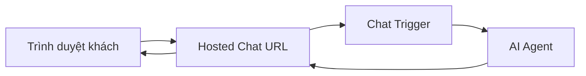

# Bài 07 — Xuất bản giao diện chat có xác thực và hỗ trợ tệp đính kèm

## 1. Tóm tắt và mục tiêu học tập

Sau khi workflow chạy được trong editor, bạn có thể mở một giao diện trò chuyện riêng thay vì luôn dùng canvas. Bài học này trình bày **Hosted Chat**, các lựa chọn xác thực, quá trình publish và lưu ý khi muốn gửi tệp/hình ảnh cho mô hình AI.

## 2. Từ bản thử nghiệm đến URL chatbot

Trong node **Chat Trigger**:

1. Mở thiết lập **Make Chat Publicly Available**.
2. Bật tùy chọn công khai khi workflow đã được kiểm thử và bảo vệ thích hợp.
3. Ở **Mode**, chọn **Hosted Chat**.
4. Đặt **Initial Message(s)** thành lời chào, ví dụ: “Chào bạn! Mình là Luna. Mình có thể giúp gì?”.
5. Cấu hình **Authentication** thích hợp.
6. Lưu/publish workflow theo cơ chế phiên bản hiện tại.
7. Sao chép **Chat URL**, mở ở cửa sổ trình duyệt khác và thử gửi tin nhắn.

Với Hosted Chat, n8n cung cấp giao diện chat đã dựng sẵn. Với Embedded Chat, nhà phát triển tự gắn widget hoặc gọi webhook từ giao diện riêng.

## 3. Các lựa chọn xác thực

| Chế độ | Tác động | Khi nào dùng |
|---|---|---|
| None | Bất cứ ai biết URL có thể gửi tin | Demo không có dữ liệu riêng và có kiểm soát chi phí |
| Basic Auth | Yêu cầu username/password dùng chung | Demo cá nhân đơn giản |
| n8n User Auth (nếu có) | Người dùng phải đăng nhập n8n | Phù hợp môi trường nội bộ và cơ chế quản trị truy cập |

Nếu chatbot dùng **ký ức dài hạn**, không nên mở public không xác thực và để mọi người cùng dùng một bảng hai cột. **Basic Auth dùng chung không tự động tạo `user_id` riêng cho từng người**. Muốn phân quyền nhiều người, cần xác thực và cô lập dữ liệu ở workflow/backend.

## 4. Kích hoạt đính kèm tệp

Trong phần tùy chọn của **Chat Trigger** hoặc các node tương ứng, tìm khả năng cho phép **file uploads** nếu phiên bản hỗ trợ. Sau khi bật, lưu/publish lại workflow rồi làm mới giao diện Hosted Chat để kiểm tra nút tải tệp.

Tuy nhiên, **nhìn thấy nút đính kèm không đồng nghĩa Agent đọc được mọi định dạng**. Để mô tả ảnh, cần bảo đảm chat input chuyển ảnh tới model có khả năng nhìn ảnh và node/model đang được cấu hình nhận input tương ứng. Với PDF, audio hoặc bảng tính có thể cần bước đọc/trích xuất riêng.

## 5. Thử nghiệm mô tả hình ảnh

1. Chuẩn bị một ảnh không có thông tin nhạy cảm, ví dụ ảnh thumbnail do bạn sở hữu.
2. Tải ảnh lên Hosted Chat.
3. Gửi “Mô tả hình ảnh này bằng tiếng Việt.”
4. Đối chiếu mô tả với nội dung ảnh, tránh chấp nhận kết quả đoán mò.
5. Nếu Agent chỉ nhắc tên file hoặc không nhìn được hình, kiểm tra sự hỗ trợ đa phương thức của model và cách map tệp vào input.

**Checkpoint:** Link Hosted Chat hoạt động ở trình duyệt khác, bảo vệ bằng cách xác thực phù hợp và trả lời được. Phần mô tả ảnh chỉ tính đạt nếu model thực sự nhận được nội dung ảnh.

## 6. Lưu ý vận hành

Mỗi tin nhắn có thể tạo một workflow execution và tiêu thụ token/API tương ứng. Trước khi công khai URL, kiểm tra hạn mức, quyền công cụ, xử lý lỗi, lưu trữ file upload, thông tin cá nhân và chính sách retention. Dùng HTTPS khi phục vụ qua Internet; không chia sẻ URL chat nội bộ cùng credential quản trị n8n.

## 7. Câu hỏi ôn tập

### Câu 1

Chế độ nào dùng giao diện chat do n8n phục vụ sẵn?

A. Data Tables  
B. Ollama  
C. Hosted Chat  
D. Sticky Note

**Đáp án:** C. **Giải thích:** Hosted Chat cung cấp sẵn trang chat cho workflow.

### Câu 2

Cài đặt nào đặc biệt quan trọng khi công bố chatbot chứa dữ liệu riêng?

A. Authentication và kiểm soát dữ liệu theo người dùng.  
B. Màu Sticky Note.  
C. Tên ngắn của node.  
D. Cỡ chữ của editor.

**Đáp án:** A. **Giải thích:** Chat public không được kiểm soát có thể khiến dữ liệu và công cụ bị lạm dụng.

### Câu 3

Nút tải ảnh lên đã xuất hiện. Có chắc agent nhìn hiểu ảnh không?

A. Có, mọi mô hình đều hỗ trợ ảnh.  
B. Có, vì ảnh được gắn URL.  
C. Có, vì có Simple Memory.  
D. Không, còn phải hỗ trợ model đa phương thức và truyền dữ liệu đúng cách.

**Đáp án:** D. **Giải thích:** UI upload và khả năng xử lý nội dung là hai chức năng khác nhau.

### Câu 4

Nếu nhiều người cùng dùng một tài khoản Basic Auth, có thể suy ra mỗi người được tách ký ức tự động không?

A. Có, vì cùng nhập mật khẩu.  
B. Không, cần cơ chế user identity và lọc dữ liệu riêng.  
C. Có, vì mỗi model tự phân quyền.  
D. Có, nếu tên bot là Luna.

**Đáp án:** B. **Giải thích:** Basic Auth chia sẻ không định danh riêng từng người dùng cuối.

### Câu 5

Tại sao cần publish sau khi chỉnh cấu hình Hosted Chat?

A. Để làm cho model miễn phí.  
B. Để xóa execution.  
C. Để phiên bản hoạt động bên ngoài nhận cấu hình mới.  
D. Để Data Tables chuyển sang Google Sheets.

**Đáp án:** C. **Giải thích:** Các thay đổi trên editor cần được đưa vào phiên bản workflow chạy công khai.

## 8. Tổng kết

Hosted Chat giúp truy cập Luna từ URL. Khi bật đính kèm file hoặc công khai chatbot, phải kiểm tra đồng thời **giao diện**, **model**, **workflow**, **xác thực** và **bảo vệ dữ liệu**.
