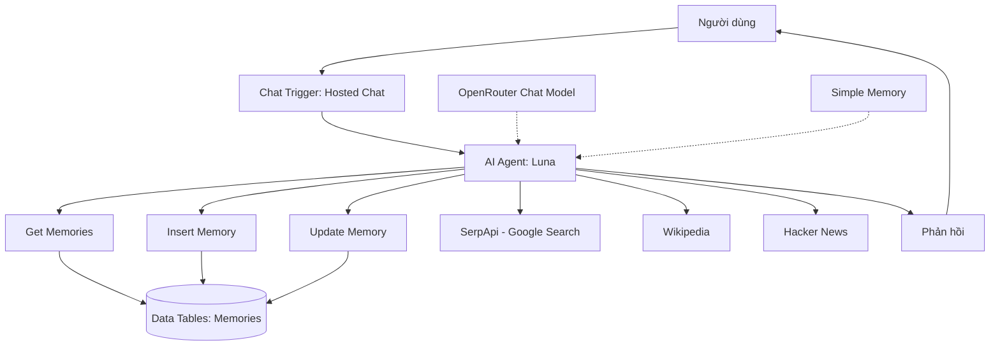

# Bài 09 — Dự án cuối khóa: hoàn thiện trợ lý Luna có trí nhớ và nghiên cứu web

## 1. Bài toán và sản phẩm yêu cầu

Xây dựng một AI Agent cá nhân tên **Luna** bằng n8n. Người dùng có thể trò chuyện tự nhiên, cho Luna ghi nhớ sở thích qua các phiên, sửa ký ức, hỏi tin tức hoặc gợi ý địa điểm dựa trên kết quả tìm kiếm, và dùng qua URL Hosted Chat có xác thực.

**Mục tiêu đo lường được:** Tự tạo workflow từ đầu, cấu hình đủ node, chạy bộ kiểm thử, xác nhận các thao tác đọc/ghi và xuất bản an toàn.

## 2. Yêu cầu chức năng

| Mã | Yêu cầu | Tiêu chí đạt |
|---|---|---|
| F01 | Chat với Luna | Phản hồi tiếng Việt, xưng tên Luna |
| F02 | Nhớ trong phiên | Nhắc lại đúng thông tin vừa nói |
| F03 | Nhớ qua phiên mới | Đọc đúng từ Data Tables |
| F04 | Lưu thuộc tính mới | Xuất hiện dòng đúng trong bảng |
| F05 | Cập nhật thuộc tính | Dòng cũ được sửa đúng, không trùng |
| F06 | Tra cứu Internet | Có tool call và nguồn kiểm chứng |
| F07 | Cá nhân hóa | Dùng sở thích để định hướng gợi ý |
| F08 | Giao diện ngoài editor | Hosted Chat URL truy cập được |
| F09 | Bảo vệ truy cập | Có phương án xác thực và giới hạn dữ liệu |

## 3. Sơ đồ kiến trúc hoàn chỉnh



Phần **Memory** của Agent nối với Simple Memory; các thành phần Data Tables và web nối ở cổng **Tools**. Nếu triển khai cho nhiều người, toàn bộ truy vấn memory cần ràng buộc với danh tính đã xác thực.

## 4. Các mốc triển khai

### 4.1. Mốc 1 — Chatbot cơ bản

Tạo Chat Trigger, AI Agent, OpenRouter Chat Model. Test “Xin chào” và “Bạn tên gì?”. Đưa system prompt xác định Luna và ngôn ngữ tiếng Việt. Ghi lại screenshot canvas hoặc mô tả cấu hình (không chứa API key).

### 4.2. Mốc 2 — Bộ nhớ theo phiên

Gắn Simple Memory, cấu hình cửa sổ 20 theo UI hiện hành, kiểm thử: “Tôi thích màu đỏ” → “Tôi thích màu gì?”. Tạo New Chat và quan sát sự tách phiên.

### 4.3. Mốc 3 — Bộ nhớ dài hạn

Tạo bảng `Memories` với `MemoryKey`, `MemoryValue`. Kết nối `Get Memories`, `Insert Memory`, `Update Memory`. Dùng những trường hợp sau:

```text
Tôi thích pizza. Hãy ghi nhớ.
Món tôi thích là gì?
Hãy tạo cuộc trò chuyện mới, rồi hỏi lại món tôi thích.
Thực ra bây giờ tôi thích sushi hơn. Hãy cập nhật.
Món yêu thích hiện tại của tôi là gì?
```

Phải quan sát bảng và tool execution sau mỗi bước. Đối với nhiều người dùng, bổ sung `user_id` tin cậy, điều kiện lọc và kiểm thử quyền riêng tư.

### 4.4. Mốc 4 — Nghiên cứu từ web

Kết nối SerpApi, Wikipedia và Hacker News nếu những node/tài khoản tương ứng khả dụng. Thử:

```text
Gợi ý nhà hàng tại New York phù hợp sở thích của tôi.
Tìm các thông tin mới nhất về OpenClaw và cho biết nguồn tham khảo.
```

Kiểm tra Agent có truy xuất memory trước khi cá nhân hóa và không tự bịa địa chỉ, giờ mở cửa hoặc bài báo chưa tìm được.

### 4.5. Mốc 5 — Giao diện và an toàn

Đặt Chat Trigger ở Hosted Chat, bảo vệ bằng authentication phù hợp, publish workflow, thử URL ở trình duyệt khác. Tùy chọn bật đính kèm ảnh, chỉ ghi nhận kết quả đạt khi model thật sự nhận và mô tả được ảnh.

## 5. Bộ kiểm thử chấp nhận

| Test | Input/hoàn cảnh | Hành vi mong đợi |
|---|---|---|
| 01 | “Bạn tên gì?” | “Luna” |
| 02 | “Tôi thích pizza” rồi hỏi trong cùng phiên | Trả lời pizza |
| 03 | “Hãy ghi nhớ pizza” rồi New Chat | Gọi Get và trả lời pizza |
| 04 | “Tôi thích sushi hơn, hãy sửa lại” | Update thành sushi |
| 05 | New Chat hỏi món sau cập nhật | Trả lời sushi, không còn pizza là sở thích hiện tại |
| 06 | Nói “Con chó của tôi tên Ruby, hãy lưu” | Insert dòng mới và tra lại được |
| 07 | Hỏi tin công nghệ mới | Gọi web tool, có nguồn và mốc thời gian |
| 08 | Hỏi địa điểm dựa sở thích | Dùng Memories và tìm kiếm web |
| 09 | Web tool lỗi hoặc trả không đủ dữ kiện | Không bịa kết quả |
| 10 | Chat URL ở trình duyệt khác | Truy cập theo đúng chính sách xác thực |

Mọi test ghi **Đạt / Không đạt**, ảnh hoặc log cần thiết và cách khắc phục. Không công khai dữ liệu cá nhân hoặc credential khi nộp bản ghi kiểm thử.

## 6. Deliverables

1. Một workflow n8n có tên **Trợ lý AI của tôi** và các node đã kết nối đúng.
2. Một bảng **Memories** với dữ liệu kiểm thử không nhạy cảm.
3. Danh sách 10 test đã chạy và kết quả.
4. URL Hosted Chat hoặc ảnh chụp trạng thái publish khi không thể chia sẻ URL.
5. Ghi chú giới hạn: nhà cung cấp model, hỗ trợ multimodal, hạn mức API, khả năng tách người dùng và phương án backup.

## 7. Definition of Done

- [ ] Workflow chạy đúng từ Chat Trigger tới AI Agent và Chat Model.
- [ ] Luna có system prompt và nhận đúng ngữ cảnh thời gian.
- [ ] Simple Memory trả lời đúng trong phiên.
- [ ] Get/Insert/Update được kiểm chứng bằng dữ liệu thực ở Data Tables.
- [ ] Sở thích được truy xuất sau khi bắt đầu phiên mới.
- [ ] Công cụ web hoạt động khi câu hỏi cần dữ liệu bên ngoài.
- [ ] Khi lỗi công cụ, chatbot không tuyên bố thao tác thành công sai sự thật.
- [ ] Chat URL được cấu hình xác thực và bảo vệ phù hợp.
- [ ] Không có bí mật trong file export hoặc tài liệu bàn giao.

## 8. Câu hỏi ôn tập

### Câu 1

Bằng chứng nào mạnh nhất rằng long-term memory đã hoạt động?

A. Agent dùng emoji đúng.  
B. Sơ đồ có nhiều node.  
C. Model nói “tôi nhớ”.  
D. Bảng được ghi đúng và New Chat đọc lại được.

**Đáp án:** D. **Giải thích:** Cần kiểm chứng cả ghi và truy xuất trong phiên khác.

### Câu 2

Trong kiến trúc trên, vai trò của SerpApi là gì?

A. Nguồn dữ liệu tìm kiếm bên ngoài.  
B. Kho lưu mật khẩu người dùng.  
C. Thay thế Simple Memory.  
D. Kích hoạt workflow theo lịch.

**Đáp án:** A. **Giải thích:** SerpApi trả dữ kiện tìm kiếm web, không lưu hội thoại.

### Câu 3

Khi cập nhật từ pizza sang sushi, hành vi đúng là gì?

A. Chỉ giữ cả hai mà không phân biệt hiện tại.  
B. Sửa bản ghi tương ứng và kiểm tra kết quả.  
C. Tắt mô hình.  
D. Đổi tên trợ lý.

**Đáp án:** B. **Giải thích:** Giá trị hiện tại phải thống nhất và xác minh được.

### Câu 4

Nếu bản demo chưa phân vùng dữ liệu theo danh tính, nên làm gì khi muốn phục vụ nhiều người?

A. Đổi màu Sticky Note.  
B. Chỉ đổi lời chào.  
C. Thêm xác thực, user_id tin cậy và điều kiện lọc tại tầng lưu trữ/workflow.  
D. Chỉ tăng độ dài memory.

**Đáp án:** C. **Giải thích:** Bảo vệ dữ liệu nhiều người không thể chỉ dựa vào prompt.

### Câu 5

Tiêu chí nào cho thấy mô tả ảnh đã được kiểm chứng?

A. User có nút upload.  
B. File có phần mở rộng .png.  
C. Agent trả lời dù không có ảnh.  
D. Model nhận input ảnh thật và mô tả khớp với nội dung ảnh.

**Đáp án:** D. **Giải thích:** Tải file thành công chưa đủ chứng minh mô hình có khả năng nhìn ảnh.

## 9. Tổng kết

Bạn đã có một quy trình có thể nâng cấp từ trợ lý chat thành sản phẩm: **thu nhận tin nhắn → suy luận bằng mô hình → truy xuất/lưu ký ức → sử dụng công cụ → tạo câu trả lời → kiểm tra kết quả**. Mốc quan trọng của sản phẩm thật không chỉ là tính năng, mà còn là khả năng truy vết, bảo mật và phân biệt đúng dữ kiện với suy đoán.
