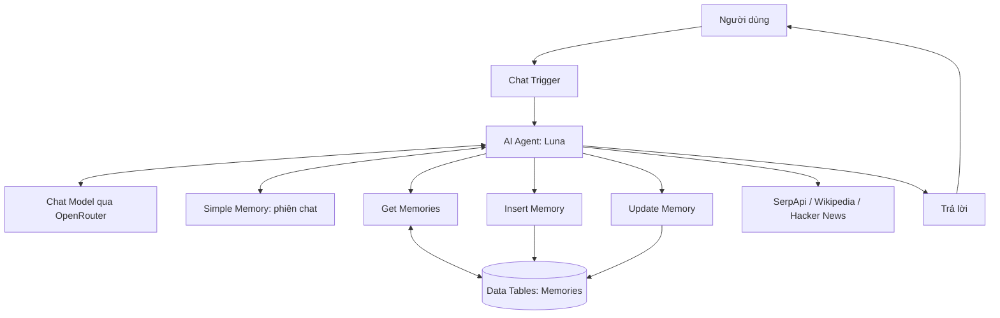

# Khóa học thực hành: Xây dựng trợ lý AI cá nhân Luna bằng n8n

> **Từ chatbot đơn giản đến AI Agent nhớ sở thích qua nhiều phiên trò chuyện và tự tìm kiếm thông tin trên Internet.**

**Đối tượng:** Người mới bắt đầu n8n, không yêu cầu kinh nghiệm lập trình.  
**Hình thức:** 9 bài Markdown độc lập, có sơ đồ Mermaid, ví dụ, checkpoint và câu hỏi trắc nghiệm.  
**Sản phẩm cuối:** Workflow n8n với Chat Trigger, AI Agent, Chat Model, bộ nhớ hội thoại, Data Tables, công cụ tra cứu và giao diện Hosted Chat.

## 1. Bạn sẽ xây dựng được gì?

Một chatbot tên **Luna** trả lời tiếng Việt tự nhiên, ghi nhớ tên, sở thích và thông tin người dùng muốn lưu, tra cứu thông tin từ các công cụ web, đồng thời hoạt động trên một liên kết chat khi workflow được xuất bản.

Ví dụ xuyên suốt: người dùng nói *“Tôi thích pizza”*. Sau đó mở phiên chat khác và hỏi *“Tôi thích món gì?”*, Luna tra bảng ký ức để trả lời *“Pizza”*. Khi hỏi *“Gợi ý nhà hàng ở New York”*, Luna có thể dùng sở thích đó để định hướng tìm kiếm và trình bày các lựa chọn có nguồn tra cứu.

## 2. Lộ trình học

| Thứ tự | Tài liệu | Kết quả đạt được |
|---|---|---|
| 01 | [Làm quen với n8n và cài đặt](01_LAM_QUEN_VA_CAI_DAT_N8N.md) | Mở được n8n và hiểu ba cách triển khai |
| 02 | [Tạo workflow Chat Trigger – AI Agent](02_XAY_DUNG_WORKFLOW_AI_AGENT.md) | Chatbot trả lời được tin nhắn |
| 03 | [Thiết kế system prompt và nhân cách Luna](03_SYSTEM_PROMPT_VA_KIEM_THU.md) | Agent có vai trò, quy tắc và ngữ cảnh thời gian |
| 04 | [Bộ nhớ hội thoại ngắn hạn](04_BO_NHO_HOI_THOAI_NGAN_HAN.md) | Agent giữ ngữ cảnh trong cùng phiên |
| 05 | [Bộ nhớ dài hạn với Data Tables](05_BO_NHO_DAI_HAN_DATA_TABLES.md) | Lưu, đọc, cập nhật sở thích qua các phiên |
| 06 | [Công cụ tìm kiếm và nghiên cứu web](06_CONG_CU_NGHIEN_CUU_WEB.md) | Kết hợp trí nhớ với tìm kiếm Google/Wikipedia/Hacker News |
| 07 | [Xuất bản Hosted Chat và xử lý tệp](07_XUAT_BAN_CHAT_VA_TEP_DINH_KEM.md) | Dùng chatbot qua URL, có xác thực |
| 08 | [Bảo mật, độ tin cậy và xử lý lỗi](08_BAO_MAT_VA_XU_LY_LOI.md) | Biết rủi ro, lỗi thường gặp và cách khắc phục |
| 09 | [Dự án cuối khóa và bộ kiểm thử](09_DU_AN_CUOI_KHOA.md) | Hoàn thiện và tự đánh giá workflow |

## 3. Sơ đồ kiến trúc toàn khóa

`Chat Trigger` nhận tin nhắn, `AI Agent` chọn hành động và tạo câu trả lời. `Simple Memory` giữ ngữ cảnh theo phiên. `Data Tables` lưu dữ liệu có thể truy xuất ở những phiên khác. Các công cụ web cung cấp thông tin bên ngoài khi câu hỏi cần cập nhật.

## 4. Chuẩn bị

- Một máy tính có trình duyệt; nếu cài local, cần Node.js tương thích hoặc Docker.
- Một môi trường n8n local, n8n Cloud hoặc máy chủ tự host.
- Tài khoản nhà cung cấp mô hình, ví dụ OpenRouter, và khóa API nếu chọn dịch vụ đó.
- Tùy chọn: tài khoản SerpApi để tìm kiếm qua Google; lưu ý hạn mức và phí tùy dịch vụ.

**Lưu ý về chi phí:** Phần mềm n8n self-host có thể dùng miễn phí theo điều kiện giấy phép áp dụng, nhưng máy chủ, mô hình AI, dịch vụ tìm kiếm hoặc gói Cloud có thể phát sinh chi phí. Mức giá minh họa trong lời giới thiệu không phải báo giá hiện hành.

## 5. Phương pháp học

Đọc từng bài, làm checkpoint ngay trong giao diện n8n, lưu kết quả kiểm thử trước khi chuyển bài. Ở mỗi bài, các câu trắc nghiệm có đáp án và giải thích để người học tự đối chiếu. Không cần viết mã để hoàn thành workflow cơ bản.

## 6. Thuật ngữ nhanh

| Thuật ngữ | Ý nghĩa |
|---|---|
| Workflow | Chuỗi bước thực hiện tự động hóa |
| Trigger | Nút kích hoạt workflow |
| AI Agent | Thành phần phối hợp mô hình, bộ nhớ và công cụ |
| Chat Model | Mô hình ngôn ngữ tạo hoặc hỗ trợ quyết định câu trả lời |
| Credential | Thông tin xác thực kết nối dịch vụ |
| Session | Một phiên hội thoại, được phân biệt bằng session ID |
| Data Table | Bảng dữ liệu nội bộ trong n8n |
| Tool call | Lệnh agent gọi một công cụ bên ngoài hoặc node hỗ trợ |

## 7. Tài liệu tham khảo chính thức

- [n8n Documentation](https://docs.n8n.io/)
- [Chat Trigger](https://docs.n8n.io/integrations/builtin/core-nodes/n8n-nodes-langchain.chattrigger/)
- [Data Tables](https://docs.n8n.io/data/data-tables/)
- [Data Table node – row operations](https://docs.n8n.io/integrations/builtin/core-nodes/n8n-nodes-base.datatable/rows/)
- [Hướng dẫn chạy n8n bằng npm](https://docs.n8n.io/hosting/installation/npm/)

> Tên nhãn giao diện và khả năng tích hợp có thể thay đổi theo phiên bản n8n. Khi thấy khác biệt, ưu tiên tài liệu n8n tương ứng với phiên bản đang dùng. Không nhúng API key, mật khẩu hoặc dữ liệu cá nhân thật vào tài liệu bài học.
