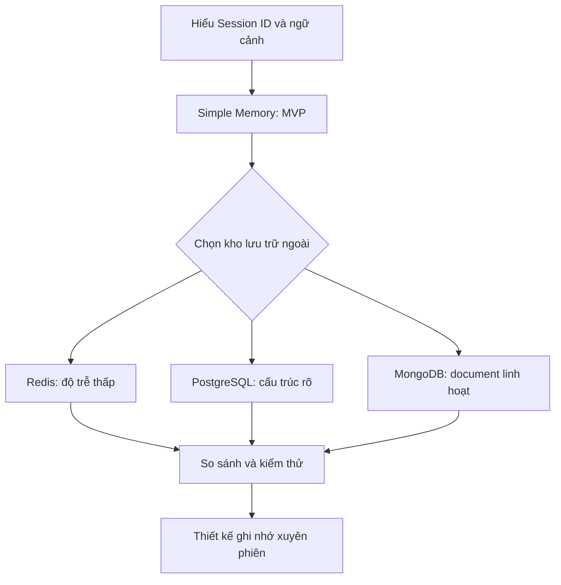

# Khóa học: Xây dựng bộ nhớ hội thoại cho AI Agent với n8n

> Lộ trình thực hành bằng tiếng Việt: từ bộ nhớ đơn giản đến lưu trữ hội thoại bền vững với Redis, PostgreSQL và MongoDB.

## 1. Giới thiệu khóa học

Một AI Agent chỉ trả lời dựa trên câu hỏi hiện tại thường không thể duy trì ngữ cảnh khi cuộc trò chuyện kéo dài hoặc người dùng bắt đầu một phiên mới. Để giải quyết vấn đề này, ta cần **bộ nhớ hội thoại**: cơ chế ghi và truy xuất các lượt tin nhắn phù hợp để mô hình có ngữ cảnh khi phản hồi.

Khóa học hướng dẫn bốn phương án bộ nhớ có thể kết nối với AI Agent trong **n8n**:

1. **Simple Memory**: thử nghiệm nhanh, không cấu hình dịch vụ cơ sở dữ liệu ngoài.
2. **Redis Chat Memory**: truy xuất nhanh, thích hợp với ứng dụng thời gian thực.
3. **Postgres Chat Memory**: lưu lịch sử trong bảng PostgreSQL, thuận tiện cho dữ liệu có cấu trúc.
4. **MongoDB Chat Memory**: lưu lịch sử dưới dạng document, linh hoạt khi cấu trúc dữ liệu thay đổi.

Phần cuối hướng dẫn lựa chọn giải pháp và thiết kế ví dụ ghi nhớ sở thích người dùng qua nhiều ngày. **Lưu lịch sử hội thoại** và **trích xuất ký ức dài hạn** là hai khả năng khác nhau; việc kết nối database không tự động khiến agent hiểu mọi thông tin từ các phiên cũ.

## 2. Mục tiêu học tập

Sau khóa học, học viên có thể:

- Giải thích vai trò của `Session ID`, `Context Window Length`, kho lưu trữ và cơ chế truy xuất.
- Kết nối lần lượt Simple Memory, Redis, PostgreSQL, MongoDB với AI Agent trong n8n.
- Kiểm tra một bản ghi hội thoại đã được lưu và đọc lại ở phiên sau.
- Chọn phương án dựa trên độ trễ, tính bền vững, tính linh hoạt và chi phí vận hành.
- Thiết kế bước mở rộng để ghi nhớ sở thích người dùng giữa các phiên chat.

## 3. Thứ tự học và tệp bài giảng

| Bài | Tệp Markdown | Trọng tâm |
| --- | --- | --- |
| 01 | [01_nhap_mon_bo_nho_ai_agent.md](01_nhap_mon_bo_nho_ai_agent.md) | Khái niệm bộ nhớ, phiên và luồng dữ liệu |
| 02 | [02_simple_memory.md](02_simple_memory.md) | Thử nghiệm nhanh với Simple Memory |
| 03 | [03_redis_upstash.md](03_redis_upstash.md) | Kết nối Redis với Upstash |
| 04 | [04_postgres_supabase.md](04_postgres_supabase.md) | Kết nối PostgreSQL với Supabase |
| 05 | [05_mongodb_atlas.md](05_mongodb_atlas.md) | Kết nối MongoDB Atlas |
| 06 | [06_so_sanh_va_lua_chon.md](06_so_sanh_va_lua_chon.md) | Đánh đổi và tiêu chí chọn bộ nhớ |
| 07 | [07_lab_ghi_nho_xuyen_phien.md](07_lab_ghi_nho_xuyen_phien.md) | Lab hệ thống nhớ người dùng qua nhiều phiên |

## 4. Sơ đồ lộ trình

Lộ trình bắt đầu từ mô hình tối giản để phân biệt các thành phần, sau đó mới chuyển sang kho lưu trữ ngoài và đánh giá khả năng sử dụng thực tế.

## 5. Yêu cầu chuẩn bị

- Một môi trường n8n có các node `Chat Trigger`, `AI Agent`, chat model và nhóm Memory.
- Thông tin kết nối dịch vụ cơ sở dữ liệu nếu làm các bài Redis, PostgreSQL hoặc MongoDB.
- Khả năng truy cập dashboard của nhà cung cấp để xác minh dữ liệu đã lưu.
- Dùng tài khoản và dữ liệu thử nghiệm; không ghi token, mật khẩu hay hội thoại nhạy cảm vào ảnh chụp hoặc tệp bài nộp.

Tên trường cấu hình và giao diện có thể thay đổi theo phiên bản n8n hoặc dịch vụ. **Lấy endpoint, port và phương án SSL từ dashboard đang dùng**, không cố định các giá trị minh họa.

## 6. Cách đánh giá hoàn thành

- Mỗi bài: hoàn thành phần thực hành và trả lời câu hỏi trắc nghiệm.
- Bài 07: vượt qua ba tình huống kiểm thử: cùng phiên, phiên mới cùng người dùng, và phiên mới của người dùng khác.
- Tệp nộp: sơ đồ workflow, mô tả cấu hình (đã che thông tin bí mật), kết quả kiểm thử và nhận xét giải pháp.

## 7. Tài liệu tra cứu

- [Tài liệu n8n](https://docs.n8n.io/)
- [Danh sách AI Memory nodes trong n8n](https://docs.n8n.io/integrations/builtin/cluster-nodes/sub-nodes/)
- [Upstash Docs](https://upstash.com/docs)
- [Supabase Docs](https://supabase.com/docs)
- [MongoDB Atlas Docs](https://www.mongodb.com/docs/atlas/)

> Các bước triển khai bên dưới sử dụng bốn lựa chọn bộ nhớ trong n8n làm trọng tâm. Bài 07 là phần mở rộng kiến trúc nhằm phục vụ yêu cầu ghi nhớ **giữa các phiên**; không đồng nhất phần mở rộng này với chức năng mặc định của bất kỳ node Memory nào.
