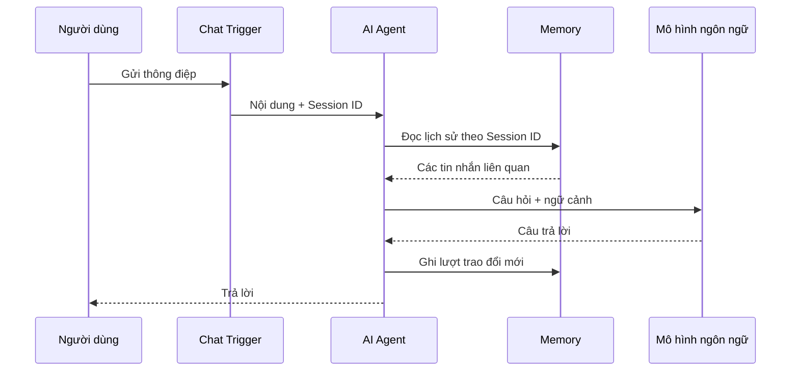

# Bài 01. Nền tảng bộ nhớ hội thoại trong AI Agent

## 1. Tóm tắt

Bộ nhớ hội thoại cung cấp cho AI Agent các tin nhắn trước đó để trả lời có mạch lạc. Trong n8n, một workflow cơ bản kết hợp `Chat Trigger`, `AI Agent`, chat model và memory node. Hiệu quả ghi nhớ phụ thuộc không chỉ vào nơi lưu dữ liệu mà còn vào **cách xác định phiên** và **phần lịch sử được đưa trở lại mô hình**.

## 2. Mục tiêu học tập

- Giải thích được mối quan hệ giữa lịch sử chat, `Session ID` và cửa sổ ngữ cảnh.
- Phân biệt lưu dữ liệu lâu dài với việc mô hình có thể truy xuất dữ liệu đó.
- Thiết kế được workflow tối thiểu để kiểm tra bộ nhớ.

## 3. Vì sao AI Agent cần bộ nhớ?

Giả sử người dùng nhắn: “Thời tiết ở London thế nào?”. Sau đó họ hỏi: “Tôi vừa hỏi gì?”. Nếu không truyền lại lượt chat trước, mô hình không thể biết “gì” đang nói tới. Bộ nhớ giúp lấy lại thông điệp trước làm ngữ cảnh, nhờ đó agent có thể đáp: “Bạn vừa hỏi về thời tiết ở London”.

Nên tách ba khái niệm:

| Thành phần | Nhiệm vụ | Câu hỏi kiểm tra |
| --- | --- | --- |
| **Storage** | Lưu các thông điệp sau mỗi lượt | Dữ liệu có còn sau khi workflow kết thúc? |
| **Session key** | Xác định thông điệp thuộc cuộc trò chuyện nào | Hai phiên có dùng cùng khóa không? |
| **Retrieval / context** | Đọc và đưa những thông điệp phù hợp vào lời nhắc | Agent thực sự nhận những gì trước khi trả lời? |

Một database có hàng nghìn dòng chat không đồng nghĩa mô hình đã được cung cấp hàng nghìn dòng đó.

## 4. Cơ chế hoạt động

`Session ID` đóng vai trò khóa phân nhóm lịch sử. Nếu bạn đổi khóa, node Memory thường coi đó là một cuộc trò chuyện khác. Điều này cần thiết để **không trộn dữ liệu giữa người dùng**, nhưng cũng lý giải tại sao một agent có thể “quên” khi bắt đầu phiên mới.

## 5. Context Window Length là gì?

Đây là tham số điều chỉnh lượng lịch sử hội thoại được memory node đưa trở lại làm ngữ cảnh. Có thể bắt đầu thử nghiệm với giá trị `5`, như ví dụ trong bài, rồi tăng/giảm theo kết quả và giới hạn ngữ cảnh của mô hình. **Đơn vị đếm thực tế tùy node** (tin nhắn hoặc cặp trao đổi); cần xem mô tả trường trong bản n8n đang dùng.

Tăng giá trị này có thể làm câu trả lời đầy đủ ngữ cảnh hơn, nhưng cũng làm tăng lượng token, chi phí và nguy cơ đưa thông tin không còn liên quan. Nó **không** quyết định số bản ghi mà database được phép lưu.

## 6. Bộ nhớ ngắn hạn và bộ nhớ dài hạn

**Lịch sử hội thoại ngắn hạn** thường là chuỗi tin nhắn gần đây trong cùng `Session ID`. Nó hữu ích cho các tham chiếu như “món đó”, “câu trước” hoặc “đổi yêu cầu vừa rồi”.

**Bộ nhớ dài hạn theo người dùng** cần một định danh ổn định (`user_id`) và cơ chế chọn thông tin lâu dài, ví dụ sở thích “thích cà phê”. Một phiên chat mới có thể có `session_id` mới nhưng vẫn gắn với `user_id` cũ. Khi ấy ứng dụng cần đọc hồ sơ hoặc ký ức của người dùng và bổ sung vào câu hỏi cho AI Agent. Không nên giả định `Postgres Chat Memory` hoặc `MongoDB Chat Memory` tự làm bước trích xuất sở thích này.

## 7. Workflow tối thiểu

1. Tạo workflow mới và thêm `Chat Trigger`.
2. Nối `Chat Trigger` tới `AI Agent`, kết nối một chat model đang hoạt động.
3. Gắn một node Memory vào cổng Memory của `AI Agent`.
4. Chọn nguồn `Session ID` do `Chat Trigger` cung cấp hoặc biểu thức khóa phiên phù hợp.
5. Gửi tin nhắn thứ nhất: “Tôi đang tìm hiểu bộ nhớ AI”.
6. Gửi tin nhắn tiếp theo trong **cùng phiên**: “Tôi đang tìm hiểu gì?”.
7. Mở execution và xác minh node Memory được sử dụng, không chỉ đánh giá từ câu trả lời.

## 8. Những điểm dễ sai

- **Nhầm session với user**: `session_id` chỉ đại diện phiên; nếu mỗi lần tải lại tạo một ID mới, lịch sử cũ có thể không còn được truy xuất.
- **Nhầm ghi với nhớ**: bản ghi vẫn nằm trong database, nhưng agent không nhìn thấy nếu truy vấn sai khóa.
- **Dùng chung khóa cho mọi người**: dễ khiến câu chuyện của người A lẫn sang người B.
- **Lưu tất cả trong prompt**: tăng chi phí và có thể vượt giới hạn context; nên giới hạn lịch sử được nạp.

## 9. Thực hành ngắn

Tạo hai phiên `S_A` và `S_B` (cùng môi trường kiểm thử). Lưu một câu riêng ở `S_A`, sau đó đặt câu hỏi tham chiếu trong `S_B`. Ghi lại kết quả và giải thích sự khác nhau giữa “không tìm thấy theo khóa” và “dữ liệu đã bị xóa”.

## 10. Câu hỏi ôn tập

### Câu 1

Thành phần nào quyết định các tin nhắn được nhóm trong cùng một cuộc trò chuyện?

A. `Session ID`  
B. Tên chat model  
C. Kích thước cửa sổ trình duyệt  
D. Số lượng token đầu ra

**Đáp án:** A. **Giải thích:** Memory dùng khóa phiên để xác định tập lịch sử cần đọc và ghi.

### Câu 2

Database còn dữ liệu nhưng agent trả lời rằng không nhớ phiên trước. Nguyên nhân nào cần kiểm tra đầu tiên?

A. Màu node Memory  
B. Kết nối Internet của người hỏi luôn là nguyên nhân  
C. `Session ID` hiện tại có khác khóa đã lưu không  
D. Tên workflow có dấu tiếng Việt hay không

**Đáp án:** C. **Giải thích:** Lịch sử theo session sẽ không được truy xuất khi khóa không khớp.

### Câu 3

Tăng `Context Window Length` chủ yếu có tác dụng gì?

A. Tăng số database  
B. Đưa nhiều lượt hội thoại hơn vào ngữ cảnh, tùy cách đếm của node  
C. Tạo user mới  
D. Bật SSL

**Đáp án:** B. **Giải thích:** Đây là tham số chọn lịch sử được nạp vào mô hình, không phải tùy chọn tạo cơ sở dữ liệu.

### Câu 4

Muốn ghi nhớ sở thích xuyên phiên, kiến trúc nào hợp lý nhất?

A. Dùng một session chung cho tất cả người dùng  
B. Chỉ tăng nhiệt độ sinh văn bản  
C. Tắt lưu lịch sử chat  
D. Liên kết phiên với `user_id` ổn định và truy xuất hồ sơ người dùng

**Đáp án:** D. **Giải thích:** Định danh người dùng bền vững giúp kết nối thông tin qua nhiều session mà vẫn cách ly dữ liệu.

### Câu 5

Lưu 100 bản ghi chat vào database nghĩa là gì?

A. Chúng được lưu, nhưng chỉ những bản ghi được truy xuất mới tham gia trả lời  
B. Cả 100 bản ghi luôn ở trong prompt  
C. Mô hình đã được huấn luyện lại  
D. Dữ liệu không thể bị xóa

**Đáp án:** A. **Giải thích:** Việc lưu trữ và việc nạp ngữ cảnh là hai thao tác độc lập.

## 11. Tổng kết

Một hệ thống bộ nhớ AI cần phối hợp chính xác giữa **kho lưu trữ – khóa định danh – cách lấy lịch sử – giới hạn ngữ cảnh**. Trước khi đổi sang database phức tạp hơn, hãy kiểm thử đường đi của `Session ID`.
