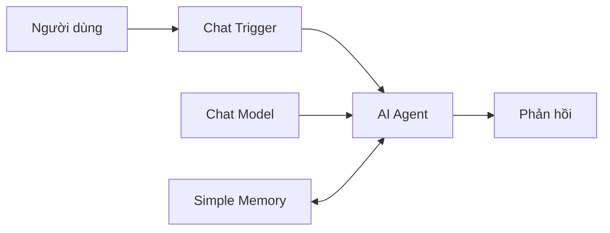

# Bài 02. Tạo bộ nhớ đầu tiên với Simple Memory trong n8n

## 1. Tóm tắt

`Simple Memory` giúp AI Agent lưu và sử dụng lịch sử hội thoại mà không phải tạo tài khoản Redis, PostgreSQL hay MongoDB. Đây là điểm xuất phát phù hợp để xây MVP, thử nghiệm prompt và kiểm tra workflow. Tuy nhiên, cần phân biệt tính tiện lợi trong thử nghiệm với yêu cầu bền vững và mở rộng của môi trường production.

## 2. Mục tiêu học tập

- Cấu hình `Simple Memory` cho workflow chat đơn giản.
- Kiểm chứng agent nhớ trong cùng phiên và đánh giá điều gì xảy ra khi đổi phiên.
- Giải thích được các giới hạn vận hành và khi nào cần chuyển sang kho lưu trữ ngoài.

## 3. Kiến thức cốt lõi

Trong n8n, `Simple Memory` thuộc nhóm memory node phục vụ AI Agent. Nó ghi lại các lượt trao đổi để tái sử dụng trong tương tác tiếp theo. Bạn không cần chuẩn bị một hệ quản trị cơ sở dữ liệu riêng; điều đó giúp tập trung vào luồng hội thoại.

Một workflow kiểm thử có dạng:

Chat model chịu trách nhiệm tạo câu trả lời, còn `Simple Memory` cung cấp lịch sử; không nên nhầm hai thành phần này.

## 4. Thao tác cấu hình

1. Trong n8n, tạo workflow với `Chat Trigger` và `AI Agent`.
2. Kết nối chat model phù hợp với `AI Agent`.
3. Tại cổng **Memory** của `AI Agent`, thêm `Simple Memory`.
4. Ở phần session, chọn phương án lấy `Session ID` từ Chat Trigger nếu workflow sử dụng chat nhúng của n8n; kiểm tra giá trị session thực tế trong execution.
5. Đặt `Context Window Length` ban đầu bằng `5` để dễ quan sát; điều chỉnh sau khi thử nghiệm.
6. Lưu và chạy thử workflow.

Không cần tạo `Credential` cơ sở dữ liệu cho bước này.

## 5. Kiểm tra trí nhớ

**Lần 1, cùng một phiên:**

- Người dùng: “Tôi đang tìm hiểu cách lưu bộ nhớ AI Agent.”
- Người dùng: “Tôi đang tìm hiểu vấn đề gì?”

Kết quả mong đợi: agent nhắc được chủ đề đã trao đổi. Nếu không, kiểm tra đầu vào và cách node Memory lấy session key.

**Lần 2, dùng session mới:**

- Tạo cuộc hội thoại mới với `Session ID` khác.
- Hỏi: “Tôi đã nói chủ đề nào ở phiên trước?”

Đừng mặc định agent sẽ biết. `Simple Memory` được dùng theo phiên; khi khóa phiên thay đổi, lịch sử có thể không còn được đưa vào mô hình. **Khả năng dữ liệu còn tồn tại sau restart, chuyển worker hoặc triển khai queue mode phụ thuộc cấu hình và giới hạn của n8n**; không nên dựa vào nó như nguồn lưu trữ bền vững cho hệ thống nhiều instance.

## 6. Ưu điểm và hạn chế

| Ưu điểm | Hạn chế |
| --- | --- |
| Thiết lập nhanh, ít thành phần | Không phải chiến lược dữ liệu bền vững cho hệ thống phân tán |
| Phù hợp demo, POC, MVP | Khó quản trị và khai thác lịch sử như dữ liệu độc lập |
| Dễ quan sát tác động của ngữ cảnh | Session mới có thể không nhìn thấy lịch sử cũ |

`MVP` (*Minimum Viable Product*) là sản phẩm tối thiểu đủ để kiểm tra giả định chính. Ở giai đoạn này, mục tiêu là chứng minh agent dùng được lịch sử, chưa phải hoàn thiện kiến trúc lưu trữ lâu dài.

## 7. Lỗi thường gặp và cách xử lý

| Triệu chứng | Cần kiểm tra |
| --- | --- |
| Agent không nhớ câu ngay trước | Có đúng cổng Memory, đúng session ID và đã chạy workflow chưa? |
| Nhớ nhầm hội thoại | Có dùng chung khóa phiên giữa nhiều luồng chat không? |
| Hết nhớ sau khi bắt đầu chat khác | Chat Trigger có cấp `Session ID` mới không? |
| Kết quả thay đổi sau khi triển khai nhiều worker | Chuyển sang memory backend phù hợp chế độ triển khai |

## 8. Thực hành

Tạo một bảng ghi kết quả cho ba tình huống: hai tin trong cùng session, hai session khác nhau, và thử lại sau khi chạy workflow mới. Ghi **Session ID đã ẩn bớt**, câu trả lời và nhận xét. Nếu chưa thể kiểm chứng restart, đánh dấu “chưa kiểm thử” thay vì khẳng định dữ liệu chắc chắn bị xóa.

## 9. Câu hỏi ôn tập

### Câu 1

Khi nào nên ưu tiên Simple Memory?

A. Khi phải báo cáo phân tích hàng triệu bản ghi  
B. Khi cần nhanh chóng thử khả năng giữ ngữ cảnh của agent  
C. Khi cần quản trị collection MongoDB  
D. Khi cần thay thế hệ thống đăng nhập

**Đáp án:** B. **Giải thích:** Simple Memory phù hợp cho giai đoạn thử nghiệm vì không cần database riêng.

### Câu 2

Simple Memory khác chat model ở điểm nào?

A. Memory lưu và cung cấp lịch sử; model sinh phản hồi  
B. Memory là công cụ phát âm thanh  
C. Model lưu toàn bộ dữ liệu vĩnh viễn  
D. Hai thành phần luôn tương đương

**Đáp án:** A. **Giải thích:** Vai trò lưu/truy xuất và suy luận sinh câu trả lời khác nhau.

### Câu 3

Người dùng tạo chat mới và không được nhắc đến nội dung trước đó. Kết luận nào hợp lý nhất?

A. n8n chắc chắn hỏng  
B. Mô hình đã xóa tài khoản  
C. Cần kiểm tra session key trước khi kết luận dữ liệu bị mất  
D. Nên cấp cùng session cho mọi người

**Đáp án:** C. **Giải thích:** Đổi khóa thường dẫn đến truy xuất lịch sử khác.

### Câu 4

Đâu là lý do nên chuyển khỏi Simple Memory khi chạy production nhiều worker?

A. Không thể có Chat Trigger  
B. Không hỗ trợ chat model  
C. Không thể đặt ngữ cảnh  
D. Cần backend chia sẻ, bền vững và dễ vận hành hơn

**Đáp án:** D. **Giải thích:** Hệ thống phân tán cần lưu trữ có khả năng dùng chung giữa các worker.

### Câu 5

Giá trị `Context Window Length` = 5 là gì trong bài thực hành?

A. Giá trị khởi đầu để thử lượng lịch sử đưa vào ngữ cảnh  
B. Mật khẩu mặc định  
C. Số database được tạo  
D. Thời gian hết hạn cố định của mọi session

**Đáp án:** A. **Giải thích:** Giá trị dùng để thử nghiệm context, không phải TTL hay thông tin xác thực.

## 10. Tổng kết

Dùng `Simple Memory` để kiểm tra logic chat và sự nhất quán của session trước khi thêm các thành phần hạ tầng. Khi cần truy xuất được qua nhiều phiên hoặc chạy production nhiều instance, cần thiết kế backend và khóa định danh phù hợp.
