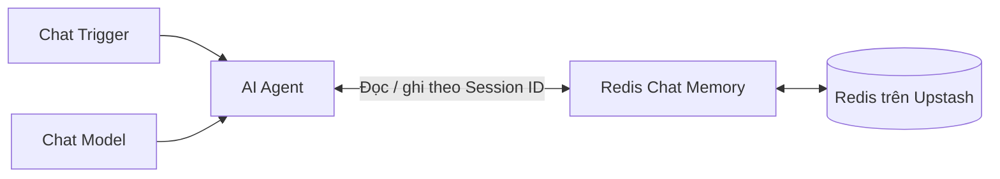

# Bài 03. Lưu bộ nhớ AI Agent bằng Redis và Upstash

## 1. Tóm tắt

`Redis Chat Memory` cho phép AI Agent dùng một Redis server làm nơi lưu lịch sử chat. Redis nổi bật ở khả năng truy xuất nhanh, đặc biệt phù hợp với tác vụ hội thoại có yêu cầu phản hồi thấp độ trễ. Bài thực hành minh họa dịch vụ Redis được quản lý bởi Upstash.

## 2. Mục tiêu học tập

- Cấu hình một Redis database và thông tin kết nối dành cho n8n.
- Phân biệt host, port, password, SSL, TTL và session key.
- Kiểm tra lịch sử hội thoại trong bảng điều khiển dữ liệu và đánh giá khi tạo phiên mới.

## 3. Kiến thức nền tảng

Redis là hệ thống lưu trữ dữ liệu dạng key-value, thường được dùng làm bộ nhớ đệm, hệ thống hàng đợi hoặc nơi truy xuất dữ liệu độ trễ thấp. Với chat memory, một khóa phiên dùng để tìm các lượt hội thoại tương ứng.

Tốc độ nhanh không có nghĩa Redis tự hiểu và trích xuất sở thích dài hạn: agent vẫn phải có logic truy xuất đúng khóa và đúng thông tin.

## 4. Tạo Redis trên Upstash

1. Mở [Upstash](https://upstash.com/) và đăng nhập.
2. Tạo Redis database mới, đặt một tên dễ phân biệt với các môi trường production khác.
3. Chọn region gần hệ thống chạy n8n để giảm độ trễ mạng nếu phù hợp yêu cầu.
4. Chọn gói tài nguyên phù hợp, sau đó tạo database.
5. Trong dashboard, tìm **Redis connection details**: endpoint/host, port, password, yêu cầu TLS/SSL và (nếu có) username.

**Quan trọng:** Redis protocol credential và REST API token có thể là hai loại thông tin khác nhau. Dùng đúng mục kết nối Redis mà node n8n yêu cầu; không tự lấy một token REST rồi giả định đó là password TCP. Các port trong ví dụ thường gặp không phải cấu hình cố định cho mọi tài khoản.

## 5. Cấu hình Redis Chat Memory trong n8n

1. Trong workflow `Chat Trigger → AI Agent`, thêm `Redis Chat Memory` ở cổng Memory.
2. Tại phần `Credential`, tạo kết nối Redis mới.
3. Điền `Host` bằng hostname từ dashboard, **không kèm** tiền tố `https://` nếu trường chỉ nhận hostname.
4. Điền `Port`, `Password`, `Username` (nếu được cấp) theo chi tiết kết nối Redis.
5. Bật `SSL/TLS` nếu dịch vụ yêu cầu mã hóa, không bật/tắt tùy tiện.
6. Lưu và kiểm tra kết nối.
7. Chọn cách lấy `Session ID` từ Chat Trigger hoặc biểu thức session nhất quán với ứng dụng.
8. Đặt `Context Window Length` thử nghiệm là `5`.
9. Xem mục `Session Time To Live` hoặc TTL nếu phiên cần hết hạn; cấu hình theo chính sách lưu trữ thay vì mặc định tắt hạn sử dụng.

## 6. Kiểm tra lưu trữ

**Bước A.** Mở chat và hỏi: “Ở Mỹ, football có thể chỉ môn nào?”.  
**Bước B.** Gửi một câu tiếp nối trong cùng session, chẳng hạn “Nhắc lại câu tôi vừa hỏi”.  
**Bước C.** Mở trình duyệt dữ liệu Redis của dịch vụ và kiểm tra khóa/bản ghi mới, bao gồm nội dung người dùng và phản hồi AI nếu định dạng lưu trữ của node thể hiện.  
**Bước D.** Mở session khác và quan sát khóa mới; xác minh dữ liệu phiên trước vẫn tồn tại hay đã hết hạn theo TTL.

Đây là bài kiểm tra hai thuộc tính khác nhau: **còn lưu trên Redis** và **được nạp vào phiên chat hiện tại**. Không đồng nhất chúng.

## 7. Ưu điểm, giới hạn và bảo mật

| Điểm mạnh | Điều cần lưu ý |
| --- | --- |
| Đọc/ghi nhanh, thích hợp luồng đối thoại thời gian thực | Cần vận hành dịch vụ Redis và giới hạn tài nguyên |
| Dễ tổ chức lịch sử theo session key | TTL hoặc chính sách eviction có thể khiến khóa bị xóa |
| Phù hợp chức năng lịch sử ngắn hạn với tải tương tác cao | Không thay thế hồ sơ sở thích hoặc tìm kiếm ngữ nghĩa |

Mặc dù Redis có khả năng lưu bền vững trong những cấu hình nhất định, **chính sách persistence, TTL và eviction của dịch vụ thực tế** mới quyết định tuổi thọ dữ liệu. Không đặt thông tin bí mật trực tiếp trong code hoặc chia sẻ ảnh chứa credential. Với môi trường production, dùng mạng/TLS, phân quyền và theo dõi mức sử dụng.

## 8. Xử lý sự cố

- **Timeout / kết nối bị từ chối**: so sánh host, port, TLS và giới hạn mạng với dashboard.
- **Sai thông tin xác thực**: kiểm tra username/password của giao thức Redis và ký tự đặc biệt khi sao chép.
- **Không có lịch sử**: xác nhận đã gắn memory node vào AI Agent, đúng `Session ID` và workflow đã chạy.
- **Khóa biến mất**: kiểm tra TTL, eviction, xóa thủ công hoặc thay đổi môi trường.

## 9. Thực hành

Cấu hình hai `Session ID` thử nghiệm, gửi hai câu ở mỗi phiên và chụp kết quả hiển thị trong data browser (ẩn thông tin nhạy cảm). Sau đó giải thích vì sao tồn tại hai khóa không có nghĩa agent ở session A tự biết nội dung session B.

## 10. Câu hỏi ôn tập

### Câu 1

Lợi thế thường được ưu tiên của Redis Chat Memory là gì?

A. Tự huấn luyện lại mô hình  
B. Thay thế xác thực người dùng  
C. Truy xuất dữ liệu với độ trễ thấp  
D. Không cần session key

**Đáp án:** C. **Giải thích:** Redis thường được dùng ở các tác vụ cần thao tác key-value nhanh.

### Câu 2

Nếu trường `Host` yêu cầu hostname, cách nhập nào phù hợp?

A. Nhập hostname theo dashboard, không kèm `https://`  
B. Dán nguyên trang dashboard  
C. Nhập luôn mật khẩu vào trường Host  
D. Dùng Session ID làm Host

**Đáp án:** A. **Giải thích:** Host là tên máy chủ, không phải URL dashboard hay khóa phiên.

### Câu 3

Vì sao cần chú ý TTL?

A. Vì TTL là số token mô hình sinh ra  
B. Vì TTL là port Redis  
C. Vì TTL thay thế SSL  
D. Vì TTL có thể quy định thời điểm dữ liệu phiên hết hạn

**Đáp án:** D. **Giải thích:** Thời gian sống của khóa ảnh hưởng tới khả năng còn dữ liệu sau này.

### Câu 4

Điều gì cần kiểm tra khi Redis yêu cầu kết nối bảo mật?

A. Đặt cùng khóa cho tất cả người dùng  
B. Cấu hình TLS/SSL đúng yêu cầu của endpoint  
C. Tắt credential  
D. Tăng nhiệt độ model

**Đáp án:** B. **Giải thích:** Endpoint và client phải thống nhất về cơ chế truyền tải mã hóa.

### Câu 5

Redis giữ được bản ghi của session cũ nhưng chat mới không nhắc được bản ghi đó. Phát biểu nào đúng?

A. Redis chắc chắn bị hỏng  
B. Tất cả bản ghi đã bị xóa  
C. Cần kiểm tra logic truy xuất theo session mới  
D. Chỉ cần đổi tên database

**Đáp án:** C. **Giải thích:** Dữ liệu có thể vẫn tồn tại nhưng không được lấy ra nếu không có khóa/truy vấn tương ứng.

## 11. Tổng kết

Redis thích hợp với lịch sử hội thoại cần phản hồi nhanh. Khi triển khai, hãy ưu tiên kiểm tra **đúng loại thông tin kết nối, TLS, TTL và Session ID** hơn việc chỉ thấy n8n báo kết nối thành công.
