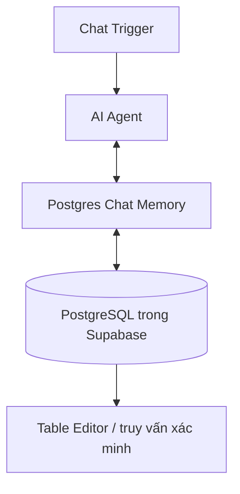

# Bài 04. Lưu lịch sử AI Agent bằng PostgreSQL và Supabase

## 1. Tóm tắt

`Postgres Chat Memory` lưu lịch sử hội thoại trong một cơ sở dữ liệu PostgreSQL. Bài này sử dụng Supabase làm môi trường quản lý PostgreSQL, giúp người học kiểm tra trực tiếp bản ghi qua trình quản lý bảng. Cách tiếp cận này phù hợp khi hệ thống đã dùng PostgreSQL hoặc cần quản trị dữ liệu có cấu trúc.

## 2. Mục tiêu học tập

- Tạo dự án PostgreSQL và lấy thông số kết nối chính xác.
- Kết nối `Postgres Chat Memory` với n8n, chọn bảng lịch sử và kiểm tra bản ghi.
- Phân biệt `table name`, `Session ID` và `Context Window Length`.

## 3. PostgreSQL trong kiến trúc bộ nhớ

PostgreSQL là hệ quản trị cơ sở dữ liệu quan hệ, sử dụng bảng và câu lệnh SQL để lưu/truy vấn dữ liệu. Node `Postgres Chat Memory` tận dụng backend này để ghi các lượt chat. Một bảng lịch sử có thể chứa định danh phiên và nội dung thông điệp theo định dạng do node quản lý.



**Chú ý:** Lưu trong cùng một bảng không có nghĩa các phiên nhìn được dữ liệu của nhau. Khóa phiên vẫn là tiêu chí truy xuất.

## 4. Chuẩn bị database trên Supabase

1. Vào [Supabase](https://supabase.com/) và đăng nhập.
2. Tạo tổ chức/dự án mới theo quyền hạn và hạn mức của tài khoản.
3. Chọn region phù hợp với nơi triển khai n8n.
4. Tạo mật khẩu cơ sở dữ liệu mạnh và lưu trong nơi quản lý bí mật, không chép vào file Markdown.
5. Sau khi dự án hoạt động, mở mục **Connect** hoặc **Database connection**.
6. Lấy `Host`, `Database`, `User`, `Password`, `Port` và phương thức `SSL` cho kiểu kết nối mà bạn chọn.

Một số cấu hình dùng **transaction pooler**, có thể hiển thị port như `6543`; số port phải lấy từ chính dashboard thay vì dùng mặc định cho mọi dự án. Xem giới hạn của pooler và phương thức kết nối phù hợp với phiên bản driver đang dùng.

## 5. Kết nối Postgres Chat Memory trong n8n

1. Thêm `Postgres Chat Memory` vào cổng Memory của `AI Agent`.
2. Tạo credential PostgreSQL mới trong n8n.
3. Điền từng trường từ phần connection details: host, port, database, user, password.
4. Chọn SSL/TLS đúng theo yêu cầu máy chủ; không bỏ qua xác minh chứng chỉ nếu chưa hiểu tác động.
5. Lưu credential và xác minh kết nối.
6. Chọn nguồn `Session ID` phù hợp với Chat Trigger.
7. Đặt tên bảng lưu lịch sử, ví dụ `n8n_chat_history` (tên minh họa); kiểm tra quyền tạo/ghi bảng của tài khoản đang dùng.
8. Đặt context window ban đầu là `5` rồi chạy thử workflow.

Tên bảng cần nhất quán giữa những lần triển khai. Thay đổi bảng có thể làm workflow không còn thấy lịch sử cũ dù dữ liệu vẫn nằm trong bảng trước.

## 6. Kiểm tra dữ liệu

1. Trong cửa sổ chat, nhập: “Xin chào, hôm nay thế nào?”.
2. Tiếp theo: “Câu tôi vừa nói là gì?”.
3. Mở Supabase `Table Editor` để xem bảng lịch sử do node tạo hoặc ghi vào (nếu có đủ quyền).
4. Xem các hàng ghi và xác định cột biểu diễn session, tin nhắn và thứ tự bản ghi.
5. Nếu muốn kiểm tra bằng SQL, chọn đúng tên bảng và cột thực tế trong dashboard thay vì giả định schema cố định.

Ví dụ truy vấn khám phá khi bảng có tên minh họa:

```sql
SELECT *
FROM n8n_chat_history
LIMIT 20;
```

Câu lệnh này chỉ đọc dữ liệu; nó không giả định tên các cột. Schema và quyền truy cập thực tế do phiên bản node cùng cấu hình backend quyết định.

## 7. Ưu điểm và giới hạn

| Ưu điểm | Lưu ý |
| --- | --- |
| Dữ liệu có tổ chức, thuận tiện quan sát và quản trị | Cần quản lý schema, quyền và kết nối |
| Phù hợp khi ứng dụng vốn đã sử dụng PostgreSQL | Có chi phí truy vấn và kết nối database |
| Dễ triển khai sao lưu, chính sách dữ liệu theo hệ CSDL quan hệ | Không nên so sánh độ trễ chỉ từ một yêu cầu thử nghiệm |

PostgreSQL thường là lựa chọn cân bằng khi tính bền vững và cấu trúc dữ liệu quan trọng. Redis có thể phù hợp hơn cho các thao tác bộ nhớ tức thời, nhưng tốc độ thực tế còn phụ thuộc mạng, tải, truy vấn và cấu hình hệ thống.

## 8. Những lỗi thường gặp

- **Sai port/pooler**: xác nhận `Connection method` đang được dùng; không trộn endpoint của kết nối trực tiếp với port của pooler.
- **Không tạo được bảng**: tài khoản chưa có quyền tạo bảng/schema hoặc tên bảng không hợp lệ.
- **Không có bản ghi mới**: xem lại cổng Memory và execution log.
- **Không nhớ qua phiên mới**: session key đã đổi; không phải bằng chứng PostgreSQL mất dữ liệu.
- **Lỗi SSL**: dùng cấu hình được dịch vụ cung cấp và kiểm tra chain chứng chỉ.

## 9. Thực hành

Tạo hai phiên thử nghiệm A và B. Sau khi tạo lịch sử cho mỗi phiên, xác nhận trên bảng database có bản ghi tương ứng và ghi nhận cách hai phiên được phân tách. Đưa ra đề xuất chính sách lưu trữ/ẩn dữ liệu cá nhân khi triển khai thật.

## 10. Câu hỏi ôn tập

### Câu 1

Tác dụng chính của `Postgres Chat Memory` là gì?

A. Tạo giao diện trò chơi  
B. Biên dịch prompt  
C. Thay chat model  
D. Lưu và lấy lịch sử chat thông qua PostgreSQL

**Đáp án:** D. **Giải thích:** Node dùng database PostgreSQL làm backend hội thoại.

### Câu 2

Port nào nên điền khi dashboard hiển thị phương án kết nối qua pooler?

A. Luôn chọn 6379  
B. Port tương ứng với endpoint/pooler được dashboard cung cấp  
C. Luôn chọn 80  
D. Số ngẫu nhiên

**Đáp án:** B. **Giải thích:** Port phụ thuộc endpoint và phương thức kết nối cụ thể.

### Câu 3

Đổi `Table Name` có thể gây ra tình huống nào?

A. Agent đọc/ghi vào bảng mới và không thấy dữ liệu ở bảng cũ  
B. Toàn bộ PostgreSQL tự xóa  
C. Người dùng được gộp tài khoản  
D. Không có thay đổi nào có thể xảy ra

**Đáp án:** A. **Giải thích:** Node có thể dùng bảng khác, dù dữ liệu cũ chưa bị xóa.

### Câu 4

Muốn biết bảng đã thực sự ghi dữ liệu, thao tác nào phù hợp nhất?

A. Đổi tên chatbot  
B. Tăng nhiệt độ sinh  
C. Xem bản ghi ở Table Editor hoặc truy vấn chỉ đọc  
D. Tắt session key

**Đáp án:** C. **Giải thích:** Kiểm chứng trên CSDL xác nhận được hành động ghi, thay vì suy ra từ câu trả lời.

### Câu 5

Vấn đề bảo mật nào quan trọng trong kết nối PostgreSQL?

A. Đưa password vào tài liệu công khai  
B. Tắt toàn bộ xác thực  
C. Cho người dùng chung credential quản trị  
D. Phân quyền tối thiểu và bảo vệ kết nối bằng SSL/TLS phù hợp

**Đáp án:** D. **Giải thích:** Hạn chế quyền và mã hóa kết nối giảm nguy cơ lộ dữ liệu.

## 11. Tổng kết

`Postgres Chat Memory` tạo khả năng lưu lịch sử hội thoại trong bảng database có thể quản lý và kiểm tra. Thành công của workflow phụ thuộc vào **credential, loại endpoint, quyền bảng, tên bảng và Session ID**.
