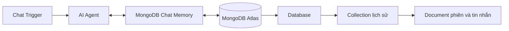

# Bài 05. Bộ nhớ hội thoại dạng document với MongoDB Atlas

## 1. Tóm tắt

`MongoDB Chat Memory` lưu lịch sử trong MongoDB, hệ quản trị dữ liệu theo document. Cách này linh hoạt khi ứng dụng có nhiều dạng nội dung hoặc định dạng lưu trữ phát triển theo thời gian. Bài học thực hành với MongoDB Atlas, dịch vụ MongoDB được quản lý trên cloud.

## 2. Mục tiêu học tập

- Tạo MongoDB Atlas deployment và database user để kết nối n8n.
- Cấu hình mạng, chuỗi kết nối và collection dành cho chat memory.
- Kiểm chứng document hội thoại và phân biệt database, collection, session.

## 3. Khái niệm cần biết

MongoDB lưu document trong **collection**, các collection thuộc về **database**. Document thường có cấu trúc dạng BSON (gần với JSON), thuận tiện khi dữ liệu chứa nhiều trường khác nhau.

| Thuật ngữ | Vai trò |
| --- | --- |
| Cluster / deployment | Nơi MongoDB được chạy |
| Database | Không gian nhóm collection |
| Collection | Tập hợp document |
| Document | Bản ghi dữ liệu |
| Database user | Tài khoản kết nối và phân quyền truy cập |
| Connection string | Chuỗi thông số kết nối tới MongoDB |

## 4. Tạo môi trường MongoDB Atlas

1. Truy cập [MongoDB Atlas](https://www.mongodb.com/atlas) và đăng nhập.
2. Tạo một project và deployment trong hạn mức tài khoản.
3. Chọn cloud provider/region theo nhu cầu, ví dụ môi trường gần n8n.
4. Tạo **database user** với username, password và quyền phù hợp.
5. Thiết lập **Network Access / IP Access List** cho địa chỉ IP công khai của n8n hoặc kênh kết nối mạng riêng.
6. Tại cluster, chọn **Connect → Drivers** (nếu giao diện còn dùng cách đặt tên này) và lấy connection string.
7. Chọn database và collection phù hợp hoặc tạo mới qua giao diện database.

**Lưu ý bảo mật quan trọng:** Một hướng dẫn demo có thể chọn “Allow access from anywhere” (`0.0.0.0/0`) để kết nối nhanh. **Không dùng cấu hình đó làm mặc định cho production.** Ưu tiên IP allowlist giới hạn ở địa chỉ thoát mạng của n8n, kết hợp user quyền tối thiểu, mật khẩu mạnh và TLS.

## 5. Cấu hình n8n

1. Gắn `MongoDB Chat Memory` vào cổng Memory của `AI Agent`.
2. Trong Credential, chọn cách nhập thông tin MongoDB được node hỗ trợ, ví dụ **connection string** nếu có.
3. Điền chuỗi kết nối từ Atlas. Khi chuỗi có placeholder như `<db_password>`, thay bằng mật khẩu đã tạo; với ký tự đặc biệt, URL-encode đúng theo định dạng URI.
4. Chọn database và tên collection lưu lịch sử theo đúng trường node yêu cầu.
5. Chọn `Session ID` được truyền từ Chat Trigger, đặt cửa sổ ngữ cảnh thử nghiệm là `5`.
6. Lưu và kiểm thử kết nối, sau đó gửi vài tin nhắn để kiểm tra việc ghi dữ liệu.

Không đưa chuỗi kết nối thật vào báo cáo hoặc Git; thông tin này có thể chứa username/password.

## 6. Kiểm tra kết quả

1. Nhắn: “Hướng dẫn làm hamburger tại nhà”.
2. Nhắn tiếp trong cùng phiên: “Nhắc lại món tôi vừa hỏi”.
3. Mở Atlas **Browse Collections** hoặc trình xem dữ liệu tương đương.
4. Chọn database/collection đã cấu hình và xác định document mới.
5. Xem các trường chứa session và thông điệp theo schema thực tế do node ghi. Có thể thấy nội dung phía người dùng và phía AI trong định dạng hội thoại.
6. Lặp lại với `Session ID` mới, xác định bản ghi mới được tạo ở đâu và agent truy xuất bằng khóa nào.

## 7. Ưu điểm và đánh đổi

| Ưu điểm | Đánh đổi |
| --- | --- |
| Document phù hợp cấu trúc dữ liệu linh hoạt | Cần thiết kế truy vấn, chỉ mục và quản lý truy cập |
| Tiện khi ứng dụng đã dùng MongoDB | Chi phí vận hành/phân tích tùy workload |
| Có thể mở rộng lưu trữ theo cấu hình deployment | Không mặc định nhanh hơn mọi database khác |

MongoDB phù hợp với hệ thống có dữ liệu linh hoạt, nhưng **lưu nhiều document không đồng nghĩa agent có bộ nhớ dài hạn thông minh**. Ứng dụng phải chỉ định cách lọc, tóm tắt và lấy ký ức liên quan.

## 8. Xử lý lỗi phổ biến

- **Authentication failed**: kiểm tra database user/password, database xác thực và ký tự cần URL-encode.
- **Server selection timeout**: xem lại IP access list, DNS, cluster còn hoạt động và khả năng kết nối từ n8n.
- **Không thấy document**: xác nhận đúng database, collection, session và execution của node.
- **Quyền không đủ**: cấp quyền đọc/ghi theo database cần thiết, tránh dùng role quản trị toàn cục chỉ để thử chat.
- **Kết nối thành công nhưng chat không nhớ**: kiểm tra cách truyền `Session ID`.

## 9. Thực hành

Tạo hai phiên chat với hai khóa riêng. Đọc các document tương ứng trong Atlas, ghi lại cấu trúc (ẩn dữ liệu cá nhân), rồi mô tả điều gì cần thêm nếu muốn agent tìm lại thông tin của một người dùng qua nhiều session.

## 10. Câu hỏi ôn tập

### Câu 1

Trong MongoDB, tập hợp các document được gọi là gì?

A. Port  
B. Collection  
C. Credential  
D. Token window

**Đáp án:** B. **Giải thích:** Collection chứa các document trong một database.

### Câu 2

Cấu hình mạng nào phù hợp hơn cho Atlas production?

A. Chặn tất cả và bỏ qua kết nối  
B. Cho mọi IP truy cập công khai vô thời hạn  
C. Ghi mật khẩu vào tài liệu  
D. Chỉ cho phép IP hoặc mạng đã được xác định của ứng dụng

**Đáp án:** D. **Giải thích:** Giới hạn nguồn kết nối giảm phạm vi phơi bày dịch vụ.

### Câu 3

Lỗi thường gặp khi mật khẩu trong connection string chứa ký tự đặc biệt là gì?

A. URI không được encode đúng và xác thực/kết nối thất bại  
B. MongoDB tự thay thành PostgreSQL  
C. Session ID biến thành IP  
D. Không thể tạo database mới

**Đáp án:** A. **Giải thích:** Các ký tự URI có ý nghĩa cú pháp phải được xử lý đúng.

### Câu 4

Ưu thế nổi bật của dữ liệu document so với một schema bảng cố định là gì?

A. Không cần bảo mật  
B. Luôn nhanh nhất trong mọi trường hợp  
C. Dễ thích nghi hơn với cấu trúc dữ liệu thay đổi  
D. Tự nhớ toàn bộ cuộc đời người dùng

**Đáp án:** C. **Giải thích:** Document cho phép các bản ghi có cấu trúc linh hoạt.

### Câu 5

Điều nào cần thiết để agent biết nội dung hội thoại đã lưu?

A. Chỉ cần Atlas hiển thị số lượng document  
B. Có cơ chế truy xuất document đúng theo khóa và cung cấp cho mô hình  
C. Đổi tên cluster mỗi ngày  
D. Thêm tài khoản quản trị toàn cục

**Đáp án:** B. **Giải thích:** Cơ chế truy xuất quyết định dữ liệu lưu nào trở thành ngữ cảnh của agent.

## 11. Tổng kết

`MongoDB Chat Memory` là phương án linh hoạt để ghi lại hội thoại dưới dạng document. Các bước cần đặc biệt chú ý là **user/role, IP allowlist, connection string, database/collection và session key**.
