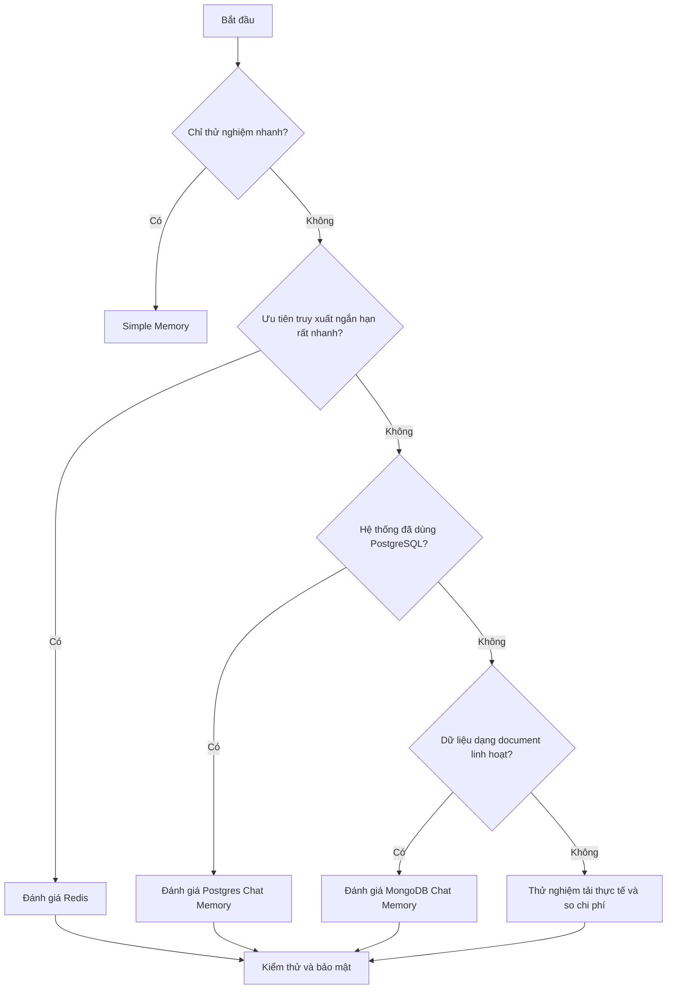

# Bài 06. So sánh và lựa chọn bộ nhớ phù hợp cho AI Agent

## 1. Tóm tắt

Không có một backend bộ nhớ tối ưu cho mọi AI Agent. Việc lựa chọn phải dựa trên bài toán thực tế: demo hay production, truy xuất có cần rất nhanh không, dữ liệu có cấu trúc thế nào, cần giữ bao lâu và có sẵn công nghệ gì. Bài này xây dựng khung so sánh thực dụng giữa Simple Memory, Redis, PostgreSQL và MongoDB.

## 2. Mục tiêu học tập

- Đánh giá được bốn phương án trên cùng một bộ tiêu chí.
- Chọn backend hợp lý cho ít nhất ba loại ứng dụng.
- Xây dựng kế hoạch kiểm thử trước khi dùng production.

## 3. Bảng so sánh tổng quan

| Tiêu chí | Simple Memory | Redis | PostgreSQL | MongoDB |
| --- | --- | --- | --- | --- |
| Mục tiêu điển hình | Thử nghiệm / MVP | Chat độ trễ thấp | Lịch sử có cấu trúc | Lịch sử dạng document |
| Database ngoài | Không cần | Cần | Cần | Cần |
| Quản trị dữ liệu | Hạn chế | Theo key/TTL | Theo bảng/SQL | Theo collection/document |
| Dữ liệu tồn tại lâu dài | Không nên giả định | Phụ thuộc TTL/persistence | Theo chính sách CSDL | Theo chính sách CSDL |
| Độ phức tạp khởi tạo | Thấp | Trung bình | Trung bình | Trung bình |
| Phù hợp nhiều worker | Cần xem giới hạn | Có thể, nếu cấu hình đúng | Có thể, nếu cấu hình đúng | Có thể, nếu cấu hình đúng |

Bảng trên là đánh giá định tính; **không phải benchmark đo hiệu năng**. Trên một workload cụ thể, độ trễ Redis, PostgreSQL và MongoDB phải được kiểm tra bằng cùng dữ liệu, cùng cách truy vấn và cùng môi trường mạng.

## 4. Các tình huống ứng dụng

### 4.1. Chatbot mẫu để chứng minh ý tưởng

Bài toán: một chatbot nhỏ, vài cuộc trò chuyện, chủ yếu cần xác nhận agent biết tham chiếu đến câu hỏi trước. Chọn **Simple Memory** để giảm công sức thiết lập. Khi thành chức năng vận hành thật, đánh giá lại vấn đề lưu trữ bền vững.

### 4.2. Trợ lý giọng nói cần phản hồi nhanh

Bài toán: liên tục trao đổi bằng giọng nói và cần lấy lại vài lượt hội thoại gần đây. **Redis** là ứng viên tốt cho bộ nhớ phiên nhờ khả năng truy cập nhanh. Cần kiểm soát độ trễ cả quy trình (STT → truy xuất → model → TTS), không chỉ backend.

### 4.3. Ứng dụng quản trị người dùng đã dùng SQL

Bài toán: lưu hội thoại cùng hệ thống vận hành dùng dữ liệu có cấu trúc. **PostgreSQL** giúp dễ tích hợp và kiểm tra lịch sử bằng SQL; cần thiết kế quyền, bảng và chính sách lưu giữ.

### 4.4. Ứng dụng có dữ liệu chat biến đổi linh hoạt

Bài toán: mỗi phiên có thêm metadata, thông tin công cụ hoặc dữ liệu khác nhau. **MongoDB** là ứng viên phù hợp nhờ document linh hoạt; vẫn cần kiểm soát schema ở tầng ứng dụng và tạo chỉ mục thích hợp.

## 5. Sơ đồ quyết định

Sơ đồ chỉ hỗ trợ quyết định ban đầu. Một hệ thống có thể kết hợp Redis cho context gần và PostgreSQL/MongoDB cho lịch sử dài hơn; tuy nhiên, nên thêm nhiều thành phần chỉ khi có yêu cầu cụ thể.

## 6. Những tiêu chí không nên bỏ qua

**Tính bền vững:** dữ liệu có còn sau restart, đổi worker, hết TTL hoặc mất kết nối? Cần kế hoạch sao lưu/khôi phục khi dữ liệu quan trọng.

**Quyền riêng tư:** các bản ghi chat có thể chứa thông tin cá nhân. Nên gắn `user_id`, dùng phân quyền tối thiểu, đặt thời hạn lưu hợp lý và có cách xóa dữ liệu theo yêu cầu.

**Cách ly người dùng:** tuyệt đối không dùng một session key chung cho nhiều tài khoản. Nếu có backend đa người dùng, khóa truy vấn phải gắn với quyền sở hữu dữ liệu.

**Khả năng mở rộng:** kiểm tra số cuộc hội thoại đồng thời, số lượng tin nhắn mỗi phiên, tải kết nối database, chi phí và quan sát lỗi.

**Truy xuất bộ nhớ dài hạn:** lịch sử chat nguyên văn chưa phải hồ sơ ký ức. Nếu cần nhớ “người này thích cà phê”, hãy có bước trích xuất sự kiện, ghi với `user_id`, xác minh/điều chỉnh và tìm lại khi người đó quay lại.

## 7. Checklist quyết định triển khai

- [ ] Đã xác định yêu cầu giữ dữ liệu theo ngày/tháng hay chỉ phiên chat.
- [ ] Đã biết khóa `Session ID` và `user_id` lấy từ đâu.
- [ ] Đã kiểm thử lưu/đọc cùng session và khác session.
- [ ] Đã xác minh quyền truy cập, SSL/TLS và secret storage.
- [ ] Đã kiểm tra TTL, chính sách sao lưu/xóa và phục hồi sự cố.
- [ ] Đã đo độ trễ end-to-end trong điều kiện gần với thực tế.
- [ ] Đã xác định có cần lưu sở thích dài hạn ngoài chat memory hay không.

## 8. Câu hỏi ôn tập

### Câu 1

Trong giai đoạn demo ngắn, yêu cầu ít hạ tầng, lựa chọn khởi đầu nào hợp lý?

A. Simple Memory  
B. Luôn xây cluster MongoDB phân tán  
C. Cài cả ba database cùng lúc  
D. Loại bỏ session key

**Đáp án:** A. **Giải thích:** Simple Memory giảm công việc cấu hình trong giai đoạn thử nghiệm.

### Câu 2

Ứng dụng có Redis TTL ngắn nhưng cần lưu hồ sơ sở thích nhiều tháng. Cách tiếp cận hợp lý là gì?

A. Đổi tên mọi session  
B. Không cần làm gì thêm  
C. Lưu hồ sơ dài hạn ở kho phù hợp và dùng Redis cho lịch sử gần  
D. Tắt xác thực Redis

**Đáp án:** C. **Giải thích:** Hai loại dữ liệu có vòng đời khác nhau nên có thể dùng chiến lược lưu trữ khác nhau.

### Câu 3

Vì sao không thể tuyên bố Redis luôn nhanh hơn PostgreSQL ở mọi quy trình?

A. Redis không thể kết nối mạng  
B. Độ trễ toàn hệ thống còn phụ thuộc truy vấn, mạng, tải và thiết kế  
C. PostgreSQL không lưu dữ liệu  
D. Tất cả truy vấn có độ trễ bằng nhau

**Đáp án:** B. **Giải thích:** Cần đo trên workload thực tế thay vì dùng một nhận xét định tính làm benchmark.

### Câu 4

Rủi ro của việc dùng cùng session key cho mọi người là gì?

A. Giảm số câu hỏi ôn tập  
B. Tăng chất lượng SSL  
C. Tăng số collection  
D. Có thể trộn hoặc lộ lịch sử giữa người dùng

**Đáp án:** D. **Giải thích:** Session key phải tách các cuộc trò chuyện để bảo vệ dữ liệu.

### Câu 5

Hệ thống đã dùng PostgreSQL và cần quản lý lịch sử theo bảng. Ưu tiên nào hợp lý?

A. Chọn Postgres Chat Memory để tái sử dụng hạ tầng phù hợp  
B. Bỏ database đang vận hành  
C. Chỉ lưu trong prompt  
D. Chọn ngẫu nhiên, không thử nghiệm

**Đáp án:** A. **Giải thích:** Tái sử dụng hạ tầng có sẵn thường giảm chi phí tích hợp và vận hành.

## 9. Tổng kết

Hãy chọn bộ nhớ dựa trên **yêu cầu vòng đời dữ liệu, tốc độ, cấu trúc, khả năng vận hành và bảo mật**, thay vì theo một danh sách xếp hạng chung. Đây là quyết định kiến trúc có thể thay đổi khi sản phẩm phát triển.
