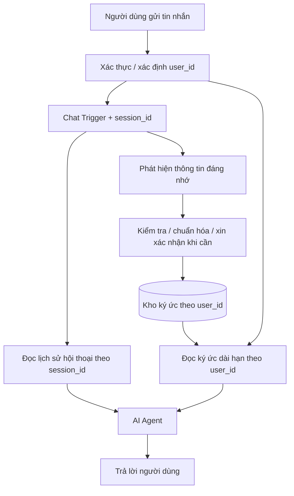
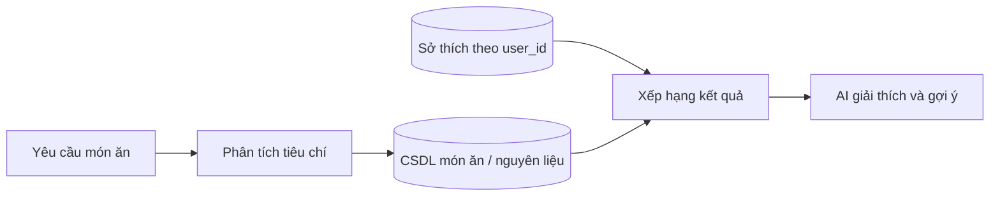

# Bài 07. Lab: Xây dựng AI Agent ghi nhớ người dùng qua nhiều phiên

## 1. Tổng quan

Bộ nhớ chat trong n8n thường tập trung vào lịch sử theo `Session ID`. Nhưng một trợ lý cá nhân cần khả năng ghi nhớ thông tin ổn định theo **người dùng**, ngay cả khi họ mở cuộc trò chuyện mới. Bài lab này mở rộng kiến thức đã học để thiết kế một lớp “ký ức người dùng” bên cạnh các memory node, với tình huống: thứ Hai người dùng nói thích cà phê; Chủ nhật người dùng hỏi gợi ý món ăn thì agent có thể dùng sở thích cũ nếu phù hợp.

Đây là **bài thực hành thiết kế mở rộng**, không phải hành vi tự động có sẵn chỉ nhờ bật Redis/Postgres/MongoDB Chat Memory.

## 2. Mục tiêu học tập

- Phân biệt chính xác `session_id`, `user_id` và ký ức trích xuất.
- Mô tả được luồng ghi, đọc và cập nhật sở thích ở nhiều phiên.
- Thiết kế mô hình dữ liệu nhỏ với các điều kiện truy xuất an toàn.
- Kiểm thử dữ liệu của hai người dùng không bị trộn lẫn.

## 3. Yêu cầu và chuẩn bị

**Tình huống:**

- Thứ Hai, người dùng A nhắn: “Tôi thích cà phê”.
- Vài ngày sau, A mở phiên chat mới và hỏi: “Tôi chán quá, gợi ý món gì phù hợp?”.
- Nếu thông tin sở thích còn giá trị, agent có thể đưa ra gợi ý liên quan đến cà phê, nhưng không nhất thiết mọi món đều phải có cà phê.
- Người dùng B không được truy cập ký ức của A.

**Chuẩn bị:** workflow n8n có Chat Trigger, AI Agent, chat model, một backend chat memory theo lựa chọn của người học và một nơi lưu hồ sơ dài hạn có thể truy vấn theo `user_id`. Ví dụ bên dưới dùng bảng quan hệ để làm rõ mô hình; cũng có thể triển khai bằng document MongoDB với điều kiện tương ứng.

## 4. Sơ đồ kiến trúc



`session_id` phục vụ ngữ cảnh tức thời; `user_id` phục vụ hồ sơ dài hạn. Luồng trích xuất chỉ nên lưu thông tin hữu ích, phù hợp mục đích và có thể kiểm soát; không sao chép toàn bộ tin nhắn thành “sở thích” một cách vô điều kiện.

## 5. Thiết kế dữ liệu tối thiểu

Một cấu trúc minh họa cho PostgreSQL:

```sql
CREATE TABLE user_memories (
    id BIGSERIAL PRIMARY KEY,
    user_id TEXT NOT NULL,
    category TEXT NOT NULL,
    memory_key TEXT NOT NULL,
    memory_value TEXT NOT NULL,
    source_session_id TEXT,
    updated_at TIMESTAMPTZ NOT NULL DEFAULT NOW(),
    UNIQUE (user_id, category, memory_key)
);

CREATE INDEX idx_user_memories_user_id
ON user_memories(user_id);
```

Ví dụ bản ghi minh họa:

| user_id | category | memory_key | memory_value |
| --- | --- | --- | --- |
| `user_a` | `food_preference` | `coffee` | `Thích cà phê` |

Các trường chỉ nhằm diễn giải ý tưởng, **không phải schema bắt buộc** của `Postgres Chat Memory` trong n8n. Đây là bảng riêng cho bộ nhớ người dùng. Nếu muốn phân biệt “thích” với “không thích”, có thể bổ sung trường trạng thái hoặc cấu trúc giá trị đã chuẩn hóa; nếu cần lưu nhạy cảm, phải có chính sách đồng ý và bảo vệ dữ liệu.

## 6. Các bước triển khai ở mức workflow

### 6.1. Xác định danh tính người dùng

Lấy `user_id` từ tầng đăng nhập đã xác thực. **Không tin một `user_id` do người gọi tự điền nếu backend chưa kiểm tra quyền**. Với ứng dụng chỉ demo, có thể dùng hai ID giả lập A/B để thử cách ly, nhưng không dùng cách đó làm xác thực production.

### 6.2. Ghi lịch sử theo session

Kết nối `Chat Trigger → AI Agent → Memory` như các bài trước. Mỗi phiên có một `session_id`; ghi và lấy lịch sử theo phiên này. Đừng thay thế tất cả session bằng một khóa chung chỉ để “nhớ” xuyên phiên.

### 6.3. Trích xuất sở thích có giá trị lâu dài

Sau khi nhận câu “Tôi thích cà phê”, bước xử lý có thể tạo sự kiện:

```json
{
  "category": "food_preference",
  "memory_key": "coffee",
  "memory_value": "Thích cà phê"
}
```

Trước khi lưu, kiểm tra nội dung có đúng là sở thích của người dùng, có rõ ràng và không mâu thuẫn với thông tin hiện tại. Với thông tin mơ hồ, nên hỏi lại; cho phép người dùng xem và xóa ký ức đã lưu.

### 6.4. Lưu và cập nhật ký ức

Với ví dụ SQL, ứng dụng có thể ghi vào bảng riêng bằng `Postgres` node hoặc một API được phép truy cập. Thao tác cập nhật minh họa:

```sql
INSERT INTO user_memories
    (user_id, category, memory_key, memory_value, source_session_id)
VALUES
    ($1, 'food_preference', 'coffee', 'Thích cà phê', $2)
ON CONFLICT (user_id, category, memory_key)
DO UPDATE SET
    memory_value = EXCLUDED.memory_value,
    source_session_id = EXCLUDED.source_session_id,
    updated_at = NOW();
```

`$1` và `$2` là tham số được bind lần lượt với `user_id` và `session_id` trong lớp truy vấn hỗ trợ parameterized SQL; không nối trực tiếp chuỗi người dùng thành SQL. Khi tạo tích hợp, kiểm tra cách đặt tham số của node đang dùng.

### 6.5. Lấy ký ức khi bắt đầu phiên mới

Trước khi gọi mô hình, truy vấn các ghi nhớ phù hợp với `user_id` đã xác thực:

```sql
SELECT category, memory_key, memory_value
FROM user_memories
WHERE user_id = $1
ORDER BY updated_at DESC
LIMIT 20;
```

Chỉ chèn những thông tin có ích vào prompt, ví dụ:

> Sở thích đã được lưu của người dùng: thích cà phê. Khi gợi ý món ăn, cân nhắc sở thích này nếu phù hợp. Không suy đoán rằng người dùng luôn muốn dùng cà phê.

Phần này là dữ liệu tham khảo cho AI, không phải chỉ thị có quyền cao hơn các nguyên tắc vận hành của ứng dụng.

## 7. Nâng cấp thành gợi ý món ăn theo database

Nếu yêu cầu còn bao gồm “tìm món có tôm”, “món có cà phê” hoặc “món ít calo”, cần **cơ sở dữ liệu món ăn độc lập**. Bộ nhớ sở thích không thay thế danh mục thực phẩm. Luồng có thể gồm:



Ví dụ, bộ lọc nguyên liệu bắt buộc nên được áp dụng ở tầng truy vấn database; sở thích cà phê chỉ là tín hiệu xếp hạng bổ sung. Với “ít calo”, cần dữ liệu năng lượng đáng tin cậy và khẩu phần rõ ràng; không tự suy đoán chỉ từ tên món.

## 8. Kiểm thử và checkpoint

| Bước | Hành động | Kết quả cần đạt |
| --- | --- | --- |
| 1 | A nói “Tôi thích cà phê” ở session `s1` | Có bản ghi sở thích của A sau bước xử lý hợp lệ |
| 2 | A tạo session `s2`, hỏi món phù hợp | Agent có thể dùng ký ức A khi phù hợp |
| 3 | B tạo session `s3`, hỏi cùng câu | Không truy xuất sở thích của A |
| 4 | A đổi ý “Tôi không còn thích cà phê nữa” | Bản ghi được sửa/xóa sau khi xử lý cập nhật |
| 5 | A yêu cầu xem/xóa dữ liệu ghi nhớ | Có phương án đọc/xóa đúng `user_id` |

**Điều kiện đạt:** không lẫn dữ liệu giữa A và B; không phụ thuộc session cũ để đọc hồ sơ người dùng; có bằng chứng truy vấn/ghi đúng trong database.

## 9. Debug và những tình huống rủi ro

- **Agent không nhớ A ở session mới:** kiểm tra `user_id` có ổn định không, query theo đúng user chưa, kết quả query có đưa vào prompt không.
- **B thấy sở thích A:** coi là sự cố cách ly dữ liệu; dừng thử nghiệm với dữ liệu thật, kiểm tra quyền truy vấn và khóa lọc.
- **Agent ghi nhớ nhầm:** bổ sung bước kiểm tra phát biểu, cập nhật hoặc xác nhận; phân biệt suy luận với thông tin do người dùng nói.
- **Quá nhiều ký ức:** giới hạn, xếp hạng, tổng hợp những thông tin cần thiết thay vì nạp toàn bộ.
- **Lưu thông tin nhạy cảm:** cần cơ sở pháp lý/mục đích phù hợp, giới hạn lưu giữ và cơ chế xóa.

## 10. Deliverable và checklist

- [ ] Sơ đồ workflow thể hiện hai tầng memory (session và user).
- [ ] Bảng hoặc collection ký ức riêng với khóa người dùng.
- [ ] Ghi chú cách xác thực `user_id`.
- [ ] Kết quả kiểm thử các trường hợp 1–5.
- [ ] Mô tả cơ chế sửa/xóa ký ức.

## 11. Câu hỏi ôn tập

### Câu 1

Khóa phù hợp để truy vấn sở thích người dùng qua nhiều phiên là gì?

A. Tên chatbot  
B. Số câu trả lời  
C. `user_id` ổn định và đã được xác thực  
D. Mọi `session_id` gộp lại thành một

**Đáp án:** C. **Giải thích:** Hồ sơ cá nhân cần gắn với người dùng, không phụ thuộc một phiên chat duy nhất.

### Câu 2

Nếu A thích cà phê, B bắt đầu phiên mới thì điều nào phải đúng?

A. B không được đọc ký ức của A  
B. B luôn có cùng sở thích với A  
C. Cả hai phải dùng chung session  
D. Toàn bộ dữ liệu của A được thêm vào prompt của B

**Đáp án:** A. **Giải thích:** Việc cách ly dữ liệu theo user là điều kiện bảo mật bắt buộc.

### Câu 3

Nói “Tôi thích cà phê” khác gì với việc chỉ có tin nhắn trong lịch sử chat?

A. Không có gì khác  
B. Nó tự động cập nhật mọi CSDL  
C. Nó buộc mọi gợi ý đều chứa cà phê  
D. Có thể trích xuất thành ký ức có cấu trúc, lưu theo user và truy xuất lại

**Đáp án:** D. **Giải thích:** Lưu sở thích dài hạn cần một bước xử lý riêng, không chỉ ghi lịch sử nguyên văn.

### Câu 4

Muốn tìm món có tôm, hệ thống cần bổ sung thành phần nào?

A. Tăng Context Window Length vô hạn  
B. Dữ liệu món ăn/nguyên liệu và bước truy vấn lọc phù hợp  
C. Đặt mật khẩu Redis mới  
D. Cùng một session cho mọi người

**Đáp án:** B. **Giải thích:** Bộ nhớ người dùng không thay thế cơ sở dữ liệu các món ăn.

### Câu 5

Đâu là xử lý đúng khi người dùng nói “Tôi không thích cà phê nữa”?

A. Giữ nguyên thông tin cũ và không thay đổi  
B. Lưu thành sở thích của người khác  
C. Cập nhật/xóa ký ức cũ phù hợp với phát biểu mới  
D. Xóa toàn bộ tài khoản không cần hỏi

**Đáp án:** C. **Giải thích:** Ký ức dài hạn phải hỗ trợ sửa đổi, không được coi là bất biến.

## 12. Tổng kết

Khả năng ghi nhớ qua nhiều ngày đến từ việc thiết kế **định danh người dùng ổn định, bộ nhớ có cấu trúc, đường ghi/đọc rõ ràng và kiểm soát quyền truy cập**. Chat memory vẫn hữu ích cho hội thoại gần, nhưng không đủ để tự tạo một trợ lý có trí nhớ cá nhân đáng tin cậy.
