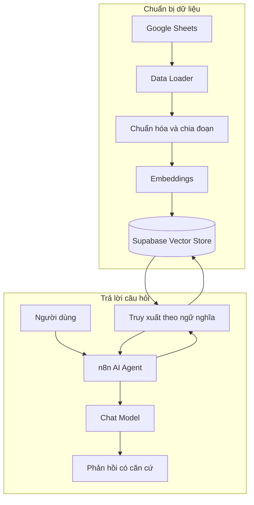

# Bài 01 — RAG và kiến trúc AI Agent truy xuất dữ liệu

## 1. Tóm tắt

Một mô hình ngôn ngữ không mặc nhiên biết bảng giá, chính sách hay danh mục sản phẩm riêng của doanh nghiệp. **Retrieval-Augmented Generation (RAG)** cho phép hệ thống truy xuất dữ liệu phù hợp lúc người dùng hỏi rồi đưa dữ liệu đó vào ngữ cảnh để mô hình tạo câu trả lời có căn cứ.

## 2. Mục tiêu học tập

Sau bài này, có thể giải thích RAG, phân biệt việc gửi toàn bộ bảng dữ liệu với truy xuất chọn lọc và mô tả các vai trò của n8n, LLM, Vector Store và Memory.

## 3. Bài toán thực tế

Khách hỏi: “Có tivi khoảng 5 triệu không?”. Một LLM độc lập không biết tồn kho. Chatbot cần truy xuất danh mục cửa hàng, nhận lại các sản phẩm gần yêu cầu rồi trả lời với giá và tình trạng hàng được xác thực.

RAG gồm hai nhánh độc lập:

Luồng nạp dữ liệu chạy khi nguồn cập nhật; luồng trả lời chạy theo từng câu hỏi. Cần dùng cùng một mô hình embedding tương thích cho dữ liệu lúc nạp và câu hỏi lúc tìm.

## 4. RAG khác gì gửi bảng trực tiếp?

| Tiêu chí | Gửi toàn bộ Google Sheets | RAG với Vector Store |
|---|---|---|
| Ngữ cảnh gửi tới LLM | Có thể gồm mọi hàng | Chủ yếu là các đoạn truy xuất |
| Triển khai ban đầu | Đơn giản với bảng nhỏ | Cần indexing và cấu hình retrieval |
| Dữ liệu lớn | Dễ quá giới hạn ngữ cảnh | Có thể mở rộng nhờ tìm kiếm |
| Bảo đảm chính xác giá | Cần kiểm tra | Vẫn cần kiểm tra |
| Cập nhật giá / tồn kho | Đọc nguồn mới mỗi lần hoặc cache | Cần đồng bộ/index lại và có thể truy vấn trực tiếp |

Đọc Google Sheets qua công cụ rồi đưa kết quả cho LLM là một kiểu **grounding bằng dữ liệu ngoài**, nhưng không phải hệ thống nào như vậy cũng có đầy đủ bước truy xuất và tạo sinh của RAG.

## 5. Thực hành ngắn

Vẽ lại sơ đồ và gắn nhãn cho hai bước: (1) ghi embedding, (2) tìm dữ liệu khi đặt câu hỏi. Đề xuất hai trường phải lọc chính xác đối với dữ liệu điện máy: `price_vnd` và `in_stock`.

## 6. Điểm dễ sai

- RAG không tự huấn luyện lại LLM và không làm dữ liệu doanh nghiệp trở thành kiến thức vĩnh viễn của model.
- Chat Memory lưu lịch sử cuộc trò chuyện, không thay thế danh mục sản phẩm.
- Truy xuất được đoạn gần nghĩa không đồng nghĩa đoạn đó đáp ứng toàn bộ điều kiện số học.

## 7. Câu hỏi ôn tập

**Câu 1.** Công đoạn nào giúp câu trả lời dựa trên danh mục riêng?  
A. Retrieval  B. Đổi giao diện  C. Tăng nhiệt độ  D. Xóa memory  
**Đáp án: A.** Retrieval cung cấp ngữ cảnh bên ngoài cho mô hình.

**Câu 2.** Khách hỏi giá chính xác của sản phẩm; vector similarity có đủ không?  
A. Luôn đủ  B. Chỉ cần tăng top-k  C. Không, cần đối chiếu dữ liệu cấu trúc  D. Chỉ cần lưu chat  
**Đáp án: C.** Similarity không đảm bảo phép so sánh giá.

**Câu 3.** Workflow indexing thông thường chạy khi nào?  
A. Mỗi token  B. Khi dữ liệu được thêm hoặc thay đổi  C. Sau mọi câu trả lời  D. Khi user gõ dấu hỏi  
**Đáp án: B.** Chỉ cần tạo/cập nhật vector khi dữ liệu thay đổi.

**Câu 4.** Chat Memory dùng để làm gì?  
A. Tạo bảng giá  B. Chuyển text thành vector  C. Thay nguồn tồn kho  D. Giữ ngữ cảnh hội thoại  
**Đáp án: D.** Memory hỗ trợ hiểu các lượt chat nối tiếp.

**Câu 5.** Tại sao phải giới hạn tài liệu truy xuất?  
A. Cân bằng chi phí ngữ cảnh và độ phủ  B. Để AI không dùng LLM  C. Để SQL tự sinh giá  D. Để xóa sản phẩm cũ  
**Đáp án: A.** Số đoạn truy xuất ảnh hưởng token và recall.

## 8. Tổng kết

Kiến trúc RAG tách xử lý dữ liệu khỏi xử lý hội thoại, qua đó kiểm soát được nguồn dữ liệu, chi phí ngữ cảnh và hành vi của trợ lý.
