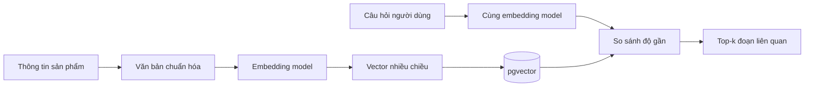

# Bài 02 — Embedding, Vector Database và thiết kế dữ liệu

## 1. Tóm tắt

Embedding là một dãy số nhiều chiều biểu diễn đặc điểm ngữ nghĩa của văn bản. Một cơ sở dữ liệu vector hỗ trợ lưu embedding và tìm các vector gần nhau theo thước đo như cosine distance. **Không nên hiểu vector luôn chỉ có ba tọa độ x–y–z**; mô hình thực tế thường có nhiều chiều hơn.

## 2. Mục tiêu học tập

Giải thích cơ chế tìm kiếm ngữ nghĩa; thiết kế document, metadata và chunk phù hợp; phân biệt lọc định lượng với truy xuất vector.

## 3. Cơ chế hoạt động



Ví dụ cùng một mặt hàng được viết: “Smart TV Casper 43 inch, giá 4.990.000đ, còn hàng.” Người dùng có thể hỏi “tivi 43 inch khoảng năm triệu”; tìm kiếm ngữ nghĩa giúp tìm được nội dung gần nghĩa dù không trùng nguyên từ.

## 4. Thiết kế một bản ghi tốt

```json
{
  "product_id": "TV-CASPER-43",
  "name": "Smart TV Casper 43 inch",
  "category": "tivi",
  "price_vnd": 4990000,
  "in_stock": true,
  "description": "Smart TV 43 inch phù hợp phòng nhỏ",
  "content": "Tên: Smart TV Casper 43 inch. Loại: tivi. Giá: 4990000 VND. Tình trạng: còn hàng. Mô tả: Smart TV 43 inch phù hợp phòng nhỏ."
}
```

`content` dành cho embedding/retrieval; các trường `product_id`, `price_vnd`, `in_stock` dùng để xác minh và lọc chính xác. Với Supabase Vector Store, metadata là cấu trúc JSON có thể giữ các thuộc tính có ích để lọc hoặc truy vết.

## 5. Chiến lược chia đoạn

**Một sản phẩm/một tài liệu** thường dễ kiểm soát hơn việc nối mọi hàng vào một chuỗi khổng lồ. Nếu phần mô tả dài, chia theo mục hoặc đoạn và bảo toàn `product_id` trên mọi chunk. Không cắt ngang giá với tên sản phẩm; nếu cắt, hệ thống có thể đánh mất mối liên hệ giữa chúng.

Một demo có thể nối nhiều hàng qua `Aggregate` và `Summarize → Concatenate`, nhưng điều đó **không mặc nhiên là chiến lược tối ưu**. Khi một chunk chứa nhiều sản phẩm, việc truy xuất một sản phẩm có thể kéo theo sản phẩm khác, gây trùng hoặc nhầm giá.

## 6. Checklist chất lượng

- Dữ liệu văn bản có tên trường và giá trị rõ ràng.
- Mọi bản ghi có `product_id` ổn định, tránh ghi đè sai.
- Giá lưu dạng số, có đơn vị; tình trạng kho có kiểu rõ ràng.
- Dữ liệu embedding không chứa khóa API hoặc dữ liệu nhạy cảm không cần thiết.
- Nêu cách update/delete tài liệu khi hàng đổi giá hoặc hết hàng.

## 7. Thực hành

Biến 3 hàng gồm TV, tủ lạnh, máy giặt thành 3 văn bản riêng, mỗi văn bản có tên, danh mục, giá, tồn kho và `product_id`. Thử truy vấn “máy giặt dưới 10 triệu”, rồi dùng điều kiện giá thực tế để quyết định đề xuất.

## 8. Câu hỏi ôn tập

**Câu 1.** Embedding lưu dưới dạng nào?  
A. Ảnh 3D  B. Mảng giá trị số  C. Một URL  D. Bảng HTML  
**Đáp án: B.** Embedding là biểu diễn số nhiều chiều.

**Câu 2.** Trường nào hữu ích nhất để lọc giá?  
A. `description`  B. `embedding`  C. `category_name`  D. `price_vnd`  
**Đáp án: D.** So sánh định lượng cần số có cấu trúc.

**Câu 3.** Tại sao giữ `product_id` trong metadata?  
A. Để định danh và truy vết  B. Để tăng số chiều embedding  C. Để thay mật khẩu  D. Để xóa chat  
**Đáp án: A.** ID gắn chunk với mặt hàng thật.

**Câu 4.** Hai văn bản gần nhau theo vector bảo đảm điều gì?  
A. Giá bằng nhau  B. Cùng kho  C. Có độ tương đồng theo thước đo, không bảo đảm mọi điều kiện  D. Cùng mã sản phẩm  
**Đáp án: C.** Similarity không phải bằng nhau ở các trường cấu trúc.

**Câu 5.** Đối với danh sách điện máy, giải pháp mặc định dễ kiểm soát là?  
A. Một chunk toàn kho  B. Một sản phẩm một document  C. Chỉ giữ giá  D. Không có metadata  
**Đáp án: B.** Cách này giữ rõ ranh giới bản ghi.

## 9. Tổng kết

Thiết kế dữ liệu và chunk ảnh hưởng trực tiếp khả năng truy xuất; embedding chỉ là một phần của bài toán.
