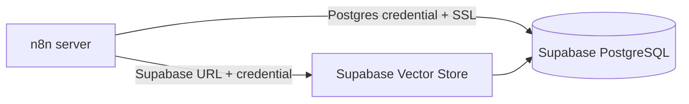

# Bài 03 — Cấu hình Supabase, PostgreSQL và credentials trong n8n

## 1. Tổng quan

Supabase cung cấp dự án PostgreSQL, có thể bật `pgvector` để lưu và truy vấn vector. n8n cần hai kết nối khác nhau: **Postgres** cho Chat Memory và **Supabase** cho Vector Store.

## 2. Mục tiêu

Tạo project, lấy thông số kết nối, lưu credentials an toàn và xác nhận n8n kết nối được PostgreSQL/Supabase.

## 3. Chuẩn bị

Có tài khoản n8n, tài khoản Supabase, quyền tạo project và quyền thiết lập credentials. Chọn region phù hợp vị trí triển khai, ví dụ Singapore nếu hệ thống/khách hàng chủ yếu ở Việt Nam; đó là lựa chọn hạ tầng, không phải yêu cầu bắt buộc.

## 4. Thực hành từng bước

1. Vào **Supabase Dashboard → New project**, chọn tổ chức, đặt tên dự án, mật khẩu cơ sở dữ liệu và region.
2. Mở mục kết nối cơ sở dữ liệu (thường là **Connect**), lấy `host`, `database`, `user`, `port`, kiểu SSL và mật khẩu tương ứng. Supabase có thể cung cấp địa chỉ kết nối qua pooler. **Dùng port đúng theo chuỗi kết nối hiển thị**; ví dụ session/transaction pooler có thể khác direct connection. Demo có nhắc `6543`, nhưng không coi đó là mặc định cho mọi chế độ.
3. Trong n8n, tạo credential **Postgres**, điền thông số; bật SSL nếu cấu hình yêu cầu và kiểm thử kết nối.
4. Trong Supabase Dashboard, lấy **Project URL** cùng API key cần thiết để tạo credential Supabase cho Vector Store. Các tên tab/API key có thể thay đổi theo giao diện hiện hành.
5. Khi node đòi hỏi quyền service-role, chỉ lưu secret trong n8n credential được bảo vệ. **Service-role có quyền rất cao và bỏ qua RLS**; không dùng trong trình duyệt hay gửi cho người dùng cuối.
6. Ghi lại tên credential nội bộ (không ghi secret). Kiểm tra n8n có thể đọc danh sách bảng sau khi đã tạo bảng ở bài nạp dữ liệu.

## 5. An toàn kết nối

- Chọn chuỗi kết nối theo chế độ pooler hỗ trợ nhu cầu của node; nếu transaction pooling không phù hợp session state/prepared statements, đổi cấu hình kết nối cho tương thích.
- Không hard-code key vào workflow JSON hoặc chia sẻ ảnh chụp màn hình lộ secret.
- Hạn chế quyền truy cập các bảng nhạy cảm; thiết lập RLS/quyền dịch vụ theo nhu cầu thật.
- Trong môi trường thử nghiệm, có thể dùng dự án riêng với dữ liệu giả lập để giảm rủi ro.

## 6. Kiểm tra và sửa lỗi

| Triệu chứng | Cách xử lý |
|---|---|
| Connection refused | Kiểm tra host, port, mạng và chế độ kết nối |
| Authentication failed | Kiểm tra user/password, reset secret nếu cần |
| SSL error | Đối chiếu yêu cầu TLS/SSL từ Supabase |
| Không hiện table | Tạo schema/table đúng project rồi reload danh sách |
| Permission denied | Kiểm tra quyền SQL, role và RLS |

## 7. Câu hỏi ôn tập

**Câu 1.** Credential nào cấp kết nối SQL cho Postgres Chat Memory?  
A. Postgres  B. Facebook  C. SMTP  D. RSS  
**Đáp án: A.** Node Chat Memory truy cập PostgreSQL.

**Câu 2.** Port lấy từ đâu?  
A. Luôn 80  B. Tự chọn bất kỳ  C. Chuỗi kết nối của project/mode tương ứng  D. URL trang chủ  
**Đáp án: C.** Port phụ thuộc endpoint dùng để kết nối.

**Câu 3.** Service-role key nên được lưu ở đâu?  
A. HTML frontend  B. n8n credential trên backend  C. Public README  D. Query string công khai  
**Đáp án: B.** Không lộ quyền đặc biệt ra client.

**Câu 4.** Vì sao cần kiểm tra SSL?  
A. Để sinh sản phẩm  B. Để tăng token  C. Để tạo embedding  D. Để kết nối tuân thủ yêu cầu bảo mật  
**Đáp án: D.** Endpoint có thể yêu cầu TLS.

**Câu 5.** Credentials Postgres và Supabase có cùng mục đích không?  
A. Hoàn toàn giống  B. Chỉ để tạo UI  C. Khác vai trò kết nối SQL và Vector Store  D. Cả hai để tạo mật khẩu người dùng  
**Đáp án: C.** Hai node dùng kết nối ở hai lớp chức năng.

## 8. Kết quả cần đạt

Hai credentials hoạt động, không lộ secret, không đưa giá trị giả định của port/host vào production.
