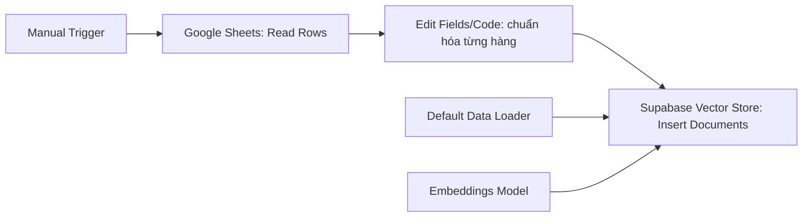

# Bài 04 — Lab nạp Google Sheets vào Supabase Vector Store

## 1. Tổng quan

Chuyển các hàng sản phẩm từ Google Sheets thành document có cấu trúc, embedding và bản ghi trong vector store. Đây là workflow **ingestion/indexing**, độc lập với workflow nhận câu hỏi.

## 2. Mục tiêu

Kết nối Google Sheets, thiết kế văn bản chuẩn hóa, nạp Supabase, quan sát `content`, `metadata`, `embedding` và phát hiện bản ghi lỗi.

## 3. Chuẩn bị

Một Google Sheet với tab `product`; có thể tạo 3–5 hàng từ ví dụ JSON ở Bài 02. Trong demo có 29 hàng dữ liệu điện máy; số hàng trong bài thực hành tùy bảng của người học.

## 4. Workflow khuyến nghị



**Các bước:**

1. Tạo workflow n8n, chọn Manual Trigger → **Google Sheets** để đọc tất cả rows từ tab `product`.
2. Xem kết quả từng item; đánh dấu trường tên, giá, tồn kho, thông số, ID.
3. Chuẩn hóa mỗi hàng thành một document có các khóa rõ nghĩa. Nếu dùng Code node, tham khảo dạng sau và điều chỉnh trường theo sheet:

```javascript
return $input.all().map(item => {
  const p = item.json;
  const name = String(p.name ?? '').trim();
  const price = Number(p.price_vnd ?? 0);
  const id = String(p.product_id ?? '').trim();
  if (!id || !name || !Number.isFinite(price)) {
    throw new Error('Thiếu ID, tên hoặc giá không hợp lệ');
  }
  return { json: {
    pageContent: `Mã: ${id}. Tên: ${name}. Danh mục: ${p.category ?? ''}. Giá: ${price} VND. Tình trạng: ${p.in_stock ? 'còn hàng' : 'hết hàng'}. Thông tin: ${p.description ?? ''}`,
    metadata: { product_id: id, category: p.category ?? '', price_vnd: price, in_stock: Boolean(p.in_stock) }
  }};
});
```

4. Tạo bảng vector trong **Supabase SQL Editor** theo hướng dẫn schema/SQL tương thích với đúng node và embedding model đang chọn. Tùy n8n, mở tài liệu từ node Supabase Vector Store để lấy mẫu SQL, thường có bảng document và hàm tìm kiếm. Kiểm tra số chiều vector phải khớp model embedding.
5. Thêm node **Supabase Vector Store** ở chế độ **Insert Documents / Add Documents**, kết nối **Default Data Loader** và **Embeddings**. Mapping trong loader phải lấy đúng chuỗi nội dung đã chuẩn hóa và metadata. Tên cổng và trường có thể khác theo phiên bản.
6. Chạy ingestion, đọc execution log và mở Supabase Table Editor để xác nhận đã có `content`, `metadata`, `embedding`.

## 5. Vì sao chỉ nạp JSON thô có thể thất bại?

Nếu loader đưa một chuỗi không rõ trường-và-giá trị hoặc chia cắt giữa tên và giá, đoạn trả về có thể không đủ để LLM suy ra sản phẩm. Trong demo, lần nạp đầu khiến chatbot không tìm ra mẫu Casper 43 inch khoảng 5 triệu; sau khi nối dữ liệu theo định dạng rõ key/value, hệ thống tìm được. Điều này chứng minh **định dạng đầu vào ảnh hưởng kết quả**, không chứng minh phải nối tất cả sản phẩm làm một chuỗi.

Một phương án demo khác là `Google Sheets → Aggregate → Summarize (Concatenate) → Data Loader → Embeddings → Supabase`. Có thể dùng để khám phá hành vi chunking, nhưng cần so sánh với cách mỗi hàng là một document.

## 6. Checkpoint và debugging

- Đầu ra Google Sheets có số dòng mong đợi.
- Document chứa đúng tên–giá–tình trạng hàng.
- Bảng vector có hàng mới; embedding không rỗng.
- Chạy lại workflow không tạo trùng bản ghi ngoài dự kiến: thiết kế cập nhật/upsert/delete theo ID khi triển khai thật.
- Không sử dụng khóa API trong pageContent hay metadata.

## 7. Deliverable

Workflow ingestion có thể chạy, ví dụ 3–5 sản phẩm trong bảng vector, ảnh/log thể hiện kiểm thử thành công (đã che secret).

## 8. Câu hỏi ôn tập

**Câu 1.** Node nào chuyển nội dung văn bản thành vector?  
A. Manual Trigger  B. Embeddings Model  C. Google Sheets  D. Memory  
**Đáp án: B.** Embedding model sinh biểu diễn vector.

**Câu 2.** Lỗi gì có thể xuất hiện nếu loader không chứa giá cùng tên sản phẩm?  
A. Mất căn cứ trả lời  B. Tạo SSL  C. Thay mật khẩu  D. Tăng RAM tự động  
**Đáp án: A.** Nội dung truy xuất thiếu thông tin quan trọng.

**Câu 3.** Bước nào nên thực hiện trước Insert Documents?  
A. Xóa workflow  B. Đăng bài Facebook  C. Bật microphone  D. Tạo bảng/hàm SQL phù hợp  
**Đáp án: D.** Vector Store cần đích dữ liệu đã cấu hình.

**Câu 4.** Kiểm tra ingestion thành công thế nào?  
A. Chỉ xem giao diện đẹp  B. Xem token toàn hệ thống  C. Xem hàng content, metadata, embedding đã ghi  D. Xóa kết nối  
**Đáp án: C.** Ba trường thể hiện tài liệu và vector được nạp.

**Câu 5.** Vì sao nên có product_id?  
A. Đổi theme  B. Theo dõi bản ghi và đồng bộ  C. Giấu tên  D. Chia phiên  
**Đáp án: B.** Định danh giúp update/delete đúng sản phẩm.

## 9. Tổng kết

Chất lượng ingestion quyết định chất lượng retrieval. Chuẩn hóa dữ liệu phải được kiểm thử trước khi làm chatbot.
