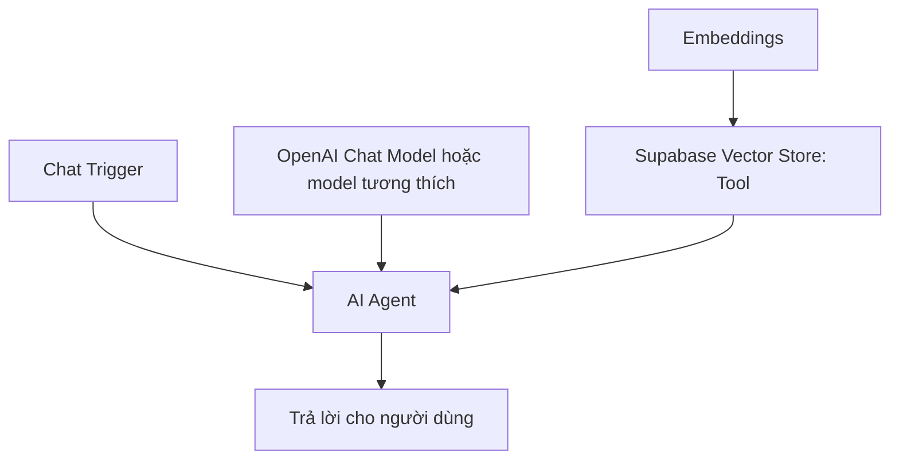

# Bài 05 — Xây dựng chatbot AI Agent truy xuất Supabase

## 1. Tóm tắt

AI Agent nhận câu hỏi, chọn công cụ truy xuất dữ liệu phù hợp, đưa các đoạn liên quan cho Chat Model và diễn đạt câu trả lời. Ví dụ “tivi khoảng 5 triệu” có thể đưa đến sản phẩm Casper 43 inch nếu dữ liệu tương ứng đang có trong store.

## 2. Mục tiêu

Ghép Chat Trigger, AI Agent, Chat Model, Supabase Vector Store và Embeddings; thiết lập prompt; kiểm tra execution log từng node.

## 3. Sơ đồ



Một truy vấn có thể gồm các bước: Agent nhận câu hỏi → tool tạo vector câu truy vấn → Supabase lấy top-k tài liệu → Agent đọc dữ liệu → Chat Model trả lời. Tùy cách agent/tool vận hành, số lượt gọi model có thể thay đổi; không mặc định chỉ có một lần gọi.

## 4. Các bước thực hiện

1. Thêm **When chat message received / Chat Trigger**.
2. Thêm **AI Agent** và nối với chat model. Trong demo có dùng OpenAI `o4-mini`; có thể chọn mô hình khác tương thích n8n, không giả định mã model luôn tồn tại.
3. Trong nhánh Tools thêm **Supabase Vector Store**, chọn chế độ cung cấp công cụ retrieval cho agent; chọn bảng/hàm match đúng với phần ingestion.
4. Kết nối Embeddings dùng cùng model/độ dài embedding như lúc nạp.
5. Đặt mô tả công cụ: “Dùng để tìm thông tin sản phẩm trong kho điện máy; dữ liệu trả về chỉ là ứng viên, cần kiểm tra điều kiện giá và tồn kho.”
6. Cấu hình system prompt:

```text
Bạn là trợ lý tư vấn điện máy bằng tiếng Việt.
Chỉ giới thiệu mặt hàng có dữ liệu trong nguồn truy xuất.
Khi câu hỏi liên quan sản phẩm, dùng công cụ tra cứu trước khi khẳng định giá, thông số hoặc tồn kho.
Không tự tạo sản phẩm, giá bán, khuyến mãi hay đường dẫn.
Nếu thông tin thiếu, nói rõ thiếu gì và hỏi bổ sung một câu ngắn.
Giá và trạng thái còn hàng phải được xác thực bằng nguồn dữ liệu cấu trúc cập nhật.
Trình bày tên sản phẩm, giá (nếu xác minh được), điểm phù hợp và lưu ý.
```

7. Thử câu “Có tivi khoảng 5 triệu không?” rồi mở execution log, xem truy vấn đưa vào tool và tài liệu nó trả về.

## 5. Giới hạn RAG khi tư vấn sản phẩm

`top-k = 4` nghĩa là tối đa khoảng bốn tài liệu/đoạn retrieval (tùy cài đặt). Đó không phải bảo đảm tìm đủ bốn sản phẩm phù hợp. Nếu nhiều sản phẩm cùng danh mục, có thể tăng k hoặc dùng lọc danh mục trước khi truy xuất. **Khoảng giá là điều kiện số học**: một ứng viên có nội dung tương tự nhưng giá vượt ngân sách vẫn phải loại.

## 6. Lỗi thường gặp

| Triệu chứng | Phân tích | Khắc phục |
|---|---|---|
| Agent nói “không biết” dù có dữ liệu | Dữ liệu sai định dạng; retrieval không trả đúng đoạn | Kiểm tra loader, chunk, embeddings, top-k |
| Đưa hàng hết kho | Chỉ dựa trên văn bản cũ | Tra kho từ bảng nguồn cập nhật |
| Nhầm giá giữa sản phẩm | Chunk ghép nhiều mặt hàng | Tách theo ID; metadata rõ |
| Trả lời dài nhưng không có dữ kiện | Prompt thiếu ràng buộc | Yêu cầu chỉ kết luận từ dữ liệu được tra cứu |

## 7. Thực hành

Tạo ba câu hỏi: theo danh mục, theo khoảng giá, theo thông số. Ghi tên tool được dùng, IDs được truy xuất và kết luận có đúng dữ liệu hay không.

## 8. Câu hỏi ôn tập

**Câu 1.** AI Agent cần dùng tool nào để đọc tài liệu đã embed?  
A. Browser history  B. Calculator  C. Supabase Vector Store  D. Screenshot  
**Đáp án: C.** Retrieval tool lấy document liên quan.

**Câu 2.** Retrieval trả về sản phẩm 12 triệu khi khách yêu cầu dưới 10 triệu; nên làm gì?  
A. Loại/kiểm chứng bằng điều kiện giá  B. Đổi giá khi trả lời  C. Giữ vì similarity cao  D. Xóa memory  
**Đáp án: A.** Điều kiện ngân sách là lọc định lượng.

**Câu 3.** Có nên dùng cùng embedding model khi nạp và tìm?  
A. Không liên quan  B. Chỉ cần cùng tên agent  C. Phải cùng Chat Memory  D. Có, để vector tương thích  
**Đáp án: D.** Không gian vector/chiều phải tương thích.

**Câu 4.** System prompt cần hạn chế điều gì?  
A. Tiếng Việt  B. Bịa sản phẩm hoặc giá  C. Logging  D. Truy xuất nguồn  
**Đáp án: B.** Agent chỉ khẳng định dữ kiện từ nguồn có căn cứ.

**Câu 5.** Khi câu trả lời sai, cần xem ở đâu đầu tiên?  
A. Wallpaper  B. Browser bookmark  C. Execution log và kết quả retrieval  D. Màu node  
**Đáp án: C.** Log thể hiện dữ liệu thực đã đến model.

## 9. Tổng kết

Prompt tốt không cứu được kho dữ liệu sai. Kiểm tra workflow và truy xuất trước khi tinh chỉnh văn phong.
