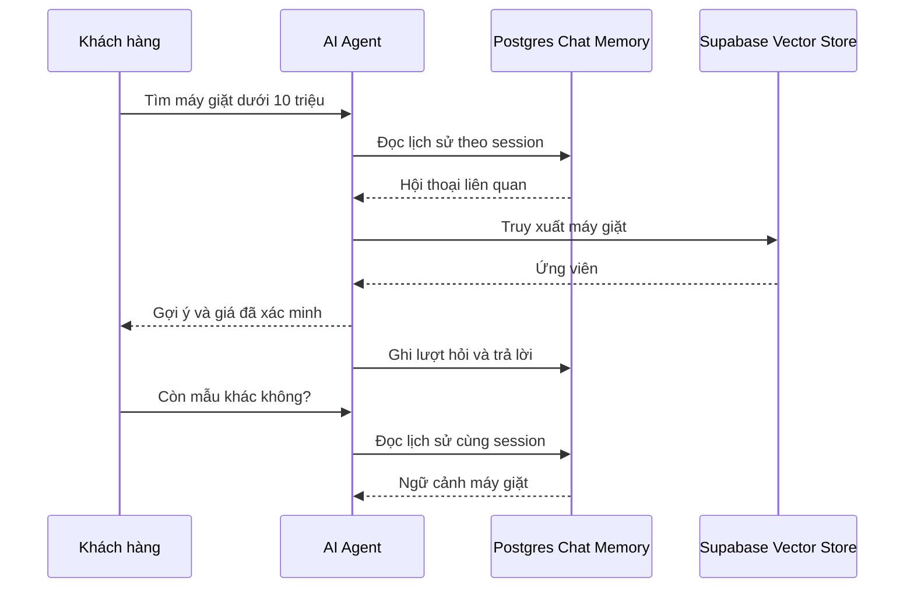

# Bài 06 — PostgreSQL Chat Memory và hội thoại nhiều lượt

## 1. Tóm tắt

Khách hàng thường hỏi tiếp: “Giới thiệu thêm máy giặt” sau khi đã xem LG Inverter. Để hiểu tham chiếu đó, agent cần lịch sử hội thoại. **Postgres Chat Memory** lưu lại thông điệp gắn theo phiên, giúp phục hồi ngữ cảnh cho lượt chat mới.

## 2. Mục tiêu

Kết nối Postgres Chat Memory, phân biệt memory với vector knowledge base và thử hội thoại ba lượt.

## 3. Kiến trúc

## 4. Thực hành cấu hình

1. Tạo node **Postgres Chat Memory**, chọn credential Postgres ở Bài 03.
2. Đặt tên bảng lịch sử, ví dụ `n8n_chat_histories` hoặc giữ bảng do node đề xuất. Tên cụ thể phụ thuộc cấu hình node; kiểm tra bảng đã tạo trong Supabase.
3. Chỉ định **Session ID** ổn định theo cuộc trò chuyện. Không dùng cùng một ID cho mọi khách hàng vì có thể trộn lịch sử.
4. Nối Memory vào cổng `Memory` của AI Agent.
5. Dùng chuỗi câu hỏi: “Tìm máy giặt dưới 10 triệu” → “Giới thiệu thêm mẫu khác” → “Mẫu đó còn hàng không?”.
6. Kiểm tra bảng lịch sử và execution log, đảm bảo chỉ lấy dữ liệu đúng phiên.

## 5. Memory ảnh hưởng token

Thêm quá nhiều lượt cũ vào prompt sẽ tăng chi phí token và có thể làm câu trả lời nhiễu. Dùng cửa sổ lịch sử vừa đủ, có thể tóm tắt lịch sử dài và giữ thông tin trạng thái quan trọng (ngân sách, danh mục quan tâm). **Không lưu kho sản phẩm vào memory** như nguồn sự thật lâu dài.

## 6. An toàn thông tin

Cần phân tách session theo người dùng; cài quyền truy cập, thời hạn lưu và xóa lịch sử phù hợp với chính sách dữ liệu. Nếu dùng nhiều môi trường, không dùng chung bảng/credential nhạy cảm ngoài ý muốn.

## 7. Debug

- Chat không nhớ lượt trước: sai Session ID, node chưa nối Memory, hoặc không có hàng lưu.
- Chat nhớ câu của người khác: session dùng chung/thiếu phân vùng.
- Trả lời giá cũ: agent lấy lời nói cũ trong memory thay vì truy vấn nguồn cập nhật.
- Token tăng bất thường: cửa sổ memory quá dài.

## 8. Câu hỏi ôn tập

**Câu 1.** Điều gì xác định chuỗi lượt chat liên quan nhau?  
A. Màu node  B. Tên project  C. Giá tiền  D. Session ID  
**Đáp án: D.** Session ID tách hội thoại.

**Câu 2.** Memory có thay thế kho sản phẩm được không?  
A. Có  B. Không  C. Chỉ khi tắt SQL  D. Chỉ với tiếng Anh  
**Đáp án: B.** Memory giữ ngữ cảnh, không đảm bảo giá/tồn kho hiện hành.

**Câu 3.** Cửa sổ lịch sử quá lớn gây gì?  
A. Tăng token và nhiễu  B. Giảm mọi token  C. Sinh thêm sản phẩm  D. Tự cài pgvector  
**Đáp án: A.** Lịch sử được cung cấp lại cho model.

**Câu 4.** Hai người dùng chung Session ID có nguy cơ gì?  
A. Đổi region  B. Giảm embedding  C. Lộ/trộn ngữ cảnh  D. Không có vấn đề  
**Đáp án: C.** Hệ thống có thể đọc lịch sử người khác.

**Câu 5.** Khi khách hỏi “mẫu đó” agent cần gì trước hết?  
A. API key mới  B. Website khác  C. Tạo vector DB mới  D. Ngữ cảnh lượt trước đúng phiên  
**Đáp án: D.** Tham chiếu phụ thuộc hội thoại.

## 9. Tổng kết

Memory giải quyết tính liên tục của hội thoại, nhưng dữ kiện thay đổi cần được truy xuất và kiểm tra lại.
