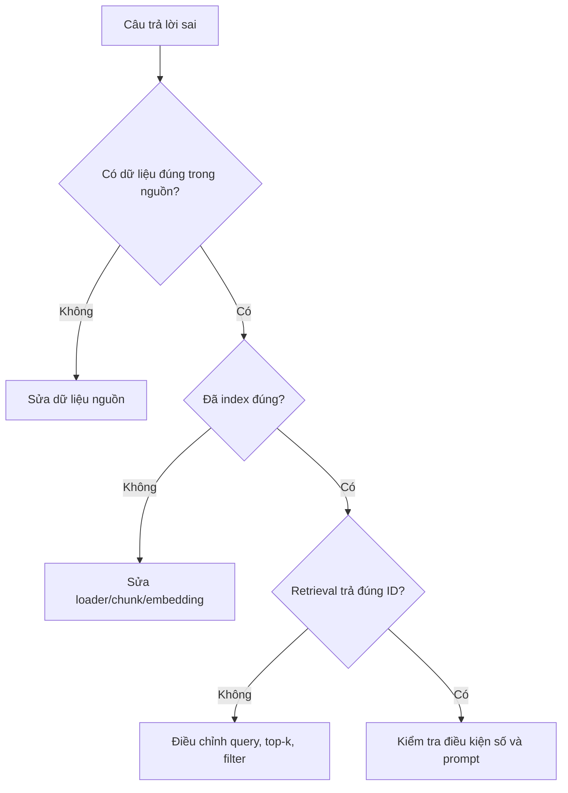

# Bài 07 — Debug retrieval và đánh giá chất lượng trả lời

## 1. Tổng quan

Một chatbot có thể trả lời “không biết” dù kho có sản phẩm; hoặc đưa ra sản phẩm đã hết hàng. Debug hiệu quả cần tìm lỗi ở đúng công đoạn thay vì chỉnh prompt một cách ngẫu nhiên.

## 2. Mục tiêu

Đọc execution log, tìm nguyên nhân câu trả lời sai, thiết kế bộ đánh giá và sửa các trường hợp trùng lặp/ngân sách/tồn kho.

## 3. Phân rã lỗi

## 4. Ca lỗi tiêu biểu

**Trường hợp A: Có TV khoảng 5 triệu nhưng agent bảo không biết.** Kiểm tra các chuỗi được loader đưa vào vector DB. Nếu key/value mất hoặc tên–giá bị tách rời, chuẩn hóa lại rồi index. So sánh truy vấn trước và sau, không kết luận chỉ nhờ một lượt chat.

**Trường hợp B: Gợi ý lặp hai tủ lạnh trong combo ngân sách 50 triệu.** Thêm ràng buộc số lượng theo danh mục, loại trùng `product_id`, cộng giá bằng số trên dữ liệu thật trước khi đưa ra tổng tiền.

**Trường hợp C: Gợi ý sản phẩm hết hàng.** Dùng bảng inventory có cập nhật để lọc `in_stock = true`. Không chỉ dựa vào embedding đã tạo trước đó.

**Trường hợp D: Khách muốn “dưới 10 triệu” nhưng agent gợi ý hàng 10,5 triệu.** Thực hiện `price_vnd < 10000000` bằng truy vấn cấu trúc. Similarity chỉ dùng để tìm nhóm ứng viên.

## 5. Bộ kiểm thử tối thiểu

| ID | Câu hỏi | Kết quả mong muốn |
|---|---|---|
| TC01 | Tivi khoảng 5 triệu | Có sản phẩm gần giá, giá rõ và còn hàng |
| TC02 | Máy giặt dưới 10 triệu | Tất cả giá dưới 10 triệu |
| TC03 | Thêm 2 mẫu khác | Không lặp ID đã giới thiệu |
| TC04 | Combo 50 triệu | Tổng cộng đúng, không vượt ngân sách |
| TC05 | Model hết hàng | Báo hết hàng, không giả vờ còn |
| TC06 | Sản phẩm không tồn tại | Không bịa sản phẩm |

Mỗi ca ghi `retrieved_ids`, `final_ids`, giá từ cơ sở dữ liệu, số token (nếu hệ thống cung cấp), thời gian đo, trạng thái pass/fail. Tính **tỉ lệ đúng = ca đạt / tổng ca** theo bộ kiểm thử tự thiết kế; không coi đó là benchmark chung.

## 6. Thực hành sửa lỗi

Tạo sản phẩm giả `TV-01` giá 4.990.000đ (còn), `TV-02` giá 6.500.000đ (hết). Yêu cầu “tivi gần 5 triệu còn hàng”; kiểm tra câu trả lời chỉ chứa `TV-01`. Đổi tồn kho và thử lại để chứng minh dữ liệu cần đồng bộ.

## 7. Câu hỏi ôn tập

**Câu 1.** Nơi nào giúp biết retrieval có lấy đúng tài liệu?  
A. Execution log  B. Logo Supabase  C. Trình chỉnh sửa ảnh  D. Theme n8n  
**Đáp án: A.** Log thể hiện input/output node.

**Câu 2.** Có tên hàng đúng nhưng nhầm giá, ưu tiên làm gì?  
A. Tăng nhiệt độ  B. Bỏ ID  C. Kiểm tra chunk và đối chiếu bảng giá  D. Tắt logging  
**Đáp án: C.** Phải xác định quan hệ tên–giá và dữ liệu chính xác.

**Câu 3.** Tổng combo 50 triệu nên xác minh bằng?  
A. Văn mẫu  B. Phép cộng trên giá số  C. Similarity  D. Chat Memory  
**Đáp án: B.** Ngân sách cần tính toán có cấu trúc.

**Câu 4.** Trùng sản phẩm nên phát hiện bằng trường nào?  
A. Màu chữ  B. Số thứ tự đoạn chat  C. Ngôn ngữ  D. `product_id`  
**Đáp án: D.** ID cố định dùng khử trùng lặp.

**Câu 5.** Nếu retrieval đã tìm đúng ID nhưng agent vẫn bịa thông số, cần kiểm tra?  
A. Prompt, nguồn dữ liệu và bước tạo câu trả lời  B. Chỉ port  C. Chỉ CSS  D. Chỉ logo  
**Đáp án: A.** Lỗi lúc tổng hợp khác lỗi lúc tìm kiếm.

## 8. Tổng kết

Một đánh giá tốt tách chất lượng truy xuất khỏi chất lượng trả lời và độ chính xác điều kiện nghiệp vụ.
