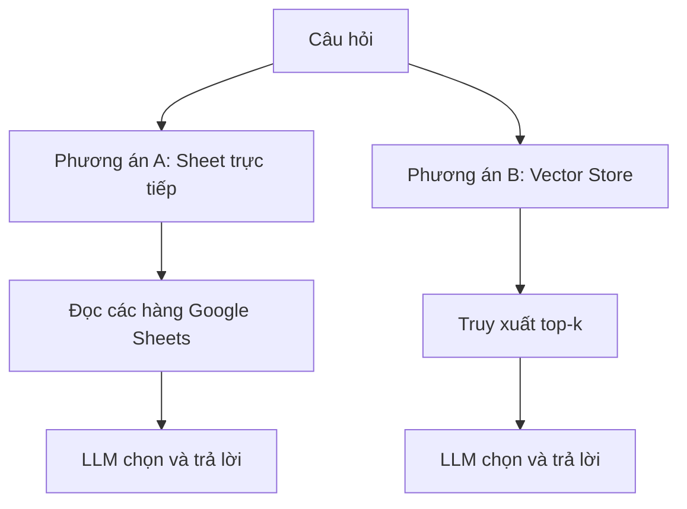

# Bài 08 — So sánh đưa Google Sheets trực tiếp và dùng Vector Store

## 1. Tổng quan

Đặt hai workflow cạnh nhau để đo thời gian, token, độ phù hợp và độ tin cậy. Cả hai có thể trả lời tốt trên tập dữ liệu nhỏ, nhưng chi phí và kiểu lỗi khác nhau.

## 2. Mục tiêu

Thiết kế so sánh công bằng, giải thích top-k và cửa sổ memory, rút ra tiêu chí lựa chọn kiến trúc.

## 3. Hai phương án

## 4. Kết quả minh họa trong buổi thực hành

| Tình huống | Sheet trực tiếp | Vector Store |
|---|---:|---:|
| Máy rửa bát ~7 triệu: thời gian | Khoảng 27,5 giây | Gần 27 giây |
| Máy rửa bát ~7 triệu: token | 5.580 | 3.600 |
| Máy lọc không khí phòng ~30 m²: thời gian | 27 giây | 40 giây |
| Máy lọc không khí phòng ~30 m²: token | Khoảng 6.000 | Khoảng 5.400 |

**Đây là số quan sát trong một demo, không phải benchmark phổ quát.** Thời gian có thể phụ thuộc model, mạng, lượng dữ liệu và số lần gọi tool. Trên một câu hỏi, vector DB dùng ít token hơn, nhưng không nhất thiết nhanh hơn.

Đối với danh mục có khoảng 29 dòng, Sheet trực tiếp thường đơn giản để thử nghiệm. Vector Store phát huy giá trị khi có nhiều tài liệu và chỉ muốn gửi nhóm phù hợp vào LLM; đổi lại cần thiết lập ingestion, truy xuất, đồng bộ và quan sát chất lượng.

## 5. Thiết kế thí nghiệm công bằng

1. Sử dụng cùng danh mục, cùng system prompt và cùng model.
2. Tách hoặc cố định memory/session khi đo để tránh ảnh hưởng của lịch sử.
3. Lặp mỗi câu nhiều lần, đo `latency`, tổng token, ID trả về, giá có chính xác và độ đầy đủ.
4. Thử `top-k = 4`, rồi `top-k = 8` và so sánh tỉ lệ bỏ sót với token; không mặc định k càng lớn càng đúng.
5. Với những điều kiện giá/tồn kho, áp dụng **cùng một bước lọc cấu trúc** ở hai phương án.

## 6. Bảng lựa chọn

| Bài toán | Cân nhắc |
|---|---|
| Vài chục sản phẩm cập nhật thường xuyên | SQL/filter hoặc Sheet trực tiếp có thể đủ |
| Kho tài liệu mô tả dài | RAG có lợi cho tra cứu ngữ nghĩa |
| Giá, tồn kho, lượng calo, dị ứng | SQL/filter có cấu trúc cần được ưu tiên |
| Kết hợp câu hỏi tự nhiên và dữ kiện động | Hybrid retrieval + structured query |

## 7. Câu hỏi ôn tập

**Câu 1.** Hai ví dụ latency minh họa điều gì?  
A. Vector luôn nhanh hơn  B. Sheet luôn nhanh hơn  C. Latency thay đổi theo luồng và tải  D. Hai hệ thống luôn bằng nhau  
**Đáp án: C.** Một phép thử không chứng minh tốc độ cố định.

**Câu 2.** Vì sao Vector Store thường gửi ít token ngữ cảnh hơn?  
A. Chỉ gửi top-k tài liệu liên quan  B. Xóa dữ liệu  C. Không dùng model  D. Đổi tiếng Việt sang số  
**Đáp án: A.** Retrieval hạn chế phần nguồn đưa tới LLM.

**Câu 3.** Trong thử nghiệm, nên giữ giống nhau điều gì?  
A. Wallpaper  B. Tên workflow  C. Thời điểm tạo project  D. Prompt, model, dữ liệu, điều kiện kiểm thử  
**Đáp án: D.** Giảm biến gây nhiễu.

**Câu 4.** Top-k tăng nghĩa là?  
A. Luôn tăng chính xác  B. Có thể tăng độ phủ nhưng cũng tăng token/nhiễu  C. Tự sửa sai giá  D. Xóa hàng hết kho  
**Đáp án: B.** Cần cân bằng recall và chi phí.

**Câu 5.** Khi dữ liệu có giá động, nên kết hợp gì?  
A. Chỉ similarity  B. Chỉ memory  C. Retrieval và truy vấn có cấu trúc  D. Chỉ UI  
**Đáp án: C.** Truy xuất ngữ nghĩa và xác minh định lượng có vai trò khác nhau.

## 8. Tổng kết

Không có một cơ sở dữ liệu phù hợp mọi yêu cầu. Kiến trúc tốt phụ thuộc loại dữ liệu, cập nhật, chi phí và yêu cầu chính xác.
