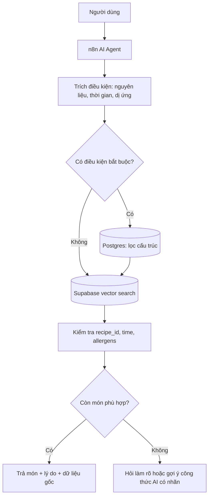

# Bài 09 — Đồ án: Conversational Food Recommendation Agent

## 1. Bài toán

Người dùng hỏi “Có món nào làm từ mì và trứng, dưới 20 phút không?”. Agent phải tìm món phù hợp từ thư viện món ăn. Nếu không có món phù hợp, agent hỏi thêm các điều kiện còn thiếu hoặc đề xuất **tạo công thức mới dưới nhãn gợi ý AI**, không được mạo nhận món đó có sẵn trong database.

Đây là **bài vận dụng kiến trúc** sang miền ẩm thực; số liệu và bản ghi ở đây là ví dụ thiết kế, không phải danh mục thật được cung cấp.

## 2. Mục tiêu sản phẩm

- Hiểu truy vấn tiếng Việt tự nhiên và các từ gần nghĩa (mì/mỳ/noodle).
- Lọc đúng nguyên liệu, thời gian, dị ứng và loại món.
- Ghi nhớ khẩu vị/ngữ cảnh trong phiên hội thoại mà không làm rò rỉ giữa người dùng.
- Nếu không có ứng viên, hỏi một câu xác định nhu cầu hoặc đề xuất recipe mới kèm cảnh báo kiểm chứng.

## 3. Dữ liệu đề xuất

```json
{
  "recipe_id": "R001",
  "name": "Mì xào trứng",
  "ingredients": ["mì", "trứng", "hành lá"],
  "time_minutes": 15,
  "allergens": ["trứng", "lúa mì"],
  "category": "món chính",
  "instructions": "Luộc mì, xào trứng và đảo chung với gia vị",
  "search_text": "Mì xào trứng, món mì nhanh, ăn bữa chính"
}
```

Nên lưu `recipes` và `ingredients` trong PostgreSQL để lọc cấu trúc; dùng `recipe_embeddings` (pgvector) cho tìm kiếm nghĩa, lưu `recipe_id` làm khóa liên kết. Không dùng embedding làm cơ sở khẳng định món an toàn cho người có dị ứng.

## 4. Kiến trúc hybrid



## 5. Workflow triển khai

**Workflow A – Ingestion:** Đọc danh mục recipe → chuẩn hóa từng recipe → tạo `search_text` → Embeddings → Supabase Vector Store, đồng bộ theo `recipe_id`.

**Workflow B – Chat:** Chat Trigger → AI Agent + Memory → trích `required_ingredients`, `excluded_ingredients`, `max_time_minutes`, `allergies` → truy vấn SQL có parameter/đối số an toàn → (tùy nhu cầu) semantic retrieval → kiểm tra dữ kiện → trả lời.

**Workflow C – Tạo món mới khi không khớp:** Agent hỏi “Bạn còn nguyên liệu nào, muốn món nước hay khô?”; nếu người dùng muốn tự tạo món, model soạn công thức thử nghiệm có danh sách nguyên liệu, thời gian **ước lượng** và hướng dẫn; đánh dấu `AI-generated`, yêu cầu người dùng xác nhận trước khi lưu công thức vào thư viện. Không tự tính chính xác dinh dưỡng hay khẳng định an toàn dị ứng nếu không có nguồn kiểm chứng.

## 6. System prompt mẫu

```text
Bạn là trợ lý gợi ý món ăn tiếng Việt.
Ưu tiên món có sẵn trong database, dựa trên công cụ tra cứu.
Phân biệt rõ "món trong thư viện" với "gợi ý công thức mới do AI tạo".
Không đưa món chứa nguyên liệu người dùng dị ứng hoặc yêu cầu tránh.
Lọc bắt buộc bằng dữ liệu cấu trúc; tìm kiếm ngữ nghĩa chỉ giúp xếp ứng viên.
Khi thiếu điều kiện quan trọng, hỏi tối đa một câu rõ ràng.
Nếu không có món phù hợp, nói rõ kết quả rỗng và đề xuất lựa chọn tiếp theo.
Không tự ghi công thức mới vào database khi chưa có sự đồng ý.
```

## 7. Milestone

1. Tạo bảng 10 món mẫu, chuẩn hóa nguyên liệu và thời gian.
2. Index `search_text` và truy xuất được ít nhất 3 cách diễn đạt có cùng ý (mì, mỳ, noodle).
3. Thêm bộ lọc theo thời gian và nguyên liệu tránh; test câu “không trứng”.
4. Thêm Postgres Chat Memory với Session ID riêng.
5. Hoàn thiện nhánh không có kết quả và hỏi làm rõ.
6. Test không trùng ID, không bịa món, không dùng công thức mới như thể đã có trong kho.

## 8. Bộ kiểm thử nghiệm thu

| Test | Đầu vào | Yêu cầu |
|---|---|---|
| F01 | Tôi có mì và trứng | Ưu tiên món chứa nguyên liệu phù hợp |
| F02 | Không ăn được trứng | Không gợi ý món có trứng |
| F03 | Dưới 15 phút | Không xuất món >15 phút nếu thời gian là điều kiện bắt buộc |
| F04 | Có món mì nào nữa? | Dựa trên lịch sử cùng session |
| F05 | Không có món trong kho | Không bịa là có; hỏi hoặc gợi ý recipe AI với nhãn |
| F06 | Lưu món vừa tạo | Yêu cầu xác nhận trước khi ghi database |

## 9. Tiêu chí hoàn thành

Có workflow ingestion và chat chạy được trên dữ liệu mẫu, trường điều kiện được lọc đúng, lịch sử theo phiên, nhật ký truy vấn, test F01–F06 được thực hiện và có thể tái lập.

## 10. Câu hỏi ôn tập

**Câu 1.** Câu “mỳ” và “mì” nên xử lý bằng?  
A. Xóa dấu  B. Semantic search và chuẩn hóa từ  C. Đổi mật khẩu  D. Chỉ lưu hình ảnh  
**Đáp án: B.** Chuẩn hóa và ngữ nghĩa giúp tìm từ biến thể.

**Câu 2.** Dị ứng trứng nên kiểm tra thế nào?  
A. Lọc chính xác danh sách allergens/ingredients  B. Chỉ cosine similarity  C. Bỏ qua  D. Chỉ xét mô tả  
**Đáp án: A.** Điều kiện an toàn không chỉ dựa tương đồng văn bản.

**Câu 3.** Không có món nào trong database, agent nên?  
A. Tự bịa tên có sẵn  B. Im lặng  C. Báo kết quả rỗng, hỏi thêm hoặc gợi ý món AI có nhãn  D. Xóa database  
**Đáp án: C.** Giữ minh bạch nguồn gốc món.

**Câu 4.** Tại sao cần recipe_id?  
A. Tăng giá  B. Thay allergy filter  C. Ẩn nguyên liệu  D. Liên kết vector với recipe gốc và khử trùng  
**Đáp án: D.** ID cho phép xác minh thông tin gốc.

**Câu 5.** Điều kiện nào cần thiết trước khi lưu công thức AI mới?  
A. Random seed  B. Sự đồng ý của người dùng và validation  C. Xóa log  D. Top-k bằng 1  
**Đáp án: B.** Tác động ghi dữ liệu cần được kiểm soát.

## 11. Tổng kết

Bộ máy tìm món hiệu quả kết hợp vector search để hiểu ý định, SQL để đảm bảo điều kiện bắt buộc và AI Agent để đối thoại, hỏi làm rõ và soạn gợi ý minh bạch.
