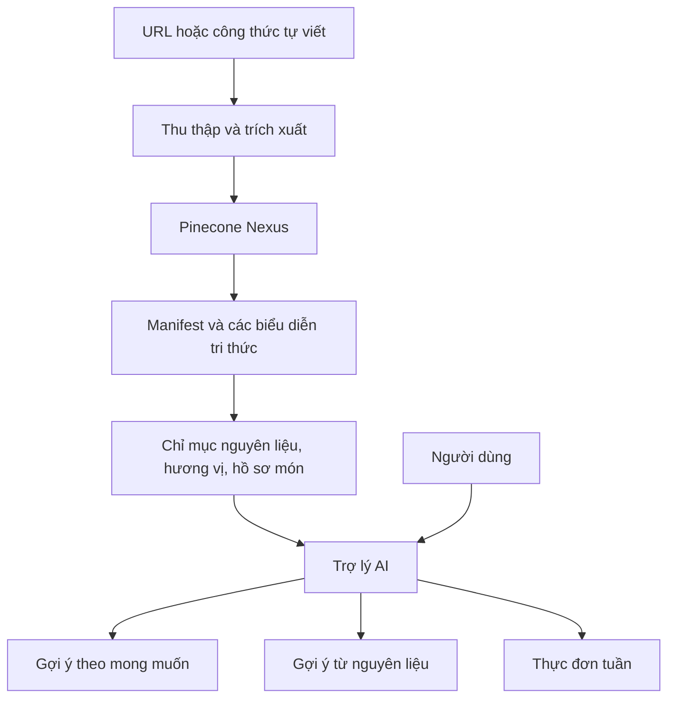

# Khóa học: Xây dựng trợ lý gợi ý món ăn với Pinecone Nexus

> **Hình thức:** Tự học bằng Markdown · **Chủ đề:** AI Agent, tổ chức tri thức công thức nấu ăn, truy xuất đa mục tiêu · **Đầu ra:** Thiết kế được nguyên mẫu trợ lý tìm món, tìm theo nguyên liệu và lập thực đơn tuần.

## 1. Giới thiệu

Một trợ lý nấu ăn tốt không chỉ tìm công thức theo tên. Nó cần trả lời các yêu cầu như “Mình muốn món thật sang trọng, nhiều sô-cô-la”, “Mình có bắp cải, đùi gà và đậu gà — nấu gì được?” hoặc “Hãy lên thực đơn một tuần, cho biết cần mua thêm gì”.

Khóa học hướng dẫn cách biến một bộ công thức thành **cơ sở tri thức có thể truy xuất theo nhiều mục đích**, lấy **Pinecone Nexus** làm trung tâm minh họa. Trọng tâm là luồng dữ liệu, `manifest`, các biểu diễn tri thức, liên kết giữa chúng và cách AI Agent vận dụng để trả lời. Các mô hình dữ liệu, prompt và mã giả do khóa học đề xuất để thực hành **không được hiểu là cú pháp API chính thức** của Nexus.

## 2. Lộ trình bài học

| Bài | Tài liệu | Kết quả chính |
| --- | --- | --- |
| 01 | [Bài toán và kiến trúc trợ lý nấu ăn](01-bai-toan-va-kien-truc.md) | Phân tích ba loại yêu cầu của người dùng |
| 02 | [Thu thập và lập chỉ mục công thức](02-thu-thap-va-lap-chi-muc.md) | Mô tả pipeline URL → tri thức |
| 03 | [Thiết kế manifest và biểu diễn tri thức](03-manifest-va-bieu-dien-tri-thuc.md) | Thiết kế các dạng biểu diễn phục vụ truy vấn |
| 04 | [Liên kết tri thức và chiến lược tìm kiếm](04-lien-ket-va-tim-kiem.md) | Hiểu vai trò chỉ mục nguyên liệu, hương vị, cạnh liên kết |
| 05 | [Gợi ý món theo mong muốn tự nhiên](05-goi-y-theo-mong-muon.md) | Thiết kế luồng tư vấn theo cảm giác, khẩu vị, ràng buộc |
| 06 | [Gợi ý món từ nguyên liệu sẵn có](06-goi-y-theo-nguyen-lieu.md) | Xử lý nguyên liệu có sẵn và đồ cần mua thêm |
| 07 | [Lập kế hoạch bữa ăn trong tuần](07-lap-ke-hoach-bua-an.md) | Tạo thực đơn, danh sách mua sắm, hướng dẫn chuẩn bị |
| 08 | [Đồ án cuối khóa: nguyên mẫu trợ lý](08-do-an-cuoi-khoa.md) | Thiết kế đầu-cuối và đánh giá thử nghiệm |

## 3. Sơ đồ tổng thể

Ở đây, `manifest` định hướng cách tổ chức dữ liệu; nhiều biểu diễn và mối liên kết giúp trợ lý không phải chỉ dựa vào một truy vấn tìm kiếm ngữ nghĩa duy nhất.

## 4. Chuẩn bị

- Có khả năng đọc Markdown, Mermaid và dữ liệu dạng bảng hoặc JSON cơ bản.
- Có bộ công thức nấu ăn tự viết hoặc đường dẫn tới các công thức được phép thu thập.
- Nếu có tài khoản truy cập Pinecone Nexus, có thể đối chiếu các phần **Sources**, **Design** và **Knowledge** trên môi trường thực tế. Không cần truy cập Nexus để hoàn thành các bài thiết kế trên giấy.
- Nắm kiến thức sơ bộ về AI Agent và truy xuất dữ liệu là lợi thế, không bắt buộc.

## 5. Cách học

Học theo thứ tự 01 → 08. Mỗi bài có phần khái niệm, ví dụ, điểm cần lưu ý, bài thực hành và **5 câu trắc nghiệm có đáp án, giải thích**. Với các bài 05–07, hãy giữ nguyên một bộ công thức thử nghiệm để dễ so sánh ba loại truy vấn. Bài 08 cung cấp nhiệm vụ tích hợp và tiêu chí tự chấm.

## 6. Phạm vi và lưu ý

Các ví dụ tên món (bánh sô-cô-la thuần chay, `Brigadeiros`, `mole`, mì soba mè), tình huống bổ sung URL và lập kế hoạch tuần gắn với nội dung khóa học. Các cấu trúc JSON, thuật toán xếp hạng, prompt mẫu và tiêu chí kiểm thử là **minh họa triển khai đề xuất**, không phải API, schema mặc định, hiệu năng hay cam kết sản phẩm của Pinecone Nexus. Giao diện, tên tính năng và khả năng truy cập sản phẩm có thể thay đổi.

Để sử dụng thực tế, cần kiểm tra tính chính xác công thức, dị ứng thực phẩm, nguyên liệu không phù hợp, khẩu phần, vệ sinh và bảo quản. AI không được tự suy diễn rằng một công thức chắc chắn đáp ứng hạn chế ăn uống chỉ từ tên món.

## 7. Thành quả mong đợi

Hoàn thành khóa học, người học có thể trình bày một thiết kế **Conversational Food Recommendation Agent**: thêm công thức từ URL, phân loại yêu cầu, chọn cách truy xuất, đưa ra gợi ý có giải thích, đánh dấu nguyên liệu còn thiếu, và tổ chức kế hoạch ăn theo tuần.
