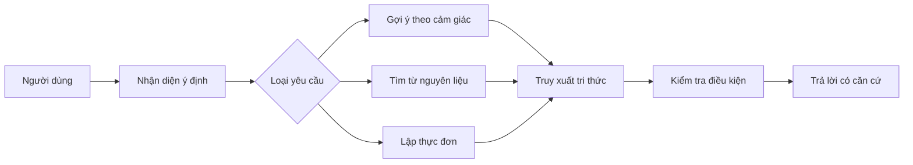

# Bài 01 — Bài toán và kiến trúc trợ lý nấu ăn

## 1. Tóm tắt

Trợ lý nấu ăn là hệ thống nhận yêu cầu tự nhiên và đối chiếu chúng với một **thư viện công thức đã được chọn lọc**. Thay vì luôn trả về món chứa một từ khóa, hệ thống phải xác định người dùng muốn khám phá món ăn, tận dụng nguyên liệu đang có hay lập kế hoạch nhiều bữa.

## 2. Mục tiêu học tập

Sau bài này, người học có thể:

1. Phân biệt ba kiểu yêu cầu quan trọng đối với trợ lý công thức.
2. Vẽ được đường đi từ dữ liệu công thức tới câu trả lời.
3. Giải thích vì sao chỉ lưu tên món và mô tả chung là chưa đủ.
4. Xác định dữ liệu tối thiểu để xây dựng phiên bản thử nghiệm.

## 3. Ba tình huống người dùng

### 3.1. Tìm món theo mong muốn

Ví dụ: “Tuần này mình muốn ăn thứ gì đó thật sang trọng, có sô-cô-la”. Người dùng không đưa tên món cụ thể, mà mô tả **trải nghiệm ăn uống**. Trợ lý cần hiểu cảm giác “sang trọng”, thành phần “sô-cô-la”, rồi đưa ra những công thức phù hợp. Gợi ý có thể là bánh sô-cô-la thuần chay, `Brigadeiros`, bánh quy chocolate chip thuần chay, hoặc một món mặn như `mole` có sử dụng sô-cô-la.

Điểm quan trọng là không đồng nhất “có sô-cô-la” với “món tráng miệng”; người dùng có thể muốn một kiểu món bất ngờ nhưng vẫn đáp ứng hương vị.

### 3.2. Tìm món theo nguyên liệu

Ví dụ: “Mình có bắp cải, đùi gà và đậu gà. Có thể nấu gì?” Người dùng chưa biết món, nhưng biết nguồn lực hiện có. Trợ lý cần **đối chiếu tập nguyên liệu** với các công thức, phân biệt món đủ đồ và món cần mua thêm ít đồ.

### 3.3. Lập thực đơn theo tuần

Ví dụ: “Hãy lên kế hoạch bữa ăn cho cả tuần từ đồ trong tủ lạnh, cho số phần ăn phù hợp”. Đây không còn là một lần tìm kiếm. Trợ lý phải ghép nhiều công thức, xét lượng nguyên liệu, số phần, sự đa dạng món và bổ sung một **danh sách mua sắm** cùng **hướng dẫn chuẩn bị**.

## 4. Kiến trúc khái niệm

Một thành phần dùng chung là **cơ sở tri thức công thức** được tổ chức cho nhiều mục tiêu. Phần nhận diện ý định quyết định cách truy xuất; phần kiểm tra điều kiện giảm nguy cơ gợi ý món trái với yêu cầu ăn uống.

## 5. Thành phần của một công thức

Bộ dữ liệu tối thiểu có thể gồm:

| Trường dữ liệu | Ý nghĩa | Ví dụ minh họa |
| --- | --- | --- |
| Tên công thức | Nhận diện món | Bánh quy sô-cô-la thuần chay |
| Nguyên liệu | Các thành phần cần thiết | Bột, sô-cô-la, chất béo thực vật |
| Cách làm | Các bước thực hiện | Trộn, tạo hình, nướng |
| Đặc tính | Hương vị hoặc cảm giác | Ngọt, đậm vị sô-cô-la |
| Hạn chế ăn uống | Điều kiện có thể xác minh | Không có thành phần sữa trong công thức đã kiểm tra |
| Nguồn | Truy vết công thức | URL hoặc bản ghi tác giả |

Bảng trên là **đề xuất dữ liệu cho bài tập**; không phải danh sách trường API cố định của Nexus.

## 6. Khác biệt giữa tìm kiếm và tư vấn

Tìm kiếm thường trả về các ứng viên giống truy vấn. Tư vấn còn phải chọn ứng viên, giải thích tại sao phù hợp và nêu điều kiện chưa thỏa mãn. Nếu truy vấn “món thuần chay” mà công thức chứa sữa, hệ thống phải loại hoặc gắn cảnh báo thay vì chỉ dựa vào độ tương đồng văn bản.

Khi chưa đủ thông tin, trợ lý có thể hỏi tiếp một câu cụ thể: “Bạn muốn món chính hay món tráng miệng?”. Việc hỏi chỉ nên diễn ra khi câu trả lời thực sự phụ thuộc vào thông tin chưa có.

## 7. Thực hành ngắn

Viết ba câu người dùng theo ba loại trên. Với mỗi câu, liệt kê: **đầu vào**, **kho tri thức cần tra**, **ràng buộc**, **đầu ra mong đợi**. Sau đó vẽ một flowchart mới thể hiện hệ thống xử lý câu “Mình có đùi gà, muốn ăn nhanh và đủ hai phần”.

## 8. Lỗi thường gặp

- Xem mọi yêu cầu là tìm kiếm từ khóa theo tên món.
- Bỏ qua số khẩu phần, chế độ ăn hoặc nguyên liệu thiếu.
- Sinh ra công thức không có trong bộ dữ liệu nhưng vẫn trình bày như kết quả truy xuất.
- Trả lời một món đơn lẻ khi người dùng yêu cầu kế hoạch tuần.

## 9. Câu hỏi ôn tập

**Câu 1.** Người dùng nói “Tôi muốn món gì đó sang trọng và vị sô-cô-la”. Hệ thống nên ưu tiên điều gì?

A. Chỉ tìm tên công thức chứa “sang trọng”.  
B. Từ chối vì người dùng chưa nêu tên món.  
C. Phân tích đặc tính và truy xuất công thức phù hợp.  
D. Tự tạo món không cần xem kho công thức.

**Đáp án:** C. **Giải thích:** Đây là yêu cầu theo trải nghiệm, không phải truy vấn tên món cố định.

**Câu 2.** Yêu cầu nào bắt buộc đối chiếu nhiều công thức với nhau?

A. Lập kế hoạch bữa ăn cho cả tuần.  
B. Xem công thức cụ thể.  
C. Đọc tên món.  
D. Kiểm tra URL công thức vừa nhập.

**Đáp án:** A. **Giải thích:** Thực đơn tuần cần lựa chọn và phối hợp nhiều món, khẩu phần và nguyên liệu.

**Câu 3.** Vì sao cần lưu nguồn công thức?

A. Để tăng số token trả lời.  
B. Để tránh phải lưu nguyên liệu.  
C. Để buộc người dùng mở web.  
D. Để truy vết và đối chiếu hướng dẫn nấu.

**Đáp án:** D. **Giải thích:** Nguồn giúp kiểm tra dữ liệu và cung cấp liên kết đáng tin cậy.

**Câu 4.** Khi dữ liệu không đủ để kiểm tra món có sữa hay không, hệ thống nên làm gì?

A. Mặc định là không có sữa.  
B. Nêu rõ chưa xác minh và kiểm tra thành phần trước khi gợi ý.  
C. Xóa thông tin nguyên liệu.  
D. Bỏ qua hạn chế của người dùng.

**Đáp án:** B. **Giải thích:** Điều kiện ăn uống cần dựa trên thành phần được xác minh, không suy đoán.

**Câu 5.** Chức năng nào phân nhánh yêu cầu thành tìm món, tìm nguyên liệu hoặc thực đơn?

A. Định dạng Markdown.  
B. Bộ đếm số lần mở ứng dụng.  
C. Nhận diện ý định.  
D. Tải ảnh công thức.

**Đáp án:** C. **Giải thích:** Nhận diện ý định định hướng chiến lược truy xuất tương ứng.

## 10. Tổng kết

Trợ lý nấu ăn cần hiểu **người dùng muốn giải quyết việc gì** trước khi truy xuất. Ba loại yêu cầu — theo mong muốn, theo nguyên liệu và theo kế hoạch — là nền tảng để thiết kế kiến trúc và dữ liệu cho toàn hệ thống.
