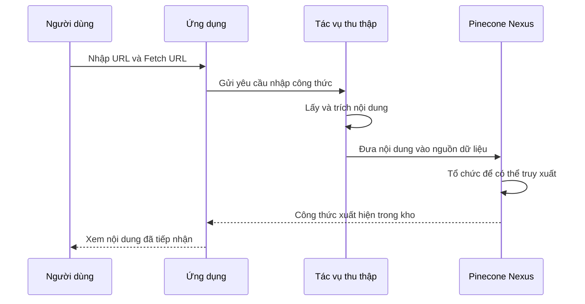

# Bài 02 — Thu thập và lập chỉ mục công thức từ URL

## 1. Tóm tắt

Muốn gợi ý món ăn, hệ thống phải có **nguồn công thức đủ tin cậy**. Một cách mở rộng thư viện là nhập URL công thức, cho tác vụ thu thập lấy nội dung, sau đó đưa dữ liệu vào Pinecone Nexus để xử lý và tổ chức.

## 2. Mục tiêu học tập

Người học có thể:

1. Mô tả các bước tiếp nhận URL công thức và lưu vào kho tri thức.
2. Phân biệt nguồn ban đầu với dữ liệu đã tổ chức để truy xuất.
3. Kiểm tra chất lượng thông tin sau khi thu thập.
4. Thiết kế trạng thái thao tác cho chức năng “Thêm công thức”.

## 3. Bài toán bổ sung công thức

Giả sử tìm được một công thức kem thuần chay yêu thích. Người dùng muốn lưu công thức bằng cách dán URL vào ứng dụng rồi chọn **Fetch URL**. Thao tác này kích hoạt một tác vụ cloud agent thu thập nội dung đường dẫn và đưa dữ liệu vào chỉ mục Nexus. Sau đó, công thức trở thành một phần của bộ dữ liệu có thể tìm kiếm.

Điểm quan trọng: chỉ lưu URL không đủ. Muốn trợ lý trả lời theo nguyên liệu, hương vị hoặc giới hạn ăn uống, hệ thống phải có dữ liệu công thức mà công cụ truy xuất có thể xử lý.

## 4. Luồng dữ liệu



Sơ đồ mô tả **luồng nghiệp vụ**. Nó không quy định endpoint, tên hàm hoặc thời gian xử lý của sản phẩm.

## 5. Kiểm tra nguồn dữ liệu đã thêm

Một giao diện quản trị cơ sở tri thức thường giúp xem lại **nguồn** đã nhận và **nội dung thực tế** mà công cụ thu thập lấy được. Khi mở một nguồn công thức, hãy kiểm tra:

1. Tên món có đúng không; có lấy nhầm tiêu đề quảng cáo không?
2. Nguyên liệu và số lượng có còn đầy đủ không?
3. Hướng dẫn có bị cắt trước bước hoàn thiện món không?
4. Nội dung có nhầm đơn vị đo hoặc nhiều công thức trên một trang không?
5. Mô tả chế độ ăn (ví dụ không chứa sữa) có khớp với danh sách thành phần không?

Một URL được nhập thành công **không đồng nghĩa** dữ liệu đã chính xác hoặc công thức đã sẵn sàng để gợi ý.

## 6. Phân biệt ba lớp dữ liệu

| Lớp | Ví dụ | Câu hỏi cần trả lời |
| --- | --- | --- |
| Nguồn gốc | Bài công thức trên web | Công thức xuất phát từ đâu? |
| Nội dung thu thập | Tiêu đề, nguyên liệu, cách làm | Công cụ đã thực sự lấy được gì? |
| Biểu diễn truy xuất | Hồ sơ món, danh sách nguyên liệu, chỉ mục hương vị | Trợ lý sẽ tìm món theo tiêu chí nào? |

Việc tách các lớp giúp dễ sửa lỗi. Nếu nguyên liệu sai ngay từ trang thu thập, không nên cố khắc phục bằng cách chỉ chỉnh prompt trả lời.

## 7. Thiết kế trải nghiệm thêm công thức

Một bản thiết kế đơn giản nên có trạng thái `Chưa nhập` → `Đang thu thập` → `Đã nhận` hoặc `Lỗi`. Khi thêm thành công, hiển thị tên món và bản xem trước của nội dung. Khi thất bại, thông báo URL không truy cập được hoặc dữ liệu không đủ; không tự tuyên bố rằng đã lập chỉ mục.

**Ví dụ phi cấu hình:**

```text
URL được nhập
  → Thu thập nội dung
  → Kiểm tra tên món / nguyên liệu / hướng dẫn
  → Thêm nguồn vào kho
  → Xác minh có thể tìm lại món
```

Thứ tự trên mang tính quy trình kiểm tra nghiệp vụ, không phải cam kết thứ tự nội bộ của Nexus.

## 8. Thực hành

Chọn hai công thức: một món mặn và một món tráng miệng. Thiết kế bảng kiểm kết quả thu thập gồm: URL, tên món, nguyên liệu, đơn vị, bước nấu, loại món, tình trạng xác minh. Mô phỏng một công thức lỗi thiếu phần nguyên liệu; nêu cách phát hiện và hướng xử lý trước khi công thức được đề xuất.

## 9. Câu hỏi ôn tập

**Câu 1.** Sau khi nhập URL, bước nào giúp kiểm chứng dữ liệu có thể sử dụng?

A. Đếm số lượt nhấp.  
B. Chỉ lưu lại URL.  
C. Tạo ảnh minh họa ngẫu nhiên.  
D. Kiểm tra nội dung thu thập và tìm lại công thức.

**Đáp án:** D. **Giải thích:** Cần xác nhận dữ liệu thực sự được thu thập và có thể truy xuất.

**Câu 2.** Nếu công cụ lấy thiếu danh sách nguyên liệu, nên ưu tiên giải quyết ở đâu?

A. Ở bước thu thập và xác minh dữ liệu.  
B. Bằng cách tăng kích thước phông chữ.  
C. Bằng cách đổi màu biểu tượng.  
D. Bằng cách thêm câu quảng cáo.

**Đáp án:** A. **Giải thích:** Lỗi nằm ở dữ liệu đầu vào, không phải ở cách hiển thị kết quả.

**Câu 3.** Lớp nào hỗ trợ tìm theo hương vị và nguyên liệu hiệu quả hơn?

A. URL đã sao chép.  
B. Biểu diễn tri thức phục vụ truy xuất.  
C. Thời điểm mở ứng dụng.  
D. Ảnh đại diện người dùng.

**Đáp án:** B. **Giải thích:** Các biểu diễn phục vụ truy vấn giúp tra theo nhiều tiêu chí.

**Câu 4.** Việc nút Fetch URL chuyển sang trạng thái hoàn thành có bảo đảm món không chứa sữa?

A. Có, nếu tiêu đề là kem.  
B. Có, nếu món được tìm thấy qua web.  
C. Không, vẫn cần kiểm tra thành phần và hạn chế ăn uống.  
D. Có, vì Nexus tự xác minh mọi hạn chế.

**Đáp án:** C. **Giải thích:** Hoàn tất nhập dữ liệu không tự động là bảo đảm về an toàn chế độ ăn.

**Câu 5.** Vì sao nên giữ URL nguồn cùng công thức?

A. Để xác thực, truy vết và kiểm tra khi cần.  
B. Để thay thế mọi hướng dẫn nấu.  
C. Để loại bỏ tên món.  
D. Để bỏ qua dữ liệu ingredient.

**Đáp án:** A. **Giải thích:** Nguồn gốc giúp sửa sai và dẫn người dùng về công thức đầy đủ.

## 10. Tổng kết

Quy trình nhập URL chỉ có giá trị khi người học xác minh được **thông tin nào đã được đưa vào kho**. Chất lượng thu thập quyết định chất lượng truy vấn tiếp theo.
