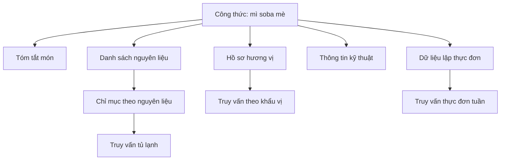

# Bài 03 — Thiết kế Manifest và các biểu diễn tri thức

## 1. Tóm tắt

Một công thức duy nhất có thể cần được nhìn theo nhiều góc độ: tên và mô tả, thành phần, hương vị, kỹ thuật chế biến hay khả năng dùng trong kế hoạch bữa ăn. Pinecone Nexus sử dụng khái niệm **manifest** để mô tả cách cơ sở tri thức được tổ chức theo tập dữ liệu và mục tiêu truy vấn.

## 2. Mục tiêu học tập

Người học có thể:

1. Giải thích chức năng của `manifest` trong kiến trúc Nexus.
2. Phân biệt một nguồn công thức với nhiều biểu diễn của nguồn đó.
3. Thiết kế danh mục biểu diễn phục vụ ba loại truy vấn.
4. Mô tả mối quan hệ giữa biểu diễn và chỉ mục tra cứu.

## 3. Manifest giải quyết vấn đề gì?

Khi chỉ có một đoạn mô tả công thức, người dùng hỏi “Món nào có sô-cô-la?” có thể tìm được một số ứng viên. Nhưng câu hỏi “Mình có ba nguyên liệu này, món nào gần đủ nhất?” đòi hỏi đối chiếu cấu trúc nguyên liệu. “Cho tôi thực đơn cả tuần” lại yêu cầu phối hợp nhiều công thức. Dùng đúng **một dạng dữ liệu** cho cả ba bài toán dễ khiến chiến lược tìm kiếm bị lệ thuộc quá mức vào độ tương đồng ngữ nghĩa.

`Manifest` là bản mô tả định hướng hệ thống tổ chức và tạo ra các dạng tri thức phù hợp với những mục tiêu đó. Từ một tập công thức, có thể phát sinh nhiều **biểu diễn** (artifacts) phục vụ các đường truy xuất khác nhau.

## 4. Các kiểu biểu diễn trong bài toán công thức

Bảng sau là **cách diễn giải bằng tiếng Việt** các nhóm biểu diễn được dùng trong ví dụ, không phải đặc tả schema hoặc danh sách trường bắt buộc của sản phẩm:

| Nhóm biểu diễn | Thông tin hữu ích | Truy vấn thích hợp |
| --- | --- | --- |
| Tóm tắt công thức (`recipe summary`) | Món là gì, đặc điểm chính | Tra tổng quan |
| Hồ sơ công thức (`recipe profile`) | Đặc trưng có cấu trúc của món | So sánh, lọc |
| Danh sách nguyên liệu (`ingredient list`) | Món dùng nguyên liệu nào | Nấu từ đồ có sẵn |
| Hồ sơ hương vị / tâm trạng (`mood profile`) | Vị và trải nghiệm gắn với món | “Sang trọng”, “đậm vị” |
| Thông tin kỹ thuật (`technique`) | Phương pháp chế biến | Tìm món theo cách làm |
| Dữ liệu lập thực đơn (`meal-planning list`) | Thông tin hỗ trợ phối bữa | Kế hoạch ăn nhiều ngày |
| Chỉ mục nguyên liệu (`ingredient index`) | Từ nguyên liệu tìm về các món | “Món nào có bơ?” |
| Ghi chú bổ trợ (`notes`) | Chi tiết bổ sung hoặc liên hệ | Hỗ trợ giải thích và truy xuất |

Tên “ghi chú bổ trợ” được dùng ở mức tổng quát vì thuật ngữ của mục ghi chú trong bản diễn đạt tiếng Việt chưa rõ. Không suy ra định dạng kỹ thuật, cơ chế băm hay kiểu lưu trữ cụ thể từ tên này.

## 5. Một nguồn, nhiều đường truy xuất

Một biểu diễn phục vụ một **mục đích truy xuất**, không phải bản sao vô ích. Chỉ mục nguyên liệu cho phép đi từ tên nguyên liệu tới các công thức, trong khi hồ sơ hương vị hỗ trợ các cách diễn đạt thiên về cảm giác.

## 6. Thiết kế mục tiêu trước khi thiết kế biểu diễn

Quy trình thực hành nên bắt đầu từ câu hỏi người dùng:

1. Liệt kê loại yêu cầu: tìm theo mong muốn, tìm theo nguyên liệu, thực đơn.
2. Xác định dữ liệu cần để trả lời từng loại.
3. Chọn biểu diễn tương ứng và mối liên kết cần giữ.
4. Kiểm tra liệu các biểu diễn có truy về được công thức gốc hay không.
5. Thử những truy vấn mẫu, bổ sung mục dữ liệu còn thiếu.

Vì vậy, không nên tạo mọi chỉ mục có thể nghĩ ra. Hãy chỉ tạo những biểu diễn phục vụ tình huống sử dụng cụ thể.

## 7. Ví dụ thiết kế dưới dạng bảng

Với công thức bánh quy sô-cô-la thuần chay, bảng minh họa có thể ghi: tóm tắt = “bánh quy vị sô-cô-la”; nhóm hương vị = “ngọt, đậm vị”; danh sách nguyên liệu = các thành phần đã xác minh; kỹ thuật = “nướng”; khả năng lập thực đơn = “món tráng miệng”. Nếu người dùng hạn chế sữa, công thức chỉ được đánh dấu phù hợp **sau khi kiểm tra mọi thành phần và khả năng thay thế**.

Đây là một **thiết kế khái niệm**, không phải cấu hình JSON có thể gửi trực tiếp tới Nexus.

## 8. Lỗi thường gặp và thực hành

Những sai lầm phổ biến là coi `manifest` như danh sách tên file; tạo biểu diễn nhưng không có cách nối về nguồn gốc; hoặc cho rằng mọi phân loại hương vị đều là sự thật khách quan. Các mô tả “sang trọng”, “dễ ăn”, “nặng vị” có yếu tố chủ quan nên cần được xem như thuộc tính để gợi ý, không phải tiêu chuẩn chắc chắn.

**Bài thực hành:** Lập bảng gồm 5 công thức. Với mỗi món, viết tóm tắt, danh sách nguyên liệu, mô tả hương vị, kỹ thuật và vai trò trong thực đơn. Sau đó chỉ ra ít nhất hai câu hỏi mà tìm tên món đơn thuần khó trả lời nhưng bảng trên có thể hỗ trợ.

## 9. Câu hỏi ôn tập

**Câu 1.** Vai trò chính của manifest trong thiết kế này là gì?

A. Hiển thị ảnh món ăn.  
B. Định hướng cách tổ chức tri thức để hỗ trợ các truy vấn cần thiết.  
C. Thay thế người dùng.  
D. Cấp chứng nhận an toàn thực phẩm.

**Đáp án:** B. **Giải thích:** Manifest định hình các biểu diễn tri thức tương ứng với mục tiêu truy xuất.

**Câu 2.** Muốn tra “Món nào dùng bơ?”, biểu diễn nào đặc biệt hữu ích?

A. Đếm lượt xem.  
B. Hình nền ứng dụng.  
C. Ngày tạo tài khoản.  
D. Chỉ mục nguyên liệu.

**Đáp án:** D. **Giải thích:** Chỉ mục đi từ nguyên liệu tới các món liên quan.

**Câu 3.** Nhóm nào hỗ trợ câu “Món có cảm giác sang trọng, đậm vị”?

A. Hồ sơ hương vị / tâm trạng.  
B. Danh sách URL lỗi.  
C. Nhật ký đăng nhập.  
D. Mã giao diện.

**Đáp án:** A. **Giải thích:** Truy vấn mô tả cảm giác cần thuộc tính hương vị và trải nghiệm.

**Câu 4.** Có nên coi bảng ví dụ trên là API chính thức của Nexus?

A. Có, vì nó có tên tiếng Anh.  
B. Có, vì ứng dụng là về công thức.  
C. Không, đây là mô hình khái niệm phục vụ thiết kế.  
D. Có, nếu tên món đầy đủ.

**Đáp án:** C. **Giải thích:** Tài liệu không cung cấp cú pháp API hoặc schema sản phẩm.

**Câu 5.** Điều gì giúp trả lời có thể kiểm tra nguồn?

A. Loại bỏ công thức gốc.  
B. Giữ liên kết từ các biểu diễn trở về công thức ban đầu.  
C. Chỉ ghi cảm giác món ăn.  
D. Không lưu nguyên liệu.

**Đáp án:** B. **Giải thích:** Nhiều biểu diễn cần quy chiếu về cùng công thức để đối chiếu.

## 10. Tổng kết

Thiết kế hệ thống tìm món nên bắt đầu từ **các câu hỏi sẽ phục vụ**, sau đó chọn biểu diễn phù hợp. Manifest giúp gắn chiến lược tổ chức dữ liệu với các mục đích ấy.
